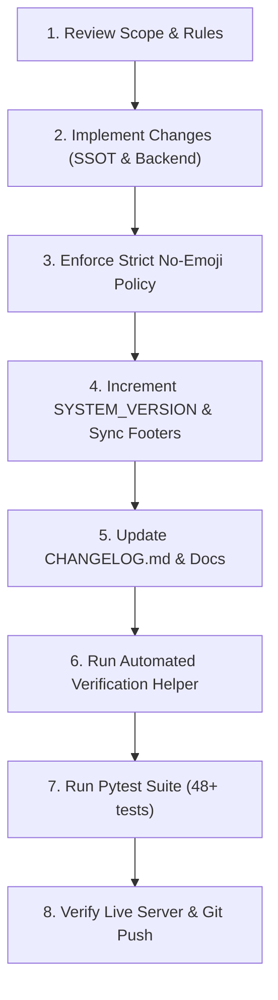

# SDU Stock Order Rules & Architectural Guidelines

Institutional rules, constraints, and standard operating procedures for the **Suan Dusit University (SDU) e-Inventory & Requisition System**.

---

## 1. Absolute Hard Rules (Non-Negotiable)

1. **Strict Zero-Emoji Policy in UI:**
   - Emojis (`⚠️`, `🟢`, `📦`, `🔍`, `🔔`, `✏️`, `🗑️`, `🏛️`, `💡`, `❌`, etc.) are **STRICTLY FORBIDDEN** in all UI elements, buttons, inputs, placeholders, table cells, modal titles, and toast alerts.
   - Use 100% Stroke-based Vector SVG Icons (`svg_icons` registry in Python, `<svg class="svg-icon">` or `vIcons` in JavaScript).
   - See [UI/UX Guidelines](./references/ui-ux-guidelines.md).

2. **Single Source of Truth (SSOT):**
   - Both `index.html` (Requester Portal) and `staff.html` (Staff Portal) are generated and compiled via `scripts/generate_separated_portals.py`.
   - Never apply major structural, HTML, CSS, or JS changes directly to `index.html` or `staff.html` without immediately updating and executing `scripts/generate_separated_portals.py`.
   - See [Architecture & SSOT](./references/architecture-and-ssot.md).

3. **Strict 100% Portal Separation (Zero-Trust):**
   - `index.html`: Public Requester Portal for 5 สวท. units and authorized personnel. Must **NEVER** contain staff actions (approvals, stock adjustments, restock, user CRUD, department CRUD).
   - `staff.html`: Private Staff & Warehouse Portal protected by HMAC token authentication.
   - Never merge portals into a single shared file.

4. **Inventory State Machine & Deduction Integrity:**
   - **Available Stock Formula:** $\text{Available} = \text{On-Hand} - \text{Reserved}$
   - **Multi-Unit Ratio:** $\text{Total Pieces} = (\text{Boxes} \times \text{Pieces Per Box}) + \text{Pieces}$
   - Approval (`APPROVED`) only locks quota: $\text{Reserved} += \text{Approved Pieces}$. It **MUST NOT** deduct `On-Hand`.
   - Physical handover (`COMPLETED`) deducts stock: $\text{On-Hand} -= \text{Approved Pieces}$ and $\text{Reserved} -= \text{Approved Pieces}$, and logs an `OUT` transaction.
   - Prevention of state bypass: A completed order can never be re-completed, approved, or rejected.
   - See [Business Logic & State Machine](./references/business-logic-and-state-machine.md).

5. **No Native Dialogs:**
   - Never call `alert()`, `confirm()`, or `prompt()`.
   - Always use **SweetAlert2** (`Swal.fire()`) styled with SDU Blue theme (`#1e40af`, `#059669`, `Prompt` font, 8px-12px rounded corners).

6. **Strict Versioning & Changelog Protocol:**
   - Every code modification, bug fix, or feature addition **must increment `SYSTEM_VERSION`** following Semantic Versioning (`MAJOR.MINOR.PATCH`).
   - Every change **must be recorded in `CHANGELOG.md`** under Keep a Changelog categories (`Added`, `Changed`, `Deprecated`, `Removed`, `Fixed`, `Security`).
   - Version string must be strictly synchronized across:
     - `CHANGELOG.md`
     - `scripts/generate_separated_portals.py` (`SYSTEM_VERSION`)
     - `backend/server.py` (`SYSTEM_VERSION`)
     - `tests/test_stock_logic.py` (`assert SYSTEM_VERSION == "..."`)
     - UI Footers in `portal.html`, `index.html`, and `staff.html`
   - See [Versioning & Testing](./references/versioning-and-testing.md).

7. **Zero-Build Vanilla Architecture:**
   - Pure HTML5 Semantic, Vanilla CSS3 (Custom Properties), Modern JavaScript ES6+.
   - Do not suggest or install npm packages, TailwindCSS, Vite, Webpack, React, or Vue. Runtime must remain zero-compile with 0ms build overhead.

8. **Automated Testing & 100% Pass Rate:**
   - All tests in `tests/test_stock_logic.py` must pass (`pytest tests/test_stock_logic.py`).
   - Target test coverage $\ge 90\%$.

---

## 2. Standard Operating Procedure (Workflow)

When implementing any task in this codebase, follow this sequence:



### Step-by-Step Execution:
1. **Implement Core Logic:**
   - Backend logic in `backend/server.py` using ACID transactions and row locking.
   - Frontend changes reflected in `scripts/generate_separated_portals.py`.
2. **Remove All Emojis:**
   - Verify all buttons, labels, and modals use SVG icons or clean text.
3. **Synchronize System Version:**
   - Update `SYSTEM_VERSION` in `server.py`, `generate_separated_portals.py`, `test_stock_logic.py`, and UI footers.
4. **Log in CHANGELOG.md:**
   - Document changes clearly following Keep a Changelog.
5. **Verify with Validation Script:**
   ```bash
   .venv\Scripts\python .agents/skills/stock-order-rules/scripts/verify_rules.py
   ```
6. **Run Full Test Suite:**
   ```bash
   .venv\Scripts\pytest tests/test_stock_logic.py
   ```
7. **Commit and Push:**
   - Stage modified files with clear conventional commit messages (e.g. `feat(...)`, `fix(...)`, `docs(...)`).

---

## 3. Reference Links

- [UI/UX & No-Emoji Guidelines](./references/ui-ux-guidelines.md)
- [Architecture & Single Source of Truth (SSOT)](./references/architecture-and-ssot.md)
- [Business Logic & State Machine](./references/business-logic-and-state-machine.md)
- [Versioning & Testing Protocol](./references/versioning-and-testing.md)
- [Automated Verification Script](./scripts/verify_rules.py)

