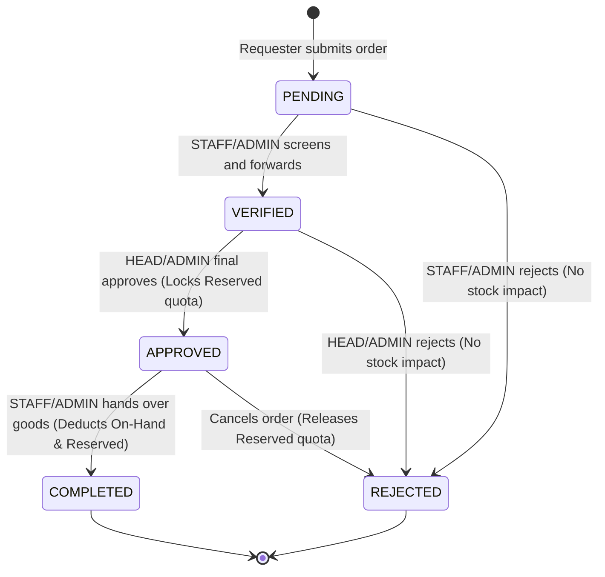

# Business Logic & State Machine (references/business-logic-and-state-machine.md)

This reference outlines the inventory calculation formulas, multi-unit conversions, two-tier requisition lifecycle state machine, multi-tier monthly quotas, and restock pricing rules (v3.8.4).

---

## 1. Inventory Formulas & Calculations

### 1.1 Available Stock Equation
$$\text{Available} = \text{On-Hand} - \text{Reserved}$$

* **On-Hand Stock:** Physical goods present in the warehouse (`CHECK (on_hand_pieces >= 0)`).
* **Reserved Stock:** Quantities committed in `APPROVED` requisitions awaiting physical handover (`CHECK (reserved_pieces >= 0)`).
* **Available Stock:** Maximum amount that requesters can order. Both frontend and backend prevent ordering above Available stock (duplicate `itemId` entries in one requisition are aggregated server-side before checking).

### 1.2 Multi-Unit Conversion
$$\text{Total Pieces} = (\text{Boxes} \times \text{Pieces Per Box}) + \text{Pieces}$$

* All internal arithmetic is performed in **Base Pieces** (lowest unit).
* For display:
  $$\text{Box Count} = \lfloor \frac{\text{Total Pieces}}{\text{Ratio}} \rfloor$$
  $$\text{Remainder Pieces} = \text{Total Pieces} \pmod{\text{Ratio}}$$
* If `is_multi_unit == False`, display only the base unit (e.g. 5 เล่ม, 12 อัน).

### 1.3 Snapshotting
When a requisition is created, `pieces_per_box_snapshot` is recorded in `requisition_items` so historical records remain immutable even if packaging ratios change later.

---

## 2. Two-Tier Requisition Lifecycle State Machine

### State Transition & RBAC Rules (CWE-841 Enforcement):
1. **`PENDING` -> `VERIFIED` (`STAFF` / `ADMIN`):**
   - Allowed only from `PENDING`. Records `verified_by`, `verified_at`, `verified_date`. Does NOT lock or deduct stock.
2. **`VERIFIED` -> `APPROVED` (`HEAD` / `ADMIN`):**
   - Allowed only from `VERIFIED`. Records `approved_by`, `approved_at`, `approved_date`.
   - `reserved_pieces += approved_pieces`; `on_hand_pieces` remains unchanged.
3. **`APPROVED` -> `COMPLETED` (`STAFF` / `ADMIN`):**
   - Allowed only from `APPROVED`. Records `completed_at`, `completed_date`.
   - `on_hand_pieces -= approved_pieces`, `reserved_pieces -= approved_pieces`.
   - Creates an `OUT` (`REQUISITION`) transaction in `stock_transactions`.
4. **`COMPLETED` is Terminal:**
   - Cannot be completed again, verified, approved, or rejected.
5. **`REJECTED` releases quota (`STAFF` / `HEAD` / `ADMIN`):**
   - If rejected/cancelled from `APPROVED`: `reserved_pieces = GREATEST(0, reserved_pieces - approved_pieces)`.

---

## 3. Multi-Tier Monthly Quota Precedence (`quota_rules`)

Evaluated server-side in `resolve_effective_monthly_limits()` against non-`REJECTED` requisitions in the current month:
1. **Personal Quota (`QUOTA_EXCEEDED`):** `USER + item_id` > `USER + all items (0)` > `inventory_items.monthly_limit`
2. **Department Quota (`DEPT_QUOTA_EXCEEDED`):** `DEPT + item_id` > `DEPT + all items (0)`
* A matching rule with `monthly_limit = 0` explicitly grants unlimited quota at that tier.

---

## 4. Restock Pricing & Audit Trail Rules

* **Restock Cost Calculation:** Supports 3 input modes (total cost, price per box, price per piece), derives `unit_price` / `total_cost`, updates `inventory_items.last_unit_price` and `last_restocked_at`, and logs `IN` (`STOCK_IN`) in `stock_transactions`.
* **Initial Stock Audit:** Creating a new item with `on_hand_pieces > 0` automatically logs an `IN` (`INITIAL_STOCK`) transaction.
* **Department Deletion Protection:** A department cannot be deleted if active users belong to it (`user_count == 0` required), and renaming a department cascades updates to `users.dept` and `quota_rules.target_key`.
