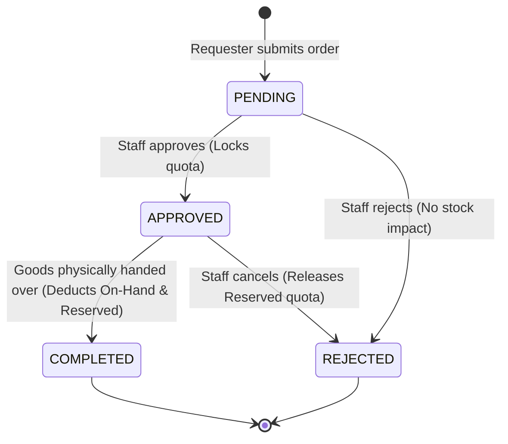

# Business Logic & State Machine (references/business-logic-and-state-machine.md)

This reference outlines the inventory calculation formulas, multi-unit conversions, and the requisition lifecycle state machine.

---

## 1. Inventory Formulas & Calculations

### 1.1 Available Stock Equation
$$\text{Available} = \text{On-Hand} - \text{Reserved}$$

* **On-Hand Stock:** Physical goods present in the warehouse.
* **Reserved Stock:** Quantities committed in `APPROVED` requisitions awaiting physical handover.
* **Available Stock:** Maximum amount that requesters can order. Catalog prevents ordering above Available stock.

### 1.2 Multi-Unit Conversion
$$\text{Total Pieces} = (\text{Boxes} \times \text{Pieces Per Box}) + \text{Pieces}$$

* All internal arithmetic is performed in **Base Pieces** (lowest unit).
* For display:
  $$\text{Box Count} = \lfloor \frac{\text{Total Pieces}}{\text{Ratio}} \rfloor$$
  $$\text{Remainder Pieces} = \text{Total Pieces} \pmod{\text{Ratio}}$$
* If `is_multi_unit == False`, display only the base unit (e.g. 5 เล่ม, 12 อัน).

### 1.3 Snapshotting
When a requisition is created, the conversion ratio (`pieces_per_box_snapshot`) is recorded in `requisition_items` to ensure historical records remain immutable even if packaging changes later.

---

## 2. Requisition Lifecycle State Machine

### State Transition Rules (CWE-841 Enforcement):
1. **`PENDING` -> `APPROVED`:**
   - Allowed only from `PENDING`.
   - `reserved_pieces += approved_pieces`.
   - `on_hand_pieces` remains unchanged.
2. **`APPROVED` -> `COMPLETED`:**
   - Allowed only from `APPROVED`.
   - `on_hand_pieces -= approved_pieces`
   - `reserved_pieces -= approved_pieces`
   - Creates an `OUT` transaction in `stock_transactions`.
3. **`COMPLETED` is Terminal:**
   - Cannot be completed again (prevents double stock deduction).
   - Cannot be approved or rejected.
4. **`REJECTED` releases quota:**
   - If rejected from `APPROVED`: `reserved_pieces -= approved_pieces`.

---

## 3. Department Management Rules

1. **Uniqueness:** Department names within the same institution must be unique.
2. **Deletion Cascade Prevention:** A department cannot be deleted if active users (`users` table) belong to it. The system must verify `user_count == 0` before allowing deletion.
