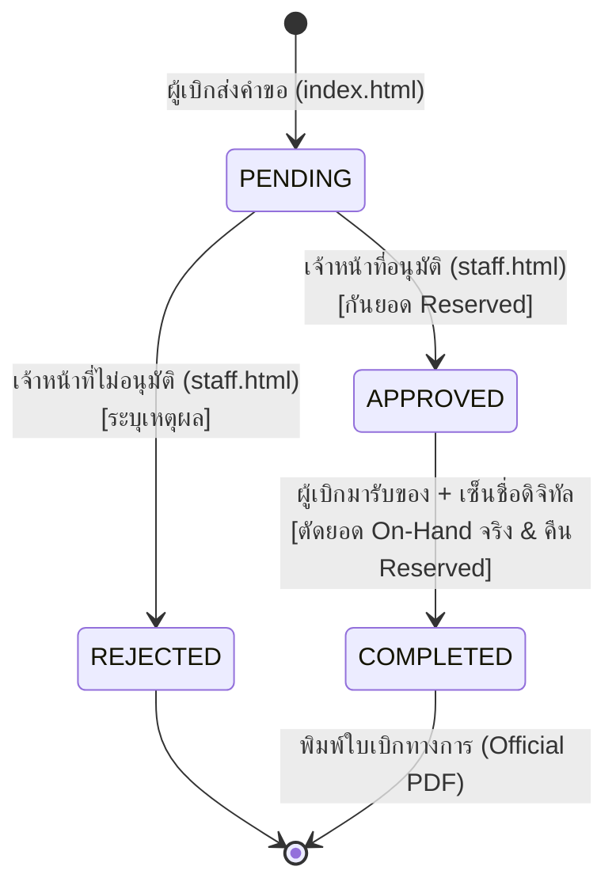

# Project Context & Development Guidelines

---

## 📌 1. ภาพรวมและบริบทของโครงการ (Project Overview & Mission)

* **ชื่อโครงการ:** ระบบเบิกพัสดุและคลังพัสดุดิจิทัล มหาวิทยาลัยสวนดุสิต  
  *(Suan Dusit University e-Inventory & Requisition System)*
* **เจ้าของโครงการ:** มหาวิทยาลัยสวนดุสิต (Suan Dusit University - SDU)
* **GitHub Repository:** [itsmekritsanai/stock-order-sdu](https://github.com/itsmekritsanai/stock-order-sdu)
* **วัตถุประสงค์ทางธุรกิจ (Business Objectives):**
  1. **Paperless & Digital Transformation:** ยกระดับกระบวนการขอเบิกพัสดุสำนักงานของมหาวิทยาลัยจากกระดาษสู่ระบบดิจิทัล 100%
  2. **Inventory Accuracy & Concurrency Prevention:** ป้องกันปัญหาสต๊อกติดลบหรือการเบิกชนกันด้วยระบบคำนวณยอดสต๊อก 3 ระดับ (*On-Hand, Reserved, Available*)
  3. **Multi-Unit Intelligence:** คำนวณการแปลงหน่วยอัตโนมัติระหว่างหน่วยบรรจุใหญ่ (กล่อง/ห่อ) และหน่วยย่อย (ชิ้น/ซอง/ใบ/แผ่น)
  4. **Strict Security Separation:** แยกสิทธิ์การใช้งานระหว่างผู้ขอเบิก (อาจารย์/บุคลากร 90+ หน่วยงาน) และเจ้าหน้าที่คลังพัสดุออกจากกันอย่างเด็ดขาด
  5. **Audit Trail & Digital Signatures:** มีระบบลงนามรับของผ่านหน้าจอสัมผัส (E-Signature Pad) และสร้างเอกสารแบบฟอร์มขอเบิกพัสดุทางการ (Official PDF) ที่ถูกต้องตามระเบียบพัสดุ

---

## 💻 2. เทคโนโลยีและสถาปัตยกรรม (Tech Stack & Architecture)

### 2.1 Frontend Web Core
* **HTML5:** โครงสร้างเชิงความหมาย (Semantic HTML), Accessible Forms, Mobile-Ready Viewport
* **CSS3 (Vanilla CSS):**
  * ใช้ **CSS Custom Properties (Variables)** ในการสร้าง Design System Token แบบรวมศูนย์
  * Layout Engine: Flexbox และ CSS Grid
  * **ห้ามใช้ TailwindCSS หรือ CSS Framework ภายนอก** เพื่อคงความเร็ว อิสระในการปรับแต่ง และไม่มี overhead
* **JavaScript (Modern ES6+):**
  * Pure Vanilla JavaScript ไม่ใช้ Framework (React/Vue) รันได้ทันทีบนเบราว์เซอร์
  * Asynchronous Operations (Promises, Async/Await)
  * Asynchronous Storage & Web Storage Events

### 2.2 ไลบรารีส่วนต่อประสาน (UI Libraries & Components)
* **SweetAlert2 (v11):**
  * ป๊อปอัปแจ้งเตือน กล่องยืนยัน (Confirmation) และ Toast Notification ทั้งหมดในระบบ
  * ปรับแต่งธีมเฉพาะของมหาวิทยาลัย (SDU Brand Colors: `#1e40af`, `#059669`, ฟอนต์ `Prompt`, กรอบโค้งมน 14px)
  * **Offline Asset:** ติดตั้งไฟล์ `assets/js/sweetalert2.all.min.js` ภายในเครื่อง พร้อมระบบ CDN Fallback
* **Google Fonts Integration:**
  * **Prompt:** สำหรับส่วนติดต่อผู้ใช้ทั่วไป (Modern UI, Buttons, Badges, Headers)
  * **Sarabun:** สำหรับแบบฟอร์มเอกสารทางราชการและข้อความทางการ
* **100% Vector SVG Icons:**
  * ใช้ไอคอนเวกเตอร์ SVG แบบเส้น Stroke ทั้งหมดจากชุด `svg_icons`
  * **นโยบาย No-Emoji:** ห้ามใช้อีโมจิในองค์ประกอบ UI หรือปุ่มกด เพื่อรักษาภาพลักษณ์ที่เป็นทางการ
* **HTML5 Canvas API:**
  * แท่นลงนามลายเซ็นดิจิทัล (E-Signature Pad) รองรับ Touchscreen, Stylus Pen และ Mouse พร้อมระบบบันทึกภาพ Base64

### 2.3 Build & Code Generation Tool
* **Python 3.x (`generate_separated_portals.py`):**
  * ทำหน้าที่เป็น **Single Source of Truth (SSOT)**
  * รวมศูนย์ Shared CSS, SVG Icons, ข้อมูลหน่วยงาน 90+, และ Initial Database Schema
  * คอมไพล์และสร้างไฟล์ `index.html` (Requester) และ `staff.html` (Staff) แบบอัตโนมัติ

### 2.4 สถาปัตยกรรมฐานข้อมูลและการซิงค์ข้อมูล (Data Persistence & Sync)
* **ปัจจุบัน (Local & Offline Mode):**
  * เก็บข้อมูลใน Browser `localStorage`:
    * `inventory_items`: ข้อมูลพัสดุคงคลัง ยอด On-Hand, Reserved, Min Alert, รูปภาพ
    * `inventory_requisitions`: ประวัติคำขอเบิก สถานะ วันที่ รายการที่อนุมัติ และลายเซ็น Base64
  * **Real-time Cross-Tab Sync:** ตรวจจับผ่าน `window.addEventListener('storage', ...)` ข้อมูลอัปเดตตรงกันทันทีข้ามแท็บโดยไม่ต้องกดรีเฟรช
* **แผนพัฒนาขั้นถัดไป (Cloud Database สำหรับ GitHub Pages):**
  * เชื่อมต่อ **Google Sheets API** ผ่าน **Google Apps Script (GAS) Web App REST API**
  * มีระบบ `LockService` ป้องกัน Concurrency Race Condition เมื่อมีผู้เบิกหลายคนส่งคำขอพร้อมกัน

---

## 🎨 3. ข้อกำหนดและรูปแบบการเขียนโค้ด (Coding Style & Guidelines)

### 3.1 มาตรฐาน Frontend (HTML / CSS / JavaScript)
1. **Zero-Build Runtime:** โค้ดทั้งหมดต้องสามารถเปิดทำงานผ่านเบราว์เซอร์หรือเว็บเซิร์ฟเวอร์แบบ Static ได้ทันทีโดยไม่ต้องผ่านกระบวนการ Webpack / Vite build
2. **Indentation & Formatting:**
   * HTML, CSS, JavaScript: เว้นวรรค 2 spaces
   * Python: เว้นวรรค 4 spaces ยึดตามมาตรฐาน **PEP 8**
3. **Design System & CSS Tokens:**
   * ใช้อ้างอิงตัวแปร CSS เท่านั้น:
     * สีหลัก: `var(--primary)` (`#1e40af`), `var(--primary-hover)` (`#1d4ed8`), `var(--primary-light)` (`#eff6ff`)
     * สีรอง/สำเร็จ: `var(--accent)` (`#059669`), `var(--accent-hover)` (`#047857`)
     * สีเตือน/รออนุมัติ: `var(--warning)` (`#d97706`), `var(--warning-light)` (`#fef3c7`)
     * สีข้อผิดพลาด/ปฏิเสธ: `var(--danger)` (`#dc2626`), `var(--danger-light)` (`#fee2e2`)
     * ส่วนโค้งมน: `var(--radius)` (8px - 12px)
4. **Nomenclature (หลักการตั้งชื่อ):**
   * HTML Element ID: `camelCase` เช่น `itemSearchInput`, `myRequisitionsModal`, `deptComboboxControl`
   * CSS Classes: `kebab-case` เช่น `req-card-item`, `combobox-dropdown`, `pill-pending`
   * JavaScript Functions: `camelCase` เช่น `openMyRequisitionsModal()`, `submitRequisition()`, `updateMyReqsBadge()`
   * Python Functions/Variables: `snake_case` เช่น `initial_items`, `dept_js_items`
5. **No Native Dialogs Rule:**
   * **ห้ามใช้ `alert()`, `confirm()`, หรือ `prompt()` ของเบราว์เซอร์โดยเด็ดขาด**
   * ต้องใช้ `Swal.fire()` หรือ `Swal.mixin()` จาก SweetAlert2 เท่านั้น

---

## ⚙️ 4. กฎระเบียบทางธุรกิจและตรรกะระบบ (Business Logic & Rules Engine)



1. **สูตรการคำนวณยอดสต๊อกพร้อมเบิก (Available Stock Formula):**
   $$\text{Available Pieces} = \text{On-Hand Pieces} - \text{Reserved Pieces}$$
2. **ตรรกะ 2 หน่วยนับ (Multi-Unit Ratio Calculation):**
   $$\text{Total Requested Pieces} = (\text{Requested Boxes} \times \text{Pieces Per Box}) + \text{Requested Pieces}$$
3. **ขั้นตอนการตัดสต๊อก (Inventory Lifecycle):**
   * **เมื่อผู้เบิกส่งคำขอ (`PENDING`):** ตรวจสอบว่า `Total Requested <= Available` หากผ่าน จะสร้างเลขที่คำขอ `REQ-YYYYMM-XXXX` (ยังไม่มีการตัดสต๊อก)
   * **เมื่อเจ้าหน้าที่อนุมัติ (`APPROVED`):** เพิ่มยอด `reserved_pieces += approved_pieces` เพื่อล็อกยอดไว้ไม่ให้ผู้อื่นเบิกซ้ำ
   * **เมื่อลงนามรับมอบสำเร็จ (`COMPLETED`):**
     * ลดสต๊อกจริง: `on_hand_pieces -= approved_pieces`
     * คืนยอดกันจอง: `reserved_pieces -= approved_pieces`
     * แนบภาพลายเซ็น Base64 เข้ากับเอกสารคำขอ
   * **กรณีปฏิเสธคำขอ (`REJECTED`):** หากคำขอนั้นเคยถูกกันยอดไว้ จะคืนยอด `reserved_pieces` กลับสู่สต๊อก

---

## 🧪 5. การทดสอบและการควบคุมคุณภาพ (Testing & Quality Assurance)

* **Testing Requirements:**
  * **Python Scripts & Automation:** ใช้ **`pytest`** ในการทดสอบฟังก์ชันการทำงาน และกำหนดเกณฑ์ **Code Coverage >= 90%**
  * **Frontend Code Validation:**
    * รันการตรวจสอบความถูกต้องของ JavaScript Syntax ผ่าน Node.js Parser:
      ```bash
      node -e "new Function(fs.readFileSync('index.html', 'utf8'))"
      ```
      ต้องผ่าน 100% โดยไม่มีข้อผิดพลาด (0 Syntax Errors)
    * ตรวจสอบว่าไม่มีการหลงเหลือคำสั่ง `alert(`, `confirm(`, หรือ `prompt(` ในโค้ด
  * **HTTP Server Verification:**
    * หน้าเว็บทั้ง `index.html` และ `staff.html` ต้องส่งคืนรหัสสถานะ `HTTP 200`
    * ตรวจสอบว่าไม่มี Asset ขาดหาย (0 Missing Assets / No 404s)
  * **Device & Responsive Testing:**
    * รองรับการแสดงผลทุกหน้าจอตลอดช่วง Viewport (Mobile 360px จนถึง Desktop 1920px)
    * แท่นเซ็นลายเซ็นต้องรองรับ Touch Event (`touchstart`, `touchmove`, `touchend`) ได้แม่นยำ

---

## 🚨 6. กฎเหล็กและข้อห้ามสำคัญ (Crucial Rules & Non-Negotiables)

1. **ห้ามแก้ไขไฟล์ Config หลักโดยไม่ได้รับอนุญาต:**
   * ห้ามดัดแปลงไฟล์ตั้งค่าระบบ หรือโครงสร้างโปรเจกต์หลักโดยไม่มีข้อกำหนดชัดเจน
2. **รักษาการแยกพอร์ทัลเด็ดขาด 100% (Strict Portal Separation):**
   * ห้ามรวม `index.html` และ `staff.html` เข้าด้วยกันเป็นหน้าเดียว
   * หน้า `index.html` ต้องไม่มีโค้ด ส่วนติดต่อ หรือสิทธิ์ในการอนุมัติคำขอ การตัดสต๊อก หรือการล็อกอินเจ้าหน้าที่
3. **Single Source of Truth (SSOT):**
   * การแก้ไขหรือเพิ่มฟีเจอร์หลักในหน้าเว็บ ควรทำผ่านสคริปต์ `generate_separated_portals.py` แล้วสั่งคอมไพล์ เพื่อป้องกันปัญหาโค้ดของทั้งสองหน้าไม่ตรงกัน
4. **ป้องกันข้อมูลสูญหาย (Accidental Data Loss Prevention):**
   * ห้ามสั่งรันคำสั่งที่ลบฐานข้อมูล ล้างข้อมูลพัสดุตั้งต้น หรือทำลายไฟล์รูปภาพโดยเด็ดขาด
5. **ห้ามตัดยอดสต๊อก On-Hand ก่อนการลงนามรับของจริง:**
   * สต๊อกจริงจะถูกตัดเมื่อผู้รับลงลายมือชื่อในหน้า `staff.html` เท่านั้น

---

## 📁 7. โครงสร้างไฟล์และความรับผิดชอบ (File Registry)

| ชื่อไฟล์ / โฟลเดอร์ | หน้าที่และความรับผิดชอบ |
| :--- | :--- |
| **`index.html`** | พอร์ทัลสำหรับอาจารย์และบุคลากร (ค้นหาพัสดุ, ตะกร้า, ส่งคำขอ, ดูรายการคำขอ, ติดตามสถานะ) |
| **`staff.html`** | พอร์ทัลสำหรับเจ้าหน้าที่พัสดุ (แดชบอร์ด, คิวอนุมัติ, แท่นเซ็นดิจิทัล, ตัดสต๊อก, พิมพ์ PDF ทางการ) |
| **`generate_separated_portals.py`** | สคริปต์ Python แม่แบบหลักสำหรับคอมไพล์และสร้าง `index.html` และ `staff.html` |
| **`Context.md`** | เอกสารระบุบริบทโครงการ, ข้อกำหนดทางเทคนิค, Coding Style, และกฎสำคัญ |
| **`TODO.md`** | แผนงานและรายการสิ่งที่ต้องทำ พร้อม Roadmap การต่อยอดระบบ |
| **`README.md`** | เอกสารแนะนำโครงการ คู่มือการติดตั้ง และการใช้งานทั่วไป |
| **`system_requirements_specification.md`** | เอกสารข้อกำหนดเชิงระบบและวิเคราะห์ความต้องการ (SRS v1.1) |
| **`departments_structured.json`** | ข้อมูลโครงสร้าง 90+ คณะ/โรงเรียน/กอง/สำนัก มหาวิทยาลัยสวนดุสิต |
| **`assets/js/sweetalert2.all.min.js`** | ไลบรารี SweetAlert2 แบบออฟไลน์ 100% |
| **`assets/images/`** | คลังภาพถ่ายพัสดุจริง 58 รายการจากระบบพัสดุ มสด. |
| **`ยอดสต๊อก ตค.xlsx`** | ไฟล์ข้อมูลพัสดุตั้งต้นจากฝ่ายพัสดุ มหาวิทยาลัยสวนดุสิต |
