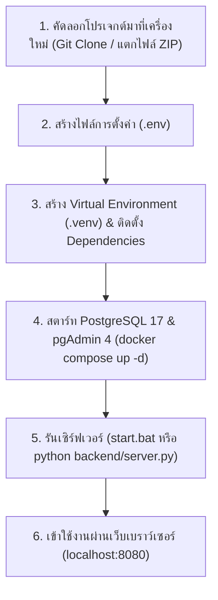

# คู่มือการติดตั้งและย้ายระบบไปเครื่องอื่น (Installation & Migration Guide)
### ระบบขอเบิกพัสดุและคลังพัสดุดิจิทัล มหาวิทยาลัยสวนดุสิต (Stock Order SDU v3.0.0)

คู่มือนี้จัดทำขึ้นเพื่อให้คุณสามารถนำโปรเจกต์นี้ไปติดตั้งและเปิดใช้งานบนเครื่องคอมพิวเตอร์เครื่องอื่น (ทั้ง Windows, macOS และ Linux) ได้อย่างราบรื่น ถูกต้อง และรวดเร็ว

---

## 📋 1. สิ่งที่ต้องมีในเครื่องใหม่ (Prerequisites)

ก่อนเริ่มการติดตั้ง ให้ตรวจสอบว่าเครื่องใหม่มีโปรแกรมเหล่านี้ติดตั้งอยู่เรียบร้อยแล้ว:

1. **Git:** สำหรับ Clone โค้ดลงเครื่อง ([ดาวน์โหลด Git](https://git-scm.com/)) *(หรือดาวน์โหลดโปรเจกต์เป็นไฟล์ .ZIP ก็ได้)*
2. **Python 3.10 ขึ้นไป:** แนะนำเวอร์ชัน 3.11 หรือใหม่กว่า ([ดาวน์โหลด Python](https://www.python.org/downloads/))  
   > ⚠️ **ข้อสำคัญบน Windows:** ในขั้นตอนติดตั้ง Python ต้อง **ติ๊กถูกที่ช่อง "Add python.exe to PATH"** เสมอ
3. **Docker Desktop:** สำหรับรัน PostgreSQL 17 และ pgAdmin 4 ([ดาวน์โหลด Docker Desktop](https://www.docker.com/products/docker-desktop/))
   * บน Windows: ตรวจสอบว่าเปิดฟีเจอร์ WSL 2 (Windows Subsystem for Linux) เรียบร้อยแล้ว
   * เปิดโปรแกรม Docker Desktop ให้ขึ้นสถานะสีเขียว (Engine running)
4. **Web Browser:** Google Chrome, Microsoft Edge, Firefox หรือ Safari

---

## 🚀 2. ขั้นตอนการติดตั้งทีละสเต็ป (Step-by-Step Installation)



### ขั้นตอนที่ 1: เตรียมโฟลเดอร์โปรเจกต์
เปิด Terminal (PowerShell หรือ Command Prompt) แล้วเข้าไปที่โฟลเดอร์โปรเจกต์:
```powershell
cd "c:\Users\<ชื่อผู้ใช้>\Downloads\Project\project stock"
# หรือหากใช้ Git Clone:
# git clone https://github.com/itsmekritsanai/stock-order-sdu.git
# cd stock-order-sdu
```

---

### ขั้นตอนที่ 2: สร้างไฟล์การตั้งค่าสภาพแวดล้อม (`.env`)
คัดลอกไฟล์เทมเพลต `.env.example` มาเป็น `.env`:

* **บน Windows (PowerShell):**
  ```powershell
  Copy-Item .env.example .env
  ```
* **บน Windows (CMD):**
  ```cmd
  copy .env.example .env
  ```
* **บน macOS / Linux:**
  ```bash
  cp .env.example .env
  ```

> [!NOTE]
> ค่าเริ่มต้นใน `.env` ถูกตั้งค่าให้พร้อมใช้งานกับ Docker Compose ทันที:
> * `DB_TYPE="postgres"`
> * `DB_HOST="127.0.0.1"`
> * `DB_PORT=5433` (พอร์ต PostgreSQL 17)
> * `DB_USER="postgres"`
> * `DB_PASSWORD="postgrespassword"`
> * `DB_NAME="sdu_inventory"`
> * `PGADMIN_PORT=5051`

---

### ขั้นตอนที่ 3: ติดตั้งไลบรารี Python ใน Virtual Environment

1. สร้าง Virtual Environment ชื่อ `.venv`:
   ```powershell
   python -m venv .venv
   ```
2. เปิดใช้งาน Virtual Environment:
   * **Windows (PowerShell):**
     ```powershell
     .venv\Scripts\activate
     ```
   * **Windows (CMD):**
     ```cmd
     .venv\Scripts\activate.bat
     ```
   * **macOS / Linux:**
     ```bash
     source .venv/bin/activate
     ```
3. ติดตั้งแพ็กเกจที่จำเป็น:
   ```powershell
   pip install -r requirements.txt
   ```
   *(ระบบจะติดตั้ง `psycopg2-binary`, `PyMySQL`, `pytest`, `pytest-cov`)*

---

### ขั้นตอนที่ 4: สตาร์ทฐานข้อมูล PostgreSQL 17 & pgAdmin 4 ผ่าน Docker

1. ตรวจสอบว่าเปิดโปรแกรม **Docker Desktop** ขึ้นมาแล้ว
2. สั่งรันคอนเทนเนอร์ด้วย Docker Compose:
   ```powershell
   docker compose up -d
   ```
3. ตรวจสอบสถานะการทำงาน:
   ```powershell
   docker compose ps
   ```
   > ฐานข้อมูลจะสร้าง Volume `postgres-stock-data` และรันสคริปต์ `backend/schema_postgres.sql` ให้นำเข้าข้อมูลกลุ่มงาน สวท., รายชื่อหัวหน้างาน, และรายการพัสดุ 34 รายการโดยอัตโนมัติทันที

---

### ขั้นตอนที่ 5: เปิดใช้งานระบบ (Start Server)

* **วิธีที่ 1 (บน Windows):**  
  ดับเบิลคลิกที่ไฟล์ **`start.bat`**
* **วิธีที่ 2 (ผ่าน Terminal):**  
  ```powershell
  .venv\Scripts\python.exe backend\server.py
  # หรือถ้า activate venv แล้ว:
  # python backend\server.py
  ```

เมื่อเซิร์ฟเวอร์เริ่มทำงาน จะแสดงข้อความว่า:
```text
=================================================================
  SDU Stock & Requisition REST API Server (PostgreSQL Edition)
  Serving at http://127.0.0.1:8080 (Port 8080)
=================================================================
```

---

### ขั้นตอนที่ 6: เข้าใช้งานผ่านเว็บเบราว์เซอร์

| บริการ | URL สำหรับเข้าใช้งาน | ข้อมูลเข้าสู่ระบบ (Credentials) |
| :--- | :--- | :--- |
| **ศูนย์กลางพอร์ทัล (Portal Gateway)** | [http://localhost:8080/portal.html](http://localhost:8080/portal.html) | เลือกระหว่างหน้าผู้ขอเบิก หรือ เจ้าหน้าที่ |
| **หน้าสำหรับผู้ขอเบิก (Requester)** | [http://localhost:8080/index.html](http://localhost:8080/index.html) | ไม่ต้องล็อกอิน (เลือกชื่อตนเองแล้วเบิกได้ทันที) |
| **หน้าสำหรับเจ้าหน้าที่พัสดุ (Staff)** | [http://localhost:8080/staff.html](http://localhost:8080/staff.html) | จัดการสต๊อก, อนุมัติ, จ่ายของ, เซ็นรับ |
| **จัดการฐานข้อมูล (pgAdmin 4)** | [http://localhost:5051](http://localhost:5051) | **Email:** `admin@admin.com`<br>**Password:** `root`<br>*(DB Password: `postgrespassword`)* |

---

## 🧪 3. การทดสอบความถูกต้องของระบบ (Automated Tests)

คุณสามารถรันชุดทดสอบ 32 รายการเพื่อยืนยันว่าเครื่องใหม่ทำงานได้ถูกต้อง 100%:
```powershell
pytest tests/ -v
```
ผลลัพธ์ที่ถูกต้องจะต้องขึ้น **`32 passed`** ทั้งหมด

---

## 🛠️ 4. การแก้ปัญหาที่พบบ่อย (Troubleshooting & FAQs)

### Q1: รัน `docker compose up -d` แล้วขึ้น `'docker' is not recognized`
* **สาเหตุ:** Terminal เปิดค้างไว้ก่อนติดตั้ง Docker Desktop ทำให้ยังไม่โหลด Path ของ Docker
* **วิธีแก้:** ปิดหน้าต่าง PowerShell/Terminal ทั้งหมดแล้วเปิดใหม่ หรือเปิด Docker Desktop ก่อนรัน

### Q2: Docker แจ้งเตือนข้อผิดพลาดเกี่ยวกับ WSL (The system cannot find the path specified)
* **วิธีแก้:** ดาวน์โหลดและรันตัวติดตั้งซ่อมแซม WSL ของ Microsoft:
  * ลิงก์ดาวน์โหลด: [Microsoft WSL GitHub Releases](https://github.com/microsoft/WSL/releases/latest/download/wsl.x64.msi)
  * ดับเบิลคลิกติดตั้งไฟล์ `wsl.x64.msi` แล้ว Restart Docker Desktop

### Q3: พอร์ต 5433 หรือ 5051 ชนกับโปรแกรมอื่นในเครื่อง
* **วิธีแก้:** เปิดไฟล์ `.env` แล้วเปลี่ยนเลขพอร์ต:
  * เช่น เปลี่ยน `DB_PORT=5434` และ `PGADMIN_PORT=5052`
  * จากนั้นรัน `docker compose down` แล้วรัน `docker compose up -d` ใหม่อีกครั้ง

### Q4: ต้องการให้คอมพิวเตอร์/แท็บเล็ต/มือถือ เครื่องอื่นในวง LAN เข้าใช้งานได้
1. ดูเลข IP ของเครื่องเซิร์ฟเวอร์หลัก (เปิด CMD พิมพ์ `ipconfig` เช่น `192.168.1.50`)
2. เปิดไฟล์ `.env` แก้ไข `HOST="127.0.0.1"` เป็น `HOST="0.0.0.0"`
3. รีสตาร์ทเซิร์ฟเวอร์ `backend/server.py`
4. เครื่องอื่นในวง Wi-Fi เดียวกันจะสามารถเข้าผ่าน:
   * ผู้ขอเบิก: `http://192.168.1.50:8080/index.html`
   * เจ้าหน้าที่: `http://192.168.1.50:8080/staff.html`

---

## 📦 5. การสำรองข้อมูล (Database Backup & Restore)

* **สำรองข้อมูลฐานข้อมูล PostgreSQL ออกมาเป็นไฟล์ SQL:**
  ```powershell
  docker exec -t sdu_stock_postgres pg_dump -U postgres sdu_inventory > backup_sdu_inventory.sql
  ```
* **กู้คืนข้อมูลจากไฟล์สำรอง:**
  ```powershell
  docker exec -i sdu_stock_postgres psql -U postgres sdu_inventory < backup_sdu_inventory.sql
  ```

