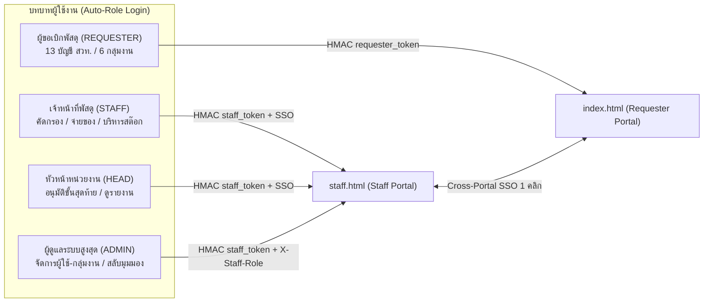
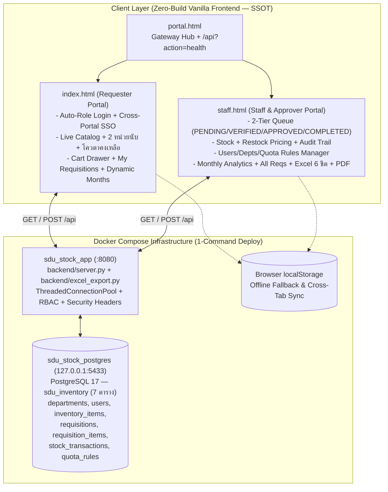
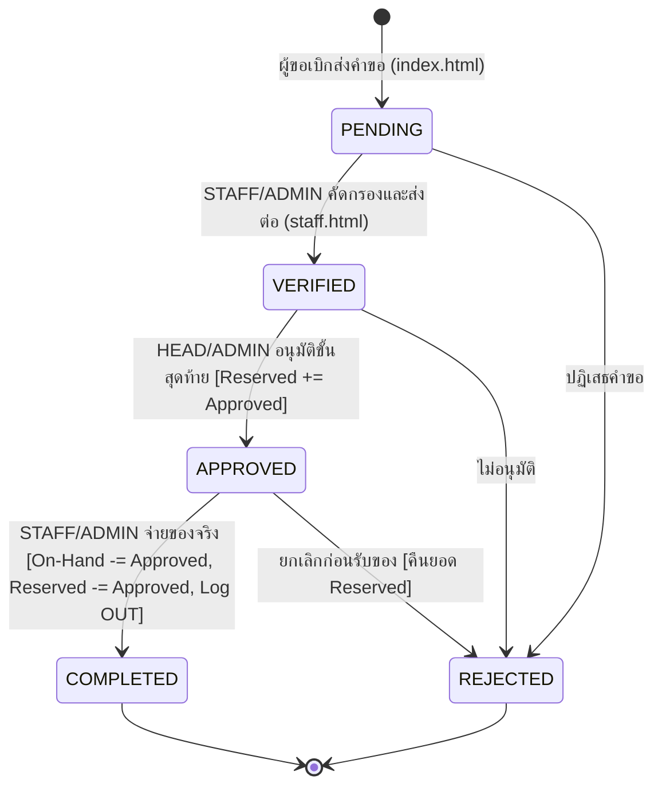

# Project Context: Stock Order SDU
### ระบบเบิกพัสดุและคลังพัสดุดิจิทัล มหาวิทยาลัยสวนดุสิต (Suan Dusit University e-Inventory System — v3.8.3)

---

## 1. วัตถุประสงค์และบริบทของโครงการ (System Objectives & Vision)

* **ชื่อระบบ:** ระบบเบิกพัสดุและคลังพัสดุดิจิทัล มหาวิทยาลัยสวนดุสิต *(Suan Dusit University e-Inventory & Requisition System)*
* **หน่วยงานใช้งาน:** สำนักส่งเสริมวิชาการและงานทะเบียน (สวท.) มหาวิทยาลัยสวนดุสิต
* **GitHub Repository:** [itsmekritsanai/stock-order-sdu](https://github.com/itsmekritsanai/stock-order-sdu)
* **วัตถุประสงค์หลัก:**
  1. **Paperless & Two-Tier Governance:** ยกระดับการขอเบิกพัสดุเป็นดิจิทัล 100% พร้อมกระบวนการตรวจสอบและอนุมัติ 2 ขั้นตอน (`PENDING` -> `VERIFIED` -> `APPROVED` -> `COMPLETED`) และแบบฟอร์มใบเบิกทางการ A4 PDF ช่องลงนามครบ 4 ฝ่าย
  2. **Inventory Accuracy & Concurrency Prevention:** ควบคุมสต๊อก 3 ระดับ (`Available = On-Hand - Reserved`) และป้องกัน Race Condition ด้วย PostgreSQL 17 ACID Transactions + `SELECT ... FOR UPDATE` (เรียงลำดับ `item_id` เพื่อกัน Deadlock)
  3. **Multi-Unit & Multi-Tier Quota Intelligence:** แปลง 2 หน่วยนับอัตโนมัติพร้อม Snapshot และควบคุมโควตารายเดือนทั้งระดับรายบุคคล (`USER`) และระดับกลุ่มงาน (`DEPT`)
  4. **Strict Portal Separation & RBAC 4 Roles:** แยกพอร์ทัลผู้ขอเบิก (`index.html`) และพอร์ทัลจัดการคลัง (`staff.html`) เด็ดขาด พร้อม Auto-Role Login, PBKDF2-HMAC-SHA256, HMAC Token, และ Cross-Portal SSO 1 คลิก
  5. **Cost Traceability & Executive Analytics:** บันทึกราคา/ยอดซื้อเข้าคลัง, Audit Trail ใน `stock_transactions`, แดชบอร์ดสถิติรายเดือนพร้อมรายการคำขอทั้งเดือน, ส่งออก Native Excel `.xlsx` 6 ชีต, และรายงานผู้บริหาร PDF

---

## 2. กลุ่มผู้ใช้งานและบทบาทสิทธิ์ (Target Users & RBAC 4 Roles)

ตั้งต้นจากรายนามบุคลากร สวท. ในไฟล์ `Book1.xlsx` (**15 บัญชี สังกัด 6 กลุ่มงาน สวท.**) พร้อมบัญชีผู้ดูแลระบบสูงสุด:

1. **`REQUESTER` (ผู้ขอเบิกพัสดุ):** เข้าสู่ระบบด้วย Username (ไม่คำนึงตัวพิมพ์เล็ก-ใหญ่) + รหัสผ่านเฉพาะบุคคล, ดูสต๊อกพร้อมเบิกและโควตาคงเหลือ, ส่งคำขอเบิก, ติดตามสถานะรายเดือน, และพิมพ์ใบเบิก PDF 4 ฝ่าย
2. **`STAFF` (เจ้าหน้าที่พัสดุ):** คัดกรองคำขอ (`verifyRequisition`), จ่ายพัสดุตัดสต๊อกจริง (`completeRequisition`), รับเข้าพร้อมราคา (`restockItem`), ปรับยอด (`adjustStock`), จัดการพัสดุ/โควตา, ดูรายงาน และสลับไปเบิกพัสดุได้ (ห้ามกด `approveRequisition`, `deleteUser`, `deleteDepartment`)
3. **`HEAD` (หัวหน้าหน่วยงาน):** เข้าสู่แท็บ `รอหัวหน้าอนุมัติ` อัตโนมัติ, อนุมัติขั้นสุดท้าย (`approveRequisition`) หรือปฏิเสธ (`rejectRequisition`), ดูสถิติ/ส่งออก Excel 6 ชีต/PDF ผู้บริหาร, และสลับไปเบิกพัสดุใน 1 คลิก
4. **`ADMIN` (ผู้ดูแลระบบสูงสุด):** ทำได้ทุกสิทธิ์ รวมถึงลบผู้ใช้/กลุ่มงาน และสลับมุมมองสิทธิ์ผ่าน Header `X-Staff-Role`

---

## 3. เทคโนโลยีและสถาปัตยกรรม (Tech Stack & Architecture)

### รายละเอียดส่วนประกอบทางเทคนิค:
* **Frontend Core:** Pure HTML5, Vanilla CSS3 (Custom Properties), Modern ES6+ แบบ Zero-Build (ไม่ใช้ npm, React, Vue, TailwindCSS)
* **Single Source of Truth (SSOT):** [scripts/generate_separated_portals.py](scripts/generate_separated_portals.py) คอมไพล์ทั้ง `index.html` และ `staff.html`
* **UI Standards:**
  * **SweetAlert2 v11** ([assets/js/sweetalert2.all.min.js](assets/js/sweetalert2.all.min.js)) พร้อม SDU Theme (`#1e40af`, `#059669`)
  * **100% Vector SVG Icons (`svg_icons` / `vIcons`):** Strict No-Emoji Policy
  * **Universal Searchable Dropdowns (`enhanceSearchableSelect`):** `<select>` ทุกตัวพิมพ์ค้นหาได้
  * **Dynamic Calendar Month Dropdowns:** สร้างงวดเดือนอัตโนมัติตามปฏิทินจริง (`v3.8.1`)
  * **Typography:** `Prompt` (UI) และ `Sarabun` (เอกสาร PDF A4)
* **Backend & Database:**
  * **PostgreSQL 17 (`sdu_inventory`):** 7 ตาราง ([backend/schema_postgres.sql](backend/schema_postgres.sql)), `CHECK` constraints, Triggers `updated_at` 4 ตาราง, เก็บข้อมูลใน `./postgres-data` (รองรับ MySQL Fallback)
  * **Python REST API ([backend/server.py](backend/server.py)):** `ThreadingHTTPServer`, `ThreadedConnectionPool`, Schema Auto-Migration, RBAC, และ Native 6-Sheet `.xlsx` Builder ([backend/excel_export.py](backend/excel_export.py))

---

## 4. มาตรฐานการเขียนโค้ด (Coding Style & Design Tokens)

1. **Zero-Build Runtime:** เปิดใช้งานได้ทันทีโดยไม่ต้องใช้ Build Bundler ฝั่ง Frontend
2. **Indentation:** HTML/CSS/JS 2 spaces | Python 4 spaces (PEP 8)
3. **CSS Design Tokens:** `--primary: #1e40af`, `--primary-hover: #1d4ed8`, `--primary-light: #eff6ff`, `--accent: #059669`, `--warning: #d97706`, `--danger: #dc2626`
4. **No Native Dialogs & No Emojis in UI:** ห้ามใช้ `alert()`, `confirm()`, `prompt()` และห้ามใช้ Emoji ในองค์ประกอบ UI ทุกจุด
5. **Searchable Dropdown Standard:** `<select>` ทุกตัวต้องรองรับการพิมพ์ค้นหาผ่าน `enhanceSearchableSelect`

---

## 5. กฎระเบียบทางธุรกิจและ State Machine (Business Logic)

1. **Available Stock:** $\text{Available} = \text{On-Hand} - \text{Reserved}$ (ห้ามติดลบ, `CHECK >= 0`)
2. **Multi-Unit Ratio:** $\text{Total Pieces} = (\text{Boxes} \times \text{Pieces Per Box}) + \text{Pieces}$
3. **Quota Precedence (`resolve_effective_monthly_limits`):**
   * รายบุคคล: `USER+item_id` > `USER+all(0)` > `inventory_items.monthly_limit` (`QUOTA_EXCEEDED`)
   * กลุ่มงาน: `DEPT+item_id` > `DEPT+all(0)` (`DEPT_QUOTA_EXCEEDED`)
4. **Restock Pricing:** คำนวณ `unit_price` และ `total_cost` อัตโนมัติ, อัปเดต `last_unit_price` / `last_restocked_at`, และบันทึก `INITIAL_STOCK` เมื่อเพิ่มพัสดุใหม่ที่มีสต๊อกตั้งต้น > 0

---

## 6. การทดสอบและควบคุมคุณภาพ (Testing & QA)

* **Automated Rules Check:** รัน `.venv\Scripts\python .agents/skills/stock-order-rules/scripts/verify_rules.py` ตรวจครบ 6 ข้อ (No-Emoji, No Native Dialogs, Version Sync, SSOT Generator, Searchable Dropdowns, Pytest)
* **Pytest Test Suite:** [tests/test_stock_logic.py](tests/test_stock_logic.py) ครอบคลุม **91 การทดสอบ (9 Test Classes)** เป้าหมาย Coverage >= 90%
* **CI/CD:** [.github/workflows/ci.yml](.github/workflows/ci.yml) รัน `verify_rules.py` และ `pytest` ร่วมกับ PostgreSQL 17 Service Container อัตโนมัติ

---

## 7. สถาปัตยกรรมความปลอดภัย (Security Architecture)

1. **Strict Backend Token & RBAC Enforcement:** บังคับ `AUTH_BYPASS="false"`, ตรวจ HMAC-SHA256 Token (อายุ 12 ชม.) และ `check_staff_role_permission()` ทุก Endpoint ภายใน
2. **PBKDF2 Password Security:** แฮชรหัสผ่านด้วย PBKDF2-HMAC-SHA256 (Salt 16 ไบต์, 600,000 รอบ), ไม่ฝังรหัสผ่านลง HTML สาธารณะ, บังคับตรวจรหัสผ่านเฉพาะบุคคลอย่างเคร่งครัด
3. **Static Path Traversal Guard & HTTP Headers:** ถอดรหัส URL ซ้ำ (`unquote` loop) + ตรวจ Canonical `realpath` ปิดกั้นไฟล์ลับ, ส่ง `X-Content-Type-Options: nosniff`, `X-Frame-Options: DENY`, `Referrer-Policy: same-origin`, จำกัดขนาด Body 10 MB, และไม่เปิดเผย Raw DB Exception
4. **XSS & Container Hardening:** ใช้ `escapeHtml()`, `isSafeSignatureDataUrl()`, รัน Docker ด้วย non-root `appuser`, และผูกพอร์ต PostgreSQL ไว้ที่ `127.0.0.1` เท่านั้น
