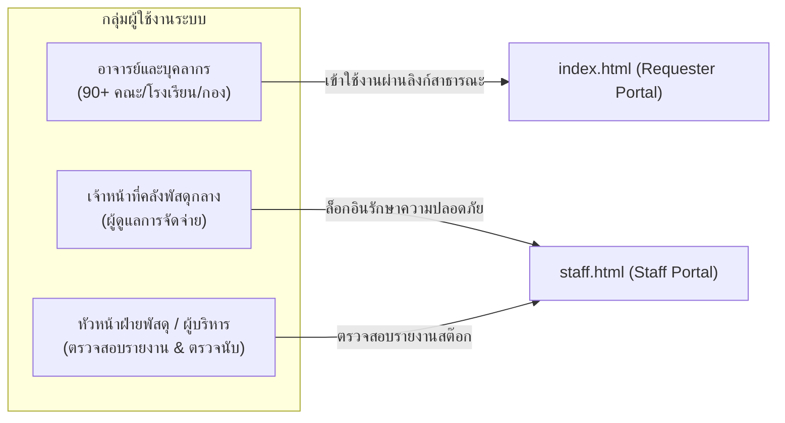
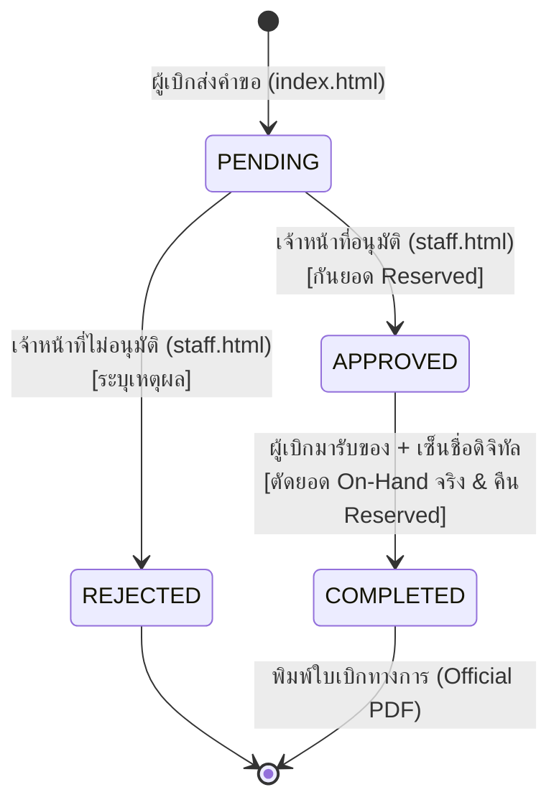

# Project Context: Stock Order SDU
### ระบบเบิกพัสดุและคลังพัสดุดิจิทัล มหาวิทยาลัยสวนดุสิต (Suan Dusit University e-Inventory System)

---

## 📌 1. วัตถุประสงค์และบริบทของโครงการ (System Objectives & Vision)

* **ชื่อระบบ:** ระบบเบิกพัสดุและคลังพัสดุดิจิทัล มหาวิทยาลัยสวนดุสิต  
  *(Suan Dusit University e-Inventory & Requisition System)*
* **เจ้าของโครงการ:** มหาวิทยาลัยสวนดุสิต (Suan Dusit University - SDU)
* **GitHub Repository:** [itsmekritsanai/stock-order-sdu](https://github.com/itsmekritsanai/stock-order-sdu)
* **วัตถุประสงค์หลัก:**
  1. **Paperless & Digital Transformation:** ยกระดับกระบวนการขอเบิกพัสดุสำนักงานของมหาวิทยาลัยจากกระดาษสู่ระบบดิจิทัล 100%
  2. **Inventory Accuracy & Concurrency Prevention:** ป้องกันปัญหาสต๊อกติดลบหรือการเบิกชนกันด้วยระบบคำนวณยอดสต๊อก 3 ระดับ (*On-Hand, Reserved, Available*)
  3. **Multi-Unit Intelligence:** คำนวณการแปลงหน่วยอัตโนมัติระหว่างหน่วยบรรจุใหญ่ (กล่อง/ห่อ) และหน่วยย่อย (ชิ้น/ซอง/ใบ/แผ่น)
  4. **Strict Security Separation:** แยกสิทธิ์การใช้งานระหว่างผู้ขอเบิก (อาจารย์/บุคลากร 90+ หน่วยงาน) และเจ้าหน้าที่คลังพัสดุออกจากกันอย่างเด็ดขาด
  5. **Audit Trail & Digital Signatures:** มีระบบลงนามรับของผ่านหน้าจอสัมผัส (E-Signature Pad) และสร้างเอกสารแบบฟอร์มขอเบิกพัสดุทางการ (Official PDF) ตามระเบียบพัสดุ

---

## 👥 2. กลุ่มผู้ใช้งานเป้าหมาย (Target Users & Personas)



1. **ผู้ขอเบิก (Requester):**
   * **ใคร:** อาจารย์, นักวิจัย, เจ้าหน้าที่ธุรการ, บุคลากรจาก 90+ หน่วยงาน (เช่น โรงเรียนการเรือน, คณะวิทยาศาสตร์, กองคลัง, สำนักวิทยบริการ)
   * **พฤติกรรม:** ต้องการความรวดเร็ว ไม่ต้องการขั้นตอนล็อกอินที่ซับซ้อน ค้นหาพัสดุด้วยชื่อภาษาไทย (ไม่ต้องจำรหัส SKU) ตรวจสอบยอดคงเหลือได้ทันที
   * **ช่องทางเข้าใช้งาน:** `index.html`
2. **เจ้าหน้าที่คลังพัสดุ (Staff / Warehouse Manager):**
   * **ใคร:** เจ้าหน้าที่ฝ่ายพัสดุและคลังพัสดุกลาง มหาวิทยาลัยสวนดุสิต
   * **พฤติกรรม:** ตรวจสอบคำขอที่ส่งเข้ามา, จัดเตรียมของ, อนุมัติปรับยอด, ให้ผู้มารับเซ็นชื่อบนหน้าจอ, ตัดสต๊อกจริง, และพิมพ์ใบเบิกทางการ
   * **ช่องทางเข้าใช้งาน:** `staff.html` (มีระบบรหัสผ่านยืนยันสิทธิ์)

---

## 💻 3. เทคโนโลยีและสถาปัตยกรรม (Tech Stack & Architecture)

```mermaid
graph TD
    subgraph "Client Layer (Zero-Build Frontend)"
        REQ["Requester Portal (index.html)<br/>- Searchable Dept Combobox (90+)<br/>- Live Catalog & Multi-Unit Ratio<br/>- Cart Drawer<br/>- My Requisitions Modal<br/>- Tracking Timeline"]
        STAFF["Staff Portal (staff.html)<br/>- Authentication Gate<br/>- Dashboard Metrics<br/>- Approval Queue<br/>- Touchscreen E-Signature Pad<br/>- Official PDF Print Engine<br/>- Inventory Stock Manager"]
    end

    subgraph "Persistence Layer"
        LOCAL[("Browser localStorage<br/>+ Cross-Tab Storage Event Sync<br/>(inventory_items, inventory_requisitions)")]
        SHEETS[("Google Sheets Database (Roadmap)<br/>- Items Sheet<br/>- Requisitions Sheet<br/>- Requisition_Items Sheet<br/>- Departments Sheet")]
        GAS["Google Apps Script Web App (API)<br/>- LockService (Concurrency Control)<br/>- JSON REST API"]
    end

    REQ <-->|Sync Local| LOCAL
    STAFF <-->|Sync Local| LOCAL
    REQ -.->|Fetch / POST (Phase 5)| GAS
    STAFF -.->|Fetch / POST (Phase 5)| GAS
    GAS <--> SHEETS
```

### รายละเอียดส่วนประกอบทางเทคนิค:
* **Frontend Core:** Pure HTML5 Semantic, Vanilla CSS3 (Custom Properties/Variables, Flexbox, Grid), Modern JavaScript ES6+ แบบ Zero-Runtime Dependency (ไม่ใช้ React/Vue หรือ TailwindCSS)
* **UI & Components:**
  * **SweetAlert2 v11:** ป๊อปอัปแจ้งเตือนและกล่องยืนยัน สไตล์ SDU Theme (`assets/js/sweetalert2.all.min.js`) พร้อม CDN Fallback
  * **Typography:** Google Fonts `Prompt` (สำหรับ UI ทั่วไป) และ `Sarabun` (สำหรับแบบฟอร์มเอกสารทางการ)
  * **Vector Icons:** 100% SVG Vector Icons (Stroke-based, viewBox 24x24) จากชุด `svg_icons` **(Strict No-Emoji Policy)**
  * **Canvas API:** แท่นลงนามดิจิทัล (E-Signature Pad) รองรับ Touchscreen, ปากกาสไตลัส และเมาส์
* **Build & Code Generator:** Python 3.x (`generate_separated_portals.py`) เป็น **Single Source of Truth (SSOT)**
* **Data Persistence:**
  * ปัจจุบัน: Browser `localStorage` พร้อม Reactive Cross-Tab Sync (`storage` event)
  * แผนพัฒนา: Google Sheets API ผ่าน Google Apps Script Web App เพื่อรองรับ GitHub Pages

---

## 🎨 4. รูปแบบการเขียนโค้ดและมาตรฐาน (Coding Style & Guidelines)

1. **Zero-Build Runtime:** โค้ดทั้งหมดต้องสามารถเปิดทำงานผ่านเบราว์เซอร์หรือเว็บเซิร์ฟเวอร์แบบ Static ได้ทันทีโดยไม่ต้องผ่านกระบวนการ build
2. **Indentation:**
   * HTML, CSS, JavaScript: เว้นวรรค 2 spaces
   * Python: เว้นวรรค 4 spaces ยึดตามมาตรฐาน **PEP 8**
3. **Design System & CSS Tokens:**
   * ใช้อ้างอิงตัวแปร CSS เท่านั้น:
     * สีหลัก: `var(--primary)` (`#1e40af`), `var(--primary-hover)` (`#1d4ed8`), `var(--primary-light)` (`#eff6ff`)
     * สีรอง/สำเร็จ: `var(--accent)` (`#059669`), `var(--accent-hover)` (`#047857`)
     * สีเตือน/รออนุมัติ: `var(--warning)` (`#d97706`), `var(--warning-light)` (`#fef3c7`)
     * สีข้อผิดพลาด/ปฏิเสธ: `var(--danger)` (`#dc2626`), `var(--danger-light)` (`#fee2e2`)
     * ส่วนโค้งมน: `var(--radius)` (8px - 14px)
4. **Nomenclature (หลักการตั้งชื่อ):**
   * HTML Element ID: `camelCase` เช่น `itemSearchInput`, `myRequisitionsModal`, `deptComboboxControl`
   * CSS Classes: `kebab-case` เช่น `req-card-item`, `combobox-dropdown`, `pill-pending`
   * JavaScript Functions: `camelCase` เช่น `openMyRequisitionsModal()`, `submitRequisition()`, `updateMyReqsBadge()`
   * Python Functions/Variables: `snake_case` เช่น `initial_items`, `dept_js_items`
5. **No Native Dialogs Rule:**
   * **ห้ามใช้ `alert()`, `confirm()`, หรือ `prompt()` ของเบราว์เซอร์โดยเด็ดขาด**
   * ต้องใช้ `Swal.fire()` หรือ `Swal.mixin()` จาก SweetAlert2 เท่านั้น
6. **Strict No-Emoji Rule in UI:**
   * ใช้ SVG Stroke เวกเตอร์จาก `svg_icons` เท่านั้น ห้ามใส่อีโมจิในปุ่ม หัวข้อ หรือตาราง

---

## ⚙️ 5. กฎระเบียบทางธุรกิจและตรรกะระบบ (Business Logic & Rules Engine)



1. **สูตรการคำนวณยอดสต๊อกพร้อมเบิก (Available Stock Formula):**
   $$\text{Available Pieces} = \text{On-Hand Pieces} - \text{Reserved Pieces}$$
2. **ตรรกะ 2 หน่วยนับ (Multi-Unit Ratio Calculation):**
   $$\text{Total Requested Pieces} = (\text{Requested Boxes} \times \text{Pieces Per Box}) + \text{Requested Pieces}$$
3. **ขั้นตอนการตัดสต๊อก (Inventory Lifecycle):**
   * **เมื่อผู้เบิกส่งคำขอ (`PENDING`):** ตรวจสอบว่า `Total Requested <= Available` หากผ่าน จะสร้างเลขที่คำขอ `REQ-YYYYMM-XXXX` (ยังไม่มีการตัดสต๊อก)
   * **เมื่อเจ้าหน้าที่อนุมัติ (`APPROVED`):** เพิ่มยอด `reserved_pieces += approved_pieces` เพื่อล็อกยอดไว้ไม่ให้ผู้อื่นเบิกซ้ำ
   * **เมื่อลงนามรับมอบสำเร็จ (`COMPLETED`):**
     * ลดสต๊อกจริง: `on_hand_pieces -= approved_pieces`
     * คืนยอดกันจอง: `reserved_pieces -= approved_pieces`
     * แนบภาพลายเซ็น Base64 เข้ากับเอกสารคำขอ
   * **กรณีปฏิเสธคำขอ (`REJECTED`):** หากคำขอนั้นเคยถูกกันยอดไว้ จะคืนยอด `reserved_pieces` กลับสู่สต๊อก

---

## 🧪 6. การทดสอบและการควบคุมคุณภาพ (Testing & Quality Assurance)

* **Python Scripts & Automation:**
  * ใช้ **`pytest`** ในการทดสอบฟังก์ชันการทำงาน และกำหนดเกณฑ์ **Code Coverage >= 90%**
* **Frontend Code Validation:**
  * ตรวจสอบความถูกต้องของ JavaScript Syntax ผ่าน Node.js Parser:
    ```bash
    node -e "new Function(fs.readFileSync('index.html', 'utf8'))"
    ```
    ต้องผ่าน 100% โดยไม่มีข้อผิดพลาด (0 Syntax Errors)
  * ตรวจสอบว่าไม่มีการหลงเหลือคำสั่ง `alert(`, `confirm(`, หรือ `prompt(` ในโค้ด
* **HTTP Server Verification:**
  * หน้าเว็บทั้ง `index.html` และ `staff.html` ต้องส่งคืนรหัสสถานะ `HTTP 200`
  * ตรวจสอบว่าไม่มี Asset ขาดหาย (0 Missing Assets / No 404s)
* **Device & Responsive Testing:**
  * รองรับการแสดงผลทุกหน้าจอตลอดช่วง Viewport (Mobile 360px จนถึง Desktop 1920px)
  * แท่นเซ็นลายเซ็นต้องรองรับ Touch Event (`touchstart`, `touchmove`, `touchend`) ได้แม่นยำ

---

## 🚨 7. กฎเหล็กและข้อห้ามสำคัญ (Crucial Rules & Non-Negotiables)

1. **ห้ามแก้ไขไฟล์ Config หลักโดยไม่ขออนุญาต:** ห้ามดัดแปลงไฟล์ตั้งค่าระบบ หรือโครงสร้างโปรเจกต์หลักโดยไม่มีข้อกำหนดชัดเจน
2. **รักษาการแยกพอร์ทัลเด็ดขาด 100% (Strict Portal Separation):**
   * ห้ามรวม `index.html` และ `staff.html` เข้าด้วยกันเด็ดขาด
   * หน้า `index.html` ต้องไม่มีโค้ด ส่วนติดต่อ หรือสิทธิ์ในการอนุมัติคำขอ การตัดสต๊อก หรือการล็อกอินเจ้าหน้าที่
3. **Single Source of Truth (SSOT):**
   * การแก้ไขหรือเพิ่มฟีเจอร์หลักในหน้าเว็บ ควรทำผ่านสคริปต์ `generate_separated_portals.py` แล้วสั่งคอมไพล์ เพื่อป้องกันปัญหาโค้ดของทั้งสองหน้าไม่ตรงกัน
4. **ป้องกันข้อมูลสูญหาย (Accidental Data Loss Prevention):**
   * ห้ามสั่งรันคำสั่งที่ลบฐานข้อมูล ล้างข้อมูลพัสดุตั้งต้น หรือทำลายไฟล์รูปภาพโดยเด็ดขาด
5. **ห้ามตัดยอดสต๊อก On-Hand ก่อนการลงนามรับของจริง:**
   * สต๊อกจริงจะถูกตัดเมื่อผู้รับลงลายมือชื่อในหน้า `staff.html` เท่านั้น
6. **การควบคุมเวอร์ชันและบันทึกประวัติ (Strict Versioning & CHANGELOG Protocol):**
   * ทุกครั้งที่มีการพัฒนา เพิ่มฟีเจอร์ หรือแก้ไขโค้ด จะต้องปรับเพิ่มเลขเวอร์ชันตามมาตรฐาน Semantic Versioning (`MAJOR.MINOR.PATCH`)
   * บันทึกรายละเอียดการเปลี่ยนแปลงทั้งหมดลงในไฟล์ `CHANGELOG.md` ทุกครั้ง
   * ซิงก์ตัวเลขเวอร์ชัน (`SYSTEM_VERSION`, Footer, `backend/Code.gs`) ให้ตรงกันเสมอ

