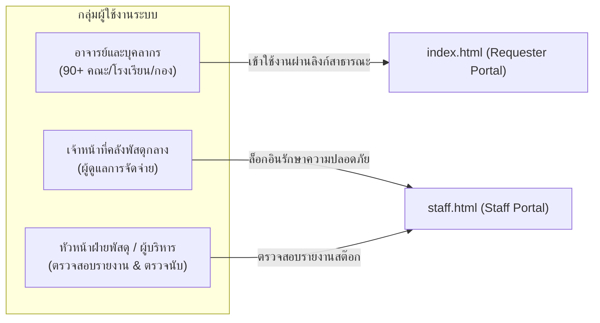

# Project Context: Stock Order SDU
### ระบบเบิกพัสดุและคลังพัสดุดิจิทัล มหาวิทยาลัยสวนดุสิต (SDU e-Inventory System)

---

## 1. วัตถุประสงค์ของโครงการ (System Objectives)
1. **Paperless Digital Transformation:** พัฒนาระบบขอเบิกพัสดุสำนักงานออนไลน์แบบไร้กระดาษ 100% สำหรับมหาวิทยาลัยสวนดุสิต
2. **Real-time Stock Accuracy:** แก้ไขปัญหาการบันทึกสต๊อกผิดพลาด การเบิกซ้ำซ้อน และสต๊อกติดลบ ด้วยการคำนวณ 3 ระดับ: **คงเหลือจริง (On-Hand)**, **ติดจอง (Reserved)**, และ **พร้อมเบิกจริง (Available)**
3. **Multi-Unit Intelligence:** รองรับการเบิกพัสดุแบบ 2 หน่วยนับพร้อมกัน (เช่น ขอเบิก 2 กล่อง + 3 ซอง) และแปลงค่าเป็นหน่วยย่อยให้อัตโนมัติ
4. **Self-Service & Transparency:** ผู้ขอเบิกสามารถติดตามสถานะเอกสารได้ตลอด 24 ชั่วโมง และดูประวัติคำขอของตนเองได้แบบเรียลไทม์
5. **Legally Compliant Digital Signatures:** รองรับการลงนามรับของผ่านหน้าจอสัมผัส (E-Signature) และพิมพ์ใบเบิกพัสดุทางการ (Official PDF) ตามระเบียบพัสดุของมหาวิทยาลัย

---

## 2. กลุ่มผู้ใช้งานเป้าหมาย (Target Users & Personas)



1. **ผู้ขอเบิก (Requester):**
   * **ใคร:** อาจารย์, นักวิจัย, เจ้าหน้าที่ธุรการ, บุคลากรจาก 90+ หน่วยงาน (เช่น โรงเรียนการเรือน, คณะวิทยาศาสตร์, กองคลัง, สำนักวิทยบริการ)
   * **พฤติกรรม:** ต้องการความรวดเร็ว ไม่ต้องการขั้นตอนล็อกอินที่ซับซ้อน ค้นหาพัสดุด้วยชื่อภาษาไทย (ไม่ต้องจำรหัส SKU) ตรวจสอบยอดคงเหลือได้ทันที
   * **ช่องทางเข้าใช้งาน:** `index.html`
2. **เจ้าหน้าที่คลังพัสดุ (Staff / Warehouse Manager):**
   * **ใคร:** เจ้าหน้าที่ฝ่ายพัสดุและคลังพัสดุกลาง มหาวิทยาลัยสวนดุสิต
   * **พฤติกรรม:** ตรวจสอบคำขอที่ส่งเข้ามา, จัดเตรียมของ, อนุมัติปรับยอด, ให้ผู้มารับเซ็นชื่อบนหน้าจอ, ตัดสต๊อกจริง, และพิมพ์ใบเบิกทางการ
   * **ช่องทางเข้าใช้งาน:** `staff.html` (มีระบบรหัสผ่านยืนยันสิทธิ์)

---

## 3. สถาปัตยกรรมระบบ (System Architecture)

```mermaid
graph TD
    subgraph "Client Layer (Zero-Build Frontend)"
        REQ["Requester Portal (index.html)<br/>- Searchable Dept Combobox (90+)<br/>- Live Catalog & Multi-Unit Ratio<br/>- Cart Drawer<br/>- My Requisitions Modal<br/>- Tracking Timeline"]
        STAFF["Staff Portal (staff.html)<br/>- Authentication Gate<br/>- Dashboard Metrics<br/>- Approval Queue<br/>- Touchscreen E-Signature Pad<br/>- Official PDF Print Engine<br/>- Inventory Stock Manager"]
    end

    subgraph "Persistence Layer"
        LOCAL[("Browser localStorage<br/>+ Cross-Tab Storage Event Sync<br/>(inventory_items, inventory_requisitions)")]
        SHEETS[("Google Sheets Database (Roadmap)<br/>- Items Sheet<br/>- Requisitions Sheet<br/>- Requisition_Items Sheet<br/>- Departments Sheet")]
        GAS["Google Apps Script Web App (API)<br/>- LockService (Concurrency Control)<br/>- JSON REST API"]
    end

    REQ <-->|Sync Local| LOCAL
    STAFF <-->|Sync Local| LOCAL
    REQ -.->|Fetch / POST (Phase 3)| GAS
    STAFF -.->|Fetch / POST (Phase 3)| GAS
    GAS <--> SHEETS
```

---

## 4. เทคโนโลยีหลักที่ใช้ (Tech Stack)

| ส่วนประกอบ | เทคโนโลยีที่ใช้ | เหตุผลในการเลือก |
| :--- | :--- | :--- |
| **โครงสร้างหน้าเว็บ** | HTML5 Semantic Elements | มาตรฐานสากล โหลดเร็ว เข้าถึงง่าย (Accessibility) |
| **การตกแต่ง (Styling)** | Vanilla CSS3 (Custom Variables, Grid, Flexbox) | ปราศจาก overhead ของ CSS Framework, ปรับแต่งธีม SDU Blue ได้อิสระ |
| **การประมวลผล (Logic)** | Modern Vanilla JavaScript (ES6+) | ทำงานบนเบราว์เซอร์ได้ทันทีโดยไม่ต้อง Build หรือติดตั้ง Node.js runtime |
| **ป๊อปอัปและข้อความเตือน** | SweetAlert2 v11 (SDU Custom Theme) | แทนที่ `alert()` แบบดั้งเดิมด้วย UI โมเดิร์น รองรับ Offline Asset |
| **ระบบไอคอน** | 100% Vector SVG Icons | ปราศจาก Emoji, คมชัดทุกความละเอียด, น้ำหนักเบามาก |
| **แท่นลงนามดิจิทัล** | HTML5 Canvas API | รองรับ Touchscreen, ปากกาสไตลัส และเมาส์ เซฟภาพเป็น Base64 PNG |
| **พิมพ์เอกสารทางการ** | CSS Print Engine / A4 Format | จัดหน้าตรงตามมาตรฐานแบบฟอร์มราชการ มสด. พร้อมตราสัญลักษณ์ |
| **เครื่องมือสร้างโค้ด** | Python 3.x (`generate_separated_portals.py`) | Single Source of Truth สำหรับ Shared CSS, SVG, และ Data Dictionary |
| **การจัดเก็บข้อมูล** | `localStorage` (ปัจจุบัน) ➔ Google Sheets (เป้าหมาย) | รองรับการทดสอบในเครื่อง และพร้อม Deploy ขึ้น GitHub Pages ฟรี 100% |

---

## 5. ขอบเขตความปลอดภัยและสิทธิ์การเข้าถึง (Security Boundaries)

* **Zero-Trust Separation:** ห้ามผู้ขอเบิกเข้าถึงฟังก์ชันของเจ้าหน้าที่โดยเด็ดขาด:
  * ใน `index.html` จะไม่มีโค้ดฟังก์ชันอนุมัติ (`approveRequisition`), ฟังก์ชันตัดสต๊อก (`completeRequisition`), หรือฟังก์ชันแก้ตัวเลขคงคลัง (`restockItem`)
  * ใน `staff.html` มี Session Auth Gate ป้องกันไม่ให้ผู้ไม่ได้รับอนุญาตมองเห็นข้อมูลภาพรวมคลัง
* **Stock Security:**
  * การลดจำนวนพัสดุในคลังจริง (`on_hand_pieces`) จะทำได้ผ่านแท่นเซ็นชื่อใน `staff.html` เท่านั้น
