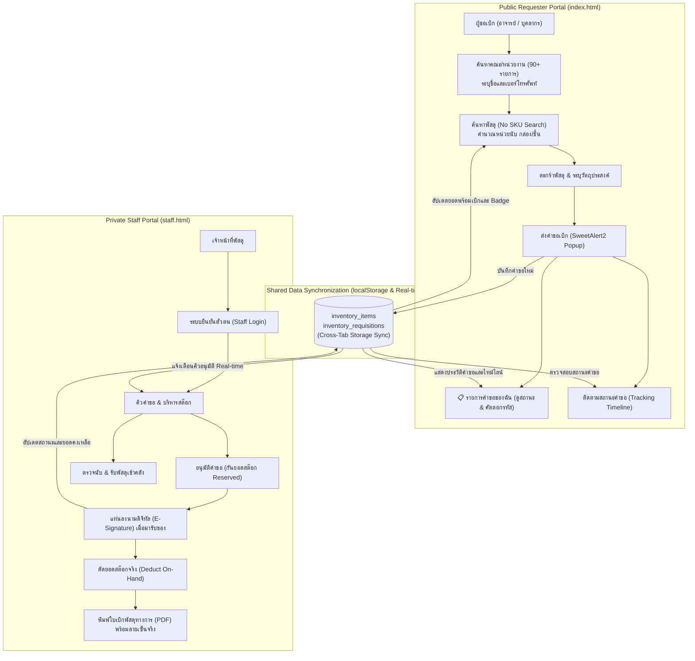

# ระบบเบิกพัสดุและคลังพัสดุดิจิทัล มหาวิทยาลัยสวนดุสิต
### (Suan Dusit University e-Inventory & Requisition System)

[](https://opensource.org/licenses/MIT)
[](https://html.spec.whatwg.org/)
[](https://developer.mozilla.org/en-US/docs/Web/JavaScript)
[](https://www.w3.org/Style/CSS/)
[](https://sweetalert2.github.io/)
[](https://www.dusit.ac.th/)

เว็บแอปพลิเคชันระบบบริหารจัดการคลังพัสดุกลางและขอเบิกพัสดุออนไลน์ มหาวิทยาลัยสวนดุสิต ที่ได้รับการออกแบบใหม่ให้ทันสมัย รองรับการแยกส่วนการใช้งานระหว่าง **"ผู้ขอเบิก (อาจารย์/บุคลากร)"** และ **"เจ้าหน้าที่คลังพัสดุ"** ออกจากกันโดยเด็ดขาด 100% เพื่อความปลอดภัย พร้อมระบบลงนามรับของดิจิทัล (E-Signature) พิมพ์ใบเบิกทางการ (Official PDF) และระบบป๊อปอัปแจ้งเตือน SweetAlert2 สวยงามระดับมืออาชีพ

---

## สถาปัตยกรรมการแยกระบบ (Architecture & Security Separation)

ระบบแบ่งการเข้าถึงเป็น 2 พอร์ทัลอิสระ เพื่อความปลอดภัยสูงสุด:



---

## คุณสมบัติเด่นของระบบ (Key Features)

### 1. หน้าสำหรับผู้ขอเบิก — `index.html` (Requester Portal)
* **ไม่ต้องเข้าสู่ระบบ (Zero-Friction Access):** ผู้เบิกสามารถเปิดลิงก์และใช้งานได้ทันที
* **Searchable Department Combobox:** ช่องเลือกหน่วยงาน/คณะ/โรงเรียนที่สังกัด สามารถพิมพ์ค้นหาแบบเรียลไทม์ได้ครอบคลุมทั้ง 90+ หน่วยงานของมหาวิทยาลัยสวนดุสิต
* **ค้นหาพัสดุด้วยชื่อ (No SKU Dependency):** ค้นหาด้วยชื่อพัสดุภาษาไทยแบบ Fuzzy Matching สะดวกรวดเร็ว
* **ระบบคำนวณหลายหน่วยนับ (Multi-Unit Conversion):** สามารถเลือกเบิกเป็น "กล่อง" หรือ "ชิ้น/ซอง/แผ่น" ได้ โดยระบบจะคำนวณยอดรวมและตัดสต๊อกให้อัตโนมัติ
* **แสดงสต๊อกคงเหลือจริง (Available Stock):** แสดงยอดสต๊อกที่เบิกได้จริงตามสูตร `Available = On-Hand - Reserved` ป้องกันการเบิกชนกัน
* **ตะกร้าขอเบิกและสร้างเอกสาร:** เพิ่มรายการใส่ตะกร้า ระบุวัตถุประสงค์ และสร้างเลขที่คำขอ `REQ-256910-XXXX`
* **ปุ่ม "📋 รายการคำขอของฉัน" (My Requisitions):**
  * ปุ่มบนเมนูด้านบนพร้อม **ตัวเลขนับจำนวนคำขอ (Count Badge)** แสดงยอดคำขอแบบเรียลไทม์
  * หน้าต่างป๊อปอัปดูรายการคำขอทั้งหมด พร้อมช่องค้นหาเอกสาร/ผู้เบิก/พัสดุ
  * แท็บคัดกรองสถานะ: ทั้งหมด, รออนุมัติ (Pending), อนุมัติแล้ว (Approved), รับมอบสำเร็จ (Completed), ไม่อนุมัติ (Rejected)
  * ปุ่มคัดลอกเลขที่เอกสารในคลิกเดียว พร้อมปุ่มทางลัดเปิดดูไทม์ไลน์สถานะทันที
* **ระบบติดตามสถานะคำขอ (Self-Service Tracking):** ผู้เบิกสามารถนำเลขที่เอกสารมาตรวจสอบสถานะคำขอได้ด้วยตัวเองตลอด 24 ชั่วโมง
* **ความปลอดภัยสูง:** ตัดแท็บและสิทธิ์การเข้าถึงของเจ้าหน้าที่พัสดุออกทั้งหมด ผู้เบิกไม่สามารถเข้ามาอนุมัติหรือปรับแก้สต๊อกได้

### 2. หน้าสำหรับเจ้าหน้าที่พัสดุ — `staff.html` (Staff & Admin Portal)
* **ระบบล็อกอินรักษาความปลอดภัย (Staff Authentication):** ป้องกันไม่ให้ผู้เบิกหรือบุคคลภายนอกเข้าถึงข้อมูลคลัง
* **แดชบอร์ดสรุปยอดสต๊อก (Dashboard Metrics):** สรุปยอดคำขอรออนุมัติ, อนุมัติแล้วรอจ่าย, จำนวนรายการคงคลัง และพัสดุใกล้หมด
* **ระบบคิวอนุมัติคำขอ (Approval Workflow):** 
  * ตรวจสอบรายละเอียดและวัตถุประสงค์
  * อนุมัติคำขอเพื่อกันยอดสต๊อก (Reserved) ป้องกันการเบิกซ้ำซ้อน
* **แท่นลงนามดิจิทัล (E-Signature Pad):**
  * เมื่อผู้ขอเบิกเดินทางมารับพัสดุที่ห้องคลัง เจ้าหน้าที่กดปุ่ม "ลงนามรับของ"
  * รองรับการเซ็นชื่อผ่านหน้าจอสัมผัส (Touchscreen), ปากกาสไตลัส, หรือเมาส์
* **ตัดสต๊อกอัตโนมัติ (Automated Inventory Deduction):** เมื่อผู้รับลงนามรับของเรียบร้อย ระบบจะตัดสต๊อกจริง (On-Hand) และคืนยอดกันจอง (Reserved) ให้ทันที
* **พิมพ์ใบเบิกพัสดุทางการ (Official PDF Printable Form):**
  * แบบฟอร์มราชการมาตรฐานตามระเบียบพัสดุ
  * ตราสัญลักษณ์มหาวิทยาลัยสวนดุสิต (Vector Seal)
  * ประทับรูปลายเซ็นดิจิทัลของผู้รับมอบลงในเอกสารโดยอัตโนมัติ
* **ระบบบริหารสต๊อกคลัง (Inventory Management):**
  * ตรวจสอบยอดสต๊อก 3 สถานะ: คงเหลือจริง (On-Hand) | ติดจอง (Reserved) | พร้อมเบิก (Available)
  * ฟังก์ชันรับพัสดุเข้าคลัง (+) และการแจ้งเตือนพัสดุต่ำกว่าเกณฑ์

### 3. มาตรฐานการออกแบบและประสบการณ์ผู้ใช้ (Design & UX)
* **SweetAlert2 Modern Dialogs:** ป๊อปอัปแจ้งเตือนและหน้าต่างยืนยันทั้งหมดใช้ SweetAlert2 ตกแต่งในธีมสีน้ำเงิน มสด. (`#1e40af`) และเขียวมรกต (`#059669`)
* **Offline Asset Support:** ดาวน์โหลดไฟล์ `sweetalert2.all.min.js` เก็บไว้ใน `assets/js/` เพื่อให้ระบบทำงานได้เสถียร 100% แม้ไม่มีอินเทอร์เน็ตภายนอก พร้อมระบบ CDN Fallback อัตโนมัติ
* **100% Vector SVG Icons:** ปราศจาก Emoji โดยเปลี่ยนมาใช้ไอคอนเวกเตอร์เส้น Stroke คุณภาพสูงทั้งหมด
* **Typography:** ใช้ฟอนต์ Google Fonts `Prompt` สำหรับหน้าจอการใช้งานทั่วไป และ `Sarabun` สำหรับแบบฟอร์มเอกสารทางการ
* **Real-time Cross-Tab Synchronization:** ระบบตรวจจับการเปลี่ยนแปลงข้อมูลข้ามแท็บเบราว์เซอร์อัตโนมัติ ไม่ต้องกด Refresh หน้าเว็บ

---

## โครงสร้างไฟล์ในโครงการ (Project Structure)

```text
stock-order-sdu/
│
├── index.html                           # หน้าเว็บสำหรับผู้ขอเบิก (Public Requester Portal)
├── staff.html                           # หน้าเว็บสำหรับเจ้าหน้าที่พัสดุ (Private Staff Portal)
│
├── assets/                              # ทรัพยากรของโครงการ
│   ├── js/                              # ไลบรารี JavaScript ออฟไลน์
│   │   └── sweetalert2.all.min.js       # SweetAlert2 Local Asset สำหรับการทำงานออฟไลน์
│   └── images/                          # รูปภาพพัสดุจริงสกัดจากไฟล์สต๊อก (58 รายการ)
│       ├── image1.jpeg ~ image58.jpeg
│
├── departments_structured.json          # ฐานข้อมูลรายชื่อคณะ/สำนัก/สถาบัน/โรงเรียน 90+ หน่วยงาน
├── คณะและหน่วยงาน.txt                     # ข้อมูลดิบรายชื่อหน่วยงาน มหาวิทยาลัยสวนดุสิต
├── ยอดสต๊อก ตค.xlsx                       # ข้อมูลสต๊อกพัสดุดิบตั้งต้นจาก Excel
├── system_requirements_specification.md # เอกสารวิเคราะห์ความต้องการเชิงระบบ (SRS v1.1)
├── TODO.md                              # รายการสิ่งที่ต้องทำและแผนการเชื่อมต่อ Google Sheets Database
│
├── generate_separated_portals.py        # สคริปต์ Python สำหรับสร้างและคอมไพล์โค้ด HTML ทั้งสองพอร์ทัล
├── .gitignore                           # การกำหนดไฟล์ที่ไม่ต้องนำขึ้น Git
└── README.md                            # เอกสารแนะนำและคู่มือการใช้งานโครงการ
```

---

## วิธีการติดตั้งและรันโครงการ (Getting Started)

ระบบถูกสร้างขึ้นโดยใช้มาตรฐาน **Pure HTML5 / Vanilla CSS / Modern JavaScript (ES6+)** จึงสามารถรันได้ทันทีโดยไม่ต้องติดตั้ง Library ภายนอกหรือ Node.js

### ขั้นตอนการรันด้วย Python Local Web Server:

1. เปิด Terminal หรือ PowerShell ในโฟลเดอร์ของโครงการ:
   ```bash
   cd "project stock"
   ```

2. สั่งรัน Local HTTP Server ผ่าน Python:
   ```bash
   python -m http.server 8080
   ```

3. เปิด Web Browser เพื่อใช้งาน:
   * **หน้าสำหรับผู้ขอเบิก:** [http://localhost:8080/index.html](http://localhost:8080/index.html)
   * **หน้าสำหรับเจ้าหน้าที่พัสดุ:** [http://localhost:8080/staff.html](http://localhost:8080/staff.html)

---

## ฐานข้อมูลและการจัดเก็บข้อมูล (Data Persistence)

* **ปัจจุบัน (Local Mode):** ทั้งสองระบบเชื่อมต่อข้อมูลกันผ่าน Browser **`localStorage`** พร้อมระบบซิงค์ข้ามแท็บเรียลไทม์ (`storage` event):
  * **`inventory_items`**: ข้อมูลรายการพัสดุ ยอดคงเหลือจริง (On-Hand), ยอดติดจอง (Reserved), เกณฑ์แจ้งเตือนสต๊อกต่ำ และภาพถ่าย
  * **`inventory_requisitions`**: ประวัติคำขอเบิก สถานะเอกสาร รายการที่อนุมัติ และภาพลายเซ็นดิจิทัล Base64
* **แผนพัฒนาขั้นถัดไป (Cloud Database):** เชื่อมต่อฐานข้อมูลเข้ากับ **Google Sheets (ผ่าน Google Apps Script Web App)** เพื่อรองรับการเปิดใช้งานจริงข้ามอุปกรณ์ผ่าน **GitHub Pages** (ดูรายละเอียดใน [TODO.md](TODO.md))

---

## แผนการพัฒนาและสิ่งที่ต้องทำ (Roadmap & To-Do List)

ติดตามความคืบหน้าของโครงการและแผนการเชื่อมต่อ **Google Sheets Database** สำหรับ GitHub Pages ได้ที่:
* 📋 **[แผนการดำเนินงานและรายการสิ่งที่ต้องทำ (TODO.md)](TODO.md)**

---

## เอกสารอ้างอิงและข้อกำหนดเชิงระบบ (SRS)

ดูรายละเอียดข้อกำหนดเชิงระบบ กฎระเบียบทางธุรกิจ และ Data Dictionary เพิ่มเติมได้ที่:
* 📄 **[System Requirements Specification (SRS v1.1)](system_requirements_specification.md)**

---

## ผู้จัดทำ (Author)

* **มหาวิทยาลัยสวนดุสิต (Suan Dusit University)**
* GitHub Repository: [itsmekritsanai/stock-order-sdu](https://github.com/itsmekritsanai/stock-order-sdu)
