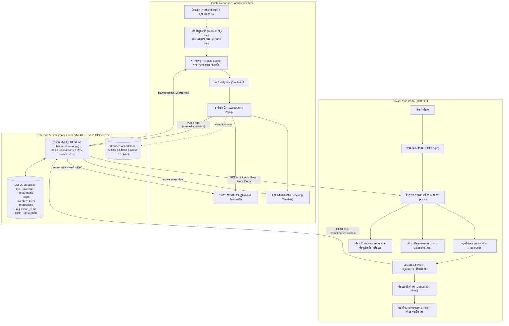

# ระบบเบิกพัสดุและคลังพัสดุดิจิทัล มหาวิทยาลัยสวนดุสิต
### (Suan Dusit University e-Inventory & Requisition System)

[](CHANGELOG.md)
[](https://opensource.org/licenses/MIT)
[](https://www.mysql.com/)
[](https://www.python.org/)
[](https://html.spec.whatwg.org/)
[](https://developer.mozilla.org/en-US/docs/Web/JavaScript)
[](https://www.w3.org/Style/CSS/)
[](https://sweetalert2.github.io/)
[](https://www.dusit.ac.th/)


เว็บแอปพลิเคชันระบบบริหารจัดการคลังพัสดุกลางและขอเบิกพัสดุออนไลน์ มหาวิทยาลัยสวนดุสิต ที่ได้รับการออกแบบใหม่ให้ทันสมัย รองรับการแยกส่วนการใช้งานระหว่าง **"ผู้ขอเบิก (อาจารย์/บุคลากร)"** และ **"เจ้าหน้าที่คลังพัสดุ"** ออกจากกันโดยเด็ดขาด 100% เพื่อความปลอดภัย เชื่อมต่อฐานข้อมูลเชิงสัมพันธ์ **MySQL (`sdu_inventory`)** ผ่าน **Python REST API Server** พร้อมระบบ Offline Fallback, ลงนามรับของดิจิทัล (E-Signature), พิมพ์ใบเบิกทางการ (Official PDF) และป๊อปอัปแจ้งเตือน SweetAlert2 สวยงามระดับมืออาชีพ

---

## สถาปัตยกรรมการแยกระบบ (Architecture & Security Separation)

ระบบแบ่งการเข้าถึงเป็น 2 พอร์ทัลอิสระ เชื่อมต่อกับฐานข้อมูล MySQL ผ่าน REST API พร้อมระบบสำรองข้อมูลแบบ Offline-First:



---

## คุณสมบัติเด่นของระบบ (Key Features)

### 1. หน้าสำหรับผู้ขอเบิก — `index.html` (Requester Portal)
* **ไม่ต้องเข้าสู่ระบบ (Zero-Friction Access):** ผู้เบิกสามารถเปิดลิงก์และใช้งานได้ทันที
* **Searchable Requester User Combobox:** ช่องเลือกชื่อผู้ขอเบิกเริ่มต้นด้วยรายชื่อหัวหน้าหน่วยงานทั้ง 4 ท่านจากไฟล์ `รายนามบุคลากร สวท.docx` (พร้อมรองรับรายชื่อที่เจ้าหน้าที่เพิ่มภายหลัง) เมื่อคลิกเลือกจะเติมกลุ่มงาน/หน่วยงานและเบอร์โทรให้อัตโนมัติทันที
* **Searchable Department Combobox:** ช่องเลือกกลุ่มงาน/หน่วยงานภายในสำนักส่งเสริมวิชาการและงานทะเบียน (สวท.) ทั้ง 5 หน่วยงานหลัก สามารถพิมพ์ค้นหาแบบเรียลไทม์ได้ทันที
* **ค้นหาพัสดุด้วยชื่อ (No SKU Dependency):** ค้นหาด้วยชื่อพัสดุภาษาไทยแบบ Fuzzy Matching สะดวกรวดเร็ว
* **ระบบคำนวณหลายหน่วยนับ (Multi-Unit Conversion):** สามารถเลือกเบิกเป็น "กล่อง" หรือ "ชิ้น/ซอง/แผ่น" ได้ โดยระบบจะคำนวณยอดรวมและตัดสต๊อกให้อัตโนมัติ
* **แสดงสต๊อกคงเหลือจริง (Available Stock):** แสดงยอดสต๊อกที่เบิกได้จริงตามสูตร `Available = On-Hand - Reserved` ป้องกันการเบิกชนกัน
* **ตะกร้าขอเบิกและสร้างเอกสาร:** เพิ่มรายการใส่ตะกร้า ระบุวัตถุประสงค์ และสร้างเลขที่คำขอ `REQ-256910-XXXX`
* **ปุ่ม "รายการคำขอของฉัน" (My Requisitions):**
  * ปุ่มบนเมนูด้านบนพร้อม **ตัวเลขนับจำนวนคำขอ (Count Badge)** แสดงยอดคำขอแบบเรียลไทม์
  * หน้าต่างป๊อปอัปดูรายการคำขอทั้งหมด พร้อมช่องค้นหาเอกสาร/ผู้เบิก/พัสดุ
  * แท็บคัดกรองสถานะ: ทั้งหมด, รออนุมัติ (Pending), อนุมัติแล้ว (Approved), รับมอบสำเร็จ (Completed), ไม่อนุมัติ (Rejected)
  * ปุ่มคัดลอกเลขที่เอกสารในคลิกเดียว พร้อมปุ่มทางลัดเปิดดูไทม์ไลน์สถานะทันที
* **ระบบติดตามสถานะคำขอ (Self-Service Tracking):** ผู้เบิกสามารถนำเลขที่เอกสารหรือชื่อผู้ขอเบิกมาตรวจสอบไทม์ไลน์สถานะคำขอ 3 ขั้นตอนได้ด้วยตัวเองตลอด 24 ชั่วโมง
* **ความปลอดภัยสูง:** ตัดแท็บและสิทธิ์การเข้าถึงของเจ้าหน้าที่พัสดุออกทั้งหมด ผู้เบิกไม่สามารถเข้ามาอนุมัติหรือปรับแก้สต๊อกได้

### 2. หน้าสำหรับเจ้าหน้าที่พัสดุ — `staff.html` (Staff & Admin Portal)
* **ระบบล็อกอินรักษาความปลอดภัย (Staff Authentication):** ป้องกันไม่ให้ผู้เบิกหรือบุคคลภายนอกเข้าถึงข้อมูลคลัง
* **แดชบอร์ดสรุปยอดสต๊อก (Dashboard Metrics):** สรุปยอดคำขอรออนุมัติ, อนุมัติแล้วรอจ่าย, จำนวนรายการคงคลัง และพัสดุใกล้หมด
* **ระบบคิวอนุมัติคำขอ (Approval Workflow):**
  * ตรวจสอบรายละเอียดและวัตถุประสงค์
  * รองรับการอนุมัติเต็มจำนวนหรือปรับลดจำนวนจ่ายจริงรายรายการ (Partial Approval) เพื่อกันยอดสต๊อก (Reserved)
  * รองรับการปฏิเสธคำขอพร้อมระบุเหตุผล และการยกเลิกใบเบิกที่อนุมัติแล้วเพื่อคืนยอดจอง (Cancel Order)
* **แท่นลงนามดิจิทัล (E-Signature Pad):**
  * เมื่อผู้ขอเบิกเดินทางมารับพัสดุที่ห้องคลัง เจ้าหน้าที่กดปุ่ม "ลงนามรับของ"
  * รองรับการเซ็นชื่อผ่านหน้าจอสัมผัส (Touchscreen), ปากกาสไตลัส, หรือเมาส์ พร้อมระบบตรวจสอบลายเซ็นว่างเปล่า
* **ตัดสต๊อกอัตโนมัติ (Automated Inventory Deduction):** เมื่อผู้รับลงนามรับของเรียบร้อย ระบบจะตัดสต๊อกจริง (On-Hand) และคืนยอดกันจอง (Reserved) ภายใต้ MySQL ACID Transaction ทันที
* **พิมพ์ใบเบิกพัสดุทางการ (Official PDF Printable Form):**
  * แบบฟอร์มราชการมาตรฐานตามระเบียบพัสดุ
  * ตราสัญลักษณ์มหาวิทยาลัยสวนดุสิต (Vector Seal)
  * ประทับรูปลายเซ็นดิจิทัลของผู้รับมอบลงในเอกสารโดยอัตโนมัติ
* **ระบบบริหารสต๊อกและรายการพัสดุ (Inventory & Item Management):**
  * ตรวจสอบยอดสต๊อก 3 สถานะ: คงเหลือจริง (On-Hand) | ติดจอง (Reserved) | พร้อมเบิก (Available)
  * **เพิ่ม / แก้ไข / ลบรายการพัสดุใหม่ (`+ เพิ่มรายการพัสดุใหม่`):** รองรับการตั้งค่าหน่วยนับเดี่ยวหรือ 2 หน่วยนับ (กล่อง/ชิ้น), กำหนดอัตราส่วนแปลงหน่วย, ยอดคงคลังเริ่มต้น, เกณฑ์แจ้งเตือนขั้นต่ำ และอัปโหลดรูปภาพพัสดุ (DataURL หรือ Path)
  * ฟังก์ชันรับพัสดุเข้าคลัง (+) แบบหลายหน่วยนับ (กล่อง/ชิ้น) และฟังก์ชันปรับยอดสต๊อกจากการตรวจนับจริง (Stock Adjustment) พร้อมบันทึก Audit Log ในตาราง `stock_transactions`
* **ระบบจัดการบุคลากรและหน่วยงาน (User & Department Management):**
  * แท็บ **"จัดการบุคลากร / หน่วยงาน"** แสดงทำเนียบหัวหน้าหน่วยงานตั้งต้น 4 ท่านและกลุ่มงานภายใน สวท. 5 หน่วยงานจาก `รายนามบุคลากร สวท.docx`
  * เจ้าหน้าที่สามารถกด **`+ เพิ่มรายชื่อบุคลากร (User)`**, แก้ไข, ลบ หรือกด **`+ เพิ่มกลุ่มงาน/หน่วยงาน`** เพิ่มเติมได้ตลอดเวลา พร้อมซิงค์ไปยังหน้าผู้ขอเบิก (`index.html`) ทันที

### 3. มาตรฐานการออกแบบและประสบการณ์ผู้ใช้ (Design & UX)
* **SweetAlert2 Modern Dialogs:** ป๊อปอัปแจ้งเตือนและหน้าต่างยืนยันทั้งหมดใช้ SweetAlert2 ตกแต่งในธีมสีน้ำเงิน มสด. (`#1e40af`) และเขียวมรกต (`#059669`)
* **Offline Asset Support:** ดาวน์โหลดไฟล์ `sweetalert2.all.min.js` เก็บไว้ใน `assets/js/` เพื่อให้ระบบทำงานได้เสถียร 100% แม้ไม่มีอินเทอร์เน็ตภายนอก พร้อมระบบ CDN Fallback อัตโนมัติ
* **100% Vector SVG Icons:** ปราศจาก Emoji โดยเปลี่ยนมาใช้ไอคอนเวกเตอร์เส้น Stroke คุณภาพสูงทั้งหมด
* **Typography:** ใช้ฟอนต์ Google Fonts `Prompt` สำหรับหน้าจอการใช้งานทั่วไป และ `Sarabun` สำหรับแบบฟอร์มเอกสารทางการ
* **Hybrid MySQL + Cross-Tab Synchronization:** ซิงค์ข้อมูลผ่าน MySQL REST API พร้อมระบบตรวจจับการเปลี่ยนแปลงข้ามแท็บเบราว์เซอร์อัตโนมัติ

---

## โครงสร้างไฟล์ในโครงการ (Project Structure)

```text
stock-order-sdu/
│
├── .cursorrules                         # กฎเกณฑ์สำหรับ AI Assisted Coding (Cursor)
├── PROJECT_CONTEXT.md                   # บริบทภาพรวม สถาปัตยกรรม ข้อกำหนด และกฎระเบียบ
├── TASKS.md                             # รายการขั้นตอนงานและแผนการพัฒนา (Roadmap)
├── CHANGELOG.md                         # บันทึกประวัติการเปลี่ยนแปลงของระบบตามมาตรฐาน SemVer
├── README.md                            # คู่มือและเอกสารแนะนำโครงการ
├── LICENSE                              # สัญญาอนุญาต MIT License
├── requirements.txt                     # รายการไลบรารี Python (PyMySQL, pytest, pytest-cov)
├── .env.example                         # เทมเพลตตัวแปรระบบสำหรับการเชื่อมต่อฐานข้อมูล MySQL
├── .gitignore                           # การกำหนดไฟล์ที่ไม่ต้องนำขึ้น Git
│
├── portal.html                          # ศูนย์กลางเชื่อมต่อพอร์ทัลกลาง (Gateway Hub)
├── index.html                           # หน้าเว็บสำหรับผู้ขอเบิก (Public Requester Portal)
├── staff.html                           # หน้าเว็บสำหรับเจ้าหน้าที่พัสดุ (Private Staff Portal)
├── 404.html                             # หน้าแสดงข้อผิดพลาดเมื่อไม่พบหน้าเว็บ (Custom 404)
├── manifest.json                        # การตั้งค่า Progressive Web App (PWA) ติดตั้งบนมือถือ
├── favicon.ico                          # ไอคอน Favicon แบบหลายขนาด
├── start.bat                            # สคริปต์ 1-Click เปิดระบบอัตโนมัติบน Windows
│
├── .github/                             # การกำหนดค่า GitHub และ AI Assistant
│   └── copilot-instructions.md          # ข้อกำหนดสำหรับ GitHub Copilot
│
├── assets/                              # ทรัพยากรของโครงการ (Static Web Assets)
│   ├── logo_sdu.png                     # ตราสัญลักษณ์ทางการ มหาวิทยาลัยสวนดุสิต
│   ├── favicon.svg / favicon-*.png      # ไอคอน Favicon ขนาดต่างๆ และ Apple Touch Icon
│   ├── icon-192.png / icon-512.png      # ไอคอนสำหรับติดตั้งเป็น PWA App
│   ├── js/                              # ไลบรารี JavaScript ออฟไลน์
│   │   └── sweetalert2.all.min.js       # SweetAlert2 Local Asset สำหรับการทำงานออฟไลน์
│   └── images/                          # รูปภาพพัสดุจริงสกัดจากไฟล์สต๊อก ตั้งชื่อตรงตามพัสดุภาษาไทย (66 รูปภาพ จาก 34 รายการ)
│
├── backend/                             # ระบบส่วนหลังบ้าน (MySQL Database & Python REST API)
│   ├── schema.sql                       # โครงสร้างตาราง MySQL 6 ตาราง พร้อมข้อมูลตั้งต้นครบชุด
│   ├── server.py                        # เซิร์ฟเวอร์ Python HTTP + MySQL REST API (Port 8080)
│   ├── init_db.py                       # สคริปต์สร้างฐานข้อมูลและนำเข้าข้อมูลตั้งต้นอัตโนมัติในคลิกเดียว
│   └── README.md                        # คู่มือการติดตั้งและใช้งาน MySQL Backend
│
├── data/                                # ข้อมูลหลักและชุดข้อมูลตั้งต้น (Master & Seed Data)
│   ├── รายนามบุคลากร สวท.docx            # ข้อมูลหลัก 5 กลุ่มงาน/หน่วยงาน และรายชื่อหัวหน้าหน่วยงาน สวท.
│   ├── คณะและหน่วยงาน.txt                # ข้อมูลอ้างอิงรายชื่อคณะ/สำนัก/สถาบัน/โรงเรียน
│   └── ยอดสต๊อก ตค.xlsx                  # ข้อมูลสต๊อกพัสดุดิบตั้งต้นจาก Excel (34 รายการ, 66 รูปภาพ)
│
├── docs/                                # เอกสารข้อมูลเชิงเทคนิค (Technical Specifications)
│   ├── SCHEMA.md                        # รายละเอียดฐานข้อมูล MySQL Entity-Relationship & Data Types
│   ├── API_SPEC.md                      # โครงสร้าง MySQL REST API Endpoints (Request/Response Specs)
│   ├── system_requirements_specification.md # เอกสารวิเคราะห์ความต้องการเชิงระบบ (SRS v1.1)
│   └── internship/                      # โฟลเดอร์จัดเก็บเอกสารรายงานฝึกงาน (ละเว้นใน .gitignore)
│
└── scripts/                             # สคริปต์เครื่องมือสร้างโค้ดและรันเซิร์ฟเวอร์ (Build & Dev Scripts)
    ├── generate_separated_portals.py    # สคริปต์ Python (SSOT) สำหรับคอมไพล์ index.html และ staff.html
    ├── launch.py                        # สคริปต์รันเซิร์ฟเวอร์ระบบ (backend/server.py) พร้อมเปิดเบราว์เซอร์
    └── run.bat                          # ทางลัดรันสคริปต์ start.bat
```

---

## วิธีการติดตั้งและรันโครงการ (Getting Started)

### 1. การตั้งค่าฐานข้อมูล MySQL (แนะนำสำหรับการใช้งานเต็มรูปแบบ)
1. ติดตั้งไลบรารีใน Virtual Environment (`.venv`):
   ```bash
   python -m venv .venv
   .venv\Scripts\activate
   pip install -r requirements.txt
   ```
2. ตั้งค่าการเชื่อมต่อ MySQL ในไฟล์ `.env` (คัดลอกจาก `.env.example` โดยค่าเริ่มต้นใช้ `DB_HOST=127.0.0.1`, `DB_PORT=3306`, `DB_USER=root`, `DB_PASSWORD=`, `DB_NAME=sdu_inventory`)
3. สร้างฐานข้อมูลและนำเข้าข้อมูลตั้งต้น (5 กลุ่มงาน สวท. + 4 หัวหน้าหน่วยงาน + 34 รายการพัสดุ):
   ```bash
   python backend/init_db.py
   ```
4. รันเซิร์ฟเวอร์ระบบ (ให้บริการทั้งหน้าเว็บและ MySQL REST API `/api` ที่พอร์ต `8080`):
   ```bash
   python backend/server.py
   ```
   *(หรือดับเบิลคลิกไฟล์ `start.bat`)*

5. เปิด Web Browser เพื่อใช้งาน:
   * **หน้าศูนย์กลางพอร์ทัล:** [http://localhost:8080/portal.html](http://localhost:8080/portal.html)
   * **หน้าสำหรับผู้ขอเบิก:** [http://localhost:8080/index.html](http://localhost:8080/index.html)
   * **หน้าสำหรับเจ้าหน้าที่พัสดุ:** [http://localhost:8080/staff.html](http://localhost:8080/staff.html)
   * **ตรวจสอบสถานะ MySQL API:** [http://localhost:8080/api?action=health](http://localhost:8080/api?action=health)

---

## ฐานข้อมูลและการจัดเก็บข้อมูล (Data Persistence)

* **ฐานข้อมูลหลัก (MySQL Relational Database — `sdu_inventory`):**
  * จัดเก็บข้อมูลลงใน 6 ตารางหลัก (`departments`, `users`, `inventory_items`, `requisitions`, `requisition_items`, `stock_transactions`) บนเอนจิน **InnoDB (`utf8mb4_unicode_ci`)**
  * ป้องกันปัญหาการเบิกชนกัน (Race Condition) ด้วย **ACID Database Transactions** และการล็อกแถวข้อมูลระดับฐานข้อมูล (`SELECT ... FOR UPDATE`)
* **ระบบสำรองข้อมูลออฟไลน์ (Hybrid Offline Fallback):**
  * กรณีเปิดหน้าเว็บแบบออฟไลน์หรือยังไม่ได้เปิดบริการ MySQL ระบบจะสลับมาอ่านและบันทึกข้อมูลลงใน Browser **`localStorage`** (`inventory_items`, `inventory_requisitions`, `inventory_users_sdu`, `inventory_depts_sdu`) พร้อมซิงค์ข้ามแท็บอัตโนมัติ (`storage` event) โดยไม่เกิดหน้าเว็บค้างหรือ Error

---

## แผนการพัฒนาและเอกสารสำคัญ (Roadmap & Documentation)

* 🤖 **[AI Development Rules (.cursorrules)](.cursorrules)** / **[.github/copilot-instructions.md](.github/copilot-instructions.md)**
* 🌐 **[ภาพรวมบริบทโครงการ (PROJECT_CONTEXT.md)](PROJECT_CONTEXT.md)**
* 📝 **[บันทึกประวัติการเปลี่ยนแปลง (CHANGELOG.md)](CHANGELOG.md)**
* 📋 **[รายการขั้นตอนงานและแผนพัฒนา (TASKS.md)](TASKS.md)**
* 🗄️ **[รายละเอียดโครงสร้างฐานข้อมูล MySQL (docs/SCHEMA.md)](docs/SCHEMA.md)**
* 🔌 **[โครงสร้าง MySQL REST API Endpoints (docs/API_SPEC.md)](docs/API_SPEC.md)**
* 🐬 **[คู่มือติดตั้งและใช้งาน MySQL Backend (backend/README.md)](backend/README.md)**
* ⚙️ **[เทมเพลตตัวแปรระบบ (.env.example)](.env.example)**
* 📄 **[System Requirements Specification (SRS v1.1)](docs/system_requirements_specification.md)**

---

## ผู้จัดทำ (Author)

* **มหาวิทยาลัยสวนดุสิต (Suan Dusit University)**
* GitHub Repository: [itsmekritsanai/stock-order-sdu](https://github.com/itsmekritsanai/stock-order-sdu)
