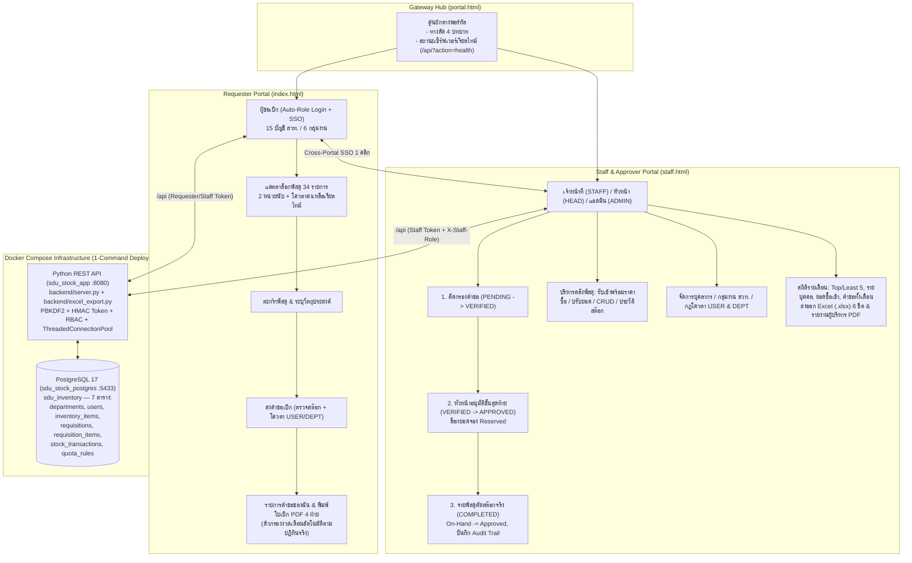

# ระบบเบิกพัสดุและคลังพัสดุดิจิทัล มหาวิทยาลัยสวนดุสิต
### (Suan Dusit University e-Inventory & Requisition System)

[](CHANGELOG.md)
[](https://opensource.org/licenses/MIT)
[](https://www.postgresql.org/)
[](https://www.docker.com/)
[](https://www.python.org/)
[](https://html.spec.whatwg.org/)
[](https://developer.mozilla.org/en-US/docs/Web/JavaScript)
[](https://www.w3.org/Style/CSS/)
[](https://sweetalert2.github.io/)
[](https://www.dusit.ac.th/)

เว็บแอปพลิเคชันระบบบริหารจัดการคลังพัสดุกลางและขอเบิกพัสดุออนไลน์ สำนักส่งเสริมวิชาการและงานทะเบียน (สวท.) มหาวิทยาลัยสวนดุสิต ออกแบบด้วยสถาปัตยกรรม **Zero-Build Vanilla Web** แยกพอร์ทัลระหว่าง **"ผู้ขอเบิก (`index.html`)"** และ **"เจ้าหน้าที่ / หัวหน้า / ผู้ดูแลระบบ (`staff.html`)"** อย่างชัดเจน ควบคุมสิทธิ์แบบ **RBAC 4 บทบาท** พร้อม **Cross-Portal SSO 1 คลิก**, ระบบอนุมัติ **2 ขั้นตอน (Two-Tier Approval)**, โควตาหลายระดับรายบุคคล/กลุ่มงาน, บันทึกราคาจัดซื้อเข้าคลัง, ส่งออกรายงาน **Native Excel (`.xlsx`) 6 ชีต**, พิมพ์ใบเบิกทางการ **A4 PDF 4 ฝ่าย**, และ Deploy ครบชุดในคำสั่งเดียวด้วย **Docker Compose (PostgreSQL 17 + Python REST API)**

---

## สถาปัตยกรรมระบบ (System Architecture)



---

## คุณสมบัติเด่นของระบบ (Key Features)

### 1. ระบบยืนยันตัวตนและสิทธิ์ 4 บทบาท (Auto-Role Login, RBAC & Cross-Portal SSO)
* **Auto-Role Login:** กรอกเฉพาะ **ชื่อผู้ใช้งาน (Case-insensitive)** และ **รหัสผ่านเฉพาะบุคคล (PBKDF2-HMAC-SHA256)** ระบบตรวจสอบบทบาทจริง (`REQUESTER`, `STAFF`, `HEAD`, `ADMIN`) และนำเข้าสู่สิทธิ์ที่ตรงกับบัญชีโดยอัตโนมัติ
* **Cross-Portal SSO (1-Click Switch):** ผู้ที่มีสิทธิ์ `HEAD`, `STAFF`, หรือ `ADMIN` สามารถสลับระหว่างหน้าขอเบิกพัสดุ (`index.html`) และหน้าอนุมัติ/จัดการคลัง (`staff.html`) ได้ทันทีในคลิกเดียวโดยไม่ต้องล็อกอินซ้ำ
* **ข้อมูลตั้งต้น สวท. (`Book1.xlsx`):** ครอบคลุม **6 กลุ่มงาน สวท.** และ **15 บัญชีบุคลากร** (`jittraporn_cha` สิทธิ์ `HEAD`, `chuthathip_pan` สิทธิ์ `STAFF`, และ 13 บัญชี สิทธิ์ `REQUESTER`) พร้อมบัญชี `admin_staff` สำหรับผู้ดูแลระบบสูงสุด

### 2. หน้าสำหรับผู้ขอเบิก — `index.html` (Requester Portal)
* **แคตตาล็อกพัสดุ 34 รายการ (66 ภาพจริง):** ค้นหาชื่อพัสดุภาษาไทยแบบเรียลไทม์ กรองหมวดหมู่ และสลับดูภาพหน่วยย่อย/หน่วยกล่องได้
* **ระบบคำนวณ 2 หน่วยนับ (Multi-Unit Conversion):** คำนวณรวมเป็นหน่วยย่อยอัตโนมัติตามสูตร `(กล่อง × อัตราส่วน) + ชิ้น` พร้อมล็อก Snapshot อัตราส่วนในใบเบิก
* **ยอดพร้อมเบิกและโควตาคงเหลือเรียลไทม์:** แสดง `Available = On-Hand - Reserved` และโควตาคงเหลือประจำเดือน (ทั้งระดับรายบุคคลและระดับกลุ่มงาน) บนการ์ดพัสดุ
* **รายการคำขอของฉันและใบเบิกทางการ PDF:** คัดกรองตามสถานะ 5 ระดับและ**งวดเดือนอัตโนมัติตามปฏิทินจริง** พร้อมพิมพ์แบบฟอร์มใบขอเบิก A4 แสดงช่องลงนามครบ **4 ฝ่าย**

### 3. หน้าสำหรับเจ้าหน้าที่ หัวหน้า และผู้ดูแลระบบ — `staff.html` (Staff & Admin Portal)
* **กระบวนการอนุมัติ 2 ขั้นตอน (Two-Tier Workflow):**
  1. `STAFF` คัดกรองและเสนอจำนวน (`PENDING` -> `VERIFIED`)
  2. `HEAD` พิจารณาอนุมัติขั้นสุดท้าย (`VERIFIED` -> `APPROVED`, ล็อกยอด `Reserved` ภายใต้ `SELECT ... FOR UPDATE`)
  3. `STAFF` จ่ายพัสดุและตัดยอดจริง (`APPROVED` -> `COMPLETED`, ตัด `On-Hand` และบันทึก `OUT` ลง `stock_transactions`)
* **บริหารคลังพัสดุและต้นทุนจัดซื้อ:**
  * แจ้งเตือนพัสดุต่ำกว่าเกณฑ์สั่งซื้อใหม่ (`min_alert`)
  * **รับพัสดุเข้าคลังพร้อมราคา (3 โหมด):** กรอกยอดเงินรวม, ราคาต่อหน่วยใหญ่, หรือราคาต่อหน่วยย่อย คำนวณราคาเฉลี่ยต่อชิ้นและยอดรวมอัตโนมัติ
  * ปรับยอดตรวจนับสต๊อก (`ADJUST`), เพิ่ม/แก้ไข/ลบพัสดุ (บันทึก `INITIAL_STOCK` อัตโนมัติเมื่อสต๊อกตั้งต้น > 0), และหน้าต่างประวัติความเคลื่อนไหวสต๊อกรายพัสดุ
* **จัดการบุคลากร กลุ่มงาน และโควตารายเดือน (`quota_rules`):**
  * ตั้งโควตาได้ทั้งระดับ **รายบุคลากร (`USER`)** และ **รายกลุ่มงาน (`DEPT`)** ทั้งแบบเจาะจงรายพัสดุและทุกพัสดุในคลัง
* **แดชบอร์ดสถิติรายเดือน & ส่งออกรายงาน:**
  * แสดงตัวชี้วัดภาพรวม, **ยอดเงินซื้อพัสดุเข้าคลังรายเดือน**, Top 5 / Slow-Moving 5, **สรุปยอดเบิกจำแนกรายบุคคล**, และ **ตารางรายการคำขอเบิกทั้งหมดในเดือน** (กดดูรายละเอียดและเปิด PDF ได้ทันที)
  * **ส่งออก Native Excel (`.xlsx`) 6 ชีต** (`ภาพรวมประจำเดือน`, `สรุปรายบุคคล`, `สรุปทุกพัสดุ`, `รายละเอียดคำขอเบิก`, `สรุปยอดซื้อเข้า`, `ประวัติซื้อเข้า`) โดยไม่ต้องพึ่งไลบรารีภายนอก พร้อม **รายงานสรุปผู้บริหาร PDF**

### 4. มาตรฐานการออกแบบและความปลอดภัย
* **Zero-Build Vanilla Architecture:** Pure HTML5, CSS3, ES6+ สร้าง `index.html` และ `staff.html` จาก Single Source of Truth ([scripts/generate_separated_portals.py](scripts/generate_separated_portals.py))
* **100% Vector SVG Icons & SweetAlert2:** ปราศจาก Emoji และ Native Dialog (`alert`/`confirm`/`prompt`) ทุกจุด
* **Universal Searchable Dropdowns:** `<select>` ทุกตัวทั้งหน้าหลักและ Modal สามารถพิมพ์ค้นหาและเลือกด้วยคีย์บอร์ดได้
* **Security Hardening:** บังคับ Token ทุก Endpoint ภายใน (`AUTH_BYPASS="false"`), PBKDF2-HMAC-SHA256, XSS Protection (`escapeHtml`), Security Headers (`nosniff`, `DENY`, `same-origin`), Path Traversal Guard, และ non-root Docker Container

---

## โครงสร้างไฟล์ในโครงการ (Project Structure)

```text
stock-order-sdu/
├── AGENTS.md                            # กฎหลักของโครงการสำหรับ AI & Developers
├── CHANGELOG.md                         # ประวัติการเปลี่ยนแปลงตามมาตรฐาน SemVer (v3.8.3)
├── INSTALLATION.md                      # คู่มือการติดตั้งและ Deploy บนเซิร์ฟเวอร์จริง
├── PROJECT_CONTEXT.md                   # บริบท สถาปัตยกรรม และกฎเกณฑ์ทางธุรกิจ
├── README.md                            # เอกสารแนะนำโครงการ (ไฟล์นี้)
├── TASKS.md                             # แผนงานและความคืบหน้าการพัฒนา (Phase 1–9)
├── LICENSE                              # สัญญาอนุญาต MIT License
├── Dockerfile                           # Docker Image (python:3.11-slim, non-root appuser, Healthcheck)
├── docker-compose.yml                   # รัน PostgreSQL 17 (sdu_stock_postgres) + Web/API (sdu_stock_app)
├── .env.example                         # เทมเพลตตัวแปรสภาพแวดล้อมและความปลอดภัย
├── requirements.txt                     # แพ็กเกจ Python (psycopg2-binary, PyMySQL, pytest, pytest-cov)
├── start.bat                            # สคริปต์ 1-Click เปิดระบบบน Windows
│
├── portal.html                          # หน้าศูนย์กลางพอร์ทัล (Gateway Hub)
├── index.html                           # หน้าผู้ขอเบิกพัสดุ (Generated จาก SSOT)
├── staff.html                           # หน้าเจ้าหน้าที่ / หัวหน้า / ผู้ดูแลระบบ (Generated จาก SSOT)
├── 404.html / manifest.json / favicon.ico
│
├── assets/                              # ตราสัญลักษณ์ มสด., SweetAlert2 (Offline), และภาพพัสดุ 66 ภาพ
├── backend/                             # Python REST API (server.py), Excel Builder (excel_export.py), SQL Schema (7 ตาราง)
├── docs/                                # คู่มือผู้ใช้และเอกสารเทคนิคครบ 6 ฉบับ (API, Schema, Data Dict, Code, User Guide, SRS)
├── scripts/                             # SSOT Generator, Launcher, Excel Seeder, Password Migration, Security Check
├── tests/                               # ชุดทดสอบอัตโนมัติ pytest 91 รายการ (test_stock_logic.py)
├── .agents/skills/stock-order-rules/    # สกิลตรวจสอบกฎโครงการ (verify_rules.py)
└── .github/workflows/ci.yml             # GitHub Actions CI (verify_rules.py + pytest + PostgreSQL 17)
```

---

## วิธีการติดตั้งและรันโครงการ (Getting Started)

### 1. รันครบทั้งระบบด้วย Docker Compose (แนะนำที่สุด)
```bash
cp .env.example .env
# แก้ไขรหัสผ่านและคีย์ลับใน .env (ตรวจสอบว่า AUTH_BYPASS="false")
docker compose up -d --build
```
> ระบบจะเปิด **PostgreSQL 17** (`127.0.0.1:5433`, เก็บข้อมูลใน `./postgres-data`) พร้อมอิมพอร์ต [backend/schema_postgres.sql](backend/schema_postgres.sql) และเปิด **Web & REST API Server** บนพอร์ต `8080` อัตโนมัติ

### 2. รัน Python Server บนเครื่อง Host โดยตรง (สำหรับพัฒนา)
```powershell
python -m venv .venv
.venv\Scripts\activate
pip install -r requirements.txt
docker compose up -d postgres
python backend/server.py
```
*(หรือดับเบิลคลิก `start.bat` บน Windows)*

### 3. เข้าใช้งานผ่าน Web Browser
* **หน้าศูนย์กลางพอร์ทัล:** http://localhost:8080/portal.html
* **หน้าสำหรับผู้ขอเบิก:** http://localhost:8080/index.html
* **หน้าสำหรับเจ้าหน้าที่/หัวหน้า/ผู้ดูแล:** http://localhost:8080/staff.html
* **ตรวจสอบสถานะ API:** http://localhost:8080/api?action=health

### 4. รันการตรวจสอบกฎและชุดทดสอบอัตโนมัติ (91 Tests)
```powershell
.venv\Scripts\python .agents/skills/stock-order-rules/scripts/verify_rules.py
.venv\Scripts\python -m pytest tests/test_stock_logic.py -v
```

---

## เอกสารอ้างอิงทั้งหมด (Documentation)

* **[คู่มือการใช้งานระบบสำหรับทุกบทบาท (docs/USER_GUIDE.md)](docs/USER_GUIDE.md)**
* **[คู่มือการติดตั้งและ Deploy บนเซิร์ฟเวอร์ (INSTALLATION.md)](INSTALLATION.md)**
* **[ข้อกำหนดความต้องการระบบ SRS v3.8.3 (docs/system_requirements_specification.md)](docs/system_requirements_specification.md)**
* **[คู่มืออธิบายโค้ดและสถาปัตยกรรม (docs/CODE_EXPLANATION.md)](docs/CODE_EXPLANATION.md)**
* **[ข้อกำหนด REST API Endpoints (docs/API_SPEC.md)](docs/API_SPEC.md)**
* **[โครงสร้างฐานข้อมูล PostgreSQL 17 — 7 ตาราง (docs/SCHEMA.md)](docs/SCHEMA.md)**
* **[พจนานุกรมข้อมูล Data Dictionary (docs/DATA_DICTIONARY.md)](docs/DATA_DICTIONARY.md)**
* **[คู่มือระบบ Backend (backend/README.md)](backend/README.md)**
* **[ภาพรวมบริบทโครงการ (PROJECT_CONTEXT.md)](PROJECT_CONTEXT.md)**
* **[แผนงานและความคืบหน้า (TASKS.md)](TASKS.md)**
* **[บันทึกการเปลี่ยนแปลง (CHANGELOG.md)](CHANGELOG.md)**

---

## ผู้จัดทำ (Author)

* **มหาวิทยาลัยสวนดุสิต (Suan Dusit University)** — สำนักส่งเสริมวิชาการและงานทะเบียน (สวท.)
* GitHub Repository: [itsmekritsanai/stock-order-sdu](https://github.com/itsmekritsanai/stock-order-sdu)
