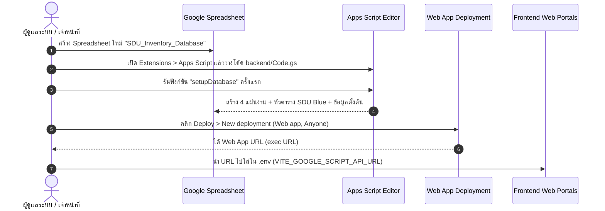

# Google Apps Script Backend (backend/Code.gs)
### ระบบขอเบิกพัสดุและคลังพัสดุดิจิทัล มหาวิทยาลัยสวนดุสิต (Stock Order SDU)

---

## 📖 ภาพรวมระบบ (Overview)

ไฟล์ [`backend/Code.gs`](file:///c:/Users/Sho/Downloads/project%20stock/backend/Code.gs) เป็นโค้ดต้นแบบ **Google Apps Script (GAS) Web App** สำหรับทำหน้าที่เป็น RESTful JSON API และ Database Controller เชื่อมต่อระหว่างหน้าเว็บฝั่งผู้ขอเบิก (`index.html`) และหน้าเว็บฝั่งเจ้าหน้าที่คลัง (`staff.html`) เข้ากับฐานข้อมูล **Google Sheets**

---

## ⚡ ขั้นตอนการนำไปติดตั้งใช้งานจริงใน 1 นาที (1-Minute Quickstart)



### รายละเอียดขั้นตอน:
1. **สร้าง Google Spreadsheet:**
   * เปิด [Google Sheets](https://sheets.new) และตั้งชื่อไฟล์ เช่น `SDU_Inventory_Database`
2. **เปิด Script Editor:**
   * ไปที่เมนู **ส่วนขยาย (Extensions)** > **Apps Script**
3. **วางโค้ด:**
   * ลบโค้ดเดิมใน `Code.gs` ทั้งหมด แล้วคัดลอกโค้ดจาก [`backend/Code.gs`](file:///c:/Users/Sho/Downloads/project%20stock/backend/Code.gs) ไปวาง
   * กดบันทึก (Ctrl + S)
4. **สร้างโครงสร้างฐานข้อมูลอัตโนมัติ (1-Click Database Setup):**
   * ที่แถบเมนูด้านบน เลือกฟังก์ชัน **`setupDatabase`** แล้วกดปุ่ม **เรียกใช้ (Run)**
   * ยอมรับการให้สิทธิ์เข้าถึง (Grant Permissions)
   * ระบบจะสร้าง 4 แผ่นงานพร้อมตกแต่งสไตล์ SDU Blue `#1e40af` และใส่ข้อมูลตั้งต้น:
     * `Items` (พัสดุคงคลัง 58 รายการ)
     * `Requisitions` (ประวัติและคิวคำขอ)
     * `Requisition_Items` (รายการพัสดุในแต่ละคำขอ)
     * `Departments` (รายชื่อ 90+ หน่วยงาน)
5. **Deploy เป็น Web App:**
   * คลิกปุ่มสีน้ำเงิน **ทำให้ใช้งานได้ (Deploy)** > **การทำให้ใช้งานได้รายการใหม่ (New deployment)**
   * คลิกรูปฟันเฟืองเลือกประเภท: **เว็บแอป (Web app)**
   * คำอธิบาย: `SDU Stock Order API v1.0`
   * การเข้าถึง (Execute as): **ฉัน (Me)**
   * ผู้มีสิทธิ์เข้าถึง (Who has access): **ทุกคน (Anyone)**
   * กด **ทำให้ใช้งานได้ (Deploy)**
6. **บันทึก URL:**
   * คัดลอก **URL เว็บแอป (Web App URL)** ที่ลงท้ายด้วย `/exec`
   * นำไปใส่ในไฟล์ `.env` ของโครงการ:
     ```env
     VITE_GOOGLE_SCRIPT_API_URL="https://script.google.com/macros/s/AKfycbxYOUR_DEPLOYMENT_ID_HERE/exec"
     ```

---

## 🛠️ รายการ Endpoints ที่รองรับ (API Endpoints Reference)

| Method | Action Parameter / Body | รายละเอียด | สิทธิ์เข้าถึง |
| :---: | :--- | :--- | :---: |
| `GET` | `?action=getItems [&category=...]` | ดึงรายการพัสดุและยอดพร้อมเบิกจริง (`Available = On-Hand - Reserved`) | สาธารณะ |
| `GET` | `?action=getRequisitions [&status=...]` | ดึงประวัติและคิวคำขอเบิกทั้งหมด พร้อมรายการพัสดุเชื่อมโยง | ทั่วไป/เจ้าหน้าที่ |
| `GET` | `?action=trackRequisition&docNo=REQ-...` | ค้นหาและติดตามสถานะคำขอรายเอกสาร | สาธารณะ |
| `GET` | `?action=getDepartments` | ดึงข้อมูล 90+ คณะ/โรงเรียน/กอง | สาธารณะ |
| `POST` | `action: "createRequisition"` | ส่งคำขอเบิกพัสดุใหม่ (ตรวจสอบสต๊อกพร้อมเบิกก่อนบันทึก) | สาธารณะ |
| `POST` | `action: "approveRequisition"` | เจ้าหน้าที่อนุมัติคำขอ และล็อกยอดพัสดุติดจอง (`reserved_pieces`) | เจ้าหน้าที่ |
| `POST` | `action: "completeRequisition"` | บันทึกรับของสำเร็จ บันทึกลายเซ็นดิจิทัล และตัดยอดคงคลังจริง | เจ้าหน้าที่ |
| `POST` | `action: "rejectRequisition"` | ปฏิเสธคำขอ คืนยอดติดจอง และบันทึกเหตุผล | เจ้าหน้าที่ |
| `POST` | `action: "restockItem"` | บันทึกรับพัสดุเข้าคลังเพิ่มยอดคงคลัง | เจ้าหน้าที่ |

---

## 🔒 ระบบรักษาความปลอดภัยและการจัดการ Concurrency

* **LockService Prevention:** 
  โค้ดใน `doPost(e)` มีการเรียกใช้ `LockService.getScriptLock()` พร้อมตั้งเวลารอคิวสูงสุด 30 วินาที (`lock.tryLock(30000)`) เพื่อป้องกันปัญหา Race Condition กรณีมีอาจารย์หรือเจ้าหน้าที่กดยืนยันเบิกพัสดุพร้อมกันในเสี้ยววินาที
* **Atomic Deductions:** 
  การตัดยอดสต๊อกและการคืนยอดพัสดุจะเกิดขึ้นใน Scope ภายใต้ Lock เสมอ มั่นใจได้ว่ายอดคงคลังจะไม่มีการติดลบอย่างแน่นอน
