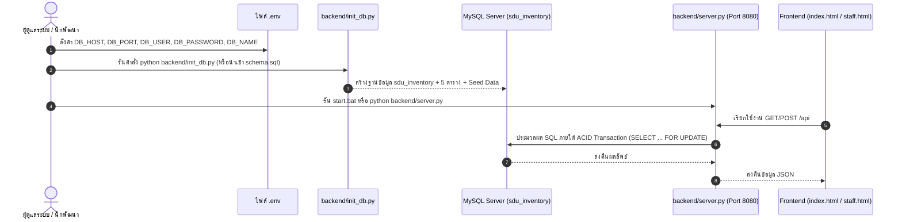

# MySQL Database & REST API Backend (`backend/`)
### ระบบขอเบิกพัสดุและคลังพัสดุดิจิทัล มหาวิทยาลัยสวนดุสิต (Stock Order SDU v2.2.0)

---

## 📖 ภาพรวมระบบส่วนหลังบ้าน (Backend Overview)

ระบบส่วนหลังบ้านของ **Stock Order SDU (v2.2.0)** ใช้ฐานข้อมูลเชิงสัมพันธ์ **MySQL 8.0+ / MariaDB 10.5+ (`InnoDB`, `utf8mb4_unicode_ci`)** ร่วมกับ **Python REST API Server ([`backend/server.py`](file:///c:/Users/Sho/Downloads/project%20stock/backend/server.py))** เพื่อความเสถียร ความปลอดภัย และรองรับการทำธุรกรรมแบบ **ACID Transactions** พร้อมการล็อกแถวข้อมูลระดับฐานข้อมูล (**`SELECT ... FOR UPDATE`**) ป้องกันปัญหาการเบิกพัสดุชนกัน (Race Condition) ได้ 100%

### ไฟล์สำคัญในโฟลเดอร์ `backend/`:
1. **[`backend/schema.sql`](file:///c:/Users/Sho/Downloads/project%20stock/backend/schema.sql):** สคริปต์ SQL สำหรับสร้างฐานข้อมูล `sdu_inventory` พร้อมตารางทั้ง 6 ตาราง (`departments`, `users`, `inventory_items`, `requisitions`, `requisition_items`, `stock_transactions`) และข้อมูลตั้งต้นครบชุด (5 กลุ่มงาน สวท., 4 หัวหน้าหน่วยงาน, 34 รายการพัสดุ 66 รูปภาพภาษาไทย, และตัวอย่างใบคำขอเบิก)
2. **[`backend/init_db.py`](file:///c:/Users/Sho/Downloads/project%20stock/backend/init_db.py):** สคริปต์ Python สำหรับสั่งสร้างฐานข้อมูลและนำเข้า `schema.sql` อัตโนมัติในคำสั่งเดียว
3. **[`backend/server.py`](file:///c:/Users/Sho/Downloads/project%20stock/backend/server.py):** เซิร์ฟเวอร์รวม (Unified Web & MySQL REST API Server) ที่ให้บริการทั้งหน้าเว็บ (`index.html`, `staff.html`, `portal.html`) และ REST API ที่ `/api` บนพอร์ต `8080`

---

## ⚡ ขั้นตอนการติดตั้งและเชื่อมต่อ MySQL (Quickstart Guide)



### 1. ตั้งค่าการเชื่อมต่อในไฟล์ [`.env`](file:///c:/Users/Sho/Downloads/project%20stock/.env)
ตรวจสอบหรือแก้ไขค่าตัวแปรการเชื่อมต่อ MySQL ในไฟล์ `.env` ที่ Root ของโปรเจกต์:
```env
DB_HOST="127.0.0.1"
DB_PORT=3306
DB_USER="root"
DB_PASSWORD=""
DB_NAME="sdu_inventory"
PORT=8080
API_BASE_URL="/api"
```

### 2. สร้างฐานข้อมูลและตารางเริ่มต้น (เลือกวิธีใดวิธีหนึ่ง)
* **วิธีที่ 1: รันผ่านสคริปต์ Python อัตโนมัติ**
  ```bash
  python backend/init_db.py
  ```
* **วิธีที่ 2: นำเข้าไฟล์ [`backend/schema.sql`](file:///c:/Users/Sho/Downloads/project%20stock/backend/schema.sql) ผ่าน MySQL CLI / phpMyAdmin / MySQL Workbench / DBeaver**
  ```bash
  mysql -u root -p < backend/schema.sql
  ```

### 3. เปิดใช้งานเซิร์ฟเวอร์
ดับเบิลคลิกไฟล์ [`start.bat`](file:///c:/Users/Sho/Downloads/project%20stock/start.bat) หรือรันคำสั่ง:
```bash
python backend/server.py
```
จากนั้นเปิดเบราว์เซอร์ไปที่ `http://localhost:8080/portal.html`

---

## 🛠️ รายการ Endpoints ที่รองรับ (MySQL REST API Reference)

| Method | Endpoint / Action | รายละเอียดการทำงาน | การควบคุม Transaction |
| :---: | :--- | :--- | :---: |
| `GET` | `/api?action=getItems [&category=...]` | ดึงรายการพัสดุคงคลังทั้งหมดพร้อมคำนวณ `Available = On-Hand - Reserved` | Read |
| `GET` | `/api?action=getRequisitions [&status=...]` | ดึงประวัติและคิวคำขอเบิกทั้งหมด เชื่อมโยงกับตาราง `requisition_items` | Read |
| `GET` | `/api?action=trackRequisition&docNo=...` | ค้นหาและติดตามสถานะคำขอตามเลขที่เอกสารหรือชื่อผู้ขอเบิก | Read |
| `GET` | `/api?action=getDepartments` | ดึงรายชื่อ 5 กลุ่มงาน/หน่วยงานภายใน สวท. จากตาราง `departments` | Read |
| `GET` | `/api?action=getUsers` | ดึงรายชื่อบุคลากรผู้มีสิทธิ์ขอเบิกจากตาราง `users` | Read |
| `POST` | `action: "createRequisition"` | สร้างใบคำขอเบิกใหม่ ตรวจสอบยอดพร้อมเบิกก่อนบันทึก | `SELECT ... FOR UPDATE` + ACID Commit |
| `POST` | `action: "approveRequisition"` | อนุมัติคำขอ (เต็มจำนวนหรือบางส่วน) และล็อกยอด `reserved_pieces` | `SELECT ... FOR UPDATE` + ACID Commit |
| `POST` | `action: "completeRequisition"` | บันทึกลายเซ็นดิจิทัล ตัดยอด `on_hand_pieces` คืนยอดจอง และบันทึก `stock_transactions` | `SELECT ... FOR UPDATE` + ACID Commit |
| `POST` | `action: "rejectRequisition"` | ปฏิเสธ/ยกเลิกคำขอ คืนยอด `reserved_pieces` (หากเคยอนุมัติ) และบันทึกเหตุผล | `SELECT ... FOR UPDATE` + ACID Commit |
| `POST` | `action: "restockItem"` | รับพัสดุเข้าคลัง เพิ่ม `on_hand_pieces` และบันทึกประวัติ `IN` ลง `stock_transactions` | `SELECT ... FOR UPDATE` + ACID Commit |
| `POST` | `action: "adjustStock"` | ปรับปรุงยอดคงคลังจริงจากการตรวจนับ และบันทึกประวัติ `ADJUST` ลง `stock_transactions` | `SELECT ... FOR UPDATE` + ACID Commit |
| `POST` | `action: "saveItem"` / `"deleteItem"` | เพิ่ม/แก้ไข หรือลบรายการพัสดุในคลัง พร้อมบันทึก `stock_transactions` | ACID Commit |
| `POST` | `action: "saveUser"` / `"deleteUser"` | เพิ่ม/แก้ไข หรือลบรายชื่อบุคลากรในตาราง `users` | ACID Commit |
| `POST` | `action: "addDepartment"` | เพิ่มกลุ่มงาน/หน่วยงานใหม่เข้าสู่ตาราง `departments` | ACID Commit |

---

## 🔒 ระบบป้องกันการเบิกชนกัน (Concurrency & ACID Transaction Control)

* **Row-Level Locking (`SELECT ... FOR UPDATE`):** ทุกครั้งที่มีการสร้างคำขอ อนุมัติ ตัดจ่าย หรือปรับสต๊อก เซิร์ฟเวอร์ [`backend/server.py`](file:///c:/Users/Sho/Downloads/project%20stock/backend/server.py) จะล็อกแถวข้อมูลพัสดุใน InnoDB จนกว่าจะ `COMMIT` สำเร็จ ป้องกันปัญหาสต๊อกติดลบเมื่อมีผู้ใช้งานกดเบิกพร้อมกัน
* **Hybrid Offline-First Fallback:** หากเซิร์ฟเวอร์ MySQL ยังไม่ได้เปิดใช้งาน หน้าเว็บ [`index.html`](file:///c:/Users/Sho/Downloads/project%20stock/index.html) และ [`staff.html`](file:///c:/Users/Sho/Downloads/project%20stock/staff.html) จะสลับไปใช้ฐานข้อมูลจำลองใน `localStorage` โดยอัตโนมัติเพื่อให้ระบบยังคงทำงานได้อย่างต่อเนื่อง 100%
