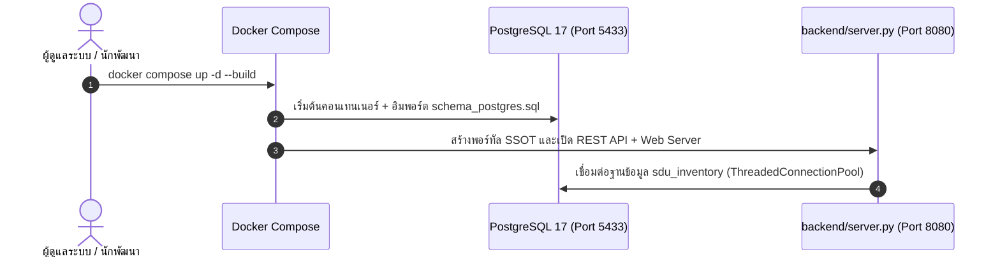

# Database & REST API Backend (`backend/`)
### ระบบจัดการวัสดุสำนักงานออนไลน์ มหาวิทยาลัยสวนดุสิต (v3.8.4)

---

## ภาพรวมระบบส่วนหลังบ้าน (Backend Overview)

ระบบส่วนหลังบ้านของ **ระบบจัดการวัสดุสำนักงานออนไลน์** ใช้ฐานข้อมูลเชิงสัมพันธ์ **PostgreSQL 17 (รันผ่าน Docker Compose)** และรองรับ MySQL/MariaDB เป็นทางเลือก โดยเชื่อมต่อกับ **Python REST API Server ([`backend/server.py`](server.py))** ผ่าน `ThreadedConnectionPool` รองรับ **ACID Transactions** พร้อมการล็อกแถวข้อมูลระดับฐานข้อมูล (**`SELECT ... FOR UPDATE`**) เพื่อป้องกันปัญหาการเบิกพัสดุชนกัน (Concurrency / Race Condition)

### ไฟล์สำคัญในโฟลเดอร์ `backend/` และรากโปรเจกต์:
1. **[`docker-compose.yml`](../docker-compose.yml):** ไฟล์ Compose สำหรับรันคอนเทนเนอร์ PostgreSQL 17 (`postgres:17-alpine`) และ Web/API Server (`app`)
2. **[`backend/schema_postgres.sql`](schema_postgres.sql):** สคริปต์ SQL สำหรับสร้างฐานข้อมูล `sdu_inventory` บน PostgreSQL 17 ครบทั้ง **7 ตาราง** (`departments`, `users`, `inventory_items`, `requisitions`, `requisition_items`, `stock_transactions`, `quota_rules`), ทริกเกอร์ `updated_at` อัตโนมัติ, ข้อมูลตั้งต้น 6 กลุ่มงาน สวท., 15 บัญชีบุคลากร, และ 34 รายการพัสดุ
3. **[`backend/init_db.py`](init_db.py):** สคริปต์ Python สำหรับตรวจสอบและสร้างฐานข้อมูลพร้อมนำเข้า Schema และเข้ารหัสรหัสผ่าน PBKDF2-HMAC-SHA256 อัตโนมัติ
4. **[`backend/excel_export.py`](excel_export.py):** โมดูล Zero-Dependency สำหรับสร้างรายงาน Excel แท้ (`.xlsx`) 6 ชีต
5. **[`backend/server.py`](server.py):** เซิร์ฟเวอร์รวมที่ให้บริการทั้งหน้าเว็บ (`portal.html`, `index.html`, `staff.html`) และ REST API ที่ `/api` บนพอร์ต `8080`

---

## ขั้นตอนการติดตั้งและเริ่มใช้งานด้วย Docker Compose



### 1. สตาร์ททั้งระบบ (PostgreSQL 17 + Web/API Server) ผ่าน Docker Compose
```bash
docker compose up -d --build
```
> [!NOTE]
> ระบบจะรันคอนเทนเนอร์ 2 ตัว:
> * **PostgreSQL 17 (`sdu_stock_postgres`):** ผูกไว้ที่ `127.0.0.1:5433` พร้อมอิมพอร์ต `schema_postgres.sql` อัตโนมัติเมื่อเริ่มทำงานครั้งแรก
> * **Web & REST API (`sdu_stock_app`):** พอร์ต `8080` พร้อม Healthcheck ที่ `/api?action=health`

### 2. กรณีต้องการรัน Python Server บนเครื่อง Host โดยตรง
1. สตาร์ทเฉพาะฐานข้อมูล PostgreSQL:
   ```bash
   docker compose up -d postgres
   ```
2. ดับเบิลคลิก [`start.bat`](../start.bat) หรือรันผ่าน PowerShell:
   ```powershell
   .venv\Scripts\python.exe backend\server.py
   ```
3. เปิดเบราว์เซอร์ไปที่ `http://localhost:8080/portal.html`

---

## รายการ Endpoints หลัก (REST API Reference)

ดูรายละเอียด Request/Response และสิทธิ์ RBAC ครบทุก Endpoint ได้ที่ [docs/API_SPEC.md](../docs/API_SPEC.md)

| Method | Endpoint / Action | สิทธิ์การเข้าถึง | รายละเอียดการทำงาน |
| :---: | :--- | :--- | :--- |
| `GET` | `/api?action=health` | สาธารณะ | ตรวจสอบสถานะ API, เวอร์ชัน, และฐานข้อมูล |
| `GET` | `/api?action=getItems [&category=...]` | สาธารณะ | ดึงรายการพัสดุคงคลังพร้อม `Available = On-Hand - Reserved` |
| `GET` | `/api?action=getDepartments` | สาธารณะ | ดึงรายชื่อกลุ่มงาน/หน่วยงาน สวท. |
| `GET` | `/api?action=trackRequisition&docNo=...` | สาธารณะ | ติดตามสถานะคำขอตามเลขที่เอกสาร |
| `GET` | `/api?action=getRequisitions` | ต้องล็อกอิน | ดึงประวัติและคิวคำขอเบิก (กรอง `status`, `month`, `search`) |
| `GET` | `/api?action=getUsers` / `getQuotas` | ต้องล็อกอิน | ดึงทำเนียบบุคลากรและกฎโควตารายเดือน |
| `GET` | `/api?action=getMonthlyAnalytics` | เจ้าหน้าที่ | ดึงสถิติรายเดือน, รายบุคคล, ยอดซื้อเข้า, และรายการคำขอทั้งเดือน |
| `GET` | `/api?action=exportMonthlyAnalyticsExcel` | เจ้าหน้าที่ | ดาวน์โหลดไฟล์ Excel แท้ (`.xlsx`) 6 ชีต |
| `GET` | `/api?action=getItemTransactions` | เจ้าหน้าที่ | ดึงประวัติความเคลื่อนไหวสต๊อก (`IN`, `OUT`, `ADJUST`) |
| `POST` | `loginRequester` / `loginStaff` | สาธารณะ | เข้าสู่ระบบและรับ HMAC-SHA256 Token (รองรับ Cross-Portal SSO) |
| `POST` | `createRequisition` | ต้องล็อกอิน | สร้างคำขอเบิกพร้อมตรวจสต๊อกและโควตา 2 ระดับ (`SELECT ... FOR UPDATE`) |
| `POST` | `verifyRequisition` / `approveRequisition` | `STAFF` / `HEAD` / `ADMIN` | คัดกรอง (`VERIFIED`) และอนุมัติขั้นสุดท้าย (`APPROVED` ล็อก `reserved_pieces`) |
| `POST` | `completeRequisition` / `rejectRequisition` | `STAFF` / `HEAD` / `ADMIN` | ตัดยอดสต๊อกจริง (`COMPLETED`) หรือปฏิเสธ/คืนยอดจอง (`REJECTED`) |
| `POST` | `restockItem` / `adjustStock` | `STAFF` / `ADMIN` | รับพัสดุเข้าคลังพร้อมราคา/มูลค่าซื้อเข้า และปรับยอดตรวจนับจริง |
| `POST` | `saveItem` / `deleteItem` | `STAFF` / `ADMIN` | เพิ่ม/แก้ไข/Soft Delete รายการพัสดุ |
| `POST` | `saveUser` / `deleteUser` | `STAFF` / `ADMIN` | เพิ่ม/แก้ไข/Soft Delete บุคลากร (`deleteUser` เฉพาะ `ADMIN`) |
| `POST` | `addDepartment` / `updateDepartment` / `deleteDepartment` | `STAFF` / `ADMIN` | จัดการกลุ่มงาน สวท. (`deleteDepartment` เฉพาะ `ADMIN`) |
| `POST` | `saveQuota` / `deleteQuota` | `STAFF` / `ADMIN` | เพิ่ม/แก้ไข/ลบกฎโควตารายเดือน (`USER` / `DEPT`) |
