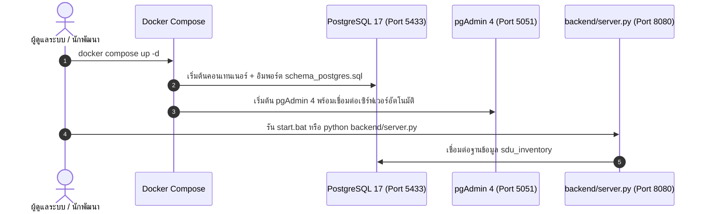

# Database & REST API Backend (`backend/`)
### ระบบขอเบิกพัสดุและคลังพัสดุดิจิทัล มหาวิทยาลัยสวนดุสิต (Stock Order SDU)

---

## 📖 ภาพรวมระบบส่วนหลังบ้าน (Backend Overview)

ระบบส่วนหลังบ้านของ **Stock Order SDU** รองรับฐานข้อมูลเชิงสัมพันธ์ **PostgreSQL 17 (รันผ่าน Docker Compose พร้อม pgAdmin 4)** และยังคงรองรับ MySQL/MariaDB เป็นทางเลือก โดยเชื่อมต่อกับ **Python REST API Server ([`backend/server.py`](file:///c:/Users/Sho/Downloads/Project/project%20stock/backend/server.py))** รองรับการทำธุรกรรมแบบ **ACID Transactions** พร้อมการล็อกแถวข้อมูลระดับฐานข้อมูล (**`SELECT ... FOR UPDATE`**) ป้องกันปัญหาการเบิกพัสดุชนกัน (Concurrency / Race Condition) 100%

### ไฟล์สำคัญในโฟลเดอร์ `backend/` และรากโปรเจกต์:
1. **[`docker-compose.yml`](file:///c:/Users/Sho/Downloads/Project/project%20stock/docker-compose.yml):** ไฟล์ Compose สำหรับรันคอนเทนเนอร์ PostgreSQL 17 (`postgres:17-alpine`) และ pgAdmin 4 (`dpage/pgadmin4`)
2. **[`backend/schema_postgres.sql`](file:///c:/Users/Sho/Downloads/Project/project%20stock/backend/schema_postgres.sql):** สคริปต์ SQL สำหรับสร้างฐานข้อมูล `sdu_inventory` บน PostgreSQL 17 พร้อมตารางทั้ง 6 ตาราง (`departments`, `users`, `inventory_items`, `requisitions`, `requisition_items`, `stock_transactions`), ทริกเกอร์ `updated_at` อัตโนมัติ, ข้อมูลตั้งต้น 34 รายการพัสดุ และตัวอย่างใบคำขอ
3. **[`pgadmin_servers.json`](file:///c:/Users/Sho/Downloads/Project/project%20stock/pgadmin_servers.json):** ไฟล์ตั้งค่าพรีโหลดการเชื่อมต่อเซิร์ฟเวอร์ฐานข้อมูลเข้าสู่ pgAdmin 4 อัตโนมัติ
4. **[`backend/init_db.py`](file:///c:/Users/Sho/Downloads/Project/project%20stock/backend/init_db.py):** สคริปต์ Python สำหรับตรวจสอบและสร้างฐานข้อมูลพร้อมนำเข้า Schema อัตโนมัติ
5. **[`backend/server.py`](file:///c:/Users/Sho/Downloads/Project/project%20stock/backend/server.py):** เซิร์ฟเวอร์รวมที่ให้บริการทั้งหน้าเว็บ (`index.html`, `staff.html`, `portal.html`) และ REST API ที่ `/api` บนพอร์ต `8080`

---

## ⚡ ขั้นตอนการติดตั้งและเริ่มใช้งานด้วย Docker Compose



### 1. สตาร์ท PostgreSQL 17 และ pgAdmin 4 ผ่าน Docker Compose
เปิด Terminal ในโฟลเดอร์ `project stock`:
```bash
docker compose up -d
```
> [!NOTE]
> ระบบจะรัน:
> * **PostgreSQL 17:** พอร์ตภายนอก `5433` (หลีกเลี่ยงการชนกับพอร์ต `5432` ของโปรเจกต์ `app-sdu`)
> * **pgAdmin 4:** พอร์ตภายนอก `5051` (หลีกเลี่ยงการชนกับพอร์ต `5050` ของโปรเจกต์ `app-sdu`)
> * **Auto Init:** นำเข้า `schema_postgres.sql` พร้อมข้อมูลตั้งต้นทันทีเมื่อคอนเทนเนอร์เริ่มทำงานครั้งแรก

### 2. เข้าใช้งาน pgAdmin 4 สำหรับจัดการฐานข้อมูล
เปิดเว็บเบราว์เซอร์ไปที่:
* **URL:** `http://localhost:5051`
* **อีเมล (Login):** `admin@admin.com`
* **รหัสผ่าน (Password):** `root`
* **การเชื่อมต่อ:** ระบบตั้งค่าเซิร์ฟเวอร์ `Stock Order SDU (PostgreSQL 17)` ไว้ให้เรียบร้อยแล้ว (รหัสผ่านของฐานข้อมูลคือ `postgrespassword`)

### 3. เปิดใช้งานเว็บเซิร์ฟเวอร์
ดับเบิลคลิกไฟล์ [`start.bat`](file:///c:/Users/Sho/Downloads/Project/project%20stock/start.bat) หรือรันผ่าน PowerShell:
```bash
.venv\Scripts\python.exe backend\server.py
```
จากนั้นเปิดเบราว์เซอร์ไปที่: `http://localhost:8080/portal.html`

---

## 🛠️ รายการ Endpoints ที่รองรับ (REST API Reference)

| Method | Endpoint / Action | รายละเอียดการทำงาน | การควบคุม Transaction |
| :---: | :--- | :--- | :---: |
| `GET` | `/api?action=getItems [&category=...]` | ดึงรายการพัสดุคงคลังทั้งหมดพร้อมคำนวณ `Available = On-Hand - Reserved` | Read |
| `GET` | `/api?action=getRequisitions [&status=...]` | ดึงประวัติและคิวคำขอเบิกทั้งหมด เชื่อมโยงกับตาราง `requisition_items` | Read |
| `GET` | `/api?action=trackRequisition&docNo=...` | ค้นหาและติดตามสถานะคำขอตามเลขที่เอกสารหรือชื่อผู้ขอเบิก | Read |
| `GET` | `/api?action=getDepartments` | ดึงรายชื่อกลุ่มงาน/หน่วยงานภายใน สวท. จากตาราง `departments` | Read |
| `GET` | `/api?action=getUsers` | ดึงรายชื่อบุคลากรผู้มีสิทธิ์ขอเบิกจากตาราง `users` | Read |
| `POST` | `action: "createRequisition"` | สร้างใบคำขอเบิกใหม่ ตรวจสอบยอดพร้อมเบิกก่อนบันทึก | `SELECT ... FOR UPDATE` + ACID Commit |
| `POST` | `action: "approveRequisition"` | อนุมัติคำขอ (เต็มจำนวนหรือบางส่วน) และล็อกยอด `reserved_pieces` | `SELECT ... FOR UPDATE` + ACID Commit |
| `POST` | `action: "completeRequisition"` | บันทึกลายเซ็นดิจิทัล ตัดยอดคงคลังจริง และสร้าง `stock_transactions` | `SELECT ... FOR UPDATE` + ACID Commit |
| `POST` | `action: "rejectRequisition"` | ปฏิเสธคำขอและคืนยอดพัสดุที่จองไว้ | `SELECT ... FOR UPDATE` + ACID Commit |
| `POST` | `action: "restockItem"` | รับพัสดุเข้าคลังและบันทึกประวัติความเคลื่อนไหว | `SELECT ... FOR UPDATE` + ACID Commit |
| `POST` | `action: "adjustStock"` | ปรับยอดตรวจนับพัสดุจริงและบันทึกประวัติ | `SELECT ... FOR UPDATE` + ACID Commit |
| `POST` | `action: "saveUser"` | เพิ่ม/แก้ไขข้อมูลบุคลากรผู้ขอเบิก | Commit |
| `POST` | `action: "saveItem"` | เพิ่ม/แก้ไขข้อมูลรายการพัสดุ | Commit |
| `POST` | `action: "addDepartment"` | เพิ่มกลุ่มงาน/หน่วยงานใหม่ภายใน สวท. | Commit |
| `POST` | `action: "updateDepartment"` | แก้ไขชื่อกลุ่มงาน/หน่วยงาน พร้อม Cascade อัปเดตสังกัดของบุคลากร | Commit |
| `POST` | `action: "deleteDepartment"` | Soft delete กลุ่มงาน/หน่วยงาน (`is_active = 0`) พร้อมป้องกันการลบเมื่อมีบุคลากรสังกัดอยู่ | Commit |
| `POST` | `action: "deleteUser"` / `deleteItem"` | Soft delete บุคลากรหรือพัสดุ (`is_active = 0`) | Commit |
