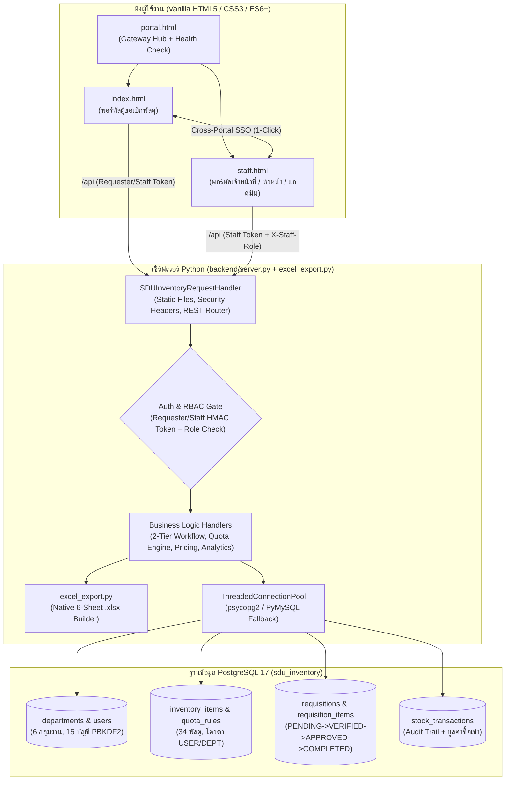

# คู่มืออธิบายโค้ดและการทำงานของระบบ (Codebase Architecture & Explanation)
### ระบบจัดการวัสดุสำนักงานออนไลน์ มหาวิทยาลัยสวนดุสิต (v3.8.4)

---

## สารบัญ
1. [ภาพรวมโครงสร้างโปรเจกต์ (Project Directory Structure)](#1-ภาพรวมโครงสร้างโปรเจกต์)
2. [สถาปัตยกรรมการทำงานและกระแสข้อมูล (System Architecture & Data Flow)](#2-สถาปัตยกรรมการทำงานและกระแสข้อมูล-system-architecture--data-flow)
3. [เจาะลึกส่วนเซิร์ฟเวอร์และแบคเอนด์ (Backend: `backend/server.py` & `backend/excel_export.py`)](#3-เจาะลึกส่วนเซิร์ฟเวอร์และแบคเอนด์-backendserverpy--backendexcel_exportpy)
4. [เจาะลึกส่วนหน้าจอผู้ใช้งานและ SSOT Generator (Frontend Applications)](#4-เจาะลึกส่วนหน้าจอผู้ใช้งานและ-ssot-generator-frontend-applications)
   * 4.1 [ตัวสร้างพอร์ทัล SSOT: `scripts/generate_separated_portals.py`](#41-ตัวสร้างพอร์ทัล-ssot-scriptsgenerate_separated_portalspy)
   * 4.2 [หน้าศูนย์กลางระบบ: `portal.html`](#42-หน้าศูนย์กลางระบบ-portalhtml)
   * 4.3 [หน้าสำหรับผู้ขอเบิกพัสดุ: `index.html`](#43-หน้าสำหรับผู้ขอเบิกพัสดุ-indexhtml)
   * 4.4 [หน้าสำหรับเจ้าหน้าที่และหัวหน้า: `staff.html`](#44-หน้าสำหรับเจ้าหน้าที่และหัวหน้า-staffhtml)
5. [เจาะลึกโครงสร้างฐานข้อมูล (Database Schema & Infrastructure)](#5-เจาะลึกโครงสร้างฐานข้อมูล)
6. [เจาะลึกสคริปต์เสริมและเครื่องมือ DevOps (Scripts & DevOps)](#6-เจาะลึกสคริปต์เสริมและเครื่องมือ-devops-scripts--devops)
7. [เจาะลึกชุดทดสอบอัตโนมัติ (Automated Test Suite: `tests/test_stock_logic.py`)](#7-เจาะลึกชุดทดสอบอัตโนมัติ-teststest_stock_logicpy)

---

## 1. ภาพรวมโครงสร้างโปรเจกต์

โปรเจกต์ใช้สถาปัตยกรรม **Zero-Build Vanilla Frontend** (HTML5, CSS3, ES6+ ล้วน ไม่ใช้ npm/React/Vue/Webpack) ร่วมกับ **Python REST API Server** และฐานข้อมูล **PostgreSQL 17** โดยรองรับการ Deploy ด้วยคำสั่งเดียวผ่าน **Docker Compose**:

```text
stock-order-sdu/
├── .env                              # ไฟล์คอนฟิกฐานข้อมูล, รหัสผ่าน, และคีย์ลับ (ไม่ถูก push ขึ้น git)
├── .env.example                      # แม่แบบตัวแปรระบบและค่าตั้งต้น
├── Dockerfile                        # อิมเมจ Python 3.11-slim (non-root appuser) พร้อม Healthcheck
├── docker-compose.yml                # บริการ PostgreSQL 17 (sdu_stock_postgres) + Web/API App (sdu_stock_app)
├── .dockerignore                     # ไฟล์ที่ละเว้นตอน Build Docker Image
├── requirements.txt                  # แพ็กเกจ Python (psycopg2-binary, PyMySQL, pytest, pytest-cov)
├── start.bat                         # สคริปต์ 1-Click เปิดระบบบน Windows
├── CHANGELOG.md                      # ประวัติการเปลี่ยนแปลงตามมาตรฐาน SemVer (ปัจจุบัน v3.8.4)
├── INSTALLATION.md                   # คู่มือการติดตั้งและ Deploy บนเซิร์ฟเวอร์จริง (Docker / Host / HTTPS)
│
├── portal.html                       # [Frontend] ศูนย์กลางพอร์ทัล (Gateway Hub + Real-time Health Check)
├── index.html                        # [Frontend - Generated] พอร์ทัลผู้ขอเบิกพัสดุ (คอมไพล์จาก SSOT)
├── staff.html                        # [Frontend - Generated] พอร์ทัลเจ้าหน้าที่/หัวหน้า/ผู้ดูแลระบบ (คอมไพล์จาก SSOT)
├── 404.html                          # หน้าแจ้งไม่พบไฟล์
├── favicon.ico, manifest.json        # ไอคอนและ PWA Web Manifest
│
├── assets/                           # ทรัพยากร Static Web Assets
│   ├── logo_sdu.png                  # ตราสัญลักษณ์มหาวิทยาลัยสวนดุสิต
│   ├── js/sweetalert2.all.min.js     # SweetAlert2 Local Asset สำหรับโหมดออฟไลน์
│   └── images/                       # รูปภาพพัสดุจริง 66 ภาพ (จาก 34 รายการ แยกหน่วยย่อย/หน่วยกล่อง)
│
├── backend/                          # [Backend] เซิร์ฟเวอร์, ส่งออก Excel, และสคีมาฐานข้อมูล
│   ├── server.py                     # Unified Web & REST API Server (ThreadingHTTPServer + RBAC + ACID)
│   ├── excel_export.py               # ตัวสร้างไฟล์ Excel (.xlsx) แท้ 6 ชีตแบบ Zero-Dependency (zipfile + OpenXML)
│   ├── schema_postgres.sql           # สคีมา PostgreSQL 17 ทั้ง 7 ตาราง + Triggers + Seed Data
│   ├── schema.sql                    # สคีมา MySQL/MariaDB (Fallback)
│   ├── init_db.py                    # สคริปต์สร้าง/รีเซ็ตฐานข้อมูลและแฮชรหัสผ่านอัตโนมัติ
│   └── README.md                     # คู่มือส่วนงาน Backend
│
├── docs/                             # เอกสารทางเทคนิคและคู่มือการใช้งาน
│   ├── API_SPEC.md                   # ข้อกำหนด REST API Endpoints และสิทธิ์ RBAC
│   ├── CODE_EXPLANATION.md           # [ไฟล์นี้] คู่มืออธิบายโครงสร้างและการทำงานของโค้ด
│   ├── DATA_DICTIONARY.md            # พจนานุกรมข้อมูลครบทั้ง 7 ตาราง
│   ├── SCHEMA.md                     # ER-Diagram และรายละเอียดสคีมา PostgreSQL 17
│   ├── USER_GUIDE.md                 # คู่มือผู้ใช้งานแยกตาม 4 บทบาท
│   └── system_requirements_specification.md # เอกสารวิเคราะห์ความต้องการระบบ (SRS v3.8.3)
│
├── scripts/                          # สคริปต์เครื่องมือพัฒนาและตรวจสอบ
│   ├── generate_separated_portals.py # Single Source of Truth (SSOT) สำหรับสร้าง index.html และ staff.html
│   ├── launch.py                     # สคริปต์รันเซิร์ฟเวอร์พอร์ต 8080 และเปิดเบราว์เซอร์
│   ├── seed_from_excel.py            # สคริปต์นำเข้าข้อมูลพัสดุจากไฟล์ Excel
│   ├── migrate_user_passwords.py     # เครื่องมือแปลงรหัสผ่าน Plaintext เป็น PBKDF2-HMAC-SHA256
│   ├── verify_live_security_fixes.py # สคริปต์ทดสอบความปลอดภัย Live HTTP
│   └── run.bat                       # ทางลัดรัน start.bat
│
├── tests/                            # ชุดทดสอบอัตโนมัติ
│   └── test_stock_logic.py           # ชุดทดสอบ pytest 91 รายการ (9 Test Classes)
│
├── .agents/skills/stock-order-rules/ # กฎโครงการและสคริปต์ตรวจสอบอัตโนมัติ (verify_rules.py)
├── .github/workflows/ci.yml          # GitHub Actions CI พร้อม PostgreSQL 17 Service Container
└── reports/security-audit/           # รายงานการตรวจสอบความปลอดภัย (run-1, run-2)
```

---

## 2. สถาปัตยกรรมการทำงานและกระแสข้อมูล (System Architecture & Data Flow)

ระบบทำงานในรูปแบบ **Client-Server Architecture** โดยมี **PostgreSQL 17** เป็นฐานข้อมูลศูนย์กลาง, **`backend/server.py`** ทำหน้าที่เป็นทั้ง Static File Server และ REST API + Security Gate, และมี **`localStorage`** เป็นกลไก Offline Fallback:



### วงจรชีวิตของใบขอเบิกพัสดุแบบ 2 ขั้นตอน (Two-Tier Approval Lifecycle):
1. **ผู้ขอเบิก (`index.html`):** เข้าสู่ระบบด้วย Username/Password (Auto-Role), เลือกพัสดุ (2 หน่วยนับ), ตรวจสอบสต๊อกพร้อมเบิกและโควตารายเดือน (รายบุคคล + กลุ่มงาน) แล้วส่งคำขอ -> สถานะ **`PENDING`** (ยังไม่ตัดสต๊อก)
2. **เจ้าหน้าที่คัดกรอง (`STAFF` ใน `staff.html`):** ตรวจสอบคำขอ ปรับยอดเสนอเบิก (หากจำเป็น) และกดส่งต่อหัวหน้า -> สถานะ **`VERIFIED`** (บันทึก `verified_by`, `verified_at`, `verified_date`)
3. **หัวหน้าหน่วยงานอนุมัติ (`HEAD` ใน `staff.html`):** ตรวจสอบและกดอนุมัติขั้นสุดท้าย -> สถานะ **`APPROVED`**, ล็อกยอดจอง `reserved_pieces += approved_pieces` ภายใต้ `SELECT ... FOR UPDATE` (บันทึก `approved_by`, `approved_at`, `approved_date`)
4. **เจ้าหน้าที่จ่ายพัสดุจริง (`STAFF` ใน `staff.html`):** ส่งมอบของจริงและยืนยันการรับมอบ -> สถานะ **`COMPLETED`**, ตัดยอด `on_hand_pieces -= approved_pieces`, ปลดล็อก `reserved_pieces -= approved_pieces`, และบันทึก `OUT` ลง `stock_transactions`
5. **กรณีไม่อนุมัติ/ยกเลิก (`REJECTED`):** บันทึก `reject_reason` และคืนยอดจอง `reserved_pieces` กลับสู่ `Available Stock` ทันทีหากเคยอยู่ในสถานะ `APPROVED`

---

## 3. เจาะลึกส่วนเซิร์ฟเวอร์และแบคเอนด์ (`backend/server.py` & `backend/excel_export.py`)

ไฟล์ [backend/server.py](../backend/server.py) (ประมาณ 3,330 บรรทัด) เป็นหัวใจหลักของฝั่ง Backend แบ่งโครงสร้างออกเป็นกลุ่มหน้าที่ชัดเจน:

### 3.1 การกำหนดค่า การเชื่อมต่อ และ Schema Auto-Migration
* **`load_env_config()`:** โหลดค่าตั้งต้นจาก `.env` และให้ค่า Environment Variables ของคอนเทนเนอร์/ระบบปฏิบัติการมีลำดับความสำคัญเหนือกว่าไฟล์ `.env`
* **`ensure_database_schema()`:** ทำงานอัตโนมัติแบบ Idempotent ตอนเปิดเซิร์ฟเวอร์ เพื่อสร้างตาราง/คอลัมน์/ดัชนี/`CHECK` Constraints ที่อาจยังไม่มี, ซิงค์ PostgreSQL Sequence (`setval`), และเข้ารหัสรหัสผ่านในตาราง `users` เป็น PBKDF2-HMAC-SHA256 โดยไม่เขียนทับ `role` ที่ผู้ดูแลปรับแก้แล้ว
* **`_get_pg_pool()` / `_PooledPgConnection` / `get_db_connection()`:** จัดการ PostgreSQL Connection ผ่าน `ThreadedConnectionPool` (รองรับ MySQL ผ่าน `PyMySQL` เป็นทางเลือก) และ **`dict_cursor(conn)`** คืนแถวข้อมูลเป็น Dictionary

### 3.2 ความปลอดภัย การยืนยันตัวตน และ RBAC
* **`hash_password()` / `verify_password()`:** เข้ารหัสและตรวจสอบรหัสผ่านด้วย **PBKDF2-HMAC-SHA256** (Salt 16 ไบต์, 600,000 รอบ) บังคับตรวจรหัสผ่านเฉพาะบุคคลอย่างเคร่งครัดใน `handle_login_requester()` และ `handle_login_staff()`
* **`generate_requester_token()` / `verify_requester_token()` / `generate_staff_token()` / `verify_staff_token()`:** สร้างและตรวจโทเค็น **HMAC-SHA256** อายุ 12 ชั่วโมง พร้อมออก Token คู่ขนานเพื่อรองรับ **Cross-Portal SSO** สำหรับผู้ที่มีสิทธิ์ `STAFF`/`HEAD`/`ADMIN`
* **`get_staff_role()` / `check_staff_role_permission()`:** ควบคุมสิทธิ์ตามบทบาท (`ADMIN`, `STAFF`, `HEAD`) และรองรับ `X-Staff-Role` เฉพาะบัญชี `ADMIN` สำหรับสลับมุมมองสิทธิ์
* **`SDUInventoryRequestHandler.is_safe_static_path()`:** ถอดรหัส URL ซ้ำ (`unquote` loop) ป้องกัน Double-Encoding Traversal, บล็อกโฟลเดอร์ลับ (`backend`, `tests`, `scripts`, `data`, `.git`, `reports` ฯลฯ) และไฟล์ตั้งค่า (`.env`, `docker-compose.yml`, `requirements.txt` ฯลฯ) พร้อมตรวจสอบ Canonical `os.path.realpath`
* **HTTP Security Headers & Body Cap:** เพิ่ม `X-Content-Type-Options: nosniff`, `X-Frame-Options: DENY`, `Referrer-Policy: same-origin` ทุกการตอบกลับ และจำกัดขนาด Request Body สูงสุด 10 MB

### 3.3 Business Logic Handlers
* **Inventory & Pricing:** `handle_get_items()`, `handle_save_item()` (ใช้ `SERIAL RETURNING id` และบันทึก `INITIAL_STOCK` อัตโนมัติเมื่อสต๊อกตั้งต้น > 0), `handle_delete_item()`, `handle_restock_item()` (รองรับคำนวณ `unit_price` / `total_cost` และอัปเดต `last_unit_price` / `last_restocked_at`), `handle_adjust_stock()`, `handle_get_item_transactions()`
* **Requisitions & Two-Tier Workflow:** `handle_create_requisition()` (รวมยอด `itemId` ซ้ำ, ตรวจสต๊อก, ตรวจโควตา 2 ระดับ, ใช้ `SAVEPOINT` retry เลขที่เอกสาร `REQ-YYYYMM-XXXX`), `handle_verify_requisition()`, `handle_approve_requisition()`, `handle_complete_requisition()`, `handle_reject_requisition()`, `handle_get_requisitions()` (ใช้ `parse_month_date_range()` แบบ SARGable Range), `handle_track_requisition()` (ค้นหาตรงเลขที่เอกสารเท่านั้น)
* **Quota Engine:** `handle_get_quotas()`, `handle_save_quota()`, `handle_delete_quota()`, และ `resolve_effective_monthly_limits()` (ลำดับความสำคัญ `USER+item` > `USER+all` > `item.monthly_limit` ควบคู่กับ `DEPT+item` > `DEPT+all`)
* **Analytics & Native Excel Export:** `handle_get_monthly_analytics()` (สรุปตัวชี้วัด, Top/Least 5, `allItemUsage`, `personUsage`, `purchaseSummary`, `purchaseTransactions`, `monthRequisitions`) และ `handle_export_monthly_analytics_excel()` ที่เรียก [backend/excel_export.py](../backend/excel_export.py) เพื่อสร้างไฟล์ `.xlsx` แท้ **6 ชีต** (`ภาพรวมประจำเดือน`, `สรุปรายบุคคล`, `สรุปทุกพัสดุ`, `รายละเอียดคำขอเบิก`, `สรุปยอดซื้อเข้า`, `ประวัติซื้อเข้า`) โดยไม่ต้องพึ่ง `openpyxl` หรือ `pandas`
* **Users & Departments:** `handle_get_users()`, `handle_save_user()`, `handle_delete_user()`, `handle_get_departments()`, `handle_add_department()`, `handle_update_department()` (Cascade ชื่อกลุ่มงานไปยัง `users` และ `quota_rules`), `handle_delete_department()`

---

## 4. เจาะลึกส่วนหน้าจอผู้ใช้งานและ SSOT Generator (Frontend Applications)

### 4.1 ตัวสร้างพอร์ทัล SSOT: `scripts/generate_separated_portals.py`
ไฟล์ [scripts/generate_separated_portals.py](../scripts/generate_separated_portals.py) เป็น **Single Source of Truth (SSOT)** สำหรับสร้างทั้ง `index.html` และ `staff.html` โดยฝัง:
* **100% Vector SVG Icons (`svg_icons` / `vIcons`):** บังคับนโยบาย Zero-Emoji ใน UI ทั้งระบบ
* **Universal Searchable Dropdown (`enhanceSearchableSelect` / `enhanceAllSearchableSelects`):** แปลง `<select>` ทุกตัว (ทั้งหน้าหลักและ SweetAlert2 modal ยกเว้น `#swal2-select`) เป็น Dropdown ที่พิมพ์ค้นหาและเลือกด้วยคีย์บอร์ดได้
* **Dynamic Calendar Month Dropdowns (`v3.8.1`):** ฟังก์ชัน `getCurrentMonthKey()`, `collectAvailableMonthKeys()`, `populateDynamicMonthSelect()`, `refreshAllMonthDropdowns()` สร้างรายการงวดเดือนอัตโนมัติตามปฏิทินจริง (เดือนปัจจุบัน + ย้อนหลัง 12 เดือน + เดือนที่มีข้อมูลจริง)
* **Strict XSS Protection & Sync Integrity:** ใช้ `escapeHtml()`, `isSafeSignatureDataUrl()`, และทุกคำสั่งบันทึกข้อมูลฝั่งเจ้าหน้าที่ต้อง `await postToMySQLAPI(...)` ตรวจสอบผลจากฐานข้อมูลก่อนอัปเดต `localStorage`

### 4.2 หน้าศูนย์กลางระบบ: `portal.html`
* หน้า Gateway Hub จัดวางภายใต้กริดความกว้าง `1060px` พร้อมแถบ Hero สรุปสถิติภาพรวม, การ์ดพอร์ทัลผู้ขอเบิก/เจ้าหน้าที่, ทางลัด 4 บทบาทสมมาตร, แถบขั้นตอนเบิกจ่าย 4 ขั้นตอน, และตรวจสอบสถานะเซิร์ฟเวอร์เรียลไทม์ผ่าน `/api?action=health`

### 4.3 หน้าสำหรับผู้ขอเบิกพัสดุ: `index.html`
* **Auto-Role Login & Cross-Portal SSO:** กรอกเฉพาะ Username + Password (ไม่คำนึงตัวพิมพ์เล็ก-ใหญ่) เก็บเซสชันใน `sdu_requester_auth_v1` หากบัญชีมีสิทธิ์ `HEAD`/`STAFF`/`ADMIN` สามารถเบิกพัสดุได้ทันทีพร้อมปุ่มสลับกลับ `staff.html` ใน 1 คลิก
* **Catalog & Multi-Unit Cart:** ค้นหาพัสดุแบบเรียลไทม์, กรองหมวดหมู่, สลับภาพหน่วยย่อย/กล่อง, แสดงยอดพร้อมเบิกและโควตาคงเหลือรายบุคคล/กลุ่มงานแบบเรียลไทม์, ตะกร้าเบิกพัสดุ, และส่งคำขอเบิก
* **My Requisitions & Official PDF:** หน้าต่างรายการคำขอของฉันพร้อมตัวกรองงวดเดือนอัตโนมัติ แท็บ 5 สถานะ และพิมพ์แบบฟอร์มใบเบิกทางการ A4 (ช่องลงนาม 4 ฝ่าย)

### 4.4 หน้าสำหรับเจ้าหน้าที่และหัวหน้า: `staff.html`
* **Auto-Role Login, Role View Switch & Cross-Portal SSO:** ตรวจบทบาทอัตโนมัติ (เปิดแท็บ `รอหัวหน้าอนุมัติ` ทันทีสำหรับ `HEAD`), ปุ่ม **"ขอเบิกพัสดุ"** ข้ามไป `index.html` ใน 1 คลิก, และ Dropdown สลับมุมมองสิทธิ์สำหรับ `ADMIN`
* **5 โมดูลหลัก:**
  1. **รายการคำขอเบิก:** แยกคิว `รอคัดกรอง (PENDING)` -> `รอหัวหน้าอนุมัติ (VERIFIED)` -> `รอจ่ายของ (APPROVED)` -> `ประวัติเสร็จสิ้น/ปฏิเสธ` พร้อมตัวกรองงวดเดือนอัตโนมัติและพิมพ์ใบเบิก 4 ฝ่าย PDF
  2. **สรุปยอดสต๊อกคลัง:** ตาราง On-Hand / Reserved / Available, แบนเนอร์แจ้งเตือนสต๊อกต่ำ (`min_alert`), รับเข้าพัสดุพร้อมคำนวณราคา 3 โหมด (`openStockInModal`), ปรับยอดตรวจนับ (`openStockAdjustModal`), CRUD รายการพัสดุ (`openItemModal`), และหน้าต่างประวัติความเคลื่อนไหวสต๊อกรายรายการ
  3. **สรุปยอดและสถิติรายเดือน (`#view-analytics`):** เลือกงวดเดือนอัตโนมัติ, การ์ดตัวชี้วัดและยอดเงินซื้อเข้า (`#analyticsPurchaseCard`), กดการ์ดหรือดูตาราง **"รายการคำขอเบิกทั้งหมดในเดือน"** (`#analyticsRequisitionsCard` + `openMonthlyRequisitionDetailModal`), Top 5 / Slow-Moving 5, ตารางสรุปยอดเบิกรายบุคคล (`personUsage`), ส่งออก Excel แท้ 6 ชีต (`.xlsx`), และพิมพ์รายงานผู้บริหาร PDF
  4. **จัดการบุคลากร / หน่วยงาน & โควตา:** CRUD บุคลากร 4 บทบาท, CRUD กลุ่มงาน สวท., และตารางจัดการกฎโควตารายเดือนเฉพาะบุคคล (`USER`) / กลุ่มงาน (`DEPT`)

---

## 5. เจาะลึกโครงสร้างฐานข้อมูล

ฐานข้อมูล **PostgreSQL 17 (`sdu_inventory`)** ประกอบด้วย **7 ตาราง** (ดูรายละเอียดครบทุกฟิลด์ใน [docs/SCHEMA.md](SCHEMA.md) และ [docs/DATA_DICTIONARY.md](DATA_DICTIONARY.md)):
1. **`departments` (6 คอลัมน์):** 6 กลุ่มงาน/หน่วยงาน สวท.
2. **`users` (11 คอลัมน์):** 15 บัญชีบุคลากร สวท. จาก `Book1.xlsx` (PBKDF2-HMAC-SHA256 + RBAC 4 บทบาท)
3. **`inventory_items` (18 คอลัมน์):** 34 รายการพัสดุ, 2 หน่วยนับ, `monthly_limit`, `last_unit_price`, `last_restocked_at`, `CHECK >= 0`
4. **`requisitions` (21 คอลัมน์):** หัวใบเบิก, สถานะ 5 ระดับ, ผู้คัดกรอง/ผู้อนุมัติ และเวลาครบทุกขั้นตอน
5. **`requisition_items` (11 คอลัมน์):** รายการย่อยในคำขอ + Snapshot อัตราส่วนแปลงหน่วย (`total_pieces > 0`)
6. **`stock_transactions` (12 คอลัมน์):** Audit Trail (`IN`/`OUT`/`ADJUST`) + `unit_price`, `total_cost`, `ON DELETE RESTRICT`
7. **`quota_rules` (9 คอลัมน์):** กฎโควตารายเดือนเฉพาะ `USER`/`DEPT` พร้อม `UNIQUE (target_type, target_key, item_id)` และ Trigger `updated_at`

---

## 6. เจาะลึกสคริปต์เสริมและเครื่องมือ DevOps (Scripts & DevOps)

* **`Dockerfile` & `docker-compose.yml`:** รันทั้ง `sdu_stock_postgres` (`postgres:17-alpine`, พอร์ต `127.0.0.1:5433`, เก็บข้อมูลใน `./postgres-data`) และ `sdu_stock_app` (`python:3.11-slim`, พอร์ต `8080`, non-root `appuser`) ด้วยคำสั่งเดียว `docker compose up -d --build`
* **`.agents/skills/stock-order-rules/scripts/verify_rules.py`:** ตรวจสอบ 6 มาตรฐานอัตโนมัติ (No-Emoji, No Native Dialogs, Version Sync, SSOT Generator, Searchable Dropdowns, และ Pytest Suite)
* **`.github/workflows/ci.yml`:** รัน `verify_rules.py` และ `pytest` ร่วมกับ PostgreSQL 17 Service Container บน GitHub Actions ทุกครั้งที่ Push/PR
* **`scripts/launch.py` & `start.bat`:** เปิดเซิร์ฟเวอร์พอร์ต `8080` และเปิดเบราว์เซอร์ไปที่ `portal.html` อัตโนมัติบน Windows
* **`scripts/migrate_user_passwords.py` & `scripts/verify_live_security_fixes.py`:** เครื่องมืออัปเกรดรหัสผ่านเป็น PBKDF2 และทดสอบความปลอดภัย Live HTTP

---

## 7. เจาะลึกชุดทดสอบอัตโนมัติ (`tests/test_stock_logic.py`)

ชุดทดสอบอัตโนมัติด้วย **`pytest`** ปัจจุบันครอบคลุม **91 การทดสอบ** แบ่งเป็น **9 Test Classes**:

1. **`TestStockInventoryCalculations` (5 รายการ):** การแปลง 2 หน่วยนับ, หน่วยเดี่ยว, สูตร `Available = On-Hand - Reserved`, การป้องกันสต๊อกติดลบ
2. **`TestRequisitionLifecycleStates` (7 รายการ):** State Machine 2 ขั้นตอน (`PENDING` -> `VERIFIED` -> `APPROVED` -> `COMPLETED` / `REJECTED`) และการกัน/ตัด/คืนสต๊อก
3. **`TestThaiFormattersAndHelpers` (4 รายการ):** รูปแบบวันที่เวลาไทย พ.ศ., เลขที่เอกสาร `REQ-YYYYMM-XXXX`, และความตรงกันของ `SYSTEM_VERSION`
4. **`TestPostgresSchemaAndConfiguration` (4 รายการ):** ตรวจสอบ `schema_postgres.sql`, `docker-compose.yml`, และ `load_env_config()`
5. **`TestApiHandlers` (25 รายการ):** ตรวจสอบการทำงานและ Validation ของ REST API Handlers ทุกตัว (Items, Requisitions, Users, Departments, Quotas, Restock, Adjust, Analytics, Login)
6. **`TestSecurityEnhancements` (4 รายการ):** `is_safe_static_path()`, PBKDF2 `hash_password`/`verify_password`, HMAC Token, และ `handle_login_staff`
7. **`TestRequisitionStateMachineSafety` (4 รายการ):** ป้องกันการข้ามสถานะหรืออนุมัติ/ตัดสต๊อกซ้ำ
8. **`TestSecurityAuditRun2Patches` (13 รายการ):** ทดสอบแพตช์ความปลอดภัยรอบที่ 2 (Traversal, Double-Encoding, Header Injection, Payload Size Cap, Role Guard)
9. **`TestPhase8ExtendedRequirements` (25 รายการ):** ทดสอบฟีเจอร์ระยะหลังทั้งหมด (RBAC 4 บทบาท, โควตา `USER`/`DEPT`, Universal Searchable Dropdowns, Native Excel 6 ชีต, ราคาซื้อเข้า, Container Deploy & Env Precedence, Security Hardening v3.7.2, DB Persistence v3.7.3, Monthly Requisitions List v3.8.0, Dynamic Month Dropdowns v3.8.1, และ Book1 Seed Users Sync v3.8.2)
