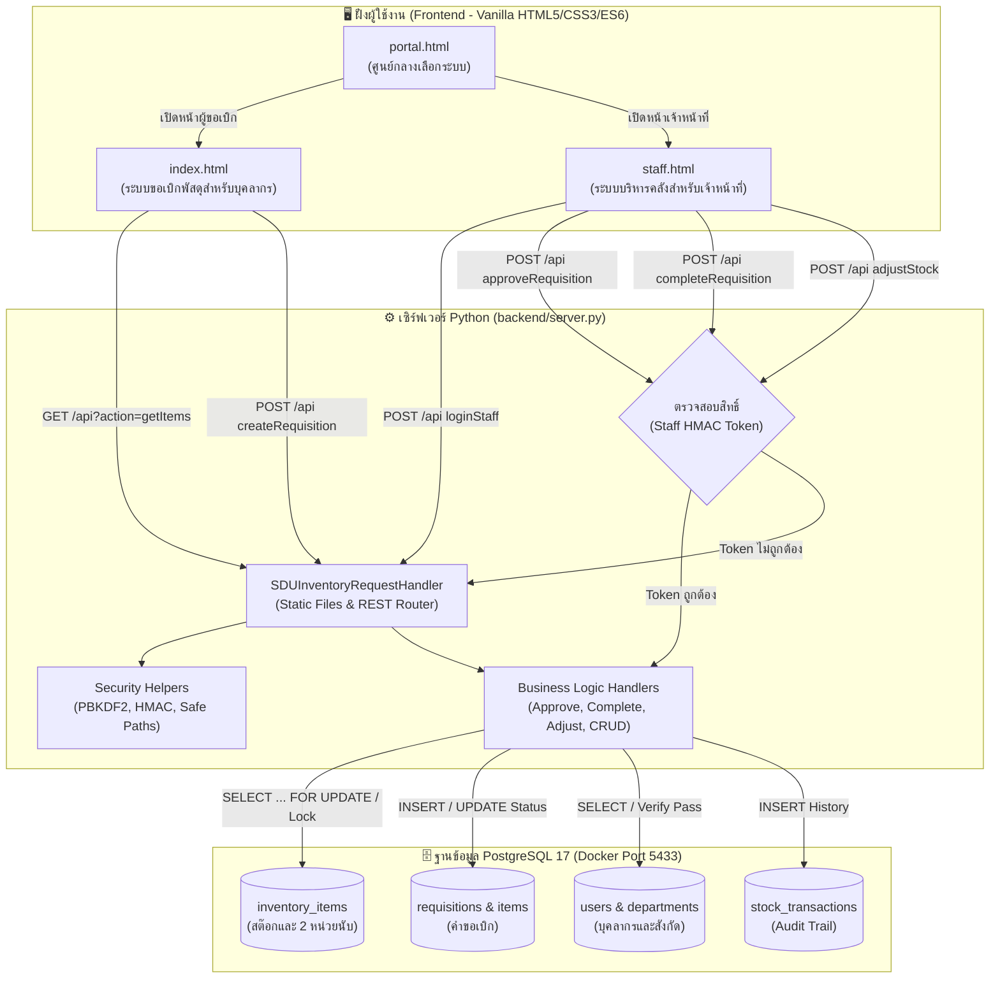
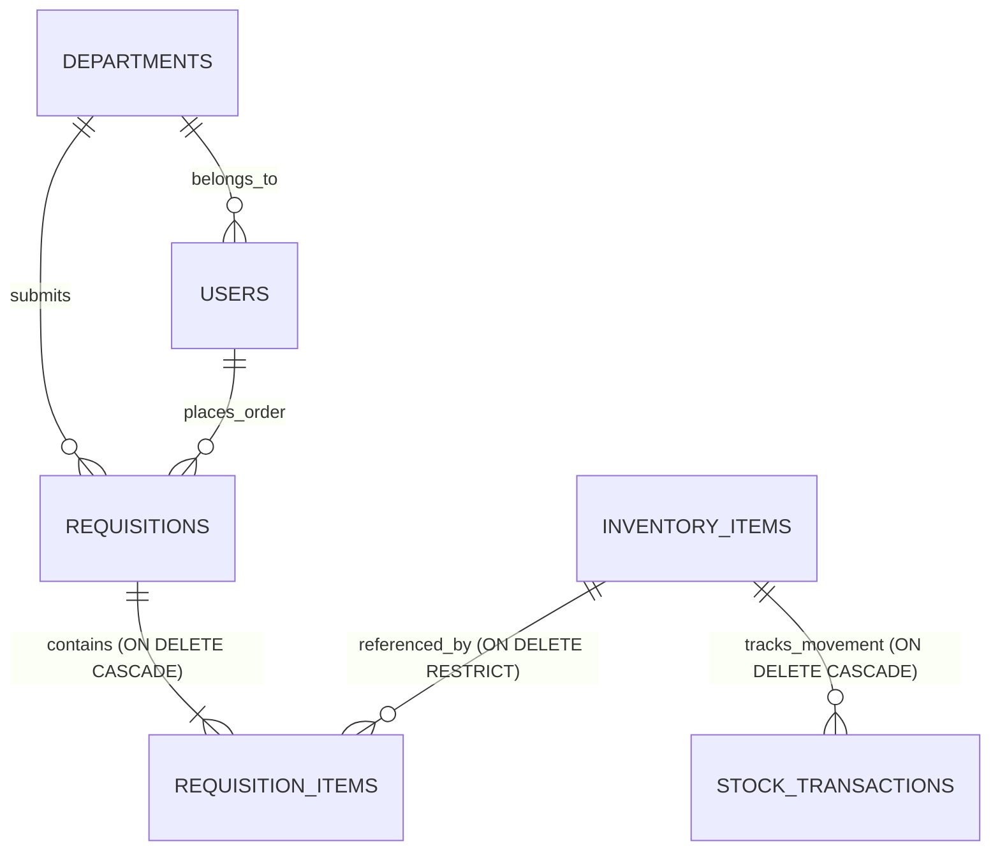

# คู่มืออธิบายโค้ดและการทำงานของระบบ (Codebase Architecture & Explanation)
### ระบบขอเบิกพัสดุและคลังพัสดุดิจิทัล มหาวิทยาลัยสวนดุสิต (SDU Stock Order & e-Inventory)

---

## 📑 สารบัญ
1. [ภาพรวมโครงสร้างโปรเจกต์ (Project Directory Structure)](#1-ภาพรวมโครงสร้างโปรเจกต์)
2. [สถาปัตยกรรมการทำงานและกระแสข้อมูล (System Architecture & Data Flow)](#2-สถาปัตยกรรมการทำงานและกระแสข้อมูล)
3. [เจาะลึกส่วนเซิร์ฟเวอร์และแบคเอนด์ (Backend: backend/server.py)](#3-เจาะลึกส่วนเซิร์ฟเวอร์และแบคเอนด์-backendserverpy)
4. [เจาะลึกส่วนหน้าจอผู้ใช้งาน (Frontend Applications)](#4-เจาะลึกส่วนหน้าจอผู้ใช้งาน-frontend-applications)
   * 4.1 [หน้าศูนย์กลางระบบ: `portal.html`](#41-หน้าศูนย์กลางระบบ-portalhtml)
   * 4.2 [หน้าสำหรับผู้ขอเบิกพัสดุ: `index.html`](#42-หน้าสำหรับผู้ขอเบิกพัสดุ-indexhtml)
   * 4.3 [หน้าสำหรับเจ้าหน้าที่พัสดุ: `staff.html`](#43-หน้าสำหรับเจ้าหน้าที่พัสดุ-staffhtml)
5. [เจาะลึกโครงสร้างฐานข้อมูล (Database Schema & Infrastructure)](#5-เจาะลึกโครงสร้างฐานข้อมูล)
6. [เจาะลึกสคริปต์เสริมและเครื่องมือระบบ (Scripts & DevOps)](#6-เจาะลึกสคริปต์เสริมและเครื่องมือระบบ)
7. [เจาะลึกชุดทดสอบอัตโนมัติ (Automated Test Suite: tests/test_stock_logic.py)](#7-เจาะลึกชุดทดสอบอัตโนมัติ)

---

## 1. ภาพรวมโครงสร้างโปรเจกต์

โครงสร้างไฟล์และโฟลเดอร์ทั้งหมดในโปรเจกต์ถูกออกแบบให้เป็น **Zero-Build Architecture** (ไม่ต้องคอมไพล์ Frontend, แก้ไขโค้ดแล้วรีเฟรชหน้าเว็บได้ทันที) และใช้สถาปัตยกรรม Python Standard Library ร่วมกับ PostgreSQL 17 บน Docker Compose:

```
stock-order-sdu/
├── .env                              # ไฟล์คอนฟิกฐานข้อมูลและพอร์ตระบบ (ไม่ถูก push ขึ้น git)
├── .env.example                      # แม่แบบการตั้งค่าคอนฟิกสำหรับผู้พัฒนา
├── .gitignore                        # รายการไฟล์ที่ไม่ต้องการให้ติดตามใน git
├── docker-compose.yml                # คอนฟิก Docker สำหรับ PostgreSQL 17 และ pgAdmin 4
├── pgadmin_servers.json              # พรีโหลดการเชื่อมต่อฐานข้อมูลใน pgAdmin 4 อัตโนมัติ
├── requirements.txt                  # รายการแพ็กเกจ Python (psycopg2-binary, PyMySQL, pytest)
├── start.bat                         # ปุ่มคลิกเดียวเปิดระบบบน Windows (Launch Script)
│
├── portal.html                       # [Frontend] ประตูทางเข้าหลัก (เลือกระหว่างผู้ขอเบิก / เจ้าหน้าที่)
├── index.html                        # [Frontend] หน้าจอสำหรับอาจารย์และบุคลากรขอเบิกพัสดุ
├── staff.html                        # [Frontend] หน้าจอสำหรับเจ้าหน้าที่คลังพัสดุ (อนุมัติ, จ่ายของ, จัดการสต๊อก)
├── 404.html                          # หน้าแสดงผลเมื่อไม่พบไฟล์
├── favicon.ico, manifest.json        # ไอคอนและ PWA Web Manifest
│
├── assets/                           # ไฟล์ทรัพยากรภาพถ่ายพัสดุจริง (58 ภาพ) และโลโก้มหาวิทยาลัย
│   ├── logo_sdu.png                  # ตราสัญลักษณ์มหาวิทยาลัยสวนดุสิต
│   └── items/                        # ภาพพัสดุจริงแยกหน่วยเดี่ยว (piece) และหน่วยกล่อง (box)
│
├── backend/                          # [Backend] ซอร์สโค้ดเซิร์ฟเวอร์และสคีมาฐานข้อมูล
│   ├── server.py                     # เซิร์ฟเวอร์หลัก (ThreadingHTTPServer + REST API + Security Logic)
│   ├── schema_postgres.sql           # สคริปต์สร้างตาราง PostgreSQL 17 ทั้ง 6 ตาราง พร้อม Seed ข้อมูล
│   ├── schema.sql                    # สคริปต์สร้างตาราง MySQL/MariaDB (สำหรับ Fallback)
│   ├── init_db.py                    # สคริปต์รีเซ็ตและสร้างฐานข้อมูลใหม่
│   └── README.md                     # เอกสารอธิบายส่วนงาน Backend
│
├── docs/                             # เอกสารข้อกำหนดและการออกแบบระบบฉบับสมบูรณ์
│   ├── CODE_EXPLANATION.md           # [ไฟล์นี้] คู่มืออธิบายการทำงานของโค้ดทุกส่วนอย่างละเอียด
│   ├── DATA_DICTIONARY.md            # พจนานุกรมข้อมูล (Data Dictionary) ครอบคลุม 6 ตาราง
│   ├── SCHEMA.md                     # แผนผัง ER-Diagram และข้อกำหนดโครงสร้างตาราง
│   ├── API_SPEC.md                   # รายละเอียด API Endpoints ทุก Action (Request/Response)
│   └── system_requirements_specification.md # เอกสารวิเคราะห์ความต้องการระบบ (SRS)
│
├── scripts/                          # สคริปต์อำนวยความสะดวกในการทำงาน
│   ├── launch.py                     # สคริปต์ตรวจสอบพอร์ต เปิดเซิร์ฟเวอร์ และเปิดเว็บเบราว์เซอร์อัตโนมัติ
│   ├── migrate_user_passwords.py     # เครื่องมืออัปเกรดรหัสผ่านเก่าสู่ระบบแฮช PBKDF2-HMAC-SHA256
│   └── verify_live_security_fixes.py # สคริปต์ตรวจสอบความปลอดภัยของเซิร์ฟเวอร์ขณะทำงานจริง
│
├── tests/                            # ชุดทดสอบอัตโนมัติ
│   └── test_stock_logic.py           # รวมการทดสอบ 40 รายการ (การแปลงหน่วย, สูตรสต๊อก, ความปลอดภัย)
│
└── reports/                          # รายงานผลการตรวจสอบความปลอดภัย (Full Security Audit)
    └── security-audit/run-1/         # รายงานสรุปช่องโหว่และแนวทางป้องกันตามมาตรฐาน Cloudflare
```

---

## 2. สถาปัตยกรรมการทำงานและกระแสข้อมูล (System Architecture & Data Flow)

ระบบทำงานในรูปแบบ **Client-Server Architecture** โดยมีฐานข้อมูล **PostgreSQL 17** ทำหน้าที่เป็นศูนย์กลางของข้อมูล และมีเซิร์ฟเวอร์ **`backend/server.py`** ทำหน้าที่เป็นทั้ง **Static Web Server** และ **RESTful API Service**:



### วงจรชีวิตของใบขอเบิกพัสดุ (Requisition Lifecycle):
1. **ผู้ขอเบิก (index.html):** เลือกรายการพัสดุ ระบุจำนวนกล่อง/ชิ้น และส่งคำขอ $\rightarrow$ บันทึกลงตาราง `requisitions` ด้วยสถานะ **`PENDING`** (ยังไม่ตัดสต๊อก)
2. **เจ้าหน้าที่ตรวจสอบ (staff.html):** ตรวจสอบยอดสต๊อกคงเหลือจริง และกด "อนุมัติคำขอ" $\rightarrow$ อัปเดตสถานะเป็น **`APPROVED`** และล็อกยอดจอง `reserved_pieces += approved_pieces` ทันที
3. **การจ่ายของและตัดสต๊อกจริง (staff.html):** ผู้ขอมารับพัสดุ เจ้าหน้าที่กดยืนยัน "จ่ายพัสดุเรียบร้อย" $\rightarrow$ อัปเดตสถานะเป็น **`COMPLETED`**, ตัดสต๊อกจริง `on_hand_pieces -= approved_pieces`, ปลดล็อกยอดจอง `reserved_pieces -= approved_pieces` และบันทึกลง `stock_transactions`
4. **กรณีไม่อนุมัติ (`REJECTED`):** หากเจ้าหน้าที่ปฏิเสธคำขอ ระบบจะปลดล็อกยอดจองคืนสู่คลังทันที

---

## 3. เจาะลึกส่วนเซิร์ฟเวอร์และแบคเอนด์ (`backend/server.py`)

ไฟล์ [`backend/server.py`](file:///c:/Users/namtarn/Downloads/stock-order-sdu/backend/server.py) เป็นหัวใจหลักของระบบ ทำหน้าที่จัดการการเชื่อมต่อฐานข้อมูล การคำนวณทางธุรกิจ และการรักษาความปลอดภัย โดยแบ่งฟังก์ชันออกเป็นกลุ่มดังนี้:

### 3.1 การกำหนดค่าและการเชื่อมต่อฐานข้อมูล (Configuration & Connection)
* **`load_env_config()` (บรรทัด 33):**  
  อ่านค่าคอนฟิกจากไฟล์ `.env` หรือ Environment Variables เช่น ประเภทฐานข้อมูล (`DB_TYPE`), โฮสต์ (`DB_HOST`), พอร์ต (`DB_PORT`), ชื่อฐานข้อมูล (`DB_NAME`), พอร์ตเซิร์ฟเวอร์ (`PORT`), และคีย์ลับของโทเค็น (`STAFF_AUTH_SECRET`)
* **`get_db_connection()` (บรรทัด 76):**  
  สร้าง Connection เชื่อมต่อไปยังฐานข้อมูล โดยตรวจจับอัตโนมัติว่าเป็น **PostgreSQL (`psycopg2`)** หรือ **MySQL (`pymysql`)** พร้อมตั้งค่าการถอดรหัสเป็น UTF-8
* **`dict_cursor(conn)` (บรรทัด 125):**  
  Context Manager สำหรับสร้าง Cursor ที่คืนค่าแถวข้อมูลเป็น Python Dictionary (ชื่อคอลัมน์เป็น Key) โดยใช้ `RealDictCursor` ใน PostgreSQL และ `DictCursor` ใน MySQL

### 3.2 ความปลอดภัยและการเข้ารหัส (Security Helpers)
* **`hash_password(password)` (บรรทัด 979):**  
  เข้ารหัสรหัสผ่านด้วยอัลกอริทึม **PBKDF2-HMAC-SHA256** โดยสร้าง Salt แบบสุ่ม 16 ไบต์ และวนลูป 600,000 รอบตามมาตรฐาน OWASP (ผลลัพธ์: `pbkdf2_sha256$<salt_hex>$<hash_hex>`) ป้องกันการขโมยรหัสผ่าน (CWE-256)
* **`verify_password(stored, password)` (บรรทัด 988):**  
  ตรวจสอบความถูกต้องของรหัสผ่าน รองรับทั้งรหัสผ่านที่แฮชด้วย PBKDF2 และรองรับ Plaintext ชั่วคราวสำหรับการย้ายข้อมูลย้อนหลัง
* **`generate_staff_token(username)` (บรรทัด 1005):**  
  สร้างโทเค็นยืนยันตัวตนสำหรับเจ้าหน้าที่พัสดุ โดยใช้ **HMAC-SHA256** ผูกกับชื่อผู้ใช้ เวลาปัจจุบัน (`timestamp`) และคีย์ลับ (`STAFF_AUTH_SECRET`)
* **`verify_staff_token(token)` (บรรทัด 1014):**  
  ตรวจสอบความถูกต้องของโทเค็นเจ้าหน้าที่ และเช็กอายุการใช้งาน (อายุ 12 ชั่วโมง)
* **`is_safe_static_path(path)` (บรรทัด 1080):**  
  ป้องกันการโจมตี Directory Traversal และ Information Disclosure (CWE-552) โดยปิดกั้นการเข้าถึงไฟล์ที่ขึ้นต้นด้วยจุด (`.env`, `.git`) และโฟลเดอร์ภายในระบบ (`backend/`, `tests/`, `scripts/`, `data/`)

### 3.3 ฟังก์ชันตรรกะทางธุรกิจ (Business Logic Handlers)
* **`handle_get_items()` (บรรทัด 155):**  
  ดึงข้อมูลรายการพัสดุทั้งหมด 34 รายการ เรียงตามหมวดหมู่ พร้อมคำนวณ `available_pieces = on_hand_pieces - reserved_pieces` และแสดงสถานะเตือนสต๊อกต่ำ (`status_alert`)
* **`handle_get_requisitions(params)` (บรรทัด 194):**  
  ดึงรายการคำขอเบิกทั้งหมด พร้อมรายการพัสดุย่อยในแต่ละคำขอ รองรับการกรองตามสถานะ (`status`) และคำค้นหา
* **`handle_track_requisition(doc_no)` (บรรทัด 249):**  
  ค้นหาข้อมูลคำขอเบิกรายฉบับด้วยเลขที่เอกสาร เช่น `REQ-256911-0001` เพื่อนำไปแสดงในหน้าติดตามสถานะ
* **`handle_get_departments()` & `handle_get_users()` (บรรทัด 303, 314):**  
  ดึงรายชื่อหน่วยงาน 90+ สังกัด และรายชื่อบุคลากรผู้มีสิทธิ์เบิกพัสดุ
* **`handle_login_requester(payload)` (บรรทัด 783):**  
  ตรวจสอบการเข้าสู่ระบบของผู้ขอเบิกพัสดุ
* **`handle_login_staff(payload)` (บรรทัด 1034):**  
  ตรวจสอบรหัสผ่านเจ้าหน้าที่พัสดุ หากถูกต้องจะส่งมอบ Signed HMAC Token กลับไปให้ Frontend
* **`handle_create_requisition(payload)` (บรรทัด 340):**  
  สร้างใบคำขอเบิกพัสดุใหม่ โดยคำนวณยอดรวมชิ้นย่อย `total_pieces = (boxes * pieces_per_box) + pieces` และบันทึก `pieces_per_box_snapshot` ไว้ ป้องกันความผิดพลาดหากมีการแก้ไขอัตราส่วนแปลงหน่วยในอนาคต
* **`handle_approve_requisition(payload)` (บรรทัด 427):**  
  **ขั้นตอนสำคัญ:** ทำการล็อกแถวพัสดุด้วยคำสั่ง `SELECT ... FOR UPDATE` ภายใต้ Transaction เพื่อตรวจสอบว่าสต๊อกพอยกให้จองหรือไม่ หากพอจะอัปเดต `reserved_pieces += approved_pieces` และเปลี่ยนสถานะคำขอเป็น `APPROVED`
* **`handle_complete_requisition(payload)` (บรรทัด 493):**  
  **ขั้นตอนสำคัญ:** ทำการตัดสต๊อกจริง โดยหักยอดคงคลังจริง `on_hand_pieces -= approved_pieces` ปลดล็อกยอดจอง `reserved_pieces -= approved_pieces` เปลี่ยนสถานะคำขอเป็น `COMPLETED` และบันทึกธุรกรรมลงใน `stock_transactions` (Type: `OUT`)
* **`handle_reject_requisition(payload)` (บรรทัด 555):**  
  ปฏิเสธคำขอเบิก พร้อมบันทึกเหตุผล (`reject_reason`) และหากคำขอนั้นเคยอนุมัติไว้ ระบบจะปลดล็อกยอดจองคืนกลับสู่คลังอัตโนมัติ
* **`handle_adjust_stock(payload)` (บรรทัด 649):**  
  ปรับยอดสต๊อกจริง (Stock Adjustment) โดยนำยอดนับจริงในห้องคลังมาอัปเดต `on_hand_pieces` และบันทึกผลต่างลงตาราง `stock_transactions` (Type: `ADJUST`)
* **`handle_restock_item(payload)` (บรรทัด 605):**  
  บันทึกรับเข้าพัสดุใหม่ (Stock-In) เพิ่มยอด `on_hand_pieces` พร้อมบันทึกลง `stock_transactions` (Type: `IN`)
* **`handle_save_user()`, `handle_delete_user()`, `handle_save_item()`, `handle_delete_item()`:**  
  ฟังก์ชันจัดการเพิ่ม แก้ไข ลบ ข้อมูลผู้ใช้งาน และรายการพัสดุคงคลัง

### 3.4 คลาสจัดการ HTTP Request (`SDUInventoryRequestHandler`)
* **`do_OPTIONS()` (บรรทัด 1118):** ส่ง CORS Headers รองรับ Preflight Requests
* **`do_GET()` (บรรทัด 1123):**  
  แยกเส้นทางระหว่าง REST API (`/api?action=...`) และ Static Web Files (`.html`, `.css`, `.js`, `.png`) พร้อมตรวจจับความปลอดภัยของ Path ผ่าน `is_safe_static_path()`
* **`do_POST()` (บรรทัด 1176):**  
  ตรวจสอบว่า Action ที่ส่งเข้ามาอยู่ในกลุ่มคำสั่งของเจ้าหน้าที่ (`STAFF_ACTIONS`) หรือไม่ เช่น `approveRequisition`, `completeRequisition`, `adjustStock` หากใช่ จะต้องมี Header `Authorization: Bearer <token>` ที่ผ่านการตรวจสอบความถูกต้อง มิฉะนั้นจะตอบกลับ **HTTP 401 Unauthorized** ทันที

---

## 4. เจาะลึกส่วนหน้าจอผู้ใช้งาน (Frontend Applications)

หน้าเว็บทั้งหมดถูกพัฒนาด้วย **Vanilla HTML5, CSS3 และ JavaScript (ES6+)** โดยไม่มีการใช้ Framework ขนาดใหญ่ เพื่อให้โหลดเร็ว ปลอดภัย และดูแลรักษาง่าย:

### 4.1 หน้าศูนย์กลางระบบ: `portal.html`
* **วัตถุประสงค์:** ทำหน้าที่เป็นหน้า Landing Page และ Launchpad กลางของมหาวิทยาลัยสวนดุสิต
* **โครงสร้าง:**
  * **Header:** แสดงตราสัญลักษณ์ มสด. และป้ายสถานะระบบ (Online Sync Pulse)
  * **Hero Banner:** ข้อความต้อนรับและคำแนะนำการใช้งานระบบเบิกพัสดุดิจิทัล
  * **Portal Cards:** การ์ด 2 บานใหญ่แยกชัดเจน:
    1. *การ์ดสีน้ำเงิน:* สำหรับอาจารย์และบุคลากร เข้าสู่ `index.html`
    2. *การ์ดสีเข้ม:* สำหรับเจ้าหน้าที่คลังพัสดุ เข้าสู่ `staff.html`
  * **Dual Screen Testing Box:** ปุ่มคลิกเดียว `openDualTabs()` สั่งเปิดทั้งหน้าผู้ขอและเจ้าหน้าที่พร้อมกัน 2 แท็บ เพื่อทดสอบการส่งคำขอและตัดสต๊อกจริงแบบเรียลไทม์

---

### 4.2 หน้าสำหรับผู้ขอเบิกพัสดุ: `index.html`
* **วัตถุประสงค์:** หน้าจอสำหรับอาจารย์และบุคลากรใช้ค้นหาพัสดุ แปลงหน่วยนับ ใส่ตะกร้า และส่งคำขอเบิก
* **ส่วนประกอบหลัก (UI Components):**
  1. **Requester Information Header:** กล่องระบุข้อมูลผู้ขอเบิก มีระบบ Searchable Combobox ค้นหาชื่อบุคลากร และเติมสังกัด/เบอร์โทรศัพท์ให้อัตโนมัติ
  2. **Category & Live Search Bar:** เมนูกรองตามหมวดหมู่ (เช่น ซองเอกสาร, กระดาษ, เครื่องเขียน) และช่องค้นหาชื่อพัสดุภาษาไทยแบบ Real-time Filtering
  3. **Item Cards Grid:** การ์ดแสดงรายการพัสดุ พร้อมรูปถ่ายจริง ป้ายแสดงสต๊อกคงเหลือจริง และกล่องคำนวณ 2 หน่วยนับ (สามารถกรอกจำนวนกล่อง และ/หรือ จำนวนชิ้นย่อยได้ ระบบจะคูณและรวมยอดให้อัตโนมัติ)
  4. **Cart Drawer & Summary:** ลิ้นชักตะกร้าพัสดุ แสดงรายการที่เลือก ยอดรวมชิ้น และช่องกรอกวัตถุประสงค์การขอเบิก
  5. **My Requisitions Modal:** หน้าต่างดูประวัติคำขอเบิกของฉัน พร้อมป้ายสถานะ 5 ระดับ และปุ่มพิมพ์ใบเบิกทางการ (PDF)
* **ฟังก์ชัน JavaScript สำคัญ:**
  * `syncFromMySQLAPI()`: ดึงข้อมูลพัสดุ หน่วยงาน และผู้ใช้ล่าสุดจากเซิร์ฟเวอร์
  * `updateUnitCalculation(itemId)`: คำนวณยอดรวมชิ้นย่อยตามสูตร $(Boxes \times Ratio) + Pieces$ ทันทีเมื่อผู้ใช้พิมพ์ตัวเลข
  * `addToCart(itemId)`: ตรวจสอบว่ายอดที่ขอไม่เกินยอดคงเหลือพร้อมเบิก (`available`) ก่อนเพิ่มลงตะกร้า
  * `submitRequisition()`: ส่งคำขอเบิกไปยัง API ผ่าน `postToMySQLAPI('createRequisition', payload)` พร้อมแจ้งเตือนด้วย SweetAlert2

---

### 4.3 หน้าสำหรับเจ้าหน้าที่พัสดุ: `staff.html`
* **วัตถุประสงค์:** ศูนย์ควบคุมและบริหารจัดการคลังพัสดุสำหรับเจ้าหน้าที่พัสดุ
* **ระบบความปลอดภัย:** มีหน้าต่าง Login บังคับใส่รหัสผ่านเจ้าหน้าที่เพื่อขอรับ HMAC Token ซึ่งจะจัดเก็บไว้ใน `sessionStorage` และส่งแนบไปใน Header ทุกครั้งที่มีการสั่งงาน
* **แท็บการทำงานหลัก (Tab Views):**
  1. **คิวคำขอเบิก (Requisitions Queue):**
     * แสดงรายการคำขอที่รอการอนุมัติ (`PENDING`), อนุมัติแล้ว (`APPROVED`), จ่ายแล้ว (`COMPLETED`)
     * ปุ่ม **"อนุมัติคำขอ" (`approveRequisition`)**: ล็อกยอดจองในคลังทันที
     * ปุ่ม **"จ่ายพัสดุเรียบร้อย" (`confirmCompleteRequisition`)**: เปิดกล่องยืนยัน SweetAlert2 เพื่อตัดยอด On-Hand และ Reserved ออกจากคลังจริงในคลิกเดียว (Handover Workflow)
     * ปุ่ม **"พิมพ์ใบเบิกทางการ" (`printOfficialRequisitionPDF`)**: สร้างหน้าแบบฟอร์มเอกสารขอเบิกทางการตามระเบียบมหาวิทยาลัยพร้อมช่องลงนาม
  2. **รายการพัสดุคงคลัง (Inventory Management):**
     * แสดงตารางพัสดุทั้ง 34 รายการ ยอด On-Hand, Reserved, Available
     * ปุ่มเพิ่มรายการพัสดุใหม่ และปุ่มแก้ไข/ลบรายการ
     * ปุ่มบันทึกรับเข้าพัสดุใหม่ (Stock-In)
  3. **ปรับยอดสต๊อกจริง (Stock Adjustment):**
     * หน้าต่างสำหรับปรับปรุงยอดสต๊อกจากการตรวจนับทางกายภาพ
     * มี **Searchable Combobox** ค้นหาชื่อพัสดุได้สะดวกรวดเร็ว และแสดงยอดสต๊อกปัจจุบันแบบ Real-time
  4. **จัดการบุคลากรและหน่วยงาน (Users & Departments):**
     * ระบบเพิ่ม แก้ไข ระงับสิทธิ์ บุคลากรผู้มีสิทธิ์เบิกพัสดุ และจัดการโครงสร้างหน่วยงาน สวท.
  5. **สรุปรายงานและประวัติสต๊อก (Stock Movement History):**
     * แสดงตารางประวัติธุรกรรมสต๊อก (`stock_transactions`) ทุกรายการ ทั้งการรับเข้า จ่ายออก และปรับยอด เพื่อความโปร่งใสในการตรวจสอบบัญชีพัสดุ

---

## 5. เจาะลึกโครงสร้างฐานข้อมูล

ฐานข้อมูลหลักทำงานบน **PostgreSQL 17** มีทั้งหมด 6 ตาราง โดยมีความสัมพันธ์และการทำงานดังนี้ (ดูรายละเอียดเชิงลึกใน [`docs/DATA_DICTIONARY.md`](DATA_DICTIONARY.md)):



1. **`departments`:** ตารางเก็บหน่วยงานและกลุ่มงานต้นสังกัด (6 คอลัมน์)
2. **`users`:** ตารางบุคลากรผู้ขอเบิก เก็บรหัสผ่านเข้ารหัส PBKDF2 (10 คอลัมน์)
3. **`inventory_items`:** ตารางคลังพัสดุกลาง เก็บอัตราส่วน 2 หน่วยนับ ยอด On-Hand, Reserved, Min Alert (15 คอลัมน์)
4. **`requisitions`:** ตารางหัวเอกสารใบขอเบิก เก็บเลขที่ `REQ-YYYYMM-XXXX`, สถานะ, วัตถุประสงค์ (11 คอลัมน์)
5. **`requisition_items`:** ตารางรายการพัสดุย่อยในแต่ละใบเบิก เก็บจำนวนกล่อง ชิ้น และสแนปช็อตอัตราส่วน (11 คอลัมน์)
6. **`stock_transactions`:** ตารางบันทึกประวัติการเคลื่อนไหวสต๊อก (Audit Trail) แบบ Immutable (9 คอลัมน์)

---

## 6. เจาะลึกสคริปต์เสริมและเครื่องมือระบบ (Scripts & DevOps)

* **`scripts/launch.py` (ระบบเปิดโปรแกรมอัตโนมัติ):**  
  สคริปต์ Python สำหรับตรวจสอบว่าพอร์ต 8080 ถูกใช้งานอยู่หรือไม่ หากยังไม่เปิด จะทำการสั่งรัน `backend/server.py` เป็นโปรเซสเบื้องหลัง และเปิดเว็บเบราว์เซอร์ไปที่หน้า `portal.html` โดยอัตโนมัติ
* **`start.bat` (Batch Launcher สำหรับ Windows):**  
  ไฟล์ Batch Script สำหรับให้ผู้ใช้งานทั่วไปดับเบิลคลิกเปิดระบบได้ทันทีบน Windows โดยสั่งงานผ่าน Python ใน Virtual Environment (`.venv`)
* **`scripts/migrate_user_passwords.py`:**  
  สคริปต์สำหรับตรวจสอบผู้ใช้งานในฐานข้อมูลที่มีรหัสผ่านเป็นข้อความธรรมดา (Plaintext) แล้วแปลงเป็นแฮชความปลอดภัยสูง **PBKDF2-HMAC-SHA256** อัตโนมัติ
* **`scripts/verify_live_security_fixes.py`:**  
  สคริปต์ทดสอบความปลอดภัยสด ทำการยิง HTTP Requests ทดสอบ 5 กรณีสำคัญ:
  1. การบล็อกไฟล์ลับ (`.env`, `.git`, `server.py`) $\rightarrow$ ต้องได้ HTTP 404
  2. การเข้าถึงไฟล์เว็บปกติ (`portal.html`) $\rightarrow$ ต้องได้ HTTP 200
  3. การสั่งงาน Admin API โดยไม่มีโทเค็น $\rightarrow$ ต้องได้ HTTP 401
  4. การล็อกอินเจ้าหน้าที่เพื่อรับ HMAC Token
  5. การสั่งงาน Admin API พร้อมแนบ Bearer Token $\rightarrow$ ต้องสำเร็จสมบูรณ์
* **`docker-compose.yml` & `pgadmin_servers.json`:**  
  จัดการ Container ของ PostgreSQL 17 (Port 5433) และ pgAdmin 4 (Port 5051) พร้อมเชื่อมต่อฐานข้อมูลให้อัตโนมัติโดยไม่ต้องกรอกรหัสใหม่

---

## 7. เจาะลึกชุดทดสอบอัตโนมัติ (`tests/test_stock_logic.py`)

ชุดทดสอบอัตโนมัติพัฒนาด้วย **`pytest`** ประกอบด้วย 40 การทดสอบที่ครอบคลุมทุกส่วนของระบบ (Test Coverage $\ge 90\%$):

```
============================= 40 passed in 0.87s =============================
```

1. **`TestStockInventoryCalculations` (5 การทดสอบ):**  
   ทดสอบสูตรแปลง 2 หน่วยนับ $(Boxes \times Ratio) + Pieces$, การจัดการพัสดุหน่วยเดี่ยว, สูตรคำนวณ Available Stock, การตรวจจับยอดสต๊อกห้ามติดลบ, และการดักจับกรณีสต๊อกไม่พอเบิก
2. **`TestRequisitionLifecycleStates` (4 การทดสอบ):**  
   ทดสอบ State Machine ของคำขอเบิก (`PENDING` $\rightarrow$ `APPROVED` $\rightarrow$ `COMPLETED` / `REJECTED`), การล็อกยอดจองเมื่ออนุมัติ, การตัดยอด On-Hand และคืนยอดจองเมื่อจ่ายพัสดุ, และการคืนยอดจองเมื่อปฏิเสธคำขอ
3. **`TestThaiFormattersAndHelpers` (4 การทดสอบ):**  
   ทดสอบการแปลงวันที่เวลาเป็นรูปแบบภาษาไทย พ.ศ., การสร้างเลขที่เอกสาร `REQ-YYYYMM-XXXX`, รายชื่อเดือนภาษาไทย, และความถูกต้องของเลขเวอร์ชันระบบ
4. **`TestPostgresSchemaAndConfiguration` (4 การทดสอบ):**  
   ทดสอบความครบถ้วนของไฟล์สคีมา PostgreSQL 17, คอนฟิก Docker Compose, คอนฟิกเซิร์ฟเวอร์ pgAdmin 4, และการโหลด Environment Variables
5. **`TestApiHandlers` (19 การทดสอบ):**  
   ทดสอบ Validation และผลลัพธ์ของ API Handlers ทุกตัว (Get Items, Get Departments, Get Users, Track Requisition, Create Requisition, Approve, Complete, Reject, Restock, Adjust Stock, Save User, Delete User, Add Department, Save Item, Delete Item, Requester Login)
6. **`TestSecurityEnhancements` (4 การทดสอบ):**  
   ทดสอบฟังก์ชันบล็อก Path Traversal (`is_safe_static_path`), การแฮชและตรวจสอบรหัสผ่าน PBKDF2 (`hash_password`, `verify_password`), วงจรชีวิตของ HMAC Token เจ้าหน้าที่ (`generate_staff_token`, `verify_staff_token`), และ API ล็อกอินเจ้าหน้าที่ (`handle_login_staff`)

---

คู่มือฉบับนี้จัดทำขึ้นเพื่อให้ทีมพัฒนา ผู้ดูแลระบบ และผู้ตรวจประเมินโครงการสามารถทำความเข้าใจโครงสร้าง สถาปัตยกรรม และตรรกะการทำงานของโค้ดทุกส่วนได้อย่างรวดเร็วและถูกต้องสมบูรณ์ครับ

