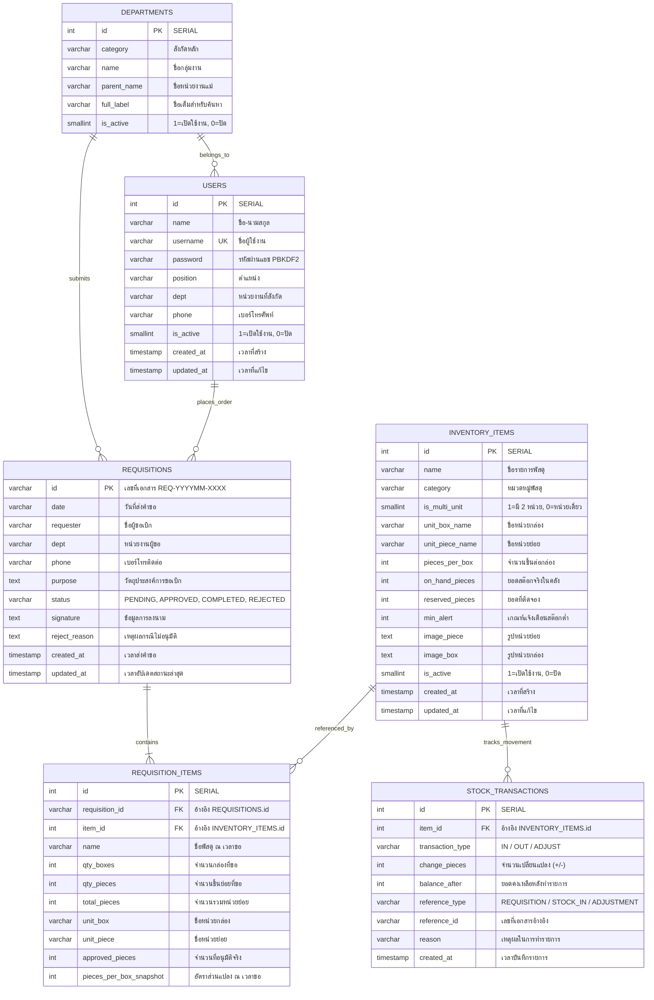

# พจนานุกรมข้อมูล (Data Dictionary)
### ระบบขอเบิกพัสดุและคลังพัสดุดิจิทัล มหาวิทยาลัยสวนดุสิต (SDU Stock Order & e-Inventory)

---

## 1. ข้อมูลทั่วไปของฐานข้อมูล (Database Overview & Metadata)

| คุณสมบัติ (Property) | รายละเอียด (Specification) |
| :--- | :--- |
| **ชื่อระบบงาน** | ระบบขอเบิกพัสดุและคลังพัสดุดิจิทัล มหาวิทยาลัยสวนดุสิต (SDU Stock Order) |
| **เวอร์ชันสถาปัตยกรรม** | v3.0.5 (PostgreSQL 17 Edition) |
| **ระบบจัดการฐานข้อมูล (RDBMS)** | PostgreSQL 17 (`postgres:17-alpine`) / MySQL Fallback |
| **ชื่อฐานข้อมูล (Database Name)** | `sdu_inventory` |
| **สคีมาหลัก (Schema)** | `public` |
| **การเข้ารหัสตัวอักษร (Character Encoding)** | UTF-8 (`th_TH.UTF-8` / `utf8mb4`) |
| **จำนวนตารางทั้งหมด** | 6 ตาราง (3 Master Data, 2 Transactional, 1 Audit Trail) |
| **พอร์ตบริการมาตรฐาน** | `5433` (Docker Compose Host Port) / Internal: `5432` |
| **เครื่องมือบริหารจัดการ GUI** | pgAdmin 4 (พอร์ต `5051`, URL: `http://localhost:5051`) |

---

## 2. ตารางสรุปภาพรวมของข้อมูล (Tables Summary Matrix)

| ลำดับ | ชื่อตารางทางกายภาพ (Physical Table) | ชื่อตารางเชิงตรรกะ (Logical Name) | ประเภทข้อมูล (Category) | คีย์หลัก (Primary Key) | จำนวนฟิลด์ | รายละเอียดและหน้าที่ของตาราง |
| :---: | :--- | :--- | :--- | :---: | :---: | :--- |
| 1 | `departments` | หน่วยงานและกลุ่มงานต้นสังกัด | Master Data | `id` | 6 | ข้อมูลสังกัดและกลุ่มงานภายใน มสด. (90+ หน่วยงาน) สำหรับระบบ Search Autocomplete |
| 2 | `users` | ทำเนียบบุคลากรและบัญชีผู้ใช้งาน | Master Data / Auth | `id` | 10 | รายชื่ออาจารย์และบุคลากรผู้มีสิทธิ์ขอเบิก พร้อมรหัสผ่านความปลอดภัยสูง (PBKDF2) |
| 3 | `inventory_items` | คลังรายการพัสดุกลาง | Master Data / Inventory | `id` | 15 | แคตตาล็อกพัสดุ 34 รายการ, สูตรแปลง 2 หน่วยนับ (กล่อง-ชิ้น), ยอดคงคลัง On-Hand และ Reserved |
| 4 | `requisitions` | ใบคำขอเบิกพัสดุ (Header) | Transactional | `id` | 11 | ข้อมูลหัวเอกสารใบขอเบิก, ผู้ขอ, วันที่, วัตถุประสงค์, สถานะ และข้อมูลประวัติการอนุมัติ |
| 5 | `requisition_items` | รายการพัสดุย่อยในคำขอ (Detail) | Transactional | `id` | 11 | รายการพัสดุที่ขอเบิกในแต่ละใบคำขอ, จำนวนกล่อง, จำนวนชิ้นย่อย, จำนวนที่อนุมัติจริง |
| 6 | `stock_transactions` | บันทึกประวัติความเคลื่อนไหวสต๊อก | Log / Audit Trail | `id` | 9 | ประวัติการตัดสต๊อก, การรับเข้า, และการปรับยอดสต๊อกจริง พร้อมยอดคงเหลือ Balance After |

---

## 3. แผนผังความสัมพันธ์ของข้อมูล (Entity-Relationship Diagram: ERD)



---

## 4. พจานุกรมข้อมูลรายตาราง (Detailed Table Specifications)

---

### 4.1 ตาราง `departments` (หน่วยงานและกลุ่มงานต้นสังกัด)
* **ชื่อตาราง:** `departments`
* **คำอธิบาย:** จัดเก็บโครงสร้างหน่วยงาน สถาบัน สำนัก และกลุ่มงานภายในมหาวิทยาลัยสวนดุสิต รองรับการค้นหาแบบ Live Auto-complete
* **Primary Key:** `id`
* **ดัชนี (Indexes):**
  * `departments_pkey` (Unique B-Tree บน `id`)
  * `idx_dept_category` (B-Tree บน `category`)
  * `idx_dept_full_label` (B-Tree บน `full_label`)

| ลำดับ | ชื่อฟิลด์ (Column Name) | ชื่อภาษาไทย (Logical Name) | ชนิดข้อมูล (Data Type) | Nullable | ค่าเริ่มต้น (Default) | คีย์/ดัชนี | ตัวอย่างข้อมูล | กฎเกณฑ์และคำอธิบาย (Business Rules) |
| :---: | :--- | :--- | :--- | :---: | :---: | :---: | :--- | :--- |
| 1 | `id` | รหัสหน่วยงาน | `SERIAL` (INTEGER) | ❌ NO | `nextval(...)` | **PK** | `1`, `2`, `3` | ลำดับตัวเลข Running อัตโนมัติ |
| 2 | `category` | สังกัดระดับคณะ/สำนัก | `VARCHAR(150)` | ❌ NO | *None* | Index | `'สำนักวิทยบริการและเทคโนโลยีสารสนเทศ (สวท.)'` | ชื่อสำนักหรือคณะต้นสังกัดหลัก |
| 3 | `name` | ชื่อกลุ่มงาน/ฝ่าย | `VARCHAR(255)` | ❌ NO | *None* | - | `'ฝ่ายเทคโนโลยีสารสนเทศ'` | ชื่อกลุ่มงานหรือฝ่ายภายในสังกัด |
| 4 | `parent_name` | หน่วยงานต้นสังกัด | `VARCHAR(255)` | ❌ NO | *None* | - | `'สำนักวิทยบริการและเทคโนโลยีสารสนเทศ'` | อ้างอิงหน่วยงานแม่เพื่อการจัดกลุ่ม |
| 5 | `full_label` | ชื่อเต็มสำหรับค้นหา | `VARCHAR(255)` | ❌ NO | *None* | Index | `'ฝ่ายเทคโนโลยีสารสนเทศ (สวท.)'` | ข้อความสมบูรณ์สำหรับแสดงผลใน Dropdown |
| 6 | `is_active` | สถานะเปิดใช้งาน | `SMALLINT` | ❌ NO | `1` | - | `1` | `1` = ใช้งานปกติ, `0` = ยกเลิก/ระงับ |

---

### 4.2 ตาราง `users` (ทำเนียบบุคลากรและบัญชีผู้ใช้งาน)
* **ชื่อตาราง:** `users`
* **คำอธิบาย:** จัดเก็บข้อมูลอาจารย์และบุคลากรผู้มีสิทธิ์ส่งคำขอเบิกพัสดุ พร้อมระบบตรวจสอบสิทธิ์ระดับเซิร์ฟเวอร์
* **Primary Key:** `id`
* **Unique Constraints:** `username`
* **ดัชนี (Indexes):**
  * `users_pkey` (Unique B-Tree บน `id`)
  * `users_username_key` (Unique B-Tree บน `username`)
  * `idx_users_name` (B-Tree บน `name`)
  * `idx_users_username` (B-Tree บน `username`)
  * `idx_users_dept` (B-Tree บน `dept`)
* **ทริกเกอร์ (Trigger):** `trg_users_updated_at` (อัปเดตค่า `updated_at` เป็นเวลาปัจจุบันอัตโนมัติเมื่อเกิดการ UPDATE)

| ลำดับ | ชื่อฟิลด์ (Column Name) | ชื่อภาษาไทย (Logical Name) | ชนิดข้อมูล (Data Type) | Nullable | ค่าเริ่มต้น (Default) | คีย์/ดัชนี | ตัวอย่างข้อมูล | กฎเกณฑ์และคำอธิบาย (Business Rules) |
| :---: | :--- | :--- | :--- | :---: | :---: | :---: | :--- | :--- |
| 1 | `id` | รหัสบุคลากร | `SERIAL` (INTEGER) | ❌ NO | `nextval(...)` | **PK** | `1`, `2`, `3` | รหัสประจำตัว Running อัตโนมัติ |
| 2 | `name` | ชื่อ-นามสกุล บุคลากร | `VARCHAR(150)` | ❌ NO | *None* | Index | `'นางสาวจีรวรรณ บุญพิทักษ์'` | ชื่อ-สกุลทางการของบุคลากร |
| 3 | `username` | ชื่อผู้ใช้สำหรับล็อกอิน | `VARCHAR(100)` | ⚠️ YES | *None* | **UK**, Index | `'jeerawan.b'` | บัญชีผู้ใช้งานประจำตัว (ห้ามซ้ำ) |
| 4 | `password` | รหัสผ่านที่เข้ารหัสแล้ว | `VARCHAR(255)` | ⚠️ YES | `''` | - | `pbkdf2_sha256$3691...$3631...` | แฮชด้วย PBKDF2-HMAC-SHA256 พร้อม Salt 16 ไบต์ |
| 5 | `position` | ตำแหน่งหน้าที่ | `VARCHAR(255)` | ⚠️ YES | `''` | - | `'หัวหน้าหน่วยงานการศึกษาและการเรียนรู้ตลอดชีวิต'` | ตำแหน่งงานหรือหน้าที่รับผิดชอบ |
| 6 | `dept` | หน่วยงานที่สังกัด | `VARCHAR(255)` | ❌ NO | *None* | Index | `'หน่วยงานการศึกษาและการเรียนรู้ตลอดชีวิต'` | อ้างอิงชื่อหน่วยงานที่บุคลากรสังกัด |
| 7 | `phone` | เบอร์โทรศัพท์ติดต่อ | `VARCHAR(50)` | ⚠️ YES | `''` | - | `'02-244-5000 ต่อ 5851'` | เบอร์โทรศัพท์ภายในหรือเบอร์มือถือ |
| 8 | `is_active` | สถานะเปิดใช้งาน | `SMALLINT` | ❌ NO | `1` | - | `1` | `1` = ปกติ, `0` = พ้นสภาพ/ระงับสิทธิ์ |
| 9 | `created_at` | เวลาที่สร้างข้อมูล | `TIMESTAMP` | ❌ NO | `CURRENT_TIMESTAMP` | - | `2026-11-04 02:44:01` | ประทับเวลาเมื่อเพิ่มบุคลากรเข้าสู่ระบบ |
| 10 | `updated_at` | เวลาที่แก้ไขล่าสุด | `TIMESTAMP` | ❌ NO | `CURRENT_TIMESTAMP` | - | `2026-11-04 03:37:54` | ปรับปรุงเวลาอัตโนมัติผ่าน Database Trigger |

---

### 4.3 ตาราง `inventory_items` (คลังรายการพัสดุกลางและอัตราส่วน 2 หน่วยนับ)
* **ชื่อตาราง:** `inventory_items`
* **คำอธิบาย:** จัดเก็บรายการพัสดุคงคลัง 34 รายการ, อัตราส่วนแปลงหน่วย (กล่อง-ชิ้น), ยอดคงเหลือจริง (On-Hand), ยอดจอง (Reserved) และเกณฑ์เตือนสต๊อกต่ำ
* **Primary Key:** `id`
* **ดัชนี (Indexes):**
  * `inventory_items_pkey` (Unique B-Tree บน `id`)
  * `idx_items_name` (B-Tree บน `name`)
  * `idx_items_category` (B-Tree บน `category`)
* **ทริกเกอร์ (Trigger):** `trg_inventory_items_updated_at`

| ลำดับ | ชื่อฟิลด์ (Column Name) | ชื่อภาษาไทย (Logical Name) | ชนิดข้อมูล (Data Type) | Nullable | ค่าเริ่มต้น (Default) | คีย์/ดัชนี | ตัวอย่างข้อมูล | กฎเกณฑ์และคำอธิบาย (Business Rules) |
| :---: | :--- | :--- | :--- | :---: | :---: | :---: | :--- | :--- |
| 1 | `id` | รหัสพัสดุ | `SERIAL` (INTEGER) | ❌ NO | `nextval(...)` | **PK** | `1`, `2`, `3` | รหัสประจำตัวรายการพัสดุ |
| 2 | `name` | ชื่อรายการพัสดุ | `VARCHAR(255)` | ❌ NO | *None* | Index | `'ซองขาว เบอร์ 9/125 ตรา มสด.'` | ชื่อพัสดุภาษาไทยระบุขนาดและตราสินค้าชัดเจน |
| 3 | `category` | หมวดหมู่พัสดุ | `VARCHAR(100)` | ❌ NO | *None* | Index | `'ซองเอกสาร'` | จัดกลุ่มพัสดุ (เช่น ซองเอกสาร, กระดาษ, เครื่องเขียน) |
| 4 | `is_multi_unit` | สถานะ 2 หน่วยนับ | `SMALLINT` | ❌ NO | `1` | - | `1` | `1` = มีหน่วยบรรจุกล่องและหน่วยย่อย, `0` = มีหน่วยเดี่ยว |
| 5 | `unit_box_name` | ชื่อหน่วยบรรจุใหญ่ | `VARCHAR(50)` | ⚠️ YES | `NULL` | - | `'กล่อง'`, `'ห่อ'`, `'เล่ม'` | ชื่อหน่วยนับระดับบรรจุภัณฑ์ (กรณีหน่วยเดี่ยวเป็น NULL) |
| 6 | `unit_piece_name` | ชื่อหน่วยย่อย | `VARCHAR(50)` | ❌ NO | `'ชิ้น'` | - | `'ซอง'`, `'แผ่น'`, `'ด้าม'`, `'ชิ้น'` | ชื่อหน่วยนับย่อยที่สุดที่อนุญาตให้เบิกได้ |
| 7 | `pieces_per_box` | อัตราส่วนชิ้นต่อกล่อง | `INTEGER` | ❌ NO | `1` | - | `500` | จำนวนชิ้นย่อยใน 1 กล่อง (ต้อง $\ge 1$) |
| 8 | `on_hand_pieces` | ยอดสต๊อกคงคลังจริง | `INTEGER` | ❌ NO | `0` | - | `12500` | จำนวนชิ้นที่มีอยู่จริงในห้องคลัง (ต้อง $\ge 0$) |
| 9 | `reserved_pieces` | ยอดติดจองรอจ่าย | `INTEGER` | ❌ NO | `0` | - | `1000` | จำนวนชิ้นที่ถูกกันไว้เมื่อคำขอได้รับอนุมัติ (ต้อง $\ge 0$) |
| 10 | `min_alert` | เกณฑ์แจ้งเตือนสต๊อกต่ำ | `INTEGER` | ❌ NO | `500` | - | `500` | หาก `(on_hand - reserved) < min_alert` จะแจ้งเตือนสต๊อกวิกฤต |
| 11 | `image_piece` | รูปภาพหน่วยย่อย | `TEXT` | ⚠️ YES | `NULL` | - | `'assets/items/item_01_piece.jpg'` | Relative Path หรือ URL รูปภาพของหน่วยย่อย |
| 12 | `image_box` | รูปภาพหน่วยกล่อง | `TEXT` | ⚠️ YES | `NULL` | - | `'assets/items/item_01_box.jpg'` | Relative Path หรือ URL รูปภาพของหน่วยกล่องบรรจุ |
| 13 | `is_active` | สถานะเปิดให้เบิก | `SMALLINT` | ❌ NO | `1` | - | `1` | `1` = แสดงในแคตตาล็อก, `0` = พักการจ่าย |
| 14 | `created_at` | เวลาที่ลงทะเบียนพัสดุ | `TIMESTAMP` | ❌ NO | `CURRENT_TIMESTAMP` | - | `2026-11-04 02:44:01` | เวลาที่บันทึกพัสดุเข้าระบบครั้งแรก |
| 15 | `updated_at` | เวลาปรับปรุงล่าสุด | `TIMESTAMP` | ❌ NO | `CURRENT_TIMESTAMP` | - | `2026-11-04 03:45:10` | ปรับปรุงเวลาอัตโนมัติเมื่อสต๊อกหรือข้อมูลเปลี่ยน |

---

### 4.4 ตาราง `requisitions` (ใบคำขอเบิกพัสดุ - Header)
* **ชื่อตาราง:** `requisitions`
* **คำอธิบาย:** จัดเก็บหัวเอกสารใบขอเบิกพัสดุ ข้อมูลผู้ขอ วัตถุประสงค์ สถานะใบคำขอ และผลการอนุมัติ
* **Primary Key:** `id`
* **ดัชนี (Indexes):**
  * `requisitions_pkey` (Unique B-Tree บน `id`)
  * `idx_req_status` (B-Tree บน `status`)
  * `idx_req_requester` (B-Tree บน `requester`)
  * `idx_req_created_at` (B-Tree บน `created_at`)
* **ทริกเกอร์ (Trigger):** `trg_requisitions_updated_at`
* **Check Constraints:** `CHECK (status IN ('PENDING', 'APPROVED', 'COMPLETED', 'REJECTED'))`

| ลำดับ | ชื่อฟิลด์ (Column Name) | ชื่อภาษาไทย (Logical Name) | ชนิดข้อมูล (Data Type) | Nullable | ค่าเริ่มต้น (Default) | คีย์/ดัชนี | ตัวอย่างข้อมูล | กฎเกณฑ์และคำอธิบาย (Business Rules) |
| :---: | :--- | :--- | :--- | :---: | :---: | :---: | :--- | :--- |
| 1 | `id` | เลขที่ใบขอเบิกพัสดุ | `VARCHAR(50)` | ❌ NO | *None* | **PK** | `'REQ-256911-0001'` | รูปแบบ: `REQ-ปีพ.ศ.(4)เดือน(2)-ลำดับ(4)` |
| 2 | `date` | วันที่เวลาแสดงผล | `VARCHAR(100)` | ❌ NO | *None* | - | `'04 พ.ย. 2569 10:15 น.'` | ข้อความวันที่และเวลาภาษาไทยสำหรับพิมพ์และแสดงผล |
| 3 | `requester` | ชื่อ-นามสกุล ผู้ขอเบิก | `VARCHAR(150)` | ❌ NO | *None* | Index | `'นางสาวจีรวรรณ บุญพิทักษ์'` | ชื่อบุคลากรผู้ส่งคำขอ |
| 4 | `dept` | หน่วยงานผู้ขอเบิก | `VARCHAR(255)` | ❌ NO | *None* | - | `'สำนักวิทยบริการและเทคโนโลยีสารสนเทศ'` | หน่วยงานต้นสังกัดของผู้ขอเบิก |
| 5 | `phone` | เบอร์โทรศัพท์ติดต่อ | `VARCHAR(50)` | ⚠️ YES | `''` | - | `'02-244-5851'` | เบอร์โทรสำหรับประสานงานรับของ |
| 6 | `purpose` | วัตถุประสงค์การขอเบิก | `TEXT` | ❌ NO | *None* | - | `'ใช้ในการจัดอบรมเชิงปฏิบัติการ AI'` | รายละเอียดความจำเป็นในการขอเบิกใช้งาน |
| 7 | `status` | สถานะของใบคำขอ | `VARCHAR(20)` | ❌ NO | `'PENDING'` | Index | `'PENDING'`, `'APPROVED'`, `'COMPLETED'` | สถานะคำขอตามวงจร Requisition Lifecycle |
| 8 | `signature` | ข้อมูลการส่งมอบ | `TEXT` | ⚠️ YES | `NULL` | - | `'HANDOVER_CONFIRMED'` หรือ DataURL | เครื่องหมายยืนยันการรับมอบพัสดุจริง |
| 9 | `reject_reason` | เหตุผลการไม่อนุมัติ | `TEXT` | ⚠️ YES | `NULL` | - | `'ยอดสต๊อกคงคลังไม่เพียงพอ กรุณาลดจำนวน'` | บันทึกเมื่อเจ้าหน้าที่พัสดุเลือก REJECT |
| 10 | `created_at` | เวลาที่ส่งคำขอ | `TIMESTAMP` | ❌ NO | `CURRENT_TIMESTAMP` | Index | `2026-11-04 10:15:22` | เวลาส่งคำขอเข้าสู่ระบบ |
| 11 | `updated_at` | เวลาเปลี่ยนสถานะ | `TIMESTAMP` | ❌ NO | `CURRENT_TIMESTAMP` | - | `2026-11-04 10:30:00` | เวลาที่มีการอนุมัติ จ่ายพัสดุ หรือปฏิเสธ |

---

### 4.5 ตาราง `requisition_items` (รายการพัสดุย่อยในคำขอเบิก - Detail)
* **ชื่อตาราง:** `requisition_items`
* **คำอธิบาย:** จัดเก็บรายการพัสดุแต่ละชนิดที่ระบุในใบขอเบิก พร้อมจำนวนกล่อง จำนวนชิ้น และสแนปช็อตอัตราส่วนการแปลงหน่วย ณ เวลาขอเบิก
* **Primary Key:** `id`
* **Foreign Keys:**
  * `requisition_id` อ้างอิง `requisitions(id)` (`ON DELETE CASCADE`)
  * `item_id` อ้างอิง `inventory_items(id)` (`ON DELETE RESTRICT`)
* **ดัชนี (Indexes):**
  * `requisition_items_pkey` (Unique B-Tree บน `id`)
  * `idx_req_items_req_id` (B-Tree บน `requisition_id`)
  * `idx_req_items_item_id` (B-Tree บน `item_id`)

| ลำดับ | ชื่อฟิลด์ (Column Name) | ชื่อภาษาไทย (Logical Name) | ชนิดข้อมูล (Data Type) | Nullable | ค่าเริ่มต้น (Default) | คีย์/ดัชนี | ตัวอย่างข้อมูล | กฎเกณฑ์และคำอธิบาย (Business Rules) |
| :---: | :--- | :--- | :--- | :---: | :---: | :---: | :--- | :--- |
| 1 | `id` | รหัสรายการย่อย | `SERIAL` (INTEGER) | ❌ NO | `nextval(...)` | **PK** | `1`, `2`, `3` | รหัสแถวรายการ Running อัตโนมัติ |
| 2 | `requisition_id` | เลขที่ใบคำขอเบิก | `VARCHAR(50)` | ❌ NO | *None* | **FK**, Index | `'REQ-256911-0001'` | เชื่อมโยงไปยัง `requisitions.id` (ลบตามหัวเอกสาร) |
| 3 | `item_id` | รหัสพัสดุ | `INTEGER` | ❌ NO | *None* | **FK**, Index | `1`, `5`, `12` | เชื่อมโยงไปยัง `inventory_items.id` (ห้ามลบพัสดุหากมีประวัติเบิก) |
| 4 | `name` | ชื่อพัสดุ ณ เวลาขอ | `VARCHAR(255)` | ❌ NO | *None* | - | `'ซองขาว เบอร์ 9/125 ตรา มสด.'` | สแนปช็อตชื่อพัสดุเพื่อป้องกันการเปลี่ยนแปลงย้อนหลัง |
| 5 | `qty_boxes` | จำนวนกล่องที่ขอ | `INTEGER` | ❌ NO | `0` | - | `2` | จำนวนที่ขอเป็นหน่วยบรรจุใหญ่ (ต้อง $\ge 0$) |
| 6 | `qty_pieces` | จำนวนชิ้นย่อยที่ขอ | `INTEGER` | ❌ NO | `0` | - | `50` | จำนวนที่ขอเป็นหน่วยย่อยเศษ (ต้อง $\ge 0$) |
| 7 | `total_pieces` | จำนวนรวมคิดเป็นชิ้น | `INTEGER` | ❌ NO | `0` | - | `1050` | $(\text{qty\_boxes} \times \text{pieces\_per\_box}) + \text{qty\_pieces}$ |
| 8 | `unit_box` | ชื่อหน่วยกล่อง | `VARCHAR(50)` | ⚠️ YES | `NULL` | - | `'กล่อง'` | บันทึกชื่อหน่วยกล่อง ณ วันที่ขอเบิก |
| 9 | `unit_piece` | ชื่อหน่วยย่อย | `VARCHAR(50)` | ❌ NO | `'ชิ้น'` | - | `'ซอง'` | บันทึกชื่อหน่วยย่อย ณ วันที่ขอเบิก |
| 10 | `approved_pieces` | จำนวนที่อนุมัติจริง | `INTEGER` | ❌ NO | `0` | - | `1050` | ยอดที่เจ้าหน้าที่อนุมัติจัดจ่ายจริง (ใช้ตัดสต๊อกจริง) |
| 11 | `pieces_per_box_snapshot` | อัตราส่วนแปลงหน่วย ณ เวลาขอ | `INTEGER` | ❌ NO | `1` | - | `500` | บันทึกค่าคงที่ชิ้น/กล่องไว้ เพื่อป้องกันสต๊อกเพี้ยนหากอัตราส่วนเปลี่ยนในอนาคต |

---

### 4.6 ตาราง `stock_transactions` (บันทึกประวัติความเคลื่อนไหวสต๊อก / Audit Trail)
* **ชื่อตาราง:** `stock_transactions`
* **คำอธิบาย:** เก็บบันทึกประวัติการเปลี่ยนแปลงยอดพัสดุทุกรายการ (รับเข้า, จ่ายออก, ปรับยอดสต๊อกจริง) แบบ Immutable เพื่อการตรวจสอบย้อนหลัง (Audit Trail)
* **Primary Key:** `id`
* **Foreign Keys:**
  * `item_id` อ้างอิง `inventory_items(id)` (`ON DELETE CASCADE`)
* **ดัชนี (Indexes):**
  * `stock_transactions_pkey` (Unique B-Tree บน `id`)
  * `idx_tx_item_id` (B-Tree บน `item_id`)
* **Check Constraints:** `CHECK (transaction_type IN ('IN', 'OUT', 'ADJUST'))`

| ลำดับ | ชื่อฟิลด์ (Column Name) | ชื่อภาษาไทย (Logical Name) | ชนิดข้อมูล (Data Type) | Nullable | ค่าเริ่มต้น (Default) | คีย์/ดัชนี | ตัวอย่างข้อมูล | กฎเกณฑ์และคำอธิบาย (Business Rules) |
| :---: | :--- | :--- | :--- | :---: | :---: | :---: | :--- | :--- |
| 1 | `id` | รหัสรายการเคลื่อนไหว | `SERIAL` (INTEGER) | ❌ NO | `nextval(...)` | **PK** | `1`, `2`, `3` | ลำดับการทำธุรกรรมสต๊อก Running อัตโนมัติ |
| 2 | `item_id` | รหัสพัสดุ | `INTEGER` | ❌ NO | *None* | **FK**, Index | `1`, `2` | อ้างอิงรายการพัสดุที่เกิดการเคลื่อนไหว |
| 3 | `transaction_type` | ประเภทธุรกรรมสต๊อก | `VARCHAR(10)` | ❌ NO | *None* | - | `'IN'`, `'OUT'`, `'ADJUST'` | `'IN'`=รับเข้า, `'OUT'`=จ่ายออก, `'ADJUST'`=ปรับยอดนับจริง |
| 4 | `change_pieces` | จำนวนชิ้นที่เปลี่ยนแปลง | `INTEGER` | ❌ NO | *None* | - | `+500`, `-1050`, `+12` | ค่าตัวเลขส่วนต่าง (บวกเมื่อเพิ่ม, ลบเมื่อตัดจ่าย) |
| 5 | `balance_after` | ยอดคงเหลือหลังรายการ | `INTEGER` | ❌ NO | `0` | - | `11450` | ยอดคงคลังจริง `on_hand_pieces` ณ จังหวะที่บันทึกรายการเสร็จ |
| 6 | `reference_type` | ประเภทเอกสารอ้างอิง | `VARCHAR(50)` | ❌ NO | *None* | - | `'REQUISITION'`, `'STOCK_IN'`, `'ADJUSTMENT'` | ต้นทางที่มาของธุรกรรม |
| 7 | `reference_id` | เลขที่เอกสารอ้างอิง | `VARCHAR(50)` | ⚠️ YES | `NULL` | - | `'REQ-256911-0001'` | รหัสเอกสาร เช่น เลขที่ใบเบิก หรือใบรับของเข้า |
| 8 | `reason` | เหตุผลในการทำรายการ | `VARCHAR(255)` | ⚠️ YES | `NULL` | - | `'จ่ายพัสดุตามคำขอ'`, `'นับสต๊อกสิ้นปีพบเกิน 12 ซอง'` | ข้อความระบุเหตุผลเพื่อการตรวจสอบบัญชีพัสดุ |
| 9 | `created_at` | เวลาที่เกิดธุรกรรม | `TIMESTAMP` | ❌ NO | `CURRENT_TIMESTAMP` | - | `2026-11-04 10:30:15` | ประทับเวลาอัตโนมัติ ห้ามแก้ไขย้อนหลัง |

---

## 5. พจนานุกรมรหัสสถานะและค่าคงที่ (Status Codes & Value Enumerations)

### 5.1 สถานะคำขอเบิก (`requisitions.status`)
| รหัสสถานะ (Code) | ป้ายกำกับภาษาไทย | สัญลักษณ์สี | คำอธิบายความหมายและผลต่อสต๊อก |
| :--- | :--- | :---: | :--- |
| **`PENDING`** | รอการตรวจสอบ | 🟡 สีส้มอ่อน | คำขอส่งถึงเจ้าหน้าที่พัสดุแล้ว ยอดสต๊อกยังไม่มีการเปลี่ยนแปลง |
| **`APPROVED`** | อนุมัติ / กันสต๊อก | 🔵 สีฟ้า | เจ้าหน้าที่อนุมัติคำขอแล้ว ระบบทำการล็อกยอดจอง `reserved_pieces += approved_pieces` ทันที |
| **`COMPLETED`** | จ่ายพัสดุเรียบร้อย | 🟢 สีเขียว | ผู้ขอได้รับมอบพัสดุแล้ว ระบบตัดสต๊อกจริง `on_hand_pieces -= approved_pieces` และปลดล็อก `reserved_pieces -= approved_pieces` |
| **`REJECTED`** | ไม่อนุมัติ / ปฏิเสธ | 🔴 สีแดง | เจ้าหน้าที่ปฏิเสธคำขอ หากเคยเป็น APPROVED ระบบจะปลดล็อกยอดจอง `reserved_pieces -= approved_pieces` คืนสู่คลังทันที |

---

### 5.2 ประเภทธุรกรรมสต๊อก (`stock_transactions.transaction_type`)
| รหัส (Code) | ชื่อประเภท | ทิศทางของสต๊อก | เหตุการณ์ที่เกิดขึ้น (Trigger Event) |
| :--- | :--- | :---: | :--- |
| **`IN`** | รับพัสดุเข้าคลัง | เพิ่มขึ้น (`+`) | เจ้าหน้าที่บันทึกรับเข้าพัสดุใหม่ (Stock-In) หรือสั่งซื้อเพิ่ม |
| **`OUT`** | จ่ายพัสดุออกจากคลัง | ลดลง (`-`) | การส่งมอบพัสดุเสร็จสิ้นในสถานะ `COMPLETED` |
| **`ADJUST`** | ปรับยอดสต๊อกจริง | เพิ่ม/ลด (`+/-`) | เจ้าหน้าที่ตรวจนับยอดพัสดุทางกายภาพและทำการกระทบยอดจริง (Stock Adjustment) |

---

## 6. สูตรการคำนวณและกฎเกณฑ์ทางธุรกิจ (Business Rules & Formulas)

### 6.1 สูตรแปลง 2 หน่วยนับ (Two-Tier Unit Conversion)
สำหรับรายการพัสดุที่มีทั้งหน่วยบรรจุกล่องและหน่วยชิ้นย่อย (`is_multi_unit = 1`):
$$\text{Total Pieces} = (\text{Qty Boxes} \times \text{Pieces Per Box}) + \text{Qty Pieces}$$

* **ตัวอย่าง:** ซองเอกสารขาว เบอร์ 9/125 (1 กล่อง = 500 ซอง) เบิก 2 กล่อง 50 ซอง:
  $$\text{Total Pieces} = (2 \times 500) + 50 = 1,050 \text{ ซอง}$$

---

### 6.2 สูตรคำนวณยอดสต๊อกคงเหลือพร้อมเบิก (Available Stock Formula)
$$\text{Available Stock} = \text{On-Hand Pieces} - \text{Reserved Pieces}$$

* **กฎข้อบังคับ:**
  1. ยอดคงคลังพร้อมเบิกต้องไม่ติดลบ: $\text{Available Stock} \ge 0$
  2. หากผู้ขอระบุจำนวนเบิกเกินยอดพร้อมเบิก ($\text{Total Pieces} > \text{Available Stock}$) ระบบจะปฏิเสธการส่งคำขอทันที
  3. เกณฑ์แจ้งเตือนสต๊อกต่ำ: หาก $\text{Available Stock} \le \text{min\_alert}$ ระบบจะแสดงแถบเตือนสีส้ม/แดงในหน้าจอ Staff Portal

---

### 6.3 ทรานแซกชันและการตัดสต๊อกจริง (ACID Stock Transitions)
การเปลี่ยนสถานะเพื่อตัดสต๊อกทำผ่านคำสั่ง SQL ที่ยึดหลัก **Row-Level Locking (`FOR UPDATE`)** ภายใต้ Database Transaction เสมอ:

1. **เมื่ออนุมัติ (`APPROVED`):**
   ```sql
   UPDATE inventory_items 
   SET reserved_pieces = reserved_pieces + %s 
   WHERE id = %s;
   ```
2. **เมื่อจ่ายพัสดุตัดสต๊อกจริง (`COMPLETED`):**
   ```sql
   UPDATE inventory_items 
   SET on_hand_pieces = on_hand_pieces - %s,
       reserved_pieces = reserved_pieces - %s 
   WHERE id = %s;
   ```
3. **เมื่อยกเลิกหรือไม่อนุมัติคำขอที่เคยอนุมัติแล้ว (`REJECTED`):**
   ```sql
   UPDATE inventory_items 
   SET reserved_pieces = reserved_pieces - %s 
   WHERE id = %s;
   ```

---

## 7. มาตรการความมั่นคงปลอดภัยของข้อมูล (Data Security Standards)

1. **การจัดเก็บรหัสผ่านผู้ใช้งาน (CWE-256 / CWE-312 Mitigation):**
   - รหัสผ่านในตาราง `users.password` จัดเก็บในรูปแบบแฮช **PBKDF2-HMAC-SHA256**
   - สร้างเกลือเข้ารหัสสุ่ม (Salt) ขนาด 16 ไบต์ (32 ตัวอักษร Hex) ประจำแต่ละบัญชี
   - รอบการคำนวณ (Iterations): 600,000 รอบตามมาตรฐาน OWASP
   - รูปแบบโครงสร้างสตริง: `pbkdf2_sha256$<salt_hex>$<derived_key_hex>`
2. **การรักษาความสมบูรณ์ของการเชื่อมโยง (Referential Integrity):**
   - Foreign Key จาก `requisition_items` ไปยัง `requisitions`: ตั้งค่า `ON DELETE CASCADE` เพื่อลบรายการย่อยอัตโนมัติเมื่อลบใบคำขอ
   - Foreign Key จาก `requisition_items` ไปยัง `inventory_items`: ตั้งค่า `ON DELETE RESTRICT` เพื่อห้ามลบรายการพัสดุหลักหากมีประวัติการเบิกค้างอยู่
3. **การเข้าถึงฐานข้อมูล:**
   - การเชื่อมต่อทั้งหมดกระทำผ่าน Python Connection Pool แยกสิทธิ์ และใช้ Parameterized Queries (`%s`) 100% ป้องกัน SQL Injection อย่างเด็ดขาด

