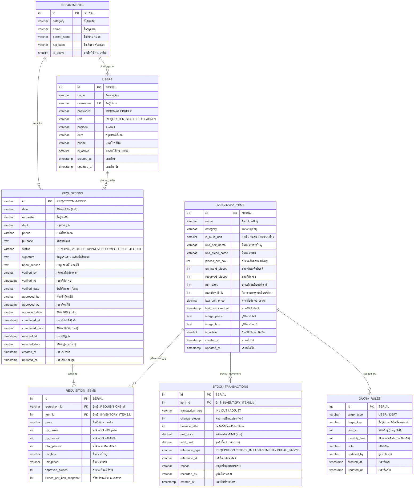

# พจนานุกรมข้อมูล (Data Dictionary)
### ระบบจัดการวัสดุสำนักงานออนไลน์ มหาวิทยาลัยสวนดุสิต

---

## 1. ข้อมูลทั่วไปของฐานข้อมูล (Database Overview & Metadata)

| คุณสมบัติ (Property) | รายละเอียด (Specification) |
| :--- | :--- |
| **ชื่อระบบงาน** | ระบบจัดการวัสดุสำนักงานออนไลน์ มหาวิทยาลัยสวนดุสิต |
| **เวอร์ชันระบบ** | **v3.8.4** (PostgreSQL 17 Edition) |
| **ระบบจัดการฐานข้อมูล (RDBMS)** | PostgreSQL 17 (`postgres:17-alpine`) / MySQL Fallback |
| **ชื่อฐานข้อมูล (Database Name)** | `sdu_inventory` |
| **สคีมาหลัก (Schema)** | `public` |
| **การเข้ารหัสตัวอักษร (Character Encoding)** | UTF-8 (`th_TH.UTF-8` / `utf8mb4`) |
| **จำนวนตารางทั้งหมด** | **7 ตาราง** (3 Master Data, 2 Transactional, 1 Audit Trail, 1 Quota Policy) |
| **พอร์ตบริการมาตรฐาน** | `127.0.0.1:5433` (Docker Host Port) / Internal: `5432` |
| **การจัดการ Connection** | `psycopg2.pool.ThreadedConnectionPool` (Min 1 / Max 20) + Schema Auto-Migration |

---

## 2. ตารางสรุปภาพรวมของข้อมูล (Tables Summary Matrix)

| ลำดับ | ชื่อตารางทางกายภาพ (Physical Table) | ชื่อตารางเชิงตรรกะ (Logical Name) | ประเภทข้อมูล (Category) | คีย์หลัก (PK) | จำนวนฟิลด์ | รายละเอียดและหน้าที่ของตาราง |
| :---: | :--- | :--- | :--- | :---: | :---: | :--- |
| 1 | `departments` | กลุ่มงานและหน่วยงานต้นสังกัด สวท. | Master Data | `id` | 6 | ข้อมูลกลุ่มงาน/หน่วยงานภายใน สวท. (ตั้งต้น 6 กลุ่มงาน) สำหรับ Dropdown ค้นหาได้ |
| 2 | `users` | ทำเนียบบุคลากรและบัญชีผู้ใช้งาน | Master Data / Auth | `id` | 11 | รายชื่อบุคลากร สวท. (ตั้งต้น 15 บัญชีจาก `Book1.xlsx`) พร้อมรหัสผ่าน PBKDF2 และบทบาท RBAC 4 ระดับ |
| 3 | `inventory_items` | คลังรายการพัสดุกลาง | Master Data / Inventory | `id` | 18 | แคตตาล็อกพัสดุตั้งต้น 34 รายการ, 2 หน่วยนับ, ยอด On-Hand/Reserved, โควตามาตรฐาน, และราคาล่าสุด |
| 4 | `requisitions` | ใบคำขอเบิกพัสดุ (Header) | Transactional | `id` | 21 | ข้อมูลหัวเอกสารใบขอเบิก, ผู้ขอ, วัตถุประสงค์, สถานะ 2-Tier Approval, และผู้คัดกรอง/ผู้อนุมัติ/เวลาครบวงจร |
| 5 | `requisition_items` | รายการพัสดุย่อยในคำขอ (Detail) | Transactional | `id` | 11 | รายการพัสดุในแต่ละคำขอ, จำนวนกล่อง/ชิ้น, ยอดอนุมัติจริง, และ Snapshot อัตราส่วนแปลงหน่วย |
| 6 | `stock_transactions` | ประวัติความเคลื่อนไหวสต๊อก | Log / Audit Trail | `id` | 12 | ประวัติรับเข้า (`IN`), จ่ายออก (`OUT`), ปรับยอด (`ADJUST`), ตั้งต้น (`INITIAL_STOCK`) พร้อมราคา/มูลค่าซื้อเข้า |
| 7 | `quota_rules` | กฎโควตาการเบิกรายเดือน | Policy / Quota | `id` | 9 | กฎกำหนดโควตารายเดือนเฉพาะรายบุคลากร (`USER`) และรายกลุ่มงาน (`DEPT`) ทั้งรายพัสดุและทุกพัสดุ |

---

## 3. แผนผังความสัมพันธ์ของข้อมูล (Entity-Relationship Diagram: ERD)

---

## 4. พจนานุกรมข้อมูลรายตาราง (Detailed Table Specifications)

---

### 4.1 ตาราง `departments` (กลุ่มงานและหน่วยงานต้นสังกัด)
* **ชื่อตาราง:** `departments`
* **คำอธิบาย:** จัดเก็บโครงสร้างกลุ่มงาน/หน่วยงานภายในสำนักส่งเสริมวิชาการและงานทะเบียน (สวท.) ตั้งต้น 6 กลุ่มงาน (สามารถเพิ่ม แก้ไข หรือลบผ่านพอร์ทัลผู้ดูแลระบบได้)
* **Primary Key:** `id`
* **ดัชนี (Indexes):** `departments_pkey`, `idx_dept_category`, `idx_dept_full_label`

| ลำดับ | ชื่อฟิลด์ (Column Name) | ชื่อภาษาไทย (Logical Name) | ชนิดข้อมูล (Data Type) | Nullable | ค่าเริ่มต้น (Default) | คีย์/ดัชนี | ตัวอย่างข้อมูล | กฎเกณฑ์และคำอธิบาย (Business Rules) |
| :---: | :--- | :--- | :--- | :---: | :---: | :---: | :--- | :--- |
| 1 | `id` | รหัสหน่วยงาน | `SERIAL` | No | `nextval(...)` | **PK** | `1`, `2`, `6` | ลำดับตัวเลข Running อัตโนมัติ |
| 2 | `category` | สังกัดหลัก | `VARCHAR(150)` | No | - | Index | `'สำนักส่งเสริมวิชาการและงานทะเบียน (สวท.)'` | ชื่อสำนักหรือคณะต้นสังกัดหลัก |
| 3 | `name` | ชื่อกลุ่มงาน/หน่วยงาน | `VARCHAR(255)` | No | - | - | `'กลุ่มงานเคาน์เตอร์บริการ'` | ชื่อกลุ่มงานหรือฝ่ายภายในสังกัด |
| 4 | `parent_name` | หน่วยงานต้นสังกัด | `VARCHAR(255)` | No | - | - | `'สำนักส่งเสริมวิชาการและงานทะเบียน (สวท.)'` | อ้างอิงหน่วยงานแม่เพื่อการจัดกลุ่ม |
| 5 | `full_label` | ชื่อเต็มสำหรับค้นหา | `VARCHAR(255)` | No | - | Index | `'กลุ่มงานเคาน์เตอร์บริการ'` | ข้อความแสดงผลใน Searchable Dropdown |
| 6 | `is_active` | สถานะเปิดใช้งาน | `SMALLINT` | No | `1` | - | `1` | `1` = ใช้งานปกติ, `0` = ยกเลิก (Soft Delete) |

---

### 4.2 ตาราง `users` (ทำเนียบบุคลากรและบัญชีผู้ใช้งาน)
* **ชื่อตาราง:** `users`
* **คำอธิบาย:** จัดเก็บรายชื่อบุคลากร สวท. (ตั้งต้น 15 บัญชีจาก `Book1.xlsx`: 1 `HEAD`, 1 `STAFF`, 13 `REQUESTER`) พร้อมระบบยืนยันตัวตนด้วย PBKDF2-HMAC-SHA256 และรองรับการล็อกอินแบบไม่คำนึงตัวพิมพ์เล็ก-ใหญ่ของ Username
* **Primary Key:** `id`
* **Unique Constraints:** `username`
* **ดัชนี (Indexes):** `users_pkey`, `users_username_key`, `idx_users_name`, `idx_users_username`, `idx_users_dept`
* **ทริกเกอร์ (Trigger):** `trg_users_updated_at`

| ลำดับ | ชื่อฟิลด์ (Column Name) | ชื่อภาษาไทย (Logical Name) | ชนิดข้อมูล (Data Type) | Nullable | ค่าเริ่มต้น (Default) | คีย์/ดัชนี | ตัวอย่างข้อมูล | กฎเกณฑ์และคำอธิบาย (Business Rules) |
| :---: | :--- | :--- | :--- | :---: | :---: | :---: | :--- | :--- |
| 1 | `id` | รหัสบุคลากร | `SERIAL` | No | `nextval(...)` | **PK** | `1`, `2`, `15` | รหัสประจำตัว Running อัตโนมัติ |
| 2 | `name` | ชื่อ-นามสกุล บุคลากร | `VARCHAR(150)` | No | - | Index | `'จิตราพร จันทรกูล'` | ชื่อ-สกุลทางการของบุคลากร |
| 3 | `username` | ชื่อผู้ใช้สำหรับล็อกอิน | `VARCHAR(100)` | Yes | `NULL` | **UK**, Index | `'jittraporn_cha'` | บัญชีผู้ใช้งานประจำตัว (ห้ามซ้ำ, เปรียบเทียบด้วย `LOWER(username)`) |
| 4 | `password` | รหัสผ่านที่เข้ารหัสแล้ว | `VARCHAR(255)` | Yes | `''` | - | `pbkdf2_sha256$<salt>$<hash>` | แฮชด้วย PBKDF2-HMAC-SHA256 (Salt 16 ไบต์, 600,000 รอบ) |
| 5 | `role` | บทบาทสิทธิ์ผู้ใช้งาน | `VARCHAR(50)` | No | `'REQUESTER'` | - | `'REQUESTER'`, `'STAFF'`, `'HEAD'`, `'ADMIN'` | ระดับสิทธิ์ตามโครงสร้าง RBAC 4 บทบาท |
| 6 | `position` | ตำแหน่งหน้าที่ | `VARCHAR(255)` | Yes | `''` | - | `'รองผู้อำนวยการ'` | ตำแหน่งงานหรือหน้าที่รับผิดชอบ |
| 7 | `dept` | กลุ่มงานที่สังกัด | `VARCHAR(255)` | No | - | Index | `'สำนักงานผู้อำนวยการสำนักส่งเสริมวิชาการและงานทะเบียน'` | อ้างอิงชื่อกลุ่มงานที่บุคลากรสังกัด |
| 8 | `phone` | เบอร์โทรศัพท์ติดต่อ | `VARCHAR(50)` | Yes | `''` | - | `'5235'` | เบอร์โทรศัพท์ภายในหรือเบอร์มือถือ |
| 9 | `is_active` | สถานะเปิดใช้งาน | `SMALLINT` | No | `1` | - | `1` | `1` = ปกติ, `0` = พ้นสภาพ/ระงับสิทธิ์ |
| 10 | `created_at` | เวลาที่สร้างข้อมูล | `TIMESTAMP` | No | `CURRENT_TIMESTAMP` | - | `2026-11-25 09:00:00` | ประทับเวลาเมื่อเพิ่มบุคลากรเข้าสู่ระบบ |
| 11 | `updated_at` | เวลาที่แก้ไขล่าสุด | `TIMESTAMP` | No | `CURRENT_TIMESTAMP` | - | `2026-11-25 10:30:00` | ปรับปรุงเวลาอัตโนมัติผ่าน Trigger |

---

### 4.3 ตาราง `inventory_items` (คลังรายการพัสดุกลาง)
* **ชื่อตาราง:** `inventory_items`
* **คำอธิบาย:** จัดเก็บรายการพัสดุคงคลัง (ตั้งต้น 34 รายการ), อัตราส่วนแปลง 2 หน่วยนับ, ยอดคงเหลือ 3 ระดับ, โควตามาตรฐาน, ราคาล่าสุด, และรูปภาพ (66 ภาพใน `assets/images/`)
* **Primary Key:** `id`
* **ดัชนี (Indexes):** `inventory_items_pkey`, `idx_items_name`, `idx_items_category`
* **Check Constraints:** `pieces_per_box >= 1`, `on_hand_pieces >= 0`, `reserved_pieces >= 0`, `min_alert >= 0`, `monthly_limit >= 0`
* **ทริกเกอร์ (Trigger):** `trg_inventory_items_updated_at`

| ลำดับ | ชื่อฟิลด์ (Column Name) | ชื่อภาษาไทย (Logical Name) | ชนิดข้อมูล (Data Type) | Nullable | ค่าเริ่มต้น (Default) | คีย์/ดัชนี | ตัวอย่างข้อมูล | กฎเกณฑ์และคำอธิบาย (Business Rules) |
| :---: | :--- | :--- | :--- | :---: | :---: | :---: | :--- | :--- |
| 1 | `id` | รหัสพัสดุ | `SERIAL` | No | `nextval(...)` | **PK** | `1`, `3`, `7` | รหัสประจำตัวรายการพัสดุ |
| 2 | `name` | ชื่อรายการพัสดุ | `VARCHAR(255)` | No | - | Index | `'กระดาษลายเส้น (ห่อละ 500 แผ่น)'` | ชื่อพัสดุภาษาไทยระบุขนาดและบรรจุภัณฑ์ |
| 3 | `category` | หมวดหมู่พัสดุ | `VARCHAR(100)` | No | - | Index | `'กระดาษและแบบฟอร์ม'` | หมวดหมู่ (`ซองเอกสาร`, `กระดาษและแบบฟอร์ม`, `เครื่องเขียนและแฟ้ม`) |
| 4 | `is_multi_unit` | สถานะ 2 หน่วยนับ | `SMALLINT` | No | `1` | - | `1` | `1` = มีหน่วยใหญ่และหน่วยย่อย, `0` = หน่วยเดี่ยว |
| 5 | `unit_box_name` | ชื่อหน่วยบรรจุใหญ่ | `VARCHAR(50)` | Yes | `NULL` | - | `'กล่อง'`, `'ห่อ'`, `'ลัง'`, `'แพ็ค'` | ชื่อหน่วยบรรจุภัณฑ์ใหญ่ |
| 6 | `unit_piece_name` | ชื่อหน่วยย่อย | `VARCHAR(50)` | No | `'ชิ้น'` | - | `'ซอง'`, `'แผ่น'`, `'ใบ'`, `'ม้วน'` | ชื่อหน่วยนับย่อยที่สุด |
| 7 | `pieces_per_box` | อัตราส่วนชิ้นต่อหน่วยใหญ่ | `INTEGER` | No | `1` | - | `500`, `2000` | จำนวนหน่วยย่อยใน 1 หน่วยใหญ่ (`CHECK >= 1`) |
| 8 | `on_hand_pieces` | ยอดสต๊อกคงคลังจริง | `INTEGER` | No | `0` | - | `23000` | จำนวนที่มีอยู่จริงในคลัง (`CHECK >= 0`) |
| 9 | `reserved_pieces` | ยอดติดจองรอจ่าย | `INTEGER` | No | `0` | - | `1000` | จำนวนที่กันไว้หลังอนุมัติ (`CHECK >= 0`) |
| 10 | `min_alert` | เกณฑ์แจ้งเตือนสต๊อกต่ำ | `INTEGER` | No | `500` | - | `1000` | หาก `Available <= min_alert` จะแสดงแจ้งเตือน (`CHECK >= 0`) |
| 11 | `monthly_limit` | โควตามาตรฐาน/เดือน/ท่าน | `INTEGER` | No | `0` | - | `500` | จำกัดการเบิกต่อบุคลากร/เดือน (`0` = ไม่จำกัด, `CHECK >= 0`) |
| 12 | `last_unit_price` | ราคาซื้อต่อหน่วยล่าสุด | `DECIMAL(12, 2)` | No | `0.00` | - | `0.45` | อัปเดตอัตโนมัติเมื่อบันทึกรับพัสดุเข้าคลังพร้อมระบุราคา (บาท) |
| 13 | `last_restocked_at` | เวลารับเข้าล่าสุด | `TIMESTAMP` | Yes | `NULL` | - | `2026-11-25 09:00:00` | ประทับเวลาล่าสุดเมื่อรับพัสดุเข้าคลัง |
| 14 | `image_piece` | รูปภาพหน่วยย่อย | `TEXT` | Yes | `NULL` | - | `'assets/images/... แผ่น.jpeg'` | Relative Path หรือ DataURL รูปหน่วยย่อย |
| 15 | `image_box` | รูปภาพหน่วยกล่อง | `TEXT` | Yes | `NULL` | - | `'assets/images/... กล่อง.jpeg'` | Relative Path หรือ DataURL รูปหน่วยใหญ่ |
| 16 | `is_active` | สถานะเปิดให้เบิก | `SMALLINT` | No | `1` | - | `1` | `1` = แสดงในแคตตาล็อก, `0` = Soft Delete |
| 17 | `created_at` | เวลาที่สร้างรายการ | `TIMESTAMP` | No | `CURRENT_TIMESTAMP` | - | `2026-11-25 09:00:00` | เวลาที่ลงทะเบียนพัสดุเข้าระบบ |
| 18 | `updated_at` | เวลาปรับปรุงล่าสุด | `TIMESTAMP` | No | `CURRENT_TIMESTAMP` | - | `2026-11-25 10:00:00` | ปรับปรุงเวลาอัตโนมัติผ่าน Trigger |

---

### 4.4 ตาราง `requisitions` (ใบคำขอเบิกพัสดุ - Header)
* **ชื่อตาราง:** `requisitions`
* **คำอธิบาย:** จัดเก็บหัวเอกสารใบขอเบิกพัสดุ ข้อมูลผู้ขอ วัตถุประสงค์ สถานะคำขอ 2-Tier Approval และประวัติผู้ดำเนินการ/เวลาครบทุกขั้นตอน
* **Primary Key:** `id`
* **ดัชนี (Indexes):** `requisitions_pkey`, `idx_req_status`, `idx_req_requester`, `idx_req_dept`, `idx_req_created_at`
* **ทริกเกอร์ (Trigger):** `trg_requisitions_updated_at`
* **Check Constraints:** `CHECK (status IN ('PENDING', 'VERIFIED', 'APPROVED', 'COMPLETED', 'REJECTED'))`

| ลำดับ | ชื่อฟิลด์ (Column Name) | ชื่อภาษาไทย (Logical Name) | ชนิดข้อมูล (Data Type) | Nullable | ค่าเริ่มต้น (Default) | คีย์/ดัชนี | ตัวอย่างข้อมูล | กฎเกณฑ์และคำอธิบาย (Business Rules) |
| :---: | :--- | :--- | :--- | :---: | :---: | :---: | :--- | :--- |
| 1 | `id` | เลขที่ใบขอเบิกพัสดุ | `VARCHAR(50)` | No | - | **PK** | `'REQ-256911-0001'` | รูปแบบ: `REQ-ปีพ.ศ.(4)เดือน(2)-ลำดับ(4)` (มี SAVEPOINT retry กันซ้ำ) |
| 2 | `date` | วันที่เวลาแสดงผล | `VARCHAR(100)` | No | - | - | `'25 พ.ย. 2569 10:15 น.'` | ข้อความวันที่และเวลาภาษาไทย |
| 3 | `requester` | ชื่อ-นามสกุล ผู้ขอเบิก | `VARCHAR(150)` | No | - | Index | `'สมชัย จารุธนกิจพานิช'` | ชื่อบุคลากรผู้ส่งคำขอ |
| 4 | `dept` | กลุ่มงานผู้ขอเบิก | `VARCHAR(255)` | No | - | Index | `'กลุ่มงานเคาน์เตอร์บริการ'` | กลุ่มงานต้นสังกัดของผู้ขอเบิก |
| 5 | `phone` | เบอร์โทรศัพท์ติดต่อ | `VARCHAR(50)` | Yes | `''` | - | `'5174'` | เบอร์โทรติดต่อประสานงาน |
| 6 | `purpose` | วัตถุประสงค์การขอเบิก | `TEXT` | No | - | - | `'ใช้สำหรับการให้บริการนักศึกษา'` | ความจำเป็นในการขอเบิก |
| 7 | `status` | สถานะของใบคำขอ | `VARCHAR(20)` | No | `'PENDING'` | Index | `'PENDING'`, `'VERIFIED'`, `'APPROVED'`, `'COMPLETED'`, `'REJECTED'` | สถานะตามวงจร 2-Tier Verification & Approval |
| 8 | `signature` | ข้อมูลการส่งมอบ/ลายเซ็น | `TEXT` | Yes | `NULL` | - | `'data:image/png;base64,...'` หรือข้อความยืนยัน | ตรวจสอบความปลอดภัย URL (`isSafeSignatureDataUrl`) ก่อนแสดงผล |
| 9 | `reject_reason` | เหตุผลการไม่อนุมัติ | `TEXT` | Yes | `NULL` | - | `'ยอดสต๊อกไม่เพียงพอ'` | บันทึกเมื่อปฏิเสธหรือยกเลิกคำขอ |
| 10 | `verified_by` | เจ้าหน้าที่ผู้คัดกรอง | `VARCHAR(150)` | Yes | `NULL` | - | `'จุฑาธิป ปั้นทอง'` | ผู้ดำเนินการคัดกรอง (`VERIFIED`) |
| 11 | `verified_at` | เวลาที่คัดกรอง | `TIMESTAMP` | Yes | `NULL` | - | `2026-11-25 09:15:00` | ประทับเวลาคัดกรอง |
| 12 | `verified_date` | วันที่คัดกรอง (ไทย) | `VARCHAR(100)` | Yes | `NULL` | - | `'25 พ.ย. 2569 09:15 น.'` | แสดงผลบนใบเบิก 4 ฝ่าย |
| 13 | `approved_by` | หัวหน้าผู้อนุมัติ | `VARCHAR(150)` | Yes | `NULL` | - | `'จิตราพร จันทรกูล'` | ผู้อนุมัติขั้นสุดท้าย (`APPROVED`) |
| 14 | `approved_at` | เวลาที่อนุมัติขั้นสุดท้าย | `TIMESTAMP` | Yes | `NULL` | - | `2026-11-25 10:00:00` | ประทับเวลาเมื่อกันยอดจอง |
| 15 | `approved_date` | วันที่อนุมัติ (ไทย) | `VARCHAR(100)` | Yes | `NULL` | - | `'25 พ.ย. 2569 10:00 น.'` | แสดงผลบนใบเบิก 4 ฝ่าย |
| 16 | `completed_at` | เวลาที่จ่ายพัสดุจริง | `TIMESTAMP` | Yes | `NULL` | - | `2026-11-25 14:30:00` | ประทับเวลาตัดสต๊อกจริง |
| 17 | `completed_date` | วันที่จ่ายพัสดุ (ไทย) | `VARCHAR(100)` | Yes | `NULL` | - | `'25 พ.ย. 2569 14:30 น.'` | แสดงผลเมื่อส่งมอบสำเร็จ |
| 18 | `rejected_at` | เวลาที่ปฏิเสธ/ยกเลิก | `TIMESTAMP` | Yes | `NULL` | - | `2026-11-25 11:00:00` | ประทับเวลาเมื่อถูกปฏิเสธ |
| 19 | `rejected_date` | วันที่ปฏิเสธ (ไทย) | `VARCHAR(100)` | Yes | `NULL` | - | `'25 พ.ย. 2569 11:00 น.'` | แสดงผลกรณีไม่อนุมัติ |
| 20 | `created_at` | เวลาที่ส่งคำขอ | `TIMESTAMP` | No | `CURRENT_TIMESTAMP` | Index | `2026-11-25 09:00:00` | ใช้สำหรับกรองงวดเดือนด้วย SARGable Range Query |
| 21 | `updated_at` | เวลาเปลี่ยนสถานะล่าสุด | `TIMESTAMP` | No | `CURRENT_TIMESTAMP` | - | `2026-11-25 14:30:00` | ปรับปรุงเวลาอัตโนมัติผ่าน Trigger |

---

### 4.5 ตาราง `requisition_items` (รายการพัสดุย่อยในคำขอเบิก - Detail)
* **ชื่อตาราง:** `requisition_items`
* **Primary Key:** `id`
* **Foreign Keys:**
  * `requisition_id` อ้างอิง `requisitions(id)` (`ON DELETE CASCADE`)
  * `item_id` อ้างอิง `inventory_items(id)` (`ON DELETE RESTRICT`)
* **ดัชนี (Indexes):** `requisition_items_pkey`, `idx_req_items_req_id`, `idx_req_items_item_id`
* **Check Constraints:** `qty_boxes >= 0`, `qty_pieces >= 0`, `total_pieces > 0`, `approved_pieces >= 0`, `pieces_per_box_snapshot >= 1`

| ลำดับ | ชื่อฟิลด์ (Column Name) | ชื่อภาษาไทย (Logical Name) | ชนิดข้อมูล (Data Type) | Nullable | ค่าเริ่มต้น (Default) | คีย์/ดัชนี | ตัวอย่างข้อมูล | กฎเกณฑ์และคำอธิบาย (Business Rules) |
| :---: | :--- | :--- | :--- | :---: | :---: | :---: | :--- | :--- |
| 1 | `id` | รหัสรายการย่อย | `SERIAL` | No | `nextval(...)` | **PK** | `1`, `2`, `3` | รหัสแถวรายการ Running อัตโนมัติ |
| 2 | `requisition_id` | เลขที่ใบคำขอเบิก | `VARCHAR(50)` | No | - | **FK**, Index | `'REQ-256911-0001'` | เชื่อมโยงไปยัง `requisitions.id` |
| 3 | `item_id` | รหัสพัสดุ | `INTEGER` | No | - | **FK**, Index | `3`, `7` | เชื่อมโยงไปยัง `inventory_items.id` (ห้าม Hard Delete พัสดุที่มีประวัติ) |
| 4 | `name` | ชื่อพัสดุ ณ เวลาขอ | `VARCHAR(255)` | No | - | - | `'กระดาษลายเส้น (ห่อละ 500 แผ่น)'` | สแนปช็อตชื่อพัสดุ |
| 5 | `qty_boxes` | จำนวนหน่วยใหญ่ที่ขอ | `INTEGER` | No | `0` | - | `2` | จำนวนหน่วยบรรจุใหญ่ (`CHECK >= 0`) |
| 6 | `qty_pieces` | จำนวนหน่วยย่อยที่ขอ | `INTEGER` | No | `0` | - | `50` | จำนวนหน่วยย่อยเศษ (`CHECK >= 0`) |
| 7 | `total_pieces` | จำนวนรวมคิดเป็นหน่วยย่อย | `INTEGER` | No | `0` | - | `1050` | $(qty\_boxes \times pieces\_per\_box) + qty\_pieces$ (`CHECK > 0`) |
| 8 | `unit_box` | ชื่อหน่วยใหญ่ | `VARCHAR(50)` | Yes | `NULL` | - | `'ห่อ'` | ชื่อหน่วยบรรจุใหญ่ ณ วันที่ขอ |
| 9 | `unit_piece` | ชื่อหน่วยย่อย | `VARCHAR(50)` | No | `'ชิ้น'` | - | `'แผ่น'` | ชื่อหน่วยย่อย ณ วันที่ขอ |
| 10 | `approved_pieces` | จำนวนที่อนุมัติจริง | `INTEGER` | No | `0` | - | `1050` | ยอดที่อนุมัติจัดจ่ายจริง (`CHECK >= 0`; ตอนสร้างบังคับเท่ากับ `total_pieces`) |
| 11 | `pieces_per_box_snapshot` | อัตราส่วนแปลงหน่วย ณ เวลาขอ | `INTEGER` | No | `1` | - | `500` | ป้องกันข้อมูลคลาดเคลื่อนหากเปลี่ยนอัตราส่วนในอนาคต (`CHECK >= 1`) |

---

### 4.6 ตาราง `stock_transactions` (ประวัติความเคลื่อนไหวสต๊อก / Audit Trail)
* **ชื่อตาราง:** `stock_transactions`
* **คำอธิบาย:** บันทึกประวัติความเคลื่อนไหวสต๊อกแบบ Immutable ทุกรายการ ทั้งการรับเข้า (พร้อมต้นทุน/ราคาซื้อ), จ่ายออก, ปรับยอดตรวจนับ, และสต๊อกตั้งต้นเมื่อสร้างพัสดุใหม่
* **Primary Key:** `id`
* **Foreign Keys:** `item_id` อ้างอิง `inventory_items(id)` (`ON DELETE RESTRICT`)
* **ดัชนี (Indexes):** `stock_transactions_pkey`, `idx_tx_item_id`, `idx_tx_created_at`, `idx_tx_type_created_at`
* **Check Constraints:** `transaction_type IN ('IN', 'OUT', 'ADJUST')`, `balance_after >= 0`, `unit_price >= 0`, `total_cost >= 0`

| ลำดับ | ชื่อฟิลด์ (Column Name) | ชื่อภาษาไทย (Logical Name) | ชนิดข้อมูล (Data Type) | Nullable | ค่าเริ่มต้น (Default) | คีย์/ดัชนี | ตัวอย่างข้อมูล | กฎเกณฑ์และคำอธิบาย (Business Rules) |
| :---: | :--- | :--- | :--- | :---: | :---: | :---: | :--- | :--- |
| 1 | `id` | รหัสธุรกรรม | `SERIAL` | No | `nextval(...)` | **PK** | `1`, `2`, `3` | ลำดับธุรกรรม Running อัตโนมัติ |
| 2 | `item_id` | รหัสพัสดุ | `INTEGER` | No | - | **FK**, Index | `3`, `7` | อ้างอิง `inventory_items.id` (`ON DELETE RESTRICT`) |
| 3 | `transaction_type` | ประเภทธุรกรรมสต๊อก | `VARCHAR(10)` | No | - | Index | `'IN'`, `'OUT'`, `'ADJUST'` | `'IN'`=รับเข้า/ตั้งต้น, `'OUT'`=จ่ายออก, `'ADJUST'`=ปรับยอด |
| 4 | `change_pieces` | จำนวนชิ้นที่เปลี่ยนแปลง | `INTEGER` | No | - | - | `+500`, `-1050` | ส่วนต่าง (+ เพิ่ม, - ลด) |
| 5 | `balance_after` | ยอดคงเหลือหลังรายการ | `INTEGER` | No | `0` | - | `23500` | ยอด `on_hand_pieces` หลังทำรายการ (`CHECK >= 0`) |
| 6 | `unit_price` | ราคาต่อหน่วยย่อย | `DECIMAL(12, 2)` | No | `0.00` | - | `0.45` | ราคาเฉลี่ยต่อหน่วยย่อยเมื่อรับเข้า (บาท, `CHECK >= 0`) |
| 7 | `total_cost` | มูลค่าซื้อเข้ารวม | `DECIMAL(12, 2)` | No | `0.00` | - | `225.00` | ยอดเงินรวมของบิล/รายการรับเข้า (บาท, `CHECK >= 0`) |
| 8 | `reference_type` | ประเภทเอกสารอ้างอิง | `VARCHAR(50)` | No | - | - | `'REQUISITION'`, `'STOCK_IN'`, `'ADJUSTMENT'`, `'INITIAL_STOCK'` | ต้นทางที่มาของธุรกรรม |
| 9 | `reference_id` | เลขที่เอกสารอ้างอิง | `VARCHAR(50)` | Yes | `NULL` | - | `'REQ-256911-0001'` | เลขที่ใบเบิกหรือเอกสารอ้างอิง |
| 10 | `reason` | เหตุผล/หมายเหตุ | `VARCHAR(255)` | Yes | `NULL` | - | `'รับพัสดุเข้าคลัง เลขที่ PO-01'` | รายละเอียดหรือเลขที่ใบส่งของ |
| 11 | `recorded_by` | ผู้บันทึกรายการ | `VARCHAR(150)` | Yes | `NULL` | - | `'จุฑาธิป ปั้นทอง'` | ชื่อเจ้าหน้าที่/ผู้ดูแลผู้ดำเนินการ |
| 12 | `created_at` | เวลาที่เกิดธุรกรรม | `TIMESTAMP` | No | `CURRENT_TIMESTAMP` | Index | `2026-11-25 10:30:15` | ประทับเวลาอัตโนมัติ (ใช้ในรายงานยอดซื้อรายเดือน) |

---

### 4.7 ตาราง `quota_rules` (กฎโควตาการเบิกรายเดือนเฉพาะบุคคล/กลุ่มงาน)
* **ชื่อตาราง:** `quota_rules`
* **คำอธิบาย:** กำหนดเพดานการเบิกรายเดือนเฉพาะเจาะจงสำหรับบุคลากรรายคน (`USER`) หรือกลุ่มงาน (`DEPT`) โดยกำหนดได้ทั้งรายพัสดุ (`item_id > 0`) หรือทุกพัสดุในคลัง (`item_id = 0`)
* **Primary Key:** `id`
* **Unique Constraints:** `UNIQUE (target_type, target_key, item_id)`
* **ดัชนี (Indexes):** `quota_rules_pkey`, `idx_quota_target` บน `(target_type, target_key)`
* **ทริกเกอร์ (Trigger):** `trg_quota_rules_updated_at`
* **Check Constraints:** `CHECK (target_type IN ('USER', 'DEPT'))`

| ลำดับ | ชื่อฟิลด์ (Column Name) | ชื่อภาษาไทย (Logical Name) | ชนิดข้อมูล (Data Type) | Nullable | ค่าเริ่มต้น (Default) | คีย์/ดัชนี | ตัวอย่างข้อมูล | กฎเกณฑ์และคำอธิบาย (Business Rules) |
| :---: | :--- | :--- | :--- | :---: | :---: | :---: | :--- | :--- |
| 1 | `id` | รหัสกฎโควตา | `SERIAL` | No | `nextval(...)` | **PK** | `1`, `2` | รหัสแถวกฎโควตา |
| 2 | `target_type` | ประเภทเป้าหมาย | `VARCHAR(20)` | No | - | **UK**, Index | `'USER'`, `'DEPT'` | `'USER'` = รายบุคลากร, `'DEPT'` = รายกลุ่มงาน |
| 3 | `target_key` | ชื่อเป้าหมาย | `VARCHAR(255)` | No | - | **UK**, Index | `'กลุ่มงานเคาน์เตอร์บริการ'` | ชื่อ-สกุล บุคลากร หรือชื่อกลุ่มงาน |
| 4 | `item_id` | รหัสพัสดุเป้าหมาย | `INTEGER` | No | `0` | **UK** | `0`, `3`, `7` | `0` = ใช้กับทุกพัสดุในคลัง, `> 0` = เฉพาะพัสดุนั้น |
| 5 | `monthly_limit` | เพดานโควตาต่อเดือน | `INTEGER` | No | `0` | - | `1000` | หน่วยย่อยสูงสุดต่อเดือน (`0` = ไม่จำกัด / ยกเว้นโควตา) |
| 6 | `note` | หมายเหตุ | `VARCHAR(255)` | Yes | `''` | - | `'ช่วงสอบปลายภาค'` | คำอธิบายประกอบ |
| 7 | `updated_by` | ผู้แก้ไขล่าสุด | `VARCHAR(150)` | Yes | `''` | - | `'ผู้ดูแลระบบคลังพัสดุ (Admin)'` | ผู้สร้าง/แก้ไขกฎโควตา |
| 8 | `created_at` | เวลาที่สร้าง | `TIMESTAMP` | No | `CURRENT_TIMESTAMP` | - | `2026-11-25 09:00:00` | เวลาสร้างกฎ |
| 9 | `updated_at` | เวลาที่แก้ไขล่าสุด | `TIMESTAMP` | No | `CURRENT_TIMESTAMP` | - | `2026-11-25 09:30:00` | ปรับปรุงเวลาอัตโนมัติผ่าน Trigger |

---

## 5. พจนานุกรมรหัสสถานะและค่าคงที่ (Status Codes & Value Enumerations)

### 5.1 สถานะคำขอเบิก (`requisitions.status`)
| รหัสสถานะ (Code) | ป้ายกำกับภาษาไทย | ผลต่อสต๊อก | คำอธิบาย |
| :--- | :--- | :--- | :--- |
| **`PENDING`** | รอคัดกรอง | ไม่มี | ผู้ขอส่งคำขอใหม่ รอเจ้าหน้าที่พัสดุตรวจสอบ |
| **`VERIFIED`** | รอหัวหน้าอนุมัติ | ไม่มี | เจ้าหน้าที่พัสดุคัดกรองและเสนอจำนวนแล้ว ส่งต่อหัวหน้าหน่วยงาน |
| **`APPROVED`** | อนุมัติแล้ว รอรับของ | `reserved += approved` | หัวหน้าอนุมัติขั้นสุดท้าย กันยอดจองไว้ (ยังไม่ตัด `on_hand`) |
| **`COMPLETED`** | จ่ายสำเร็จแล้ว | `on_hand -= approved`, `reserved -= approved` | ส่งมอบพัสดุและตัดสต๊อกจริง พร้อมบันทึก `OUT` ลง `stock_transactions` |
| **`REJECTED`** | ไม่อนุมัติ / ยกเลิก | หากเคย `APPROVED`: `reserved -= approved` | ปฏิเสธหรือยกเลิกคำขอ และคืนยอดจองสู่ `Available` ทันที |

### 5.2 ประเภทธุรกรรมสต๊อก (`stock_transactions.transaction_type` & `reference_type`)
| `transaction_type` | `reference_type` | ทิศทางสต๊อก | เหตุการณ์ที่เกิดขึ้น |
| :--- | :--- | :---: | :--- |
| **`IN`** | `STOCK_IN` | `+` | เจ้าหน้าที่บันทึกรับพัสดุเข้าคลัง (รองรับบันทึกราคาต่อหน่วยและยอดเงินรวม) |
| **`IN`** | `INITIAL_STOCK` | `+` | สร้างรายการพัสดุใหม่พร้อมสต๊อกตั้งต้น (`on_hand_pieces > 0`) |
| **`OUT`** | `REQUISITION` | `-` | จ่ายพัสดุตามคำขอเบิกเสร็จสิ้น (`COMPLETED`) |
| **`ADJUST`** | `ADJUSTMENT` | `+/-` | ปรับยอดสต๊อกจริงจากการตรวจนับ |

---

## 6. สูตรการคำนวณและกฎเกณฑ์ทางธุรกิจ (Business Rules & Formulas)

### 6.1 สูตรแปลง 2 หน่วยนับ (Multi-Unit Conversion)
$$\text{Total Pieces} = (\text{Qty Boxes} \times \text{Pieces Per Box}) + \text{Qty Pieces}$$

### 6.2 สูตรคำนวณยอดสต๊อกพร้อมเบิก (Available Stock)
$$\text{Available Stock} = \text{On-Hand Pieces} - \text{Reserved Pieces}$$

### 6.3 ลำดับความสำคัญของการตรวจสอบโควตารายเดือน (Quota Precedence)
ระบบตรวจสอบโควตาสะสมในงวดเดือนปัจจุบัน (ไม่นับใบเบิกที่ `REJECTED`) ฝั่งเซิร์ฟเวอร์ใน `resolve_effective_monthly_limits()` 2 ชั้นควบคู่กัน:
1. **ระดับรายบุคคล (Personal Quota -> Error: `QUOTA_EXCEEDED`):**
   `USER + item_id` > `USER + item_id=0 (ทุกพัสดุ)` > `inventory_items.monthly_limit`
2. **ระดับกลุ่มงาน (Department Quota -> Error: `DEPT_QUOTA_EXCEEDED`):**
   `DEPT + item_id` > `DEPT + item_id=0 (ทุกพัสดุ)`
*(หากกฎที่มีลำดับความสำคัญสูงสุดกำหนด `monthly_limit = 0` จะถือว่าไม่จำกัด/ยกเว้นโควตาในระดับนั้น)*

### 6.4 สูตรคำนวณต้นทุนการรับพัสดุเข้าคลัง (Restock Pricing)
* ถ้าระบุยอดเงินรวม (`totalCost > 0`) โดยไม่ระบุ `unitPrice`: $\text{unit\_price} = \text{round}(\text{total\_cost} / \text{qty}, 2)$
* ถ้าระบุราคาต่อหน่วย (`unitPrice > 0`) โดยไม่ระบุ `totalCost`: $\text{total\_cost} = \text{round}(\text{unit\_price} \times \text{qty}, 2)$

### 6.5 ทรานแซกชันและการตัดสต๊อกจริง (ACID Stock Transitions)
ทุกการตรวจสอบและปรับยอดสต๊อกเรียงลำดับ `item_id` ก่อนทำ `SELECT ... FOR UPDATE` ภายใต้ PostgreSQL ACID Transaction เพื่อป้องกัน Race Condition และ Deadlock:
1. **อนุมัติ (`APPROVED`):** `reserved_pieces = reserved_pieces + approved_pieces`
2. **จ่ายพัสดุจริง (`COMPLETED`):** `on_hand_pieces = on_hand_pieces - approved_pieces`, `reserved_pieces = reserved_pieces - approved_pieces`
3. **ยกเลิกคำขอที่อนุมัติแล้ว (`REJECTED`):** `reserved_pieces = GREATEST(0, reserved_pieces - approved_pieces)`

---

## 7. มาตรการความมั่นคงปลอดภัยของข้อมูล (Data Security Standards)

1. **การจัดเก็บรหัสผ่านผู้ใช้งาน:** แฮชใน `users.password` ด้วย **PBKDF2-HMAC-SHA256** (Salt สุ่ม 16 ไบต์, 600,000 รอบ) รูปแบบ `pbkdf2_sha256$<salt_hex>$<derived_key_hex>` และบังคับตรวจรหัสเฉพาะบุคคลอย่างเคร่งครัด
2. **Referential Integrity & Schema Constraints:**
   * `requisition_items.requisition_id` -> `ON DELETE CASCADE`
   * `requisition_items.item_id` และ `stock_transactions.item_id` -> `ON DELETE RESTRICT`
   * `CHECK` Constraints ป้องกันสต๊อก/ยอดจอง/ราคาติดลบ และห้ามเบิกจำนวน 0
3. **SQL Injection & Concurrency Protection:** ใช้ Parameterized Queries (`%s`) 100% ผ่าน `ThreadedConnectionPool` พร้อม `SAVEPOINT` retry สำหรับสร้างเลขที่เอกสาร `REQ-YYYYMM-XXXX`
