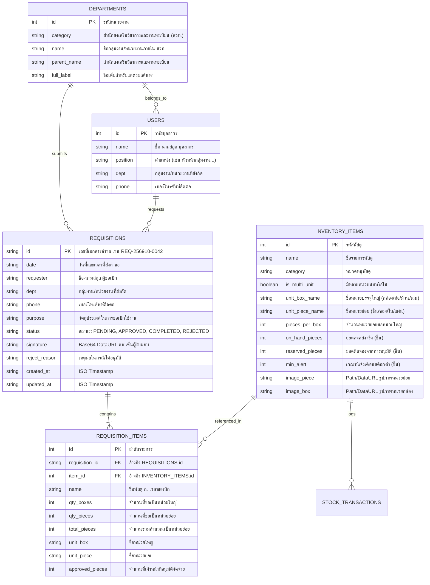

# Database Schema Specification (docs/SCHEMA.md)
### ระบบขอเบิกพัสดุและคลังพัสดุดิจิทัล มหาวิทยาลัยสวนดุสิต (Stock Order SDU)

---

## 1. แผนผังความสัมพันธ์ของข้อมูล (Entity-Relationship Diagram)



---

## 2. รายละเอียดตารางและฟิลด์ข้อมูล (Data Dictionary)

### 2.1 ตาราง `inventory_items` (คลังพัสดุกลาง)
* **คีย์หลัก (Primary Key):** `id` (Auto-increment Integer)
* **วัตถุประสงค์:** จัดเก็บข้อมูลพัสดุคงคลัง, อัตราส่วนการแปลงหน่วย และสถานะสต๊อก 3 ระดับ

| ชื่อฟิลด์ | ชนิดข้อมูล (Data Type) | Nullable | ค่าเริ่มต้น (Default) | คำอธิบายและข้อจำกัด |
| :--- | :--- | :---: | :---: | :--- |
| `id` | `INTEGER` | ❌ No | Auto | รหัสประจำตัวพัสดุ (1, 2, 3, ...) |
| `name` | `VARCHAR(255)` | ❌ No | - | ชื่อพัสดุภาษาไทยแบบละเอียด |
| `category` | `VARCHAR(100)` | ❌ No | - | หมวดหมู่ เช่น `ซองเอกสาร`, `กระดาษและแบบฟอร์ม`, `เครื่องเขียนและแฟ้ม` |
| `is_multi_unit` | `BOOLEAN` | ❌ No | `true` | `true` = มีหน่วยกล่องและหน่วยชิ้น, `false` = มีเฉพาะหน่วยเดี่ยว |
| `unit_box_name` | `VARCHAR(50)` | ⚠️ Yes | `NULL` | ชื่อหน่วยกล่อง เช่น กล่อง, ห่อ, เล่ม, ม้วน |
| `unit_piece_name` | `VARCHAR(50)` | ❌ No | `'ชิ้น'` | ชื่อหน่วยย่อย เช่น ซอง, ใบ, แผ่น, ชิ้น |
| `pieces_per_box` | `INTEGER` | ❌ No | `1` | อัตราส่วนหน่วยย่อยต่อ 1 กล่อง เช่น 250, 500, 2000 |
| `on_hand_pieces` | `INTEGER` | ❌ No | `0` | ยอดสต๊อกคงเหลือจริงในห้องคลัง (ต้อง `>= 0`) |
| `reserved_pieces` | `INTEGER` | ❌ No | `0` | ยอดที่ถูกล็อกไว้รอจ่ายหลังกดอนุมัติ (ต้อง `>= 0`) |
| `min_alert` | `INTEGER` | ❌ No | `500` | เกณฑ์สต๊อกขั้นต่ำ หาก `Available < min_alert` จะแสดงสถานะเตือน |
| `image_piece` | `TEXT` | ⚠️ Yes | `NULL` | Relative Path หรือ URL รูปภาพแบบเดี่ยว/ชิ้น |
| `image_box` | `TEXT` | ⚠️ Yes | `NULL` | Relative Path หรือ URL รูปภาพแบบกล่องบรรจุ |

---

### 2.2 ตาราง `requisitions` (ใบคำขอเบิกพัสดุ)
* **คีย์หลัก (Primary Key):** `id` (String format `REQ-YYYYMM-XXXX`)
* **วัตถุประสงค์:** จัดเก็บหัวเอกสารคำขอเบิก ข้อมูลผู้ขอ วัตถุประสงค์ และสถานะเอกสาร

| ชื่อฟิลด์ | ชนิดข้อมูล (Data Type) | Nullable | ค่าเริ่มต้น (Default) | คำอธิบายและข้อจำกัด |
| :--- | :--- | :---: | :---: | :--- |
| `id` | `VARCHAR(50)` | ❌ No | - | เลขที่เอกสาร รูปแบบ `REQ-256910-0042` |
| `date` | `VARCHAR(100)` | ❌ No | - | วันที่และเวลา เช่น `21 ต.ค. 2569 10:15 น.` |
| `requester` | `VARCHAR(150)` | ❌ No | - | ชื่อ-นามสกุล ของอาจารย์หรือผู้ขอเบิก |
| `dept` | `VARCHAR(200)` | ❌ No | - | คณะ / หน่วยงานต้นสังกัด |
| `phone` | `VARCHAR(50)` | ⚠️ Yes | `''` | เบอร์โทรศัพท์ติดต่อของผู้ขอเบิก |
| `purpose` | `TEXT` | ❌ No | - | วัตถุประสงค์ในการขอเบิกใช้งาน |
| `status` | `VARCHAR(30)` | ❌ No | `'PENDING'` | สถานะ: `'PENDING'`, `'APPROVED'`, `'COMPLETED'`, `'REJECTED'` |
| `signature` | `MEDIUMTEXT` | ⚠️ Yes | `NULL` | Data URL ภาพลายเซ็น Base64 PNG ของผู้รับของ |
| `reject_reason` | `TEXT` | ⚠️ Yes | `NULL` | เหตุผลในกรณีที่เจ้าหน้าที่ไม่อนุมัติ |
| `created_at` | `TIMESTAMP` | ❌ No | `CURRENT_TIMESTAMP` | เวลาส่งคำขอตามมาตรฐานสากล |
| `updated_at` | `TIMESTAMP` | ❌ No | `CURRENT_TIMESTAMP` | เวลาที่มีการเปลี่ยนสถานะล่าสุด |

---

### 2.3 ตาราง `requisition_items` (รายการพัสดุในคำขอ)
* **คีย์หลัก (Primary Key):** `id` (Auto-increment Integer)
* **Foreign Keys:**
  * `requisition_id` อ้างอิง `requisitions.id` (ON DELETE CASCADE)
  * `item_id` อ้างอิง `inventory_items.id`

| ชื่อฟิลด์ | ชนิดข้อมูล (Data Type) | Nullable | ค่าเริ่มต้น (Default) | คำอธิบายและข้อจำกัด |
| :--- | :--- | :---: | :---: | :--- |
| `id` | `INTEGER` | ❌ No | Auto | ลำดับรายการ |
| `requisition_id` | `VARCHAR(50)` | ❌ No | - | เชื่อมโยงกับ `requisitions.id` |
| `item_id` | `INTEGER` | ❌ No | - | เชื่อมโยงกับ `inventory_items.id` |
| `name` | `VARCHAR(255)` | ❌ No | - | สแนปช็อตชื่อพัสดุ ณ เวลาขอเบิก |
| `qty_boxes` | `INTEGER` | ❌ No | `0` | จำนวนกล่องที่ขอ |
| `qty_pieces` | `INTEGER` | ❌ No | `0` | จำนวนชิ้นย่อยที่ขอ |
| `total_pieces` | `INTEGER` | ❌ No | `0` | จำนวนรวมคิดเป็นหน่วยย่อย |
| `unit_box` | `VARCHAR(50)` | ⚠️ Yes | `NULL` | ชื่อหน่วยกล่อง |
| `unit_piece` | `VARCHAR(50)` | ❌ No | `'ชิ้น'` | ชื่อหน่วยย่อย |
| `approved_pieces` | `INTEGER` | ❌ No | `total_pieces` | จำนวนที่เจ้าหน้าที่อนุมัติจัดจ่ายจริง |

---

### 2.4 ตาราง `users` (ทำเนียบบุคลากรผู้ขอเบิก)
* **คีย์หลัก (Primary Key):** `id` (Auto-increment Integer)
* **วัตถุประสงค์:** จัดเก็บรายชื่อบุคลากรผู้มีสิทธิ์ขอเบิกพัสดุ (เริ่มต้นด้วยหัวหน้าหน่วยงาน 4 ท่านจากไฟล์ `รายนามบุคลากร สวท.docx` และรองรับการเพิ่มรายชื่อเพิ่มเติมโดยเจ้าหน้าที่พัสดุ)

| ชื่อฟิลด์ | ชนิดข้อมูล (Data Type) | Nullable | ค่าเริ่มต้น (Default) | คำอธิบายและข้อจำกัด |
| :--- | :--- | :---: | :---: | :--- |
| `id` | `INT UNSIGNED` | ❌ No | Auto | รหัสประจำตัวบุคลากร |
| `name` | `VARCHAR(150)` | ❌ No | - | ชื่อ-นามสกุล บุคลากร |
| `position` | `VARCHAR(255)` | ❌ No | `''` | ตำแหน่ง เช่น `หัวหน้ากลุ่มงานบริการวิชาการ` |
| `dept` | `VARCHAR(255)` | ❌ No | - | กลุ่มงาน/หน่วยงานภายใน สวท. ที่สังกัด |
| `phone` | `VARCHAR(50)` | ❌ No | `''` | เบอร์โทรศัพท์ติดต่อ |
| `created_at` | `TIMESTAMP` | ❌ No | `CURRENT_TIMESTAMP` | เวลาที่เพิ่มข้อมูล |
| `updated_at` | `TIMESTAMP` | ❌ No | `CURRENT_TIMESTAMP` | เวลาที่แก้ไขข้อมูลล่าสุด |

---

## 3. การติดตั้งและการจัดการฐานข้อมูล MySQL (`backend/schema.sql`)

ฐานข้อมูลหลักใช้ **MySQL 8.0+ / MariaDB 10.5+** (Storage Engine: `InnoDB`, Character Set: `utf8mb4`, Collation: `utf8mb4_unicode_ci`) โดยประกอบด้วย 6 ตารางหลักในฐานข้อมูล `sdu_inventory`:

1. **ตาราง `departments`:** เก็บข้อมูลกลุ่มงาน/หน่วยงานภายในสำนักส่งเสริมวิชาการและงานทะเบียน (สวท.) ทั้ง 5 หน่วยงานหลัก
2. **ตาราง `users`:** เก็บข้อมูลรายชื่อหัวหน้าหน่วยงานตั้งต้น 4 ท่านจาก `รายนามบุคลากร สวท.docx` และรายชื่อที่เจ้าหน้าที่เพิ่มภายหลัง
3. **ตาราง `inventory_items`:** เก็บข้อมูลพัสดุคงคลัง 34 รายการ (66 รูปภาพภาษาไทย รองรับ `LONGTEXT` สำหรับ DataURL) พร้อมดัชนีค้นหาชื่อพัสดุ (`INDEX idx_items_name`)
4. **ตาราง `requisitions`:** เก็บข้อมูลหัวเอกสารใบขอเบิก สถานะ และลายเซ็นดิจิทัล Base64 (`LONGTEXT`)
5. **ตาราง `requisition_items`:** เก็บรายการพัสดุย่อยในแต่ละใบคำขอ ผูก Foreign Key (`ON DELETE CASCADE`) กับ `requisitions.id` และ `inventory_items.id`
6. **ตาราง `stock_transactions`:** บันทึกประวัติการเคลื่อนไหวสต๊อกทุกธุรกรรม (`IN`, `OUT`, `ADJUST`) พร้อมยอดคงเหลือหลังทำรายการ (`balance_after`) เพื่อการตรวจสอบย้อนหลัง (Audit Trail)

### คำสั่งติดตั้งฐานข้อมูล:
```bash
# วิธีที่ 1: รันผ่านสคริปต์ Python อัตโนมัติ
python backend/init_db.py

# วิธีที่ 2: รันผ่าน MySQL CLI
mysql -u root -p < backend/schema.sql
```