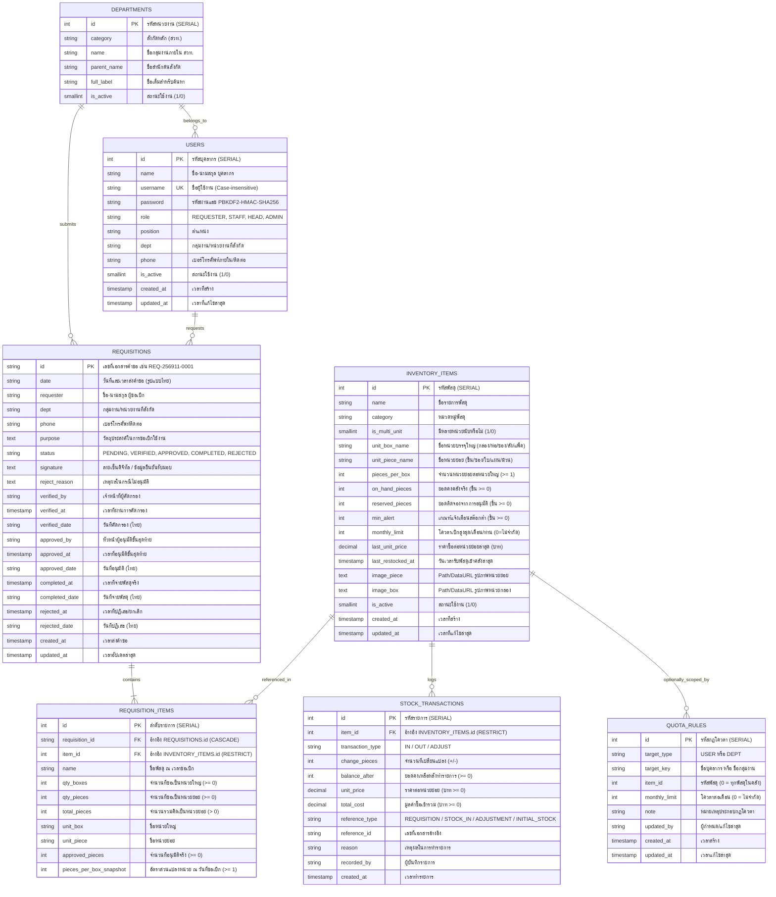

# Database Schema Specification (docs/SCHEMA.md)
### ระบบขอเบิกพัสดุและคลังพัสดุดิจิทัล มหาวิทยาลัยสวนดุสิต (Stock Order SDU v3.8.3)

> **พจนานุกรมข้อมูลฉบับสมบูรณ์ (Data Dictionary):** ดูรายละเอียดทุกฟิลด์ กฎทางธุรกิจ โควตา และรหัสสถานะทั้งหมดได้ที่ [docs/DATA_DICTIONARY.md](DATA_DICTIONARY.md)

---

## 1. แผนผังความสัมพันธ์ของข้อมูล (Entity-Relationship Diagram)

ฐานข้อมูลหลัก (`sdu_inventory`) บน **PostgreSQL 17** ประกอบด้วย **7 ตารางหลัก** (`departments`, `users`, `inventory_items`, `requisitions`, `requisition_items`, `stock_transactions`, `quota_rules`) พร้อม Triggers อัปเดต `updated_at` อัตโนมัติ 4 ตาราง และ `CHECK` Constraints สำหรับควบคุมความถูกต้องของข้อมูล



---

## 2. รายละเอียดสคีมาตารางใน PostgreSQL 17

### 2.1 ตาราง `departments` (กลุ่มงาน/หน่วยงานภายใน สวท.)
* **คีย์หลัก (Primary Key):** `id` (`SERIAL PRIMARY KEY`)
* **ดัชนี (Indexes):** `idx_dept_category`, `idx_dept_full_label`
* **ข้อมูลตั้งต้น (Seed Data):** 6 กลุ่มงาน/หน่วยงานภายในสำนักส่งเสริมวิชาการและงานทะเบียน (สวท.) ได้แก่ สำนักงานผู้อำนวยการ สวท., กลุ่มงานส่งเสริมวิชาการ, กลุ่มงานบริการวิชาการ, กลุ่มงานทะเบียนนักศึกษา ฐานข้อมูลฯ, หน่วยงานศึกษาทั่วไปและการเรียนรู้ตลอดชีวิต, และกลุ่มงานเคาน์เตอร์บริการ

| ชื่อฟิลด์ | ชนิดข้อมูล (Data Type) | Nullable | ค่าเริ่มต้น (Default) | คำอธิบายและข้อจำกัด |
| :--- | :--- | :---: | :---: | :--- |
| `id` | `SERIAL` | No | Auto | รหัสหน่วยงาน |
| `category` | `VARCHAR(150)` | No | - | สังกัดหลัก เช่น `สำนักส่งเสริมวิชาการและงานทะเบียน (สวท.)` |
| `name` | `VARCHAR(255)` | No | - | ชื่อกลุ่มงาน/หน่วยงาน |
| `parent_name` | `VARCHAR(255)` | No | - | ชื่อสำนักต้นสังกัด |
| `full_label` | `VARCHAR(255)` | No | - | ชื่อเต็มสำหรับแสดงผลและค้นหา |
| `is_active` | `SMALLINT` | No | `1` | สถานะเปิดใช้งาน (`1` = ใช้งาน, `0` = Soft Delete) |

---

### 2.2 ตาราง `users` (ทำเนียบบุคลากรและบัญชีผู้ใช้งาน)
* **คีย์หลัก (Primary Key):** `id` (`SERIAL PRIMARY KEY`)
* **Unique Key:** `username`
* **ดัชนี (Indexes):** `idx_users_name`, `idx_users_username`, `idx_users_dept`
* **Trigger:** `trg_users_updated_at`
* **ข้อมูลตั้งต้น (Seed Data):** 15 บัญชีบุคลากร สวท. จากไฟล์ `Book1.xlsx` แบ่งเป็นสิทธิ์ `HEAD` 1 บัญชี (`jittraporn_cha`), `STAFF` 1 บัญชี (`chuthathip_pan`), และ `REQUESTER` 13 บัญชี โดยระบบจะเข้ารหัสรหัสผ่านทั้งหมดเป็น **PBKDF2-HMAC-SHA256** อัตโนมัติเมื่อเริ่มต้นเซิร์ฟเวอร์หรือรัน `init_db.py`

| ชื่อฟิลด์ | ชนิดข้อมูล (Data Type) | Nullable | ค่าเริ่มต้น (Default) | คำอธิบายและข้อจำกัด |
| :--- | :--- | :---: | :---: | :--- |
| `id` | `SERIAL` | No | Auto | รหัสประจำตัวบุคลากร |
| `name` | `VARCHAR(150)` | No | - | ชื่อ-นามสกุล บุคลากร |
| `username` | `VARCHAR(100)` | Yes | `NULL` | ชื่อผู้ใช้งานสำหรับล็อกอิน (`UNIQUE`, ตรวจสอบแบบไม่คำนึงตัวพิมพ์เล็ก-ใหญ่) |
| `password` | `VARCHAR(255)` | Yes | `''` | รหัสผ่านแบบแฮช `pbkdf2_sha256$<salt>$<hash>` |
| `role` | `VARCHAR(50)` | No | `'REQUESTER'` | บทบาท RBAC: `'REQUESTER'`, `'STAFF'`, `'HEAD'`, `'ADMIN'` |
| `position` | `VARCHAR(255)` | Yes | `''` | ตำแหน่งหน้าที่ |
| `dept` | `VARCHAR(255)` | No | - | กลุ่มงาน/หน่วยงานที่สังกัด |
| `phone` | `VARCHAR(50)` | Yes | `''` | เบอร์โทรศัพท์ภายใน/ติดต่อ |
| `is_active` | `SMALLINT` | No | `1` | สถานะเปิดใช้งาน (`1` = ปกติ, `0` = ระงับสิทธิ์/ลบ) |
| `created_at` | `TIMESTAMP` | No | `CURRENT_TIMESTAMP` | เวลาที่เพิ่มข้อมูล |
| `updated_at` | `TIMESTAMP` | No | `CURRENT_TIMESTAMP` | เวลาที่แก้ไขล่าสุด (อัปเดตผ่าน Trigger) |

---

### 2.3 ตาราง `inventory_items` (คลังพัสดุกลาง)
* **คีย์หลัก (Primary Key):** `id` (`SERIAL PRIMARY KEY`)
* **ดัชนี (Indexes):** `idx_items_name`, `idx_items_category`
* **Trigger:** `trg_inventory_items_updated_at`
* **Check Constraints:** `pieces_per_box >= 1`, `on_hand_pieces >= 0`, `reserved_pieces >= 0`, `min_alert >= 0`, `monthly_limit >= 0`
* **ข้อมูลตั้งต้น (Seed Data):** 34 รายการพัสดุคงคลัง พร้อมรูปภาพหน่วยย่อย/กล่อง 66 ภาพใน `assets/images/`

| ชื่อฟิลด์ | ชนิดข้อมูล (Data Type) | Nullable | ค่าเริ่มต้น (Default) | คำอธิบายและข้อจำกัด |
| :--- | :--- | :---: | :---: | :--- |
| `id` | `SERIAL` | No | Auto | รหัสประจำตัวพัสดุ |
| `name` | `VARCHAR(255)` | No | - | ชื่อรายการพัสดุภาษาไทย |
| `category` | `VARCHAR(100)` | No | - | หมวดหมู่ เช่น `ซองเอกสาร`, `กระดาษและแบบฟอร์ม`, `เครื่องเขียนและแฟ้ม` |
| `is_multi_unit` | `SMALLINT` | No | `1` | `1` = มี 2 หน่วยนับ (กล่อง-ชิ้น), `0` = หน่วยเดี่ยว |
| `unit_box_name` | `VARCHAR(50)` | Yes | `NULL` | ชื่อหน่วยบรรจุใหญ่ เช่น กล่อง, ห่อ, ซอง, ลัง, แพ็ค |
| `unit_piece_name` | `VARCHAR(50)` | No | `'ชิ้น'` | ชื่อหน่วยย่อย เช่น ซอง, ใบ, แผ่น, ม้วน, ชิ้น |
| `pieces_per_box` | `INTEGER` | No | `1` | อัตราส่วนหน่วยย่อยต่อ 1 หน่วยใหญ่ (`CHECK >= 1`) |
| `on_hand_pieces` | `INTEGER` | No | `0` | ยอดคงคลังจริงในห้องคลัง (`CHECK >= 0`) |
| `reserved_pieces` | `INTEGER` | No | `0` | ยอดที่ถูกกันไว้หลังอนุมัติ (`CHECK >= 0`) |
| `min_alert` | `INTEGER` | No | `500` | เกณฑ์แจ้งเตือนสต๊อกต่ำ (`CHECK >= 0`) |
| `monthly_limit` | `INTEGER` | No | `0` | โควตาเบิกสูงสุด/เดือน/ท่าน (`0` = ไม่จำกัด, `CHECK >= 0`) |
| `last_unit_price` | `DECIMAL(12, 2)` | No | `0.00` | ราคาซื้อเข้าต่อหน่วยย่อยล่าสุด (บาท) |
| `last_restocked_at` | `TIMESTAMP` | Yes | `NULL` | วันเวลาที่รับพัสดุเข้าคลังครั้งล่าสุด |
| `image_piece` | `TEXT` | Yes | `NULL` | Relative Path หรือ DataURL รูปภาพหน่วยย่อย |
| `image_box` | `TEXT` | Yes | `NULL` | Relative Path หรือ DataURL รูปภาพหน่วยบรรจุใหญ่ |
| `is_active` | `SMALLINT` | No | `1` | สถานะเปิดใช้งาน (`1` = ปกติ, `0` = Soft Delete) |
| `created_at` | `TIMESTAMP` | No | `CURRENT_TIMESTAMP` | เวลาสร้างรายการ |
| `updated_at` | `TIMESTAMP` | No | `CURRENT_TIMESTAMP` | เวลาแก้ไขล่าสุด (อัปเดตผ่าน Trigger) |

---

### 2.4 ตาราง `requisitions` (ใบคำขอเบิกพัสดุ)
* **คีย์หลัก (Primary Key):** `id` (`VARCHAR(50) PRIMARY KEY`)
* **ดัชนี (Indexes):** `idx_req_status`, `idx_req_requester`, `idx_req_dept`, `idx_req_created_at`
* **Trigger:** `trg_requisitions_updated_at`
* **Check Constraint:** `status IN ('PENDING', 'VERIFIED', 'APPROVED', 'COMPLETED', 'REJECTED')`

| ชื่อฟิลด์ | ชนิดข้อมูล (Data Type) | Nullable | ค่าเริ่มต้น (Default) | คำอธิบายและข้อจำกัด |
| :--- | :--- | :---: | :---: | :--- |
| `id` | `VARCHAR(50)` | No | - | เลขที่เอกสาร รูปแบบ `REQ-YYYYMM-XXXX` (ปี พ.ศ.) |
| `date` | `VARCHAR(100)` | No | - | วันที่และเวลาส่งคำขอรูปแบบไทย |
| `requester` | `VARCHAR(150)` | No | - | ชื่อ-นามสกุล ผู้ขอเบิก |
| `dept` | `VARCHAR(255)` | No | - | กลุ่มงาน/หน่วยงานต้นสังกัด |
| `phone` | `VARCHAR(50)` | Yes | `''` | เบอร์โทรศัพท์ติดต่อ |
| `purpose` | `TEXT` | No | - | วัตถุประสงค์ในการขอเบิกใช้งาน |
| `status` | `VARCHAR(20)` | No | `'PENDING'` | `PENDING`, `VERIFIED`, `APPROVED`, `COMPLETED`, `REJECTED` |
| `signature` | `TEXT` | Yes | `NULL` | DataURL ภาพลายเซ็น PNG หรือข้อความยืนยันรับมอบ |
| `reject_reason` | `TEXT` | Yes | `NULL` | เหตุผลในกรณีไม่อนุมัติหรือยกเลิก |
| `verified_by` | `VARCHAR(150)` | Yes | `NULL` | ชื่อเจ้าหน้าที่พัสดุผู้คัดกรอง (`VERIFIED`) |
| `verified_at` | `TIMESTAMP` | Yes | `NULL` | เวลาที่ผ่านการคัดกรอง |
| `verified_date` | `VARCHAR(100)` | Yes | `NULL` | วันที่คัดกรองรูปแบบไทย |
| `approved_by` | `VARCHAR(150)` | Yes | `NULL` | ชื่อหัวหน้าหน่วยงานผู้อนุมัติขั้นสุดท้าย (`APPROVED`) |
| `approved_at` | `TIMESTAMP` | Yes | `NULL` | เวลาที่อนุมัติขั้นสุดท้าย |
| `approved_date` | `VARCHAR(100)` | Yes | `NULL` | วันที่อนุมัติรูปแบบไทย |
| `completed_at` | `TIMESTAMP` | Yes | `NULL` | เวลาที่จ่ายพัสดุจริง (`COMPLETED`) |
| `completed_date` | `VARCHAR(100)` | Yes | `NULL` | วันที่จ่ายพัสดุรูปแบบไทย |
| `rejected_at` | `TIMESTAMP` | Yes | `NULL` | เวลาที่ปฏิเสธหรือยกเลิก (`REJECTED`) |
| `rejected_date` | `VARCHAR(100)` | Yes | `NULL` | วันที่ปฏิเสธรูปแบบไทย |
| `created_at` | `TIMESTAMP` | No | `CURRENT_TIMESTAMP` | เวลาส่งคำขอ |
| `updated_at` | `TIMESTAMP` | No | `CURRENT_TIMESTAMP` | เวลาเปลี่ยนสถานะล่าสุด (อัปเดตผ่าน Trigger) |

---

### 2.5 ตาราง `requisition_items` (รายการพัสดุในคำขอ)
* **คีย์หลัก (Primary Key):** `id` (`SERIAL PRIMARY KEY`)
* **Foreign Keys:**
  * `requisition_id` อ้างอิง `requisitions(id)` (`ON DELETE CASCADE`)
  * `item_id` อ้างอิง `inventory_items(id)` (`ON DELETE RESTRICT`)
* **ดัชนี (Indexes):** `idx_req_items_req_id`, `idx_req_items_item_id`
* **Check Constraints:** `qty_boxes >= 0`, `qty_pieces >= 0`, `total_pieces > 0`, `approved_pieces >= 0`, `pieces_per_box_snapshot >= 1`

| ชื่อฟิลด์ | ชนิดข้อมูล (Data Type) | Nullable | ค่าเริ่มต้น (Default) | คำอธิบายและข้อจำกัด |
| :--- | :--- | :---: | :---: | :--- |
| `id` | `SERIAL` | No | Auto | ลำดับรายการ |
| `requisition_id` | `VARCHAR(50)` | No | - | เชื่อมโยงกับ `requisitions.id` |
| `item_id` | `INTEGER` | No | - | เชื่อมโยงกับ `inventory_items.id` |
| `name` | `VARCHAR(255)` | No | - | สแนปช็อตชื่อพัสดุ ณ เวลาขอเบิก |
| `qty_boxes` | `INTEGER` | No | `0` | จำนวนหน่วยใหญ่ที่ขอ (`CHECK >= 0`) |
| `qty_pieces` | `INTEGER` | No | `0` | จำนวนหน่วยย่อยที่ขอ (`CHECK >= 0`) |
| `total_pieces` | `INTEGER` | No | `0` | จำนวนรวมคิดเป็นหน่วยย่อย (`CHECK > 0`) |
| `unit_box` | `VARCHAR(50)` | Yes | `NULL` | ชื่อหน่วยใหญ่ ณ เวลาขอเบิก |
| `unit_piece` | `VARCHAR(50)` | No | `'ชิ้น'` | ชื่อหน่วยย่อย ณ เวลาขอเบิก |
| `approved_pieces` | `INTEGER` | No | `0` | จำนวนที่อนุมัติจัดจ่ายจริง (`CHECK >= 0`) |
| `pieces_per_box_snapshot` | `INTEGER` | No | `1` | อัตราส่วนแปลงหน่วย ณ เวลาขอเบิก (`CHECK >= 1`) |

---

### 2.6 ตาราง `stock_transactions` (บันทึกประวัติความเคลื่อนไหวสต๊อก / Audit Trail)
* **คีย์หลัก (Primary Key):** `id` (`SERIAL PRIMARY KEY`)
* **Foreign Key:** `item_id` อ้างอิง `inventory_items(id)` (`ON DELETE RESTRICT`)
* **ดัชนี (Indexes):** `idx_tx_item_id`, `idx_tx_created_at`, `idx_tx_type_created_at`
* **Check Constraints:** `transaction_type IN ('IN', 'OUT', 'ADJUST')`, `balance_after >= 0`, `unit_price >= 0`, `total_cost >= 0`

| ชื่อฟิลด์ | ชนิดข้อมูล (Data Type) | Nullable | ค่าเริ่มต้น (Default) | คำอธิบายและข้อจำกัด |
| :--- | :--- | :---: | :---: | :--- |
| `id` | `SERIAL` | No | Auto | รหัสรายการธุรกรรมสต๊อก |
| `item_id` | `INTEGER` | No | - | อ้างอิง `inventory_items.id` (`ON DELETE RESTRICT`) |
| `transaction_type` | `VARCHAR(10)` | No | - | `'IN'` (รับเข้า), `'OUT'` (จ่ายออก), `'ADJUST'` (ปรับยอด) |
| `change_pieces` | `INTEGER` | No | - | จำนวนเปลี่ยนแปลง (`+` รับเข้า / `-` จ่ายออก) |
| `balance_after` | `INTEGER` | No | `0` | ยอด `on_hand_pieces` คงเหลือหลังทำรายการ (`CHECK >= 0`) |
| `unit_price` | `DECIMAL(12, 2)` | No | `0.00` | ราคาซื้อเข้าต่อหน่วยย่อย (บาท, `CHECK >= 0`) |
| `total_cost` | `DECIMAL(12, 2)` | No | `0.00` | ยอดเงินซื้อเข้ารวมของรายการนี้ (บาท, `CHECK >= 0`) |
| `reference_type` | `VARCHAR(50)` | No | - | `'REQUISITION'`, `'STOCK_IN'`, `'ADJUSTMENT'`, `'INITIAL_STOCK'` |
| `reference_id` | `VARCHAR(50)` | Yes | `NULL` | เลขที่เอกสารอ้างอิง เช่น `REQ-256911-0001` |
| `reason` | `VARCHAR(255)` | Yes | `NULL` | เหตุผล/หมายเหตุ/เลขที่ใบส่งของ |
| `recorded_by` | `VARCHAR(150)` | Yes | `NULL` | ชื่อผู้บันทึกรายการ |
| `created_at` | `TIMESTAMP` | No | `CURRENT_TIMESTAMP` | วันเวลาที่ทำรายการ |

---

### 2.7 ตาราง `quota_rules` (กฎโควตาการเบิกรายเดือนเฉพาะบุคคล/กลุ่มงาน)
* **คีย์หลัก (Primary Key):** `id` (`SERIAL PRIMARY KEY`)
* **Unique Constraint:** `UNIQUE (target_type, target_key, item_id)`
* **ดัชนี (Indexes):** `idx_quota_target` บน `(target_type, target_key)`
* **Trigger:** `trg_quota_rules_updated_at`
* **Check Constraint:** `target_type IN ('USER', 'DEPT')`

| ชื่อฟิลด์ | ชนิดข้อมูล (Data Type) | Nullable | ค่าเริ่มต้น (Default) | คำอธิบายและข้อจำกัด |
| :--- | :--- | :---: | :---: | :--- |
| `id` | `SERIAL` | No | Auto | รหัสกฎโควตา |
| `target_type` | `VARCHAR(20)` | No | - | `'USER'` (รายบุคลากร) หรือ `'DEPT'` (รายกลุ่มงาน/หน่วยงาน) |
| `target_key` | `VARCHAR(255)` | No | - | ชื่อ-นามสกุล บุคลากร หรือชื่อกลุ่มงาน |
| `item_id` | `INTEGER` | No | `0` | รหัสพัสดุ (`0` หมายถึง ทุกพัสดุในคลัง) |
| `monthly_limit` | `INTEGER` | No | `0` | โควตาสูงสุดต่อเดือนเป็นหน่วยย่อย (`0` = ไม่จำกัด/ยกเว้น) |
| `note` | `VARCHAR(255)` | Yes | `''` | หมายเหตุประกอบการกำหนดโควตา |
| `updated_by` | `VARCHAR(150)` | Yes | `''` | ชื่อเจ้าหน้าที่/ผู้ดูแลที่แก้ไขล่าสุด |
| `created_at` | `TIMESTAMP` | No | `CURRENT_TIMESTAMP` | เวลาที่สร้างกฎโควตา |
| `updated_at` | `TIMESTAMP` | No | `CURRENT_TIMESTAMP` | เวลาที่แก้ไขล่าสุด (อัปเดตผ่าน Trigger) |

---

## 3. การติดตั้งและจัดการฐานข้อมูล PostgreSQL 17 (Docker Compose)

ไฟล์ [docker-compose.yml](../docker-compose.yml) จัดการคอนเทนเนอร์หลัก 2 ตัวพร้อมกัน:

1. **คอนเทนเนอร์ฐานข้อมูล (`postgres` / `sdu_stock_postgres`):**
   * Image: `postgres:17-alpine`
   * Host Port: `127.0.0.1:5433` -> Container `5432` (ผูกเฉพาะ loopback เพื่อความปลอดภัย)
   * ฐานข้อมูล: `sdu_inventory`
   * พื้นที่จัดเก็บถาวร: `./postgres-data:/var/lib/postgresql/data`
   * สคริปต์สคีมาเริ่มต้น: [backend/schema_postgres.sql](../backend/schema_postgres.sql) (อิมพอร์ตอัตโนมัติครั้งแรกเมื่อยังไม่มีข้อมูล)
2. **คอนเทนเนอร์เว็บและ API (`app` / `sdu_stock_app`):**
   * Build จาก [Dockerfile](../Dockerfile) (`python:3.11-slim`, รันด้วย non-root `appuser`)
   * Port: `8080:8080`
   * สั่ง `python scripts/generate_separated_portals.py && exec python backend/server.py` พร้อม Healthcheck ที่ `/api?action=health`
   * รัน `ensure_database_schema()` อัตโนมัติเมื่อเริ่มทำงาน เพื่อทำ Schema Auto-Migration, ซิงค์ Sequence (`setval`), และเข้ารหัสรหัสผ่าน PBKDF2 ให้ครบถ้วน

### คำสั่งควบคุมฐานข้อมูลและระบบ:
```bash
# สตาร์ททั้ง PostgreSQL 17 และ Web/API Server (1-Command Deploy)
docker compose up -d --build

# ตรวจสอบสถานะการทำงานและ Healthcheck
docker compose ps

# รีเซ็ตและสร้างฐานข้อมูลใหม่จาก schema_postgres.sql (ข้อมูลเดิมจะถูกลบ)
python backend/init_db.py

# สำรองข้อมูล PostgreSQL เป็นไฟล์ SQL
docker exec -t sdu_stock_postgres pg_dump -U postgres sdu_inventory > backup_sdu_inventory.sql

# หยุดการทำงาน
docker compose down
```
