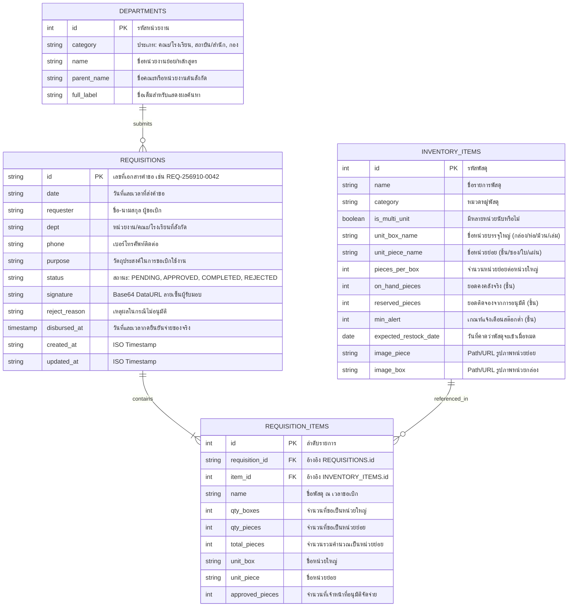

# Database Schema Specification (docs/SCHEMA.md)
### ระบบขอเบิกพัสดุและคลังพัสดุดิจิทัล มหาวิทยาลัยสวนดุสิต (Stock Order SDU)

---

## 1. แผนผังความสัมพันธ์ของข้อมูล (Entity-Relationship Diagram)



---

## 2. รายละเอียดตารางและฟิลด์ข้อมูล (Data Dictionary)

### 2.1 ตาราง `inventory_items` (คลังพัสดุกลาง)
* **คีย์หลัก (Primary Key):** `id` (Auto-increment Integer)
* **วัตถุประสงค์:** จัดเก็บข้อมูลพัสดุคงคลัง, อัตราส่วนการแปลงหน่วย และสถานะสต๊อก 3 ระดับ

| ชื่อฟิลด์ | ชนิดข้อมูล (Data Type) | Nullable | ค่าเริ่มต้น (Default) | คำอธิบายและข้อจำกัด |
| :--- | :--- | :---: | :---: | :--- |
| `id` | `INTEGER` | ❌ No | Auto | รหัสประจำตัวพัสดุ (1, 2, 3, ...) |
| `name` | `VARCHAR(255)` | ❌ No | - | ชื่อพัสดุภาษาไทยแบบละเอียด |
| `category` | `VARCHAR(100)` | ❌ No | - | หมวดหมู่ เช่น `ซองเอกสาร`, `กระดาษและแบบฟอร์ม`, `เครื่องเขียนและแฟ้ม` |
| `is_multi_unit` | `BOOLEAN` | ❌ No | `true` | `true` = มีหน่วยกล่องและหน่วยชิ้น, `false` = มีเฉพาะหน่วยเดี่ยว |
| `unit_box_name` | `VARCHAR(50)` | ⚠️ Yes | `NULL` | ชื่อหน่วยกล่อง เช่น กล่อง, ห่อ, เล่ม, ม้วน |
| `unit_piece_name` | `VARCHAR(50)` | ❌ No | `'ชิ้น'` | ชื่อหน่วยย่อย เช่น ซอง, ใบ, แผ่น, ชิ้น |
| `pieces_per_box` | `INTEGER` | ❌ No | `1` | อัตราส่วนหน่วยย่อยต่อ 1 กล่อง เช่น 250, 500, 2000 |
| `on_hand_pieces` | `INTEGER` | ❌ No | `0` | ยอดสต๊อกคงเหลือจริงในห้องคลัง (ต้อง `>= 0`) |
| `reserved_pieces` | `INTEGER` | ❌ No | `0` | ยอดที่ถูกล็อกไว้รอจ่ายหลังกดอนุมัติ (ต้อง `>= 0`) |
| `min_alert` | `INTEGER` | ❌ No | `500` | เกณฑ์สต๊อกขั้นต่ำ หาก `Available < min_alert` จะแสดงสถานะเตือน |
| `expected_restock_date` | `DATE` | ⚠️ Yes | `NULL` | วันที่คาดว่าพัสดุล็อตใหม่จะเข้าคลังเมื่อของหมด (สำหรับแจ้งผู้ขอเบิก) |
| `image_piece` | `TEXT` | ⚠️ Yes | `NULL` | Relative Path หรือ URL รูปภาพแบบเดี่ยว/ชิ้น |
| `image_box` | `TEXT` | ⚠️ Yes | `NULL` | Relative Path หรือ URL รูปภาพแบบกล่องบรรจุ |

---

### 2.2 ตาราง `requisitions` (ใบคำขอเบิกพัสดุ)
* **คีย์หลัก (Primary Key):** `id` (String format `REQ-YYYYMM-XXXX`)
* **วัตถุประสงค์:** จัดเก็บหัวเอกสารคำขอเบิก ข้อมูลผู้ขอ วัตถุประสงค์ และสถานะเอกสาร

| ชื่อฟิลด์ | ชนิดข้อมูล (Data Type) | Nullable | ค่าเริ่มต้น (Default) | คำอธิบายและข้อจำกัด |
| :--- | :--- | :---: | :---: | :--- |
| `id` | `VARCHAR(50)` | ❌ No | - | เลขที่เอกสาร รูปแบบ `REQ-256910-0042` |
| `date` | `VARCHAR(100)` | ❌ No | - | วันที่และเวลา เช่น `21 ต.ค. 2569 10:15 น.` |
| `requester` | `VARCHAR(150)` | ❌ No | - | ชื่อ-นามสกุล ของอาจารย์หรือผู้ขอเบิก |
| `dept` | `VARCHAR(200)` | ❌ No | - | คณะ / หน่วยงานต้นสังกัด |
| `phone` | `VARCHAR(50)` | ⚠️ Yes | `''` | เบอร์โทรศัพท์ติดต่อของผู้ขอเบิก |
| `purpose` | `TEXT` | ❌ No | - | วัตถุประสงค์ในการขอเบิกใช้งาน |
| `status` | `VARCHAR(30)` | ❌ No | `'PENDING'` | สถานะ: `'PENDING'`, `'APPROVED'`, `'COMPLETED'`, `'REJECTED'` |
| `signature` | `MEDIUMTEXT` | ⚠️ Yes | `NULL` | Data URL ภาพลายเซ็น Base64 PNG ของผู้รับของ |
| `reject_reason` | `TEXT` | ⚠️ Yes | `NULL` | เหตุผลในกรณีที่เจ้าหน้าที่ไม่อนุมัติ |
| `disbursed_at` | `TIMESTAMPTZ` | ⚠️ Yes | `NULL` | วันที่และเวลาที่เจ้าหน้าที่กดยืนยันจ่ายของจริง (เมื่อสถานะเป็น `COMPLETED`) |
| `created_at` | `TIMESTAMP` | ❌ No | `CURRENT_TIMESTAMP` | เวลาส่งคำขอตามมาตรฐานสากล |
| `updated_at` | `TIMESTAMP` | ❌ No | `CURRENT_TIMESTAMP` | เวลาที่มีการเปลี่ยนสถานะล่าสุด |

---

### 2.3 ตาราง `requisition_items` (รายการพัสดุในคำขอ)
* **คีย์หลัก (Primary Key):** `id` (Auto-increment Integer)
* **Foreign Keys:**
  * `requisition_id` อ้างอิง `requisitions.id` (ON DELETE CASCADE)
  * `item_id` อ้างอิง `inventory_items.id`

| ชื่อฟิลด์ | ชนิดข้อมูล (Data Type) | Nullable | ค่าเริ่มต้น (Default) | คำอธิบายและข้อจำกัด |
| :--- | :--- | :---: | :---: | :--- |
| `id` | `INTEGER` | ❌ No | Auto | ลำดับรายการ |
| `requisition_id` | `VARCHAR(50)` | ❌ No | - | เชื่อมโยงกับ `requisitions.id` |
| `item_id` | `INTEGER` | ❌ No | - | เชื่อมโยงกับ `inventory_items.id` |
| `name` | `VARCHAR(255)` | ❌ No | - | สแนปช็อตชื่อพัสดุ ณ เวลาขอเบิก |
| `qty_boxes` | `INTEGER` | ❌ No | `0` | จำนวนกล่องที่ขอ |
| `qty_pieces` | `INTEGER` | ❌ No | `0` | จำนวนชิ้นย่อยที่ขอ |
| `total_pieces` | `INTEGER` | ❌ No | `0` | จำนวนรวมคิดเป็นหน่วยย่อย |
| `unit_box` | `VARCHAR(50)` | ⚠️ Yes | `NULL` | ชื่อหน่วยกล่อง |
| `unit_piece` | `VARCHAR(50)` | ❌ No | `'ชิ้น'` | ชื่อหน่วยย่อย |
| `approved_pieces` | `INTEGER` | ❌ No | `total_pieces` | จำนวนที่เจ้าหน้าที่อนุมัติจัดจ่ายจริง |

---

## 3. สคริปต์โครงสร้างฐานข้อมูล PostgreSQL (PostgreSQL DDL & Constraints)

ระบบรันบน **PostgreSQL 16 (Alpine)** จัดการผ่าน **pgAdmin 4** ด้วย Docker (`docker-compose.yml`):

```sql
-- สร้างตารางหน่วยงาน (Departments)
CREATE TABLE IF NOT EXISTS departments (
    id SERIAL PRIMARY KEY,
    category VARCHAR(100) NOT NULL,
    name VARCHAR(255) NOT NULL,
    parent_name VARCHAR(255),
    full_label VARCHAR(300) GENERATED ALWAYS AS (
        CASE 
            WHEN parent_name IS NOT NULL AND parent_name <> '' 
            THEN parent_name || ' - ' || name 
            ELSE name 
        END
    ) STORED
);

-- สร้างตารางคลังพัสดุกลาง (Inventory Items)
CREATE TABLE IF NOT EXISTS inventory_items (
    id SERIAL PRIMARY KEY,
    name VARCHAR(255) NOT NULL,
    category VARCHAR(100) NOT NULL,
    is_multi_unit BOOLEAN DEFAULT FALSE,
    unit_box_name VARCHAR(50),
    unit_piece_name VARCHAR(50) NOT NULL DEFAULT 'ชิ้น',
    pieces_per_box INT NOT NULL DEFAULT 1 CHECK (pieces_per_box >= 1),
    on_hand_pieces INT NOT NULL DEFAULT 0 CHECK (on_hand_pieces >= 0),
    reserved_pieces INT NOT NULL DEFAULT 0 CHECK (reserved_pieces >= 0),
    min_alert INT NOT NULL DEFAULT 0 CHECK (min_alert >= 0),
    expected_restock_date DATE,
    image_piece VARCHAR(255),
    image_box VARCHAR(255),
    created_at TIMESTAMPTZ DEFAULT CURRENT_TIMESTAMP,
    updated_at TIMESTAMPTZ DEFAULT CURRENT_TIMESTAMP
);

-- สร้างตารางใบคำขอเบิก (Requisitions)
CREATE TABLE IF NOT EXISTS requisitions (
    id VARCHAR(50) PRIMARY KEY,
    dept VARCHAR(255) NOT NULL,
    requester VARCHAR(255) NOT NULL,
    phone VARCHAR(50),
    purpose TEXT,
    date_display VARCHAR(100) NOT NULL,
    status VARCHAR(20) NOT NULL DEFAULT 'PENDING' CHECK (status IN ('PENDING', 'APPROVED', 'COMPLETED', 'REJECTED')),
    signature TEXT,
    reject_reason TEXT,
    disbursed_at TIMESTAMPTZ,
    created_at TIMESTAMPTZ DEFAULT CURRENT_TIMESTAMP,
    updated_at TIMESTAMPTZ DEFAULT CURRENT_TIMESTAMP
);

-- สร้างตารางรายการพัสดุในคำขอ (Requisition Items)
CREATE TABLE IF NOT EXISTS requisition_items (
    id SERIAL PRIMARY KEY,
    requisition_id VARCHAR(50) NOT NULL REFERENCES requisitions(id) ON DELETE CASCADE,
    item_id INT REFERENCES inventory_items(id) ON DELETE SET NULL,
    name VARCHAR(255) NOT NULL,
    qty_boxes INT NOT NULL DEFAULT 0 CHECK (qty_boxes >= 0),
    qty_pieces INT NOT NULL DEFAULT 0 CHECK (qty_pieces >= 0),
    total_pieces INT NOT NULL CHECK (total_pieces > 0),
    unit_box VARCHAR(50),
    unit_piece VARCHAR(50) NOT NULL DEFAULT 'ชิ้น',
    approved_pieces INT NOT NULL DEFAULT 0 CHECK (approved_pieces >= 0)
);

-- Indexes สำหรับเร่งความเร็วการค้นหา
CREATE INDEX IF NOT EXISTS idx_inventory_items_category ON inventory_items(category);
CREATE INDEX IF NOT EXISTS idx_requisitions_status ON requisitions(status);
CREATE INDEX IF NOT EXISTS idx_requisitions_requester ON requisitions(requester);
CREATE INDEX IF NOT EXISTS idx_requisition_items_req_id ON requisition_items(requisition_id);
```

---

## 4. การจัดการผ่าน Docker & pgAdmin 4 (Container Environment)

* **ไฟล์ควบคุม:** `docker-compose.yml` และ `backend/database/init.sql`
* **พอร์ตบริการ:**
  * **PostgreSQL:** `localhost:5432` (User: `sdu_admin`, Database: `sdu_stock_db`)
  * **pgAdmin 4 Web UI:** `http://localhost:5050` (Email: `admin@dusit.ac.th`)
* **คำสั่งเริ่มต้นใช้งาน:**
  ```bash
  docker compose up -d
  ```
