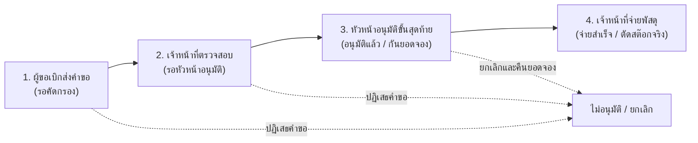

# คู่มือการใช้งานระบบ (User Guide)
### ระบบขอเบิกพัสดุและคลังพัสดุดิจิทัล มหาวิทยาลัยสวนดุสิต (Stock Order SDU v3.7.7)

คู่มือฉบับนี้อธิบายขั้นตอนการใช้งานระบบสำหรับผู้ใช้งานทุกบทบาท ตั้งแต่การเข้าสู่ระบบ การขอเบิกพัสดุ การคัดกรองและอนุมัติ 2 ขั้นตอน การบริหารคลังพัสดุ ไปจนถึงการออกรายงานสรุปสถิติประจำเดือน

---

## 1. ภาพรวมและช่องทางเข้าใช้งาน

ระบบแบ่งหน้าจอการทำงานออกเป็น 3 หน้าหลัก:

| หน้าจอ | URL | สำหรับใคร |
| :--- | :--- | :--- |
| **ศูนย์กลางพอร์ทัล** | `http://<host>:8080/portal.html` | หน้าแรกรวมลิงก์ทางเข้าและแสดงสถานะเซิร์ฟเวอร์ |
| **หน้าผู้ขอเบิกพัสดุ** | `http://<host>:8080/index.html` | บุคลากร อาจารย์ และหัวหน้าหน่วยงานที่ต้องการขอเบิกพัสดุ |
| **หน้าบริหารคลังและอนุมัติ** | `http://<host>:8080/staff.html` | เจ้าหน้าที่พัสดุ, หัวหน้าหน่วยงานผู้อนุมัติ, และผู้ดูแลระบบ |

### ผังวงจรการเบิกจ่ายพัสดุ (2-Tier Approval Workflow)



---

## 2. การเข้าสู่ระบบและบทบาทผู้ใช้งาน (Auto-Role Login)

ระบบรองรับการเข้าสู่ระบบแบบ **กรอกเฉพาะ ชื่อผู้ใช้งาน (Username) + รหัสผ่าน (Password)** โดยไม่ต้องเลือกแท็บบทบาทเอง ระบบจะตรวจสอบสิทธิ์ของบัญชีและนำไปยังหน้างานที่ตรงกับบทบาทให้อัตโนมัติ

### ตารางบทบาทและสิทธิ์การใช้งาน

| บทบาท | สิทธิ์หลักในระบบ | ตัวอย่างบัญชีตั้งต้น |
| :--- | :--- | :--- |
| **ผู้ขอเบิกพัสดุ (`REQUESTER`)** | เลือกเบิกพัสดุ, ดูโควตาคงเหลือ, ติดตามสถานะคำขอ, พิมพ์ใบเบิก PDF | `somchai_jar`, `tatsanee_soo`, `apichart_kro` ฯลฯ (13 บัญชี) |
| **เจ้าหน้าที่พัสดุ (`STAFF`)** | คัดกรองคำขอ (`Verify`), จ่ายพัสดุตัดสต๊อก, รับเข้า/ปรับยอดสต๊อก, จัดการรายการพัสดุและโควตา | `chuthathip_pan`, `staff` |
| **หัวหน้าหน่วยงาน (`HEAD`)** | พิจารณาอนุมัติคำขอขั้นสุดท้าย (`Approve`), ปฏิเสธคำขอ, ดูสถิติและส่งออกรายงาน, ขอเบิกพัสดุได้ | `jittraporn_cha`, `head` |
| **ผู้ดูแลระบบสูงสุด (`ADMIN`)** | ทำได้ทุกสิทธิ์ พร้อมจัดการบัญชีบุคลากร/กลุ่มงาน และสลับมุมมองสิทธิ์ได้ | `admin_staff` |

*(รหัสผ่านตั้งต้นตามค่าที่กำหนดในไฟล์ `.env`)*

### การสลับพอร์ทัลแบบ 1 คลิก (สำหรับหัวหน้า เจ้าหน้าที่ และผู้ดูแลระบบ)
บัญชีที่มีสิทธิ์ `HEAD`, `STAFF`, หรือ `ADMIN` สามารถสลับไปมาเพื่อ **ขอเบิกพัสดุ** และ **อนุมัติ/จัดการคลัง** ได้ทันทีโดยไม่ต้องกรอกรหัสผ่านซ้ำ:
- จากหน้า **`staff.html`** → กดปุ่ม **"ขอเบิกพัสดุ"** บนแถบด้านบน เพื่อไปหน้าแคตตาล็อกขอเบิกพัสดุทันที
- จากหน้า **`index.html`** → กดปุ่ม **"หน้าอนุมัติคำขอ (หัวหน้า)"** / **"หน้าจัดการคลังพัสดุ"** / **"หน้าผู้ดูแลระบบคลัง"** บนแถบด้านบน เพื่อสลับกลับมาหน้าจัดการทันที
- เมื่อกด **"ออกจากระบบ"** จากหน้าใดก็ตาม ระบบจะล้างเซสชันทั้งสองพอร์ทัลพร้อมกัน

---

## 3. วิธีใช้งานสำหรับผู้ขอเบิกพัสดุ (`index.html`)

### 3.1 การเลือกเบิกพัสดุและส่งคำขอ
1. เข้าสู่ระบบด้วย **ชื่อผู้ใช้งาน** และ **รหัสผ่าน** — ระบบจะดึงชื่อ-นามสกุล, กลุ่มงาน/หน่วยงาน สวท., และเบอร์ติดต่อของท่านมาเติมให้อัตโนมัติ
2. ค้นหาพัสดุที่ต้องการด้วย **ช่องค้นหาชื่อพัสดุ** หรือกด **แถบหมวดหมู่** (`ทั้งหมด`, `ซองเอกสาร`, `กระดาษและแบบฟอร์ม`, `เครื่องเขียนและแฟ้ม`)
3. บนการ์ดพัสดุแต่ละรายการสามารถดูข้อมูลได้ครบถ้วน:
   - สลับดูรูปภาพ **หน่วยย่อย** หรือ **หน่วยบรรจุ (กล่อง/ห่อ/แพ็ค)**
   - ดู **ยอดพร้อมเบิกจริง** และ **โควตาคงเหลือของท่านในเดือนนี้** (หากมีการกำหนดโควตา)
4. ระบุจำนวนที่ต้องการเบิก (กรอกเป็นหน่วยใหญ่ เช่น กล่อง และ/หรือ หน่วยย่อย เช่น ชิ้น/ซอง ระบบจะคำนวณรวมเป็นหน่วยย่อยให้อัตโนมัติ) แล้วกด **"เพิ่มเข้าตะกร้า"**
5. กดปุ่ม **"ตะกร้าของฉัน"** มุมขวาบนเพื่อตรวจสอบรายการทั้งหมด กรอก **"วัตถุประสงค์ในการขอเบิก"** จากนั้นกด **"ยืนยันส่งคำขอเบิกพัสดุ"**
6. ระบบจะตรวจสอบสต๊อกพร้อมเบิกและโควตารายเดือน (ทั้งระดับรายบุคคลและระดับกลุ่มงาน) หากผ่านจะออกเลขที่เอกสารรูปแบบ `REQ-YYYYMM-XXXX` ให้ทันที

### 3.2 การติดตามสถานะและพิมพ์ใบเบิกพัสดุ
1. กดปุ่ม **"รายการคำขอของฉัน"** บนแถบด้านบน (มีตัวเลขแสดงจำนวนคำขอทั้งหมด)
2. ใช้ **ตัวกรองงวดเดือน** หรือ **แท็บสถานะ 5 ระดับ** (`รอคัดกรอง`, `รอหัวหน้าอนุมัติ`, `อนุมัติแล้ว รอรับของ`, `จ่ายสำเร็จแล้ว`, `ไม่อนุมัติ / ยกเลิก`) เพื่อค้นหาเอกสาร
3. กดปุ่ม **"พิมพ์ใบเบิก PDF"** เพื่อดูและสั่งพิมพ์แบบฟอร์มใบขอเบิกพัสดุทางการ A4 (แสดงช่องลงนามครบ 4 ฝ่าย: ผู้ขอเบิก, เจ้าหน้าที่คัดกรอง, หัวหน้าผู้อนุมัติ, และผู้รับมอบ)

---

## 4. วิธีใช้งานสำหรับเจ้าหน้าที่พัสดุ (`STAFF` ใน `staff.html`)

### 4.1 แท็บ "รายการคำขอเบิก" — คัดกรองและจ่ายพัสดุ
1. **คัดกรองคำขอใหม่ (แท็บ "รอคัดกรอง"):**
   - ตรวจสอบรายการพัสดุและวัตถุประสงค์ สามารถปรับแก้จำนวนที่เสนออนุมัติรายรายการได้หากจำเป็น
   - กด **"คัดกรองและส่งต่อหัวหน้า"** เพื่อเปลี่ยนสถานะเป็น `รอหัวหน้าอนุมัติ` (ขั้นตอนนี้ยังไม่ตัดสต๊อก)
   - หากข้อมูลไม่ถูกต้องหรือไม่สามารถจัดหาได้ กด **"ปฏิเสธคำขอ"** พร้อมระบุเหตุผล
2. **จ่ายพัสดุและตัดสต๊อกจริง (แท็บ "รอจ่ายของ"):**
   - เมื่อคำขอผ่านการอนุมัติจากหัวหน้าแล้วและผู้เบิกมารับของ กด **"จ่ายพัสดุเรียบร้อย"**
   - ระบบจะตัดยอดคงคลังจริง (`On-Hand`), คืนยอดติดจอง (`Reserved`), และบันทึกประวัติ `OUT` ลง Audit Trail อัตโนมัติ
   - สามารถกด **"พิมพ์ใบเบิกทางการ PDF"** เพื่อเก็บเป็นหลักฐานประกอบการเบิกจ่ายได้ทันที

### 4.2 แท็บ "สรุปยอดสต๊อกคลัง" — บริหารพัสดุคงคลัง
ระบบแสดงยอดสต๊อกแยก 3 ค่าชัดเจน: **คงเหลือจริง (On-Hand)**, **ติดจองรอมอบ (Reserved)**, และ **พร้อมเบิก (Available = On-Hand - Reserved)** พร้อมแถบแจ้งเตือน **รายการพัสดุถึงจุดสั่งซื้อใหม่ (สต๊อกต่ำ)**

- **รับพัสดุเข้าคลัง (`+ รับพัสดุเข้าคลัง`):**
  1. พิมพ์ค้นหาและเลือกพัสดุจาก Dropdown ค้นหาได้
  2. ระบุจำนวนที่รับเข้า (หน่วยใหญ่ และ/หรือ หน่วยย่อย)
  3. ระบุราคาซื้อเข้า (เลือกได้ 3 โหมด: **ยอดเงินรวมทั้งครั้ง**, **ราคาต่อหน่วยใหญ่**, หรือ **ราคาต่อหน่วยย่อย**) ระบบจะคำนวณราคาเฉลี่ยต่อชิ้นและยอดรวมให้ทันที
  4. กรอกหมายเหตุ/เลขที่ใบสั่งซื้อ แล้วกดบันทึก (ระบบจะบวกสต๊อก บันทึกวันเวลารับเข้าล่าสุด และเก็บประวัติ `IN` พร้อมมูลค่าจัดซื้อ)
- **ปรับยอดสต๊อกจริง (`ปรับยอดสต๊อก`):** ใช้เมื่อตรวจนับสต๊อกประจำงวดหรือมีพัสดุชำรุด/สูญหาย ระบบบันทึกส่วนต่างและเหตุผลลงประวัติ `ADJUST`
- **เพิ่ม / แก้ไข / ลบรายการพัสดุ (`+ เพิ่มรายการพัสดุใหม่`):** กำหนดชื่อ, หมวดหมู่, หน่วยนับเดี่ยวหรือ 2 หน่วยนับพร้อมอัตราส่วน, ยอดตั้งต้น (บันทึก `INITIAL_STOCK` อัตโนมัติ), เกณฑ์เตือนขั้นต่ำ (`min_alert`), โควตารายเดือนมาตรฐาน, และอัปโหลดรูปภาพหน่วยย่อย/กล่อง
- **ตั้งค่าเกณฑ์เตือนด่วน:** กดที่ค่าเกณฑ์เตือนในแถวพัสดุเพื่อปรับ `min_alert` ได้ทันที
- **ดูประวัติความเคลื่อนไหว (`ประวัติ`):** ดูรายการย้อนหลังทั้งหมด (`รับเข้า`, `จ่ายออก`, `ปรับยอด`) พร้อมวันเวลา ผู้บันทึก และมูลค่าซื้อเข้า

### 4.3 แท็บ "จัดการบุคลากร / หน่วยงาน" — ทำเนียบและโควตารายเดือน
- **กำหนดโควตารายเดือนเฉพาะเจาะจง (`+ กำหนดโควตาใหม่`):**
  - ตั้งโควตาได้ทั้งระดับ **รายบุคลากร (`USER`)** และ **รายกลุ่มงาน/หน่วยงาน (`DEPT`)**
  - เลือกได้ทั้งแบบเจาะจง **รายพัสดุ** หรือ **ทุกพัสดุในคลัง** (ตั้งค่า `0` = ไม่จำกัด/ยกเว้นโควตา)
  - ลำดับความสำคัญของการตรวจสอบ: `โควตารายคน+รายพัสดุ` > `โควตารายคน+ทุกพัสดุ` > `โควตามาตรฐานของพัสดุ` (และตรวจสอบคู่กับ `โควตากลุ่มงาน`)

---

## 5. วิธีใช้งานสำหรับหัวหน้าหน่วยงาน (`HEAD` ใน `staff.html`)

1. **เข้าสู่ระบบ:** กรอก Username + Password ที่ `staff.html` ระบบจะตรวจสิทธิ์ `HEAD` และเปิดแท็บ **"รอหัวหน้าอนุมัติ"** ให้อัตโนมัติ
2. **พิจารณาอนุมัติคำขอ:**
   - ตรวจสอบรายละเอียดคำขอและจำนวนที่เจ้าหน้าที่คัดกรองเสนอมา (สามารถปรับจำนวนอนุมัติขั้นสุดท้ายได้)
   - กด **"อนุมัติขั้นสุดท้าย (กันสต๊อก)"** — ระบบจะเปลี่ยนสถานะเป็น `อนุมัติแล้ว` และกันยอดจอง (`Reserved`) ไว้ให้ผู้เบิกมารับของ (ยังไม่ตัด `On-Hand` จนกว่าจะส่งมอบจริง)
   - หรือกด **"ปฏิเสธคำขอ"** พร้อมระบุเหตุผล
3. **หากหัวหน้าต้องการเบิกพัสดุเอง:** กดปุ่ม **"ขอเบิกพัสดุ"** บนแถบด้านบนเพื่อข้ามไปหน้าแคตตาล็อกได้ทันทีในคลิกเดียว
4. **ดูรายงานสรุปและสถิติรายเดือน (แท็บ "สรุปยอดและสถิติรายเดือน"):**
   - เลือกงวดเดือนที่ต้องการ (หรือดูข้อมูลย้อนหลังทั้งหมด)
   - ตรวจสอบตัวชี้วัดภาพรวม: จำนวนคำขอแยกตามสถานะ, ปริมาณพัสดุที่ขอ/อนุมัติ, **ยอดเงินซื้อพัสดุเข้าคลังรายเดือน**, อันดับพัสดุที่เบิกมากที่สุด 5 อันดับ (Top 5), พัสดุที่เบิกน้อยที่สุด 5 อันดับ (Slow-Moving), และ **ตารางสรุปยอดเบิกจำแนกรายบุคคล** (กดดูรายละเอียดพัสดุรายคนได้)
   - กด **"ส่งออก Excel (.xlsx)"** เพื่อดาวน์โหลดไฟล์สเปรดชีตจัดรูปแบบพร้อมใช้งาน **6 ชีต** (`ภาพรวมประจำเดือน`, `สรุปรายบุคคล`, `สรุปทุกพัสดุ`, `รายละเอียดคำขอเบิก`, `สรุปยอดซื้อเข้า`, `ประวัติซื้อเข้า`)
   - กด **"พิมพ์รายงานผู้บริหาร (PDF)"** สำหรับแนบเสนอผู้บริหารหรือเก็บเข้าแฟ้มประจำเดือน

---

## 6. วิธีใช้งานสำหรับผู้ดูแลระบบสูงสุด (`ADMIN` ใน `staff.html`)

ผู้ดูแลระบบมีสิทธิ์ครบทุกส่วนของระบบ พร้อมความสามารถเพิ่มเติมดังนี้:
- **สลับมุมมองสิทธิ์ชั่วคราว:** ใช้ Dropdown มุมขวาบนของ Header เพื่อสลับดูมุมมอง `ผู้ดูแลระบบ` / `เจ้าหน้าที่พัสดุ` / `หัวหน้าผู้อนุมัติ` ได้ตลอดเวลา
- **จัดการบัญชีบุคลากร (`+ เพิ่มรายชื่อบุคลากร`):** เพิ่ม แก้ไข ลบรายชื่อบุคลากร ตั้งรหัสผ่าน และกำหนดบทบาท (`REQUESTER`, `STAFF`, `HEAD`, `ADMIN`)
- **จัดการกลุ่มงาน/หน่วยงาน (`จัดการกลุ่มงาน`):** เพิ่ม แก้ไขชื่อ (อัปเดตสังกัดของบุคลากรและกฎโควตาให้อัตโนมัติ) หรือลบกลุ่มงานที่ไม่มีบุคลากรสังกัดอยู่

---

## 7. การเปิดใช้งานเซิร์ฟเวอร์ (สำหรับผู้ดูแลระบบ / IT)

### วิธีที่ 1: รันด้วย Docker Compose (แนะนำ)
```bash
cp .env.example .env
# ตรวจสอบค่า AUTH_BYPASS="false" และรหัสผ่านใน .env
docker compose up -d --build
```
*(หากต้องการเปิด pgAdmin 4 ด้วย ให้รัน `docker compose --profile tools up -d`)*

### วิธีที่ 2: รันบนเครื่อง Windows โดยตรง
1. เปิดฐานข้อมูล PostgreSQL (`docker compose up -d postgres`)
2. ดับเบิลคลิกไฟล์ `start.bat` หรือรัน `.venv\Scripts\python.exe backend/server.py`
3. เปิดเบราว์เซอร์ไปที่ `http://localhost:8080/portal.html`

---

## 8. คำถามที่พบบ่อย (FAQ)

- **ถาม: พิมพ์รหัสผ่านถูกแล้วทำไมยังเข้าไม่ได้?**
  - **ตอบ:** ตรวจสอบว่าพิมพ์ตัวพิมพ์เล็ก-ใหญ่ของ Username ถูกต้อง และบัญชีนั้นยังมีสถานะเปิดใช้งาน (`is_active = 1`) หากลืมรหัสผ่านให้ติดต่อผู้ดูแลระบบเพื่อตั้งรหัสใหม่ในแท็บ "จัดการบุคลากร / หน่วยงาน"
- **ถาม: ส่งคำขอเบิกแล้วระบบแจ้งว่าเกินโควตา ทำอย่างไร?**
  - **ตอบ:** ระบบจะแสดงยอดโควตาคงเหลือของเดือนปัจจุบันให้ทราบบนการ์ดพัสดุและข้อความแจ้งเตือน หากมีความจำเป็นเร่งด่วนให้ติดต่อเจ้าหน้าที่พัสดุหรือผู้ดูแลระบบเพื่อปรับกฎโควตาเฉพาะบุคคล/กลุ่มงานในแท็บจัดการบุคลากร
- **ถาม: อนุมัติคำขอไปแล้วแต่ผู้เบิกขอยกเลิก สต๊อกที่กันไว้จะหายไหม?**
  - **ตอบ:** ไม่หายครับ เจ้าหน้าที่หรือหัวหน้าสามารถกด **"ยกเลิกคำขอและคืนสต๊อกจอง"** ที่ใบเบิกสถานะ `รอจ่ายของ` ระบบจะคืนยอด `Reserved` กลับเป็น `Available` ให้อัตโนมัติทันที
- **ถาม: อยากใช้แอปบนมือถือเหมือนแอปทั่วไปได้ไหม?**
  - **ตอบ:** ได้ครับ ระบบรองรับ PWA สามารถเปิดผ่านเบราว์เซอร์บนสมาร์ตโฟนแล้วเลือก **"เพิ่มไปยังหน้าจอหลัก (Add to Home Screen)"** เพื่อใช้งานได้ทันที
