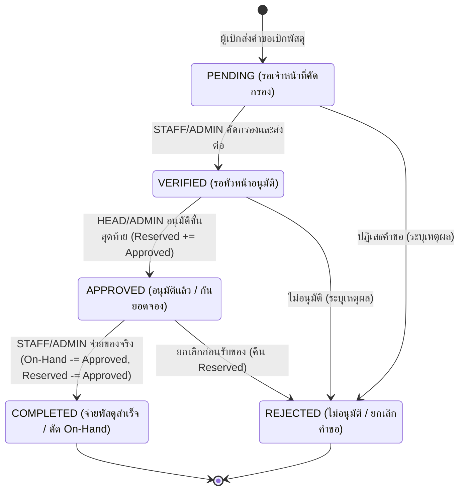
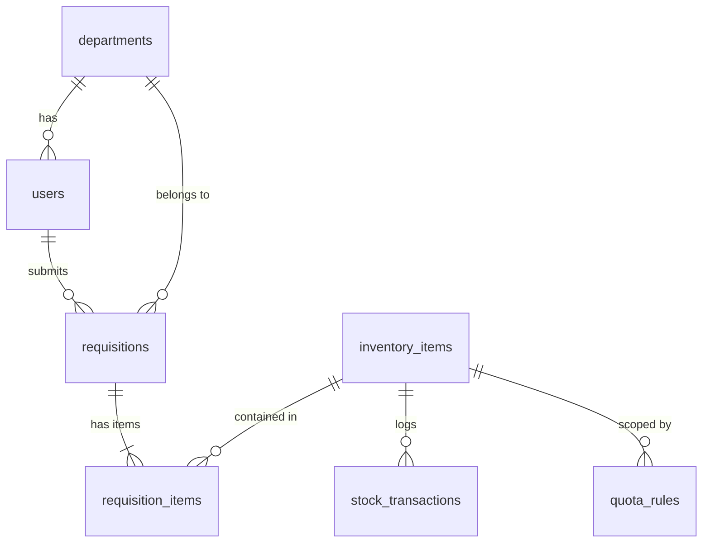

# ข้อกำหนดความต้องการของระบบ (System Requirements Specification - SRS)
## ระบบเบิกพัสดุและบริหารจัดการคลังพัสดุดิจิทัล มหาวิทยาลัยสวนดุสิต (Stock Order SDU)
**เวอร์ชัน:** 3.8.3  
**วันที่ปรับปรุง:** 25 พฤศจิกายน 2569  
**สถาปัตยกรรม:** PostgreSQL 17 / Docker Compose (1-Command Deploy) / Python REST API + Zero-Build Vanilla ES6+ Web Portals

---

## 1. ภาพรวมโครงการ (Project Overview)

ระบบเว็บแอปพลิเคชันสำหรับบริหารจัดการคลังพัสดุและคำขอเบิกพัสดุ สำนักส่งเสริมวิชาการและงานทะเบียน (สวท.) มหาวิทยาลัยสวนดุสิต เพื่อยกระดับกระบวนการเบิกจ่ายพัสดุจากเอกสารกระดาษสู่ระบบดิจิทัลที่โปร่งใส ตรวจสอบย้อนหลังได้ทุกขั้นตอน (Audit Trail) และสอดคล้องตามหลักธรรมาภิบาลภาครัฐ

### จุดเด่นและลักษณะเฉพาะของระบบปัจจุบัน (v3.8.3):
1. **การอนุมัติแบบ 2 ขั้นตอน (Two-Tier Verification & Approval):** เจ้าหน้าที่พัสดุคัดกรองความถูกต้อง (`PENDING` -> `VERIFIED`) ก่อนส่งต่อให้หัวหน้าหน่วยงานพิจารณาอนุมัติขั้นสุดท้าย (`VERIFIED` -> `APPROVED`) และเจ้าหน้าที่ตัดจ่ายเมื่อส่งมอบจริง (`APPROVED` -> `COMPLETED`)
2. **การควบคุมสิทธิ์ RBAC 4 บทบาท + Auto-Role Login + Cross-Portal SSO:** แยกสิทธิ์ `REQUESTER`, `STAFF`, `HEAD`, `ADMIN` ล็อกอินด้วย Username (Case-insensitive) + รหัสผ่านเฉพาะบุคคล (PBKDF2) พร้อมสลับระหว่างหน้าเบิกพัสดุและหน้าจัดการคลังใน 1 คลิกโดยไม่ต้องล็อกอินซ้ำ
3. **ระบบโควตาการเบิกรายเดือนแบบหลายระดับ (Multi-Tier Quota Policy):** ควบคุมได้ทั้งโควตามาตรฐานของพัสดุ (`inventory_items.monthly_limit`) และกฎโควตาเฉพาะรายบุคลากร (`USER`) และรายกลุ่มงาน (`DEPT`) ในตาราง `quota_rules` ทั้งรายพัสดุและทุกพัสดุ
4. **การบริหารสต๊อก 2 หน่วยนับ และสต๊อก 3 ระดับ:** คำนวณหน่วยใหญ่/หน่วยย่อยอัตโนมัติพร้อม Snapshot อัตราส่วนแปลงหน่วย และควบคุม $\text{Available} = \text{On-Hand} - \text{Reserved}$ ภายใต้ PostgreSQL ACID Transaction (`SELECT ... FOR UPDATE`)
5. **การบันทึกต้นทุนและราคาจัดซื้อตอนรับพัสดุเข้าคลัง:** บันทึกราคาต่อหน่วยและยอดเงินรวม (รองรับ 3 โหมดกรอกราคา), ประทับเวลา `last_restocked_at`, และสรุปยอดจัดซื้อรายเดือน
6. **ระบบวิเคราะห์สถิติรายเดือนและส่งออก Native Excel 6 ชีต:** แสดงตัวชี้วัดภาพรวม, Top 5 / Slow-Moving 5, สรุปยอดเบิกรายบุคคล, สรุปยอดซื้อเข้า, ตารางรายการคำขอทั้งหมดในเดือน (พร้อมตัวเลือกเดือนอัตโนมัติตามปฏิทินจริง), ส่งออก `.xlsx` 6 ชีต (Zero-Dependency), และพิมพ์รายงานผู้บริหาร PDF
7. **มาตรฐาน UI/UX ของสถาบัน:** 100% Vector SVG Icons (Zero-Emoji Policy), SweetAlert2 ธีมสีน้ำเงิน มสด. (ไม่มี Native Dialog), และ Universal Searchable Dropdown ใน `<select>` ทุกตัว

---

## 2. สิทธิ์และโครงสร้างผู้ใช้งาน (User Roles & Access Control)

ระบบจำแนกผู้ใช้งานออกเป็น 4 บทบาท รองรับกลุ่มงาน สวท. ตั้งต้น **6 กลุ่มงาน** และบัญชีบุคลากรตั้งต้น **15 บัญชี** (จากไฟล์ `Book1.xlsx`):

| กลุ่มผู้ใช้งาน (Role) | การเข้าถึง (Authentication) | หน้าที่และความรับผิดชอบในระบบ |
| :--- | :--- | :--- |
| **1. ผู้ขอเบิก (`REQUESTER`)** *(บุคลากร สวท. 13 บัญชีตั้งต้น)* | เข้าสู่ระบบด้วย Username (ไม่คำนึงตัวพิมพ์เล็ก-ใหญ่) + รหัสผ่านเฉพาะบุคคล (PBKDF2) ได้รับ HMAC-SHA256 `requester_token` | - ค้นหาพัสดุ ตรวจสอบสต๊อกพร้อมเบิกและโควตาคงเหลือรายบุคคล/กลุ่มงาน - ส่งคำขอเบิกพัสดุ (`PENDING`) - ติดตามสถานะคำขอของตนเองพร้อมตัวกรองงวดเดือนอัตโนมัติ - พิมพ์ใบขอเบิกพัสดุทางการ A4 (PDF 4 ฝ่าย) |
| **2. เจ้าหน้าที่พัสดุ (`STAFF`)** *(เช่น `chuthathip_pan`, `staff`)* | เข้าสู่ระบบ Auto-Role ได้รับทั้ง `staff_token` และ `requester_token` (Cross-Portal SSO) | - คัดกรองและปรับยอดเสนอเบิก (`PENDING` -> `VERIFIED`) หรือปฏิเสธ (`REJECTED`) - จ่ายพัสดุจริงตัดยอด `On-Hand` (`APPROVED` -> `COMPLETED`) - รับพัสดุเข้าคลังพร้อมระบุราคา/ยอดซื้อ (`restockItem`), ปรับยอดตรวจนับ (`adjustStock`), CRUD รายการพัสดุ และกฎโควตา - ดูประวัติความเคลื่อนไหวสต๊อก, รายงานสถิติ, ส่งออก `.xlsx` และขอเบิกพัสดุได้ (ไม่สามารถกด `approveRequisition`, `deleteUser`, `deleteDepartment`) |
| **3. หัวหน้าหน่วยงาน (`HEAD`)** *(เช่น `jittraporn_cha`, `head`)* | เข้าสู่ระบบ Auto-Role (เปิดแท็บ `รอหัวหน้าอนุมัติ` อัตโนมัติ) พร้อม Cross-Portal SSO | - ตรวจสอบคำขอที่ผ่านการคัดกรอง (`VERIFIED`) และกดอนุมัติขั้นสุดท้าย (`APPROVED` ล็อก `Reserved`) หรือปฏิเสธ (`REJECTED`) - ตรวจสอบรายงานสถิติรายเดือน, รายการคำขอทั้งเดือน, ยอดซื้อเข้า, ส่งออก `.xlsx` 6 ชีต และพิมพ์รายงานผู้บริหาร PDF - สลับไปขอเบิกพัสดุที่ `index.html` ได้ใน 1 คลิก |
| **4. ผู้ดูแลระบบสูงสุด (`ADMIN`)** *(เช่น `admin_staff`)* | สิทธิ์สูงสุด + รองรับ Header `X-Staff-Role` สำหรับสลับมุมมองสิทธิ์ | - ดำเนินการได้ทุกคำสั่งในระบบ รวมถึงจัดการบัญชีบุคลากร (`deleteUser`) และกลุ่มงาน (`deleteDepartment`) - ดูแลค่าคอนฟิก `.env`, Docker Compose, PostgreSQL 17 และการสำรองข้อมูล |

---

## 3. กฎเกณฑ์ทางธุรกิจและการคำนวณ (Business Rules & Logic)

### 3.1 การแปลงหน่วยนับ (Multi-Unit Conversion)
* จัดเก็บยอดคงคลังทุกรายการใน **หน่วยย่อยที่สุด (Base Unit)**
* สูตรสำหรับพัสดุ 2 หน่วยนับ (อัตราส่วน $R = \text{pieces\_per\_box} \ge 1$):
  $$\text{Total Pieces} = (\text{Qty Boxes} \times R) + \text{Qty Pieces}$$
* ล็อกอัตราส่วนแปลงหน่วย ณ วันที่ขอเบิกลง `requisition_items.pieces_per_box_snapshot`

### 3.2 การควบคุมสต๊อก 3 ระดับ (Stock Availability Equation)
$$\text{Available Stock} = \text{On-Hand Stock} - \text{Reserved Stock}$$
* ยอดสต๊อกและยอดจองต้องไม่ติดลบ (`CHECK >= 0`) และทุกคำขอเบิกห้ามเกิน `Available Stock`
* ฝั่งเซิร์ฟเวอร์จะรวมยอดพัสดุกรณีส่ง `itemId` ซ้ำในใบคำขอเดียวกัน และเรียงลำดับ `item_id` ก่อนทำ `SELECT ... FOR UPDATE` เพื่อลดความเสี่ยง Deadlock

### 3.3 วงจรสถานะคำขอเบิก 2 ขั้นตอน (Two-Tier Requisition Lifecycle)

### 3.4 ระบบโควตาการเบิกรายเดือนแบบหลายระดับ (Multi-Tier Monthly Quota Policy)
ระบบตรวจสอบโควตาสะสมของเดือนปัจจุบัน (ไม่รวมคำขอสถานะ `REJECTED`) ฝั่งเซิร์ฟเวอร์ 2 ชั้นควบคู่กัน:
1. **ระดับรายบุคคล (`QUOTA_EXCEEDED`):** ลำดับความสำคัญ `USER + item_id` > `USER + ทุกพัสดุ (0)` > `inventory_items.monthly_limit`
2. **ระดับกลุ่มงาน/หน่วยงาน (`DEPT_QUOTA_EXCEEDED`):** ลำดับความสำคัญ `DEPT + item_id` > `DEPT + ทุกพัสดุ (0)`
* หากกฎที่มีลำดับความสำคัญสูงสุดกำหนด `monthly_limit = 0` จะถือว่าไม่จำกัด/ยกเว้นโควตาในระดับนั้น
* หน้าแคตตาล็อกผู้ขอเบิกแสดงยอดโควตาคงเหลือแบบเรียลไทม์บนการ์ดพัสดุ

### 3.5 การรับพัสดุเข้าคลัง ต้นทุนจัดซื้อ และ Audit Trail
* `restockItem` รองรับการกรอกราคา 3 โหมด (ยอดเงินรวมทั้งครั้ง / ราคาต่อหน่วยใหญ่ / ราคาต่อหน่วยย่อย) คำนวณ `unit_price` และ `total_cost` อัตโนมัติ, อัปเดต `inventory_items.last_unit_price` และ `last_restocked_at`, และบันทึก `IN` (`STOCK_IN`) ลง `stock_transactions`
* การสร้างพัสดุใหม่พร้อมสต๊อกตั้งต้น (`on_hand_pieces > 0`) จะบันทึก `IN` (`INITIAL_STOCK`) ลง `stock_transactions` อัตโนมัติ
* ตาราง `stock_transactions` เป็น Audit Trail แบบ Immutable พร้อม `ON DELETE RESTRICT` ไม่ให้ลบพัสดุที่มีประวัติความเคลื่อนไหว

### 3.6 ตัวกรองงวดเดือนอัตโนมัติตามปฏิทินจริงและการเก็บข้อมูลระยะยาว
* ไม่ทำ Hard Delete กับ `requisitions`, `requisition_items`, และ `stock_transactions`
* ตัวเลือกเดือนทั้ง 3 จุด (`analyticsMonthSelect`, `staffReqMonthFilter`, `myReqsMonthSelect`) สร้างรายการเดือนอัตโนมัติตามปฏิทินจริง โดยเลือกเดือนปัจจุบันเป็นค่าเริ่มต้น + ย้อนหลัง 12 เดือน + เดือนที่มีข้อมูลจริงในฐานข้อมูล
* ฝั่ง Backend กรองเดือนด้วย SARGable Range Query (`created_at >= start AND created_at < end`) เพื่อใช้ดัชนี `idx_req_created_at` และ `idx_tx_type_created_at` อย่างเต็มประสิทธิภาพ

### 3.7 ระบบรายงานวิเคราะห์ประจำเดือนและส่งออกไฟล์
* **Monthly Analytics Dashboard (`#view-analytics`):** แสดงตัวชี้วัดคำขอตามสถานะ, ยอดชิ้นที่ขอ/อนุมัติ, **ยอดเงินซื้อพัสดุเข้าคลังรายเดือน**, Top 5 / Slow-Moving 5, **สรุปยอดเบิกจำแนกรายบุคคล (`personUsage`)**, และ **รายการคำขอเบิกทั้งหมดในเดือน (`monthRequisitions`)** พร้อม Modal รายละเอียดและปุ่มเปิดใบเบิก PDF
* **Native Excel Export (`.xlsx` 6 ชีต):** สร้างด้วย [backend/excel_export.py](../backend/excel_export.py) ประกอบด้วย `ภาพรวมประจำเดือน`, `สรุปรายบุคคล`, `สรุปทุกพัสดุ`, `รายละเอียดคำขอเบิก`, `สรุปยอดซื้อเข้า`, และ `ประวัติซื้อเข้า` (พร้อม CSV Fallback สำหรับโหมดออฟไลน์)
* **Executive Summary PDF:** รายงานสรุปผู้บริหารขนาด A4 พร้อมตารางสรุปรายบุคคลและยอดจัดซื้อ

---

## 4. โครงสร้างฐานข้อมูล (Database Schema Summary)

ฐานข้อมูล **PostgreSQL 17 (`sdu_inventory`)** ประกอบด้วย **7 ตาราง** (รายละเอียดฟิลด์และ Constraints ครบถ้วนดูได้ใน [docs/SCHEMA.md](SCHEMA.md) และ [docs/DATA_DICTIONARY.md](DATA_DICTIONARY.md)):

1. `departments` (6 กลุ่มงาน สวท. ตั้งต้น)
2. `users` (15 บัญชี สวท. ตั้งต้นจาก `Book1.xlsx`, PBKDF2-HMAC-SHA256, RBAC 4 บทบาท)
3. `inventory_items` (34 รายการพัสดุตั้งต้น, 2 หน่วยนับ, `monthly_limit`, `last_unit_price`, `last_restocked_at`)
4. `requisitions` (21 ฟิลด์ ครอบคลุม 2-Tier Verification/Approval และวันเวลาไทยทุกสถานะ)
5. `requisition_items` (11 ฟิลด์ + `pieces_per_box_snapshot` + `CHECK (total_pieces > 0)`)
6. `stock_transactions` (12 ฟิลด์ + `unit_price`, `total_cost`, `recorded_by`, `ON DELETE RESTRICT`)
7. `quota_rules` (9 ฟิลด์ สำหรับโควตา `USER`/`DEPT`, `UNIQUE (target_type, target_key, item_id)`)

---

## 5. ข้อกำหนดหน้าจอและเอกสารทางการ (UI/UX & Official PDF)

### 5.1 พอร์ทัลผู้ใช้งานทั้ง 3 หน้า
* **`portal.html`:** หน้า Gateway Hub กริด `1060px` แสดงสถิติภาพรวม ทางลัด 4 บทบาท ขั้นตอนเบิกจ่าย 4 ขั้น และตรวจสอบสถานะเซิร์ฟเวอร์เรียลไทม์ผ่าน `/api?action=health`
* **`index.html`:** Auto-Role Login + Cross-Portal SSO, แคตตาล็อกค้นหาสด, การ์ดพัสดุ 2 หน่วยนับ + โควตาคงเหลือเรียลไทม์, ตะกร้าขอเบิก, หน้าต่างรายการคำขอของฉันพร้อมตัวกรองเดือนอัตโนมัติ
* **`staff.html`:** Auto-Role Login + Role Switch (สำหรับ `ADMIN`) + Cross-Portal SSO, คิวคำขอ 2 ขั้นตอน, บริหารสต๊อก/รับเข้าพร้อมราคา/ปรับยอด/Audit Trail, จัดการบุคลากร/กลุ่มงาน/โควตา, และหน้าสรุปยอดสถิติรายเดือนพร้อมตารางคำขอทั้งเดือนและส่งออก Excel 6 ชีต

### 5.2 แบบฟอร์มใบเบิกพัสดุทางการ (Official A4 PDF - 4 Signatures)
แสดงข้อมูลเอกสารและช่องลงนามครบ 4 ฝ่ายตามระเบียบพัสดุ:
1. **ผู้ขอเบิกพัสดุ** (ชื่อ-สกุล กลุ่มงาน วันที่ขอเบิก)
2. **เจ้าหน้าที่พัสดุผู้คัดกรอง** (`verified_by`, `verified_date`)
3. **หัวหน้าหน่วยงานผู้อนุมัติ** (`approved_by`, `approved_date`)
4. **ผู้รับมอบพัสดุ** (ลายเซ็นดิจิทัลหรือการยืนยันรับมอบ + `completed_date`)

---

## 6. ข้อกำหนดทางเทคนิคและความปลอดภัย (NFR, Security & Verification)

1. **Strict Zero-Emoji & No Native Dialogs:** ห้ามใช้ Emoji ใน UI และห้ามใช้ `alert()`/`confirm()`/`prompt()` ให้ใช้ Vector SVG Icons และ SweetAlert2 เท่านั้น
2. **Universal Searchable Dropdown Standard:** `<select>` ทุกตัวในหน้า UI และ Modal ต้องพิมพ์ค้นหาได้ผ่าน `enhanceSearchableSelect`
3. **Single Source of Truth (SSOT):** โค้ด Frontend ของ `index.html` และ `staff.html` ถูกสร้างจาก `scripts/generate_separated_portals.py` เท่านั้น
4. **Strict Token Auth & Security Hardening:** บังคับ `AUTH_BYPASS="false"` บน Production, ตรวจสอบ HMAC Token + Role Permission ทุก Endpoint ภายใน, ไม่ฝัง `password` ลง HTML สาธารณะ, ป้องกัน XSS (`escapeHtml`, `isSafeSignatureDataUrl`), ส่ง Security Headers (`nosniff`, `DENY`, `same-origin`), ป้องกัน Path Traversal แบบ Recursive Unquote + Realpath, และไม่เปิดเผย Raw DB Exception
5. **Containerized 1-Command Deploy:** บรรจุใน `Dockerfile` (non-root `appuser`, Healthcheck) และ `docker-compose.yml` (`postgres:17-alpine` ผูก `127.0.0.1:5433` + `app` พอร์ต `8080`)
6. **Automated Verification & CI:** ตรวจสอบด้วย `.agents/skills/stock-order-rules/scripts/verify_rules.py` และชุดทดสอบ `pytest tests/test_stock_logic.py` **91 รายการ** (รันอัตโนมัติพร้อม PostgreSQL 17 ใน GitHub Actions `.github/workflows/ci.yml`)

---

## 7. สถานะความต้องการส่วนขยาย (Implemented Capabilities v3.2.0 – v3.8.2)

ความต้องการส่วนขยายทั้งหมดที่เคยวางแผนไว้ได้รับการพัฒนาและผ่านชุดทดสอบอัตโนมัติครบถ้วนแล้ว:
* [x] **v3.2.0 – v3.2.5:** RBAC 4 บทบาท, ใบเบิก 4 ฝ่าย, Audit Trail Modal, แสดงโควตาคงเหลือ, แจ้งเตือนสต๊อกต่ำ, และโหมดทดสอบ `AUTH_BYPASS`
* [x] **v3.3.0 – v3.3.4:** กฎโควตาเฉพาะบุคคล/กลุ่มงาน (`quota_rules`), Universal Searchable Dropdowns, UI ภาษาไทยล้วน
* [x] **v3.4.0 – v3.6.2:** สรุปยอดเบิกรายบุคคล, ส่งออก Native Excel `.xlsx` 6 ชีต, ระบบบันทึกและคำนวณราคาซื้อเข้าคลังรายเดือน, CI Automation
* [x] **v3.7.0 – v3.7.8:** Containerized 1-Command Deploy, Security & DB Persistence Hardening (`ThreadedConnectionPool`, `CHECK` Constraints, `INITIAL_STOCK`), โฉมใหม่ `portal.html`, Auto-Role Login, และ Cross-Portal SSO 1 คลิก
* [x] **v3.8.0 – v3.8.2:** ตารางรายการคำขอเบิกทั้งหมดในเดือน, ตัวเลือกงวดเดือนอัตโนมัติตามปฏิทินจริง, ซิงค์บัญชี สวท. 15 ท่าน + 6 กลุ่มงานจาก `Book1.xlsx`, และบังคับตรวจรหัสผ่านเฉพาะบุคคล + Case-insensitive Username
