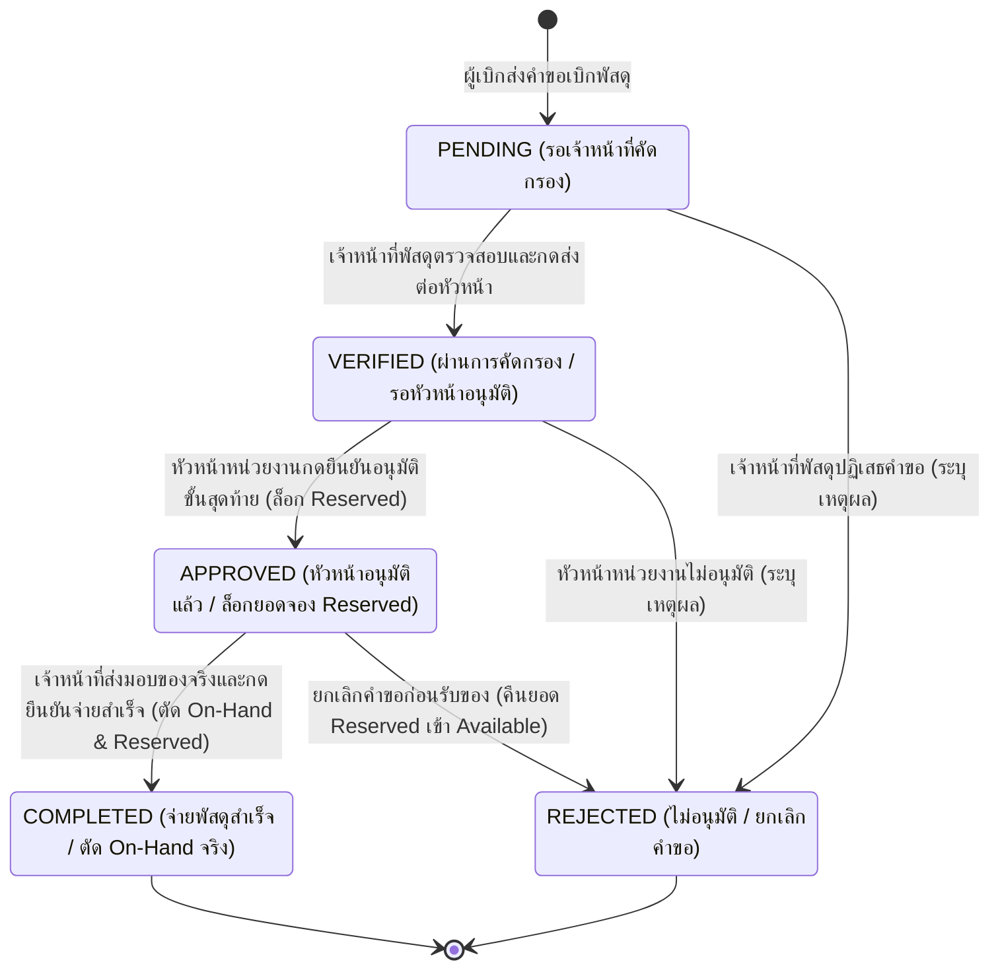
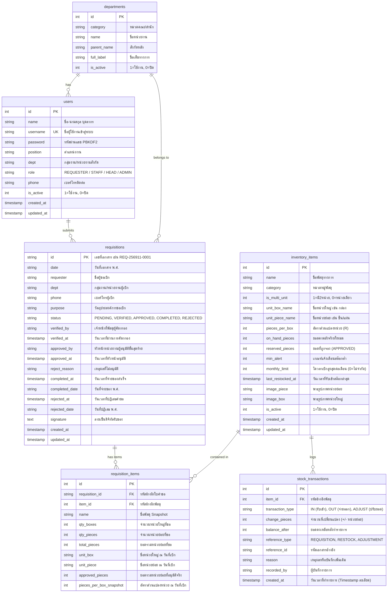

# ข้อกำหนดความต้องการของระบบ (System Requirements Specification - SRS)
## ระบบเบิกพัสดุและบริหารจัดการคลังพัสดุดิจิทัล มหาวิทยาลัยสวนดุสิต (Stock Order SDU)
**เวอร์ชัน:** 3.2.4 (ส่วนขยายข้อกำหนดครบวงจร: โควตารายเดือนต่อบุคลากร, RBAC 4 บทบาท, ใบเบิก 4 ฝ่าย, ส่งออกสถิติ, และ Audit Trail ย้อนหลัง)  
**วันที่ปรับปรุง:** 16 พฤศจิกายน 2569  
**สถาปัตยกรรม:** PostgreSQL 17 / Docker Compose / Vanilla ES6+ Web Portals (Zero-Build)

---

## 1. ภาพรวมโครงการ (Project Overview)

ระบบเว็บแอปพลิเคชันสำหรับบริหารจัดการคลังพัสดุและคำขอเบิกพัสดุ สำนักส่งเสริมวิชาการและงานทะเบียน (สวท.) มหาวิทยาลัยสวนดุสิต เพื่อยกระดับกระบวนการเบิกจ่ายพัสดุจากระบบเอกสารกระดาษและสมุดบันทึกเดิมสู่ระบบดิจิทัลที่โปร่งใส ตรวจสอบย้อนหลังได้ทุกขั้นตอน (Audit Trail) และสอดคล้องตามหลักธรรมาภิบาลภาครัฐ

### จุดเด่นและลักษณะเฉพาะของระบบ:
1. **การอนุมัติแบบ 2 ขั้นตอน (Two-Tier Verification & Approval):** เจ้าหน้าที่พัสดุทำหน้าที่คัดกรองและตรวจสอบความถูกต้องของรายการ ก่อนส่งต่อให้หัวหน้าหน่วยงานเป็นผู้พิจารณายืนยันอนุมัติเป็นคนสุดท้าย
2. **การควบคุมโควตาการเบิกรายเดือน (Monthly Requisition Quota):** สามารถกำหนดเพดานจำนวนการเบิกสูงสุดต่อเดือนรายพัสดุ เพื่อป้องกันการเบิกเกินความจำเป็นและบริหารทรัพยากรอย่างมีประสิทธิภาพ
3. **การประทับเวลาการรับเข้าพัสดุอย่างแม่นยำ (Incoming Stock Timestamp):** บันทึกวันและเวลาการนำเข้าพัสดุทุกรายการอย่างละเอียดระดับวินาที เพื่อการตรวจสอบย้อนหลังที่โปร่งใส
4. **การจัดเก็บข้อมูลระยะยาวและดูย้อนหลังรายเดือน (Long-Term Historical Archiving):** ระบบจัดเก็บข้อมูลประวัติอย่างถาวร พร้อมตัวกรองเรียกดูข้อมูลย้อนหลังแยกตามรายเดือนและปี พ.ศ.
5. **ระบบรายงานวิเคราะห์ยอดเบิกมาก-น้อย (Monthly Analytics Dashboard):** สรุปข้อมูลเชิงสถิติประจำเดือน แสดงอันดับพัสดุที่มีการเบิกจ่ายสูงสุด (Top Requisitioned) และพัสดุที่มีการเบิกจ่ายน้อยที่สุดหรือไม่มีการเบิก (Slow-Moving)
6. **การบริหารสต๊อก 2 หน่วยนับ (Multi-unit Conversion):** คำนวณตัดสต๊อกอัตโนมัติทั้งแบบหน่วยใหญ่ (กล่อง/ลัง/ห่อ/ซอง/รีม) และหน่วยย่อย (ชิ้น/แผ่น/ใบ) ด้วยสูตรคำนวณที่แม่นยำ
7. **การควบคุมสต๊อก 3 ระดับ (Stock Availability Equation):** รักษายอดคงเหลือพร้อมเบิกจริงด้วยสมการ $\text{Available} = \text{On-Hand} - \text{Reserved}$ ป้องกันการจองของซ้อนกัน

---

## 2. สิทธิ์และโครงสร้างผู้ใช้งาน (User Roles & Access Control)

ระบบจำแนกกลุ่มผู้ใช้งานออกเป็น 4 ระดับ เพื่อรองรับกระบวนการทำงานจริงตามโครงสร้างสายการบังคับบัญชา:

| กลุ่มผู้ใช้งาน (Role) | การเข้าถึง (Authentication) | หน้าที่และความรับผิดชอบในระบบ |
| :--- | :--- | :--- |
| **1. ผู้ขอเบิก (Requester)** *(อาจารย์ / บุคลากร 5 กลุ่มงาน สวท.)* | **เข้าสู่ระบบด้วย Username & Password** - บัญชีบุคลากร สวท. (ตั้งต้น `sdu1234`) - ได้รับ HMAC-SHA256 Token | - ค้นหาและตรวจสอบยอดพัสดุคงเหลือพร้อมเบิกในแคตตาล็อก - ตรวจสอบโควตาคงเหลือที่สามารถเบิกได้ในเดือนปัจจุบัน - ส่งคำขอเบิกพัสดุเข้าสู่ระบบ (สถานะเริ่มต้น `PENDING`) - ติดตามสถานะคำขอเบิกของตนเองแบบ Real-time - ดาวน์โหลดและพิมพ์ใบขอเบิกพัสดุทางการ (Official PDF) |
| **2. เจ้าหน้าที่พัสดุ (Inventory Staff / Screener)** *(ผู้ดูแลคลังและคัดกรองเบื้องต้น)* | **เข้าสู่ระบบด้วย Staff Credentials** - บัญชีเจ้าหน้าที่พัสดุ (`STAFF_USERNAME`) - ได้รับ HMAC Staff Session Token | - ตรวจสอบความถูกต้องและความจำเป็นของคำขอเบิกใหม่ (`PENDING`) - ปรับแก้จำนวนที่เห็นสมควรให้เบิก (Screening / Proposed Quantity) - **กดยืนยันผ่านการคัดกรองเพื่อส่งต่อให้หัวหน้าอนุมัติ (`VERIFIED`)** - ปฏิเสธคำขอเบิกที่ไม่ผ่านเกณฑ์ (`REJECTED`) พร้อมระบุเหตุผล - บันทึกรับเข้าพัสดุใหม่ (Stock In) พร้อมบันทึก Timestamp รับเข้า - ดำเนินการจ่ายพัสดุจริงเมื่อผู้เบิกมารับของ (`COMPLETED`) เพื่อตัดยอด On-Hand - ปรับยอดตรวจนับสต๊อกจริง (Stock Adjustment) พร้อมระบุเหตุผล - บริหารจัดการรายการพัสดุ, บุคลากร และกลุ่มงาน/หน่วยงาน |
| **3. หัวหน้าหน่วยงาน (Department Head / Approver)** *(ผู้อนุมัติขั้นสุดท้าย)* | **เข้าสู่ระบบด้วย Approver Credentials** - บัญชีระดับหัวหน้ากลุ่มงาน/ผู้อำนวยการ - ได้รับสิทธิ์ Final Approval | - ตรวจสอบรายการคำขอเบิกที่ผ่านการคัดกรองจากเจ้าหน้าที่พัสดุแล้ว (`VERIFIED`) - ตรวจสอบความสอดคล้องกับงบประมาณและโควตาประจำเดือน - **กดยืนยันอนุมัติขั้นสุดท้าย (Final Approve) เปลี่ยนสถานะเป็น `APPROVED`** - ไม่อนุมัติคำขอเบิก (`REJECTED`) พร้อมระบุเหตุผลทางบริหาร - เรียกดูรายงานสรุปยอดการเบิกจ่ายและสถิติภาพรวมประจำเดือน |
| **4. ผู้ดูแลระบบ (System Administrator)** | **Superuser Access** - สิทธิ์ควบคุมโครงสร้างระบบและฐานข้อมูล | - กำหนดค่าพารามิเตอร์ระบบใน `.env` และจัดการความปลอดภัย - ดูแลฐานข้อมูล PostgreSQL 17, Docker Volumes และ pgAdmin 4 - กำหนดนโยบายโควตาการเบิกและตั้งค่ารอบงวดบัญชี - ตรวจสอบ Audit Log และประวัติการทำรายการย้อนหลังทั้งหมด |

---

## 3. กฎเกณฑ์ทางธุรกิจและการคำนวณ (Business Rules & Logic)

### 3.1 การแปลงหน่วยนับ (Unit Conversion)
* **การจัดเก็บข้อมูลภายใน:** จัดเก็บยอดคงคลังทุกรายการใน **"หน่วยย่อยที่สุด (Base Unit)"** เสมอ เช่น ชิ้น, แผ่น, ซอง, เล่ม, ใบ
* **กรณีพัสดุ 2 หน่วยนับ (Multi-unit):**
  * กำหนดอัตราส่วนการแปลง ($R$): $1 \text{ หน่วยใหญ่ (กล่อง/ลัง/ห่อ)} = R \text{ หน่วยย่อย (ชิ้น/แผ่น/ใบ)}$
  * **สูตรแปลงหน่วย:**
    $$\text{ยอดรวมหน่วยย่อย (Total Pieces)} = (\text{จำนวนกล่อง} \times R) + \text{จำนวนชิ้น}$$
    $$\text{จำนวนหน่วยใหญ่} = \lfloor \frac{\text{ยอดรวมหน่วยย่อย}}{R} \rfloor$$
    $$\text{เศษหน่วยย่อย} = \text{ยอดรวมหน่วยย่อย} \pmod{R}$$
* **การล็อกอัตราส่วนแปลงหน่วย (Snapshot):** เมื่อสร้างใบเบิก ระบบจะบันทึกค่า $R$ ณ วันที่เบิกลงใน `requisition_items.pieces_per_box_snapshot` เพื่อป้องกันไม่ให้ข้อมูลในอดีตคลาดเคลื่อนหากมีการเปลี่ยนแปลงขนาดบรรจุภัณฑ์ในอนาคต

---

### 3.2 การควบคุมสต๊อก 3 ระดับ (Stock Availability Logic)
เพื่อป้องกันปัญหาการขอเบิกชนกันและการจ่ายของเกินสต๊อก ระบบควบคุมยอดสต๊อก 3 ระดับ:
1. **ยอดคงคลังจริง (On-Hand Stock):** จำนวนพัสดุที่มีอยู่จริงในคลัง
2. **ยอดที่ถูกจอง (Reserved Stock):** จำนวนพัสดุที่ได้รับการอนุมัติขั้นสุดท้ายแล้ว แต่ผู้เบิกยังไม่ได้รับของจริง (อยู่ในสถานะ `APPROVED`)
3. **ยอดที่เบิกได้ (Available Stock):**
   $$\text{Available Stock} = \text{On-Hand Stock} - \text{Reserved Stock}$$
* ในหน้าแคตตาล็อก ระบบจะแสดงและอนุญาตให้ระบุจำนวนเบิกได้สูงสุดไม่เกิน **`Available Stock`**

---

### 3.3 วงจรสถานะคำขอเบิก 2 ขั้นตอน (Two-Tier Requisition Lifecycle State Machine)

กระบวนการพิจารณาคำขอเบิกถูกปรับปรุงใหม่ให้มีการตรวจสอบ 2 ชั้นตามระเบียบการควบคุมภายใน:

#### นิยามสถานะคำขอเบิก:
1. **`PENDING` (รอดำเนินการคัดกรอง):** คำขอที่เพิ่งส่งเข้ามา รอเจ้าหน้าที่พัสดุตรวจสอบความถูกต้องและความพร้อมของสต๊อก
2. **`VERIFIED` (ผ่านการคัดกรองเบื้องต้น):** เจ้าหน้าที่พัสดุตรวจสอบรายการและจำนวนเรียบร้อย พร้อมส่งต่อให้หัวหน้าหน่วยงานพิจารณาอนุมัติ
3. **`APPROVED` (อนุมัติขั้นสุดท้าย):** หัวหน้าหน่วยงานกดยืนยันอนุมัติเรียบร้อย ระบบจะนำยอดพัสดุเข้าสู่สถานะติดจอง (`reserved_pieces += approved_pieces`) เพื่อกันยอดไว้ไม่ให้ผู้อื่นเบิกซ้ำ
4. **`COMPLETED` (ส่งมอบพัสดุเรียบร้อย):** ผู้เบิกเดินทางมารับพัสดุ เจ้าหน้าที่กดยืนยันจ่ายของ ระบบจะตัดสต๊อกจริง (`on_hand_pieces -= approved_pieces`, `reserved_pieces -= approved_pieces`) และบันทึกเวลาส่งมอบ (`completed_at`)
5. **`REJECTED` (ไม่อนุมัติ / ยกเลิก):** คำขอถูกปฏิเสธโดยเจ้าหน้าที่หรือหัวหน้า หรือถูกยกเลิกก่อนการส่งมอบ หากเคยอยู่ในสถานะ `APPROVED` ระบบจะปลดคืนยอดที่จองไว้กลับสู่ `Available Stock` ทันที

---

### 3.4 การจำกัดจำนวนในการเบิกต่อบุคลากรต่อเดือน (Per-Personnel Monthly Requisition Quota)

เพื่อควบคุมการเบิกพัสดุให้เกิดประโยชน์สูงสุดและกระจายสิทธิ์อย่างเท่าเทียมตามรายบุคลากร:
* **การกำหนดโควตารายการพัสดุต่อบุคลากร (`monthly_limit`):**
  * แต่ละรายการพัสดุในตาราง `inventory_items` สามารถกำหนดเพดานการเบิกสูงสุดต่อบุคลากร 1 ท่าน ประจำเดือน (ในหน่วยย่อยที่สุด) เช่น กระดาษลายเส้น จำกัดไม่เกิน 2,000 แผ่น/ท่าน/เดือน หรือ กระดาษคำตอบ จำกัดไม่เกิน 2,000 ใบ/ท่าน/เดือน
  * หากกำหนดเป็น `0` หมายถึง **"ไม่จำกัดจำนวนการเบิกต่อเดือน"**
* **กลไกการตรวจสอบโควตารายบุคลากรฝั่งเซิร์ฟเวอร์ (Per-Requester Server-Side Quota Validation):**
  * เมื่อมีการส่งคำขอเบิก (`createRequisition`) ระบบจะคำนวณหายอดการเบิกสะสมของบุคลากรท่านนั้น (`r.requester = ผู้ขอเบิก`) สำหรับพัสดุรายการนั้นในเดือนปัจจุบัน:
    $$\text{ยอดที่บุคลากรเบิกไปแล้วในเดือนนี้} = \sum \text{total\_pieces ของผู้ขอเบิกท่านนั้นในงวดเดือนปัจจุบันที่ไม่ถูก REJECTED}$$
  * หาก $\text{ยอดที่บุคลากรเบิกไปแล้ว} + \text{ยอดที่ขอเบิกใหม่} > \text{monthly\_limit}$ ระบบจะ **ปฏิเสธคำขอทันที** ด้วยรหัส `QUOTA_EXCEEDED` โดยไม่กระทบสิทธิ์โควตาของบุคลากรท่านอื่น
* **การแสดงผลในหน้าแคตตาล็อก:** แสดงป้ายแจ้งเตือนโควตาต่อบุคลากรและยอดโควตาคงเหลือเฉพาะของบุคลากรที่กำลังล็อกอินหรือถูกเลือกอยู่ในขณะนั้นแบบเรียลไทม์

---

### 3.5 การประทับเวลาการนำเข้าพัสดุ (Incoming Stock Timestamp & Traceability)

เพื่อความโปร่งใสในการรับพัสดุเข้าคลัง:
* **การบันทึก Timestamp รับเข้า:**
  * ทุกครั้งที่มีการบันทึกรับเข้าพัสดุ (`restockItem`) ระบบจะประทับเวลาที่ทำรายการจริงในระดับวินาที (`CURRENT_TIMESTAMP`) บันทึกลงในตาราง `stock_transactions` ในคอลัมน์ `created_at`
  * อัปเดตฟิลด์ `last_restocked_at` ในตาราง `inventory_items` ให้ตรงกับเวลาที่รับเข้าล่าสุด
* **รูปแบบการแสดงผลเวลาไทย:**
  * แปลงและแสดงผลในรูปแบบ พ.ศ. ตามมาตรฐานมหาวิทยาลัย:
    `ว ดดด ปปปป ชช:นน:วว น.` เช่น `16 พ.ย. 2569 14:30:15 น.`
* **ตารางประวัติการรับเข้าพัสดุ (Restock History):**
  * เจ้าหน้าที่พัสดุและหัวหน้าสามารถเปิดดูประวัติการรับเข้าพัสดุแต่ละรายการย้อนหลังได้ แสดงข้อมูล: วันที่-เวลาที่รับเข้า, ชื่อพัสดุ, จำนวนกล่อง/ชิ้นที่รับเข้า, ยอดคงคลังหลังรับเข้า, และชื่อผู้บันทึกรายการ

---

### 3.6 การจัดเก็บข้อมูลระยะยาวและการดูย้อนหลังรายเดือน (Long-Term Monthly Archiving)

* **นโยบายการจัดเก็บข้อมูลถาวร (Permanent Data Preservation):**
  * เอกสารคำขอเบิกทุกฉบับ (`requisitions`), รายการพัสดุย่อย (`requisition_items`), และประวัติความเคลื่อนไหวสต๊อก (`stock_transactions`) จะไม่มีการลบข้อมูลจริงออกจากฐานข้อมูล (ห้ามใช้ Hard Delete กับข้อมูลประวัติธุรกรรม)
* **ตัวกรองเรียกดูข้อมูลย้อนหลังรายเดือน (Monthly Historical Filter):**
  * ในหน้าบริหารคำขอเบิกของเจ้าหน้าที่ หน้าต่างรายการคำขอของผู้เบิก และหน้ารายงานประวัติสต๊อก จะมี Dropdown ให้เลือกช่วงเวลา:
    * `เดือนปัจจุบัน` (Default)
    * `ย้อนหลังรายเดือน` เช่น `พฤศจิกายน 2569`, `ตุลาคม 2569`, `กันยายน 2569` ...
    * `ทั้งหมด (All Time)`
  * ระบบดึงข้อมูลย้อนหลังตามช่วงเดือนที่เลือกได้อย่างรวดเร็วผ่าน Database Index บนฟิลด์ `created_at`

---

### 3.7 รายงานสรุปยอดเบิกมาก-น้อยประจำเดือน (Monthly Requisition Analytics Dashboard)

หน้าจอและ API สำหรับวิเคราะห์พฤติกรรมการเบิกจ่ายพัสดุในแต่ละงวดเดือน เพื่อสนับสนุนการวางแผนงบประมาณและจัดซื้อ:
* **ตัวชี้วัดภาพรวมประจำเดือน (Monthly Key Metrics):**
  * จำนวนคำขอเบิกทั้งหมดในเดือน
  * จำนวนคำขอที่อนุมัติสำเร็จ และจำนวนคำขอที่ถูกปฏิเสธ
  * ยอดรวมจำนวนชิ้นพัสดุที่ตัดจ่ายออกจริงทั้งหมด
* **การจัดอันดับพัสดุที่มีการเบิกมากที่สุด (Top Requisitioned Items):**
  * จัดอันดับ 5 หรือ 10 รายการพัสดุที่มียอดการเบิกจ่ายสูงสุดในเดือนนั้น
  * แสดงชื่อพัสดุ, หมวดหมู่, จำนวนที่เบิกจ่าย (แปลงเป็นกล่องและชิ้น), และสัดส่วนร้อยละเทียบกับยอดรวม
* **การจัดอันดับพัสดุที่มีการเบิกน้อยที่สุด / ไม่มีการเบิก (Least Requisitioned / Slow-Moving Items):**
  * แสดงรายการพัสดุที่ไม่มียอดเบิกเลยในเดือนนั้น หรือมียอดเบิกต่ำที่สุด
  * ช่วยให้เจ้าหน้าที่ทราบว่าพัสดุรายการใดค้างสต๊อก เพื่อชะลอการสั่งซื้อและบริหารพื้นที่คลังอย่างมีประสิทธิภาพ

---

## 4. โครงสร้างฐานข้อมูล (Database Schema Specifications)

### 4.1 แผนภาพความสัมพันธ์ของเอนทิตี (Entity-Relationship Diagram - ERD)

---

## 5. การออกแบบหน้าจอและโมดูล UI/UX (Module Specifications)

### 5.1 พอร์ทัลผู้ขอเบิกพัสดุ (Requester Portal - `index.html`)
* **ระบบล็อกอินบุคลากร:** เข้าใช้งานด้วย Username & Password เพื่อยืนยันตัวตน และล็อกชื่อ/กลุ่มงานสังกัดอัตโนมัติ
* **แคตตาล็อกพัสดุ:**
  * ค้นหาพัสดุแบบ Full-text / Fuzzy Search
  * แสดงยอดคงเหลือพร้อมเบิก (`Available Stock`) และป้ายระบุโควตาสูงสุดประจำเดือน
  * แสดงเตือนทันทีหากระบุจำนวนเกินยอดคงเหลือหรือเกินโควตาประจำเดือน
* **หน้าต่างรายการคำขอของฉัน (`#myRequisitionsModal`):**
  * ตัวกรองสถานะ 5 สถานะ (`ทั้งหมด`, `รอคัดกรอง`, `รอหัวหน้าอนุมัติ`, `อนุมัติแล้ว`, `รับของแล้ว`, `ไม่อนุมัติ`)
  * ตัวกรองเลือกดูประวัติย้อนหลังแยกรายเดือน (เดือนปัจจุบัน, ต.ค. 2569, ทั้งหมด)
  * ปุ่มพิมพ์และเปิดใบขอเบิกพัสดุ PDF ทางการ

### 5.2 พอร์ทัลเจ้าหน้าที่และหัวหน้า (Staff & Approver Portal - `staff.html`)
* **แท็บบริหารคำขอเบิก (Requisition Workflow Management):**
  * **แท็บ "รอคัดกรอง" (`PENDING`):** สำหรับเจ้าหน้าที่พัสดุตรวจสอบยอดสต๊อกจริง ปรับยอดที่เสนอให้เบิก และกดปุ่ม **"ผ่านการคัดกรอง (ส่งต่อหัวหน้า)"**
  * **แท็บ "รอหัวหน้าอนุมัติ" (`VERIFIED`):** สำหรับหัวหน้าหน่วยงานตรวจสอบและกดปุ่ม **"อนุมัติขั้นสุดท้าย (Final Approve)"**
  * **แท็บ "รอจ่ายของ" (`APPROVED`):** สำหรับเจ้าหน้าที่พัสดุกดปุ่ม **"จ่ายพัสดุเรียบร้อย"** เมื่อผู้เบิกมารับของ
  * **แท็บ "ประวัติเสร็จสิ้น / ปฏิเสธ" (`COMPLETED` / `REJECTED`):** เรียกดูประวัติย้อนหลังพร้อมตัวเลือกคัดกรองตามเดือน/ปี พ.ศ.
* **แท็บคลังพัสดุและรับเข้า (Inventory & Restock Management):**
  * ตารางรายการพัสดุ แสดงคอลัมน์ `ยอด On-Hand`, `ยอด Reserved`, `ยอด Available`, `โควตา/เดือน`, และ `รับเข้าล่าสุดเมื่อ (Timestamp)`
  * หน้าต่าง **[+ รับพัสดุเข้าคลัง]** พร้อมช่องระบุจำนวนและบันทึกเวลา Timestamp อัตโนมัติ
  * หน้าต่างปรับเกณฑ์โควตาสูงสุดประจำเดือน (`monthly_limit`) ของแต่ละรายการพัสดุ
* **แท็บรายงานและสถิติวิเคราะห์ (Monthly Analytics Dashboard):**
  * ตัวเลือกเดือน/ปี พ.ศ. ที่ต้องการดูรายงาน
  * การ์ดสรุปตัวเลขสถิติภาพรวมประจำเดือน
  * กราฟ/ตารางจัดอันดับพัสดุที่มีการเบิกมากที่สุด (Top Items) และพัสดุที่มีการเบิกน้อยที่สุด (Least Items)

---

## 6. ข้อกำหนดเอกสารทางการ (Official PDF Printable Form)

ใบขอเบิกพัสดุทางการ (PDF A4) ตามระเบียบมหาวิทยาลัยสวนดุสิต รองรับการแสดงผลลายมือชื่อและการอนุมัติ 3 ฝ่าย:
1. **ผู้ขอเบิกพัสดุ:** แสดงชื่อ-นามสกุลตัวบรรจง กลุ่มงาน และวันที่ขอเบิก
2. **เจ้าหน้าที่พัสดุผู้คัดกรอง:** แสดงชื่อเจ้าหน้าที่พัสดุ และวันเวลาที่ผ่านการตรวจสอบคัดกรอง
3. **หัวหน้าหน่วยงานผู้อนุมัติ:** แสดงชื่อหัวหน้าหน่วยงาน และวันเวลาที่อนุมัติขั้นสุดท้าย
4. **ผู้รับพัสดุ:** ช่องลงนามรับมอบพัสดุจริง ณ วันที่จ่ายของสำเร็จ พร้อมบันทึกวันเวลาที่รับมอบ

---

## 7. ข้อกำหนดทางเทคนิคและความปลอดภัย (NFR & Security)

1. **Strict Zero-Emoji Policy:** ห้ามใช้ Emoji ในองค์ประกอบ UI, ปุ่ม, Dialog, Placeholder หรือข้อความระบบทั้งหมด ให้ใช้ 100% Vector SVG Icons หรือ CSS Badges
2. **Single Source of Truth (SSOT):** การแก้ไขโค้ด Frontend ของทั้งสองพอร์ทัลต้องกระทำผ่าน `scripts/generate_separated_portals.py` เสมอ
3. **ACID Transaction Integrity:** ทุกการเปลี่ยนสถานะคำขอ การตัดสต๊อก การจองสต๊อก และการรับเข้า ต้องทำงานภายใต้ Transaction ของ PostgreSQL 17 ร่วมกับ Row-Level Locking (`SELECT ... FOR UPDATE`)
4. **Audit Trail & Traceability:** ทุกรายการเคลื่อนไหวสต๊อกต้องบันทึกลง `stock_transactions` พร้อม Timestamp ที่เที่ยงตรง และห้ามลบประวัติย้อนหลัง

---

## 8. ข้อกำหนดความต้องการส่วนขยายและแผนการพัฒนาต่อเนื่อง (Extended Requirements & Future Roadmap)

### 8.1 การควบคุมการเข้าถึงตามบทบาทอย่างเข้มงวด (Role-Based Access Control - RBAC)
* **การแยกบทบาท:** จำแนกบัญชีการใช้งานในพอร์ทัลเจ้าหน้าที่อย่างชัดเจน:
  * **บทบาทเจ้าหน้าที่พัสดุ (`STAFF`):** ดูแลงานคลังสินค้า, รับพัสดุเข้าคลัง, ตรวจนับสต๊อก, จ่ายพัสดุ และตรวจสอบคัดกรองคำขอ (`Verify`) เท่านั้น โดยระบบจะจำกัดไม่ให้กดอนุมัติขั้นสุดท้าย
  * **บทบาทหัวหน้าหน่วยงาน (`HEAD`):** ตรวจสอบเฉพาะรายการคำขอที่ผ่านการคัดกรองแล้ว (`VERIFIED`) และกดอนุมัติขั้นสุดท้าย (`Approve`) หรือส่งกลับเพื่อแก้ไข
  * **บทบาทผู้ดูแลระบบ (`ADMIN`):** จัดการข้อมูลโครงสร้างหน่วยงาน, บัญชีผู้ใช้งาน และการตั้งค่าระบบหลัก
* **การบังคับใช้ในระดับ API:** ตรวจสอบ Token Role ในคำขอ REST API ทุกครั้งเพื่อป้องกันการเรียกฟังก์ชันข้ามระดับสิทธิ์ (Enforce Authorization Guard)

### 8.2 การยกระดับแบบฟอร์มใบเบิกพัสดุทางการ (Official PDF Printable Form - 4 Signatures)
* **โครงสร้างช่องลงนาม 4 ฝ่าย:** ปรับปรุงส่วนท้ายของแบบฟอร์มเอกสาร A4 PDF ให้รองรับข้อมูลการตรวจสอบครบวงจรตามระเบียบมหาวิทยาลัย:
  1. **ผู้ขอเบิกพัสดุ:** แสดงชื่อตัวบรรจง, หน่วยงาน และวันที่สร้างคำขอ
  2. **เจ้าหน้าที่พัสดุผู้คัดกรอง:** แสดงชื่อเจ้าหน้าที่พัสดุ, วันเวลาที่ผ่านการตรวจสอบคัดกรอง (`verified_by`, `verified_at`)
  3. **หัวหน้าหน่วยงานผู้อนุมัติ:** แสดงชื่อหัวหน้าหน่วยงาน, วันเวลาที่อนุมัติขั้นสุดท้าย (`approved_by`, `approved_at`) พร้อมข้อความรับรองการอนุมัติ
  4. **ผู้รับมอบพัสดุ:** ประทับภาพลายเซ็นดิจิทัลจริง (Canvas Base64) และวันเวลาที่ส่งมอบของสำเร็จ (`completed_at`)

### 8.3 ระบบส่งออกรายงานและข้อมูลสถิติภาพรวมประจำเดือน (Monthly Analytics Export)
* **การส่งออกข้อมูลสถิติ:** เพิ่มฟังก์ชันดาวน์โหลดรายงานสรุปยอดการเบิกจ่ายประจำเดือนเป็นไฟล์ CSV / Excel ครอบคลุมยอดเบิกรวม ยอดคำขอ และตารางจัดอันดับพัสดุ
* **รายงานสรุปผู้บริหาร (Executive Monthly Report PDF):** พัฒนาปุ่มพิมพ์หน้ารายงานสรุปประจำเดือนในรูปแบบเอกสาร A4 ทางการ พร้อมกราฟแท่งและสรุปสถานะ เพื่อใช้เสนอผู้บริหารและแนบประกอบรายงานการประชุม

### 8.4 หน้าต่างตรวจสอบประวัติความเคลื่อนไหวสต๊อกย้อนหลังรายพัสดุ (Item Transaction Audit Trail Modal)
* **การสืบค้นประวัติย้อนหลัง:** เพิ่มปุ่ม "ประวัติการเคลื่อนไหว" ในแต่ละแถวของตารางคลังพัสดุ
* **ตารางความเคลื่อนไหว:** แสดงประวัติรายการจาก `stock_transactions` กรองเฉพาะรหัสพัสดุนั้นๆ แสดงประเภทรายการ (`IN`, `OUT`, `ADJUST`), จำนวนที่เปลี่ยนแปลง, ยอดคงเหลือหลังทำรายการ, เอกสารอ้างอิง, เหตุผล และชื่อผู้บันทึกรายการ

### 8.5 การคำนวณและแสดงผลโควตาคงเหลือของผู้ขอเบิกแบบเรียลไทม์ (Dynamic Personal Monthly Quota Tracking)
* **การคำนวณแบบเฉพาะบุคคล:** ประมวลผลยอดเบิกรวมในเดือนปัจจุบันของผู้ขอเบิกที่ล็อกอินอยู่ แล้วหักลบกับ `monthly_limit`
* **การแสดงผลเชิงรุก:** แสดงข้อความ "โควตาคงเหลือของท่านในเดือนนี้: X ชิ้น" บนการ์ดพัสดุในหน้าแคตตาล็อก เพื่อให้ผู้เบิกทราบสิทธิ์คงเหลือก่อนเลือกหยิบพัสดุใส่ตะกร้า

### 8.6 ระบบแจ้งเตือนพัสดุถึงจุดสั่งซื้อใหม่ (Low Stock & Reorder Point Alert)
* **การแจ้งเตือนพัสดุใกล้หมด:** นำเกณฑ์แจ้งเตือนสต๊อกต่ำ (`min_alert`) มาประมวลผลเปรียบเทียบกับ `on_hand_pieces`
* **วิดเจ็ตสรุปรายการ:** แสดงแถบสรุปจำนวนพัสดุที่คงเหลือต่ำกว่าเกณฑ์บนหน้าแดชบอร์ดหลักของเจ้าหน้าที่ พร้อมปุ่มลัดเพื่อดูรายการที่ต้องสั่งซื้อเติมคลังทันที
