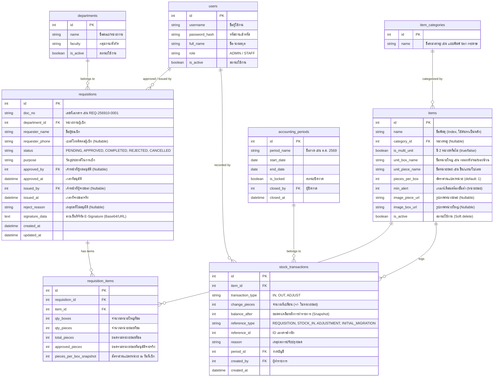

# ข้อกำหนดความต้องการของระบบ (System Requirements Specification - SRS)
## ระบบเบิกพัสดุและบริหารจัดการคลังพัสดุ (Inventory & Requisition Web Application)
**เวอร์ชัน:** 1.1 (ปรับปรุงตามข้อเท็จจริงหน้างานและกระบวนการทำงานจริง)  
**วันที่ปรับปรุง:** 21 ตุลาคม 2569  

---

## 1. ภาพรวมโครงการ (Project Overview)
ระบบเว็บแอปพลิเคชันสำหรับเปลี่ยนผ่านกระบวนการเบิกจ่ายพัสดุจากระบบกระดาษและสมุดบันทึก Excel สู่ระบบดิจิทัล อำนวยความสะดวกในการทำงานร่วมกันระหว่างหน่วยงาน/คณะผู้เบิก และเจ้าหน้าที่แผนกพัสดุ

### จุดเด่นและลักษณะเฉพาะของระบบ:
1. **ค้นหาด้วยชื่อพัสดุ (No SKU/Item Code):** อ้างอิงตามฐานข้อมูลเดิมขององค์กรที่มีชื่อพัสดุแต่ไม่มีรหัสพัสดุ โดยใช้ระบบค้นหาแบบอัจฉริยะ (Fuzzy / Full-text Search)
2. **ระบบเข้าถึงแบบเปิดสำหรับผู้เบิก (No-Login for Requester):** ผู้เบิกไม่ต้องจำรหัสผ่าน สามารถเลือกหน่วยงาน/คณะ ระบุชื่อผู้เบิก และส่งคำขอได้ทันที
3. **ระบบลงนามดิจิทัล (E-Signature):** รองรับการเซ็นชื่อบนหน้าจอ (Touchscreen/Mouse) ตอนมารับของจริง และนำลายเซ็นไปประทับลงในใบเบิก PDF อัตโนมัติ
4. **การบริหารสต๊อกหลายหน่วยนับ (Multi-unit Conversion):** คำนวณตัดสต๊อกอัตโนมัติทั้งแบบหน่วยใหญ่ (กล่อง/ลัง/ห่อ/ซอง/รีม) และหน่วยย่อย (ชิ้น/แผ่น/ใบ) พร้อมรองรับพัสดุที่มีหน่วยนับเดียว
5. **ระบบนำเข้าข้อมูลสต๊อกเดิม (Excel Data Migration):** รองรับการนำเข้าข้อมูลตั้งต้นกว่า 4,000 รายการจากไฟล์ Excel สต๊อกเดิม พร้อมตั้งยอดยกมาเริ่มต้นจากยอดคงเหลือเดือนปัจจุบัน

---

## 2. สิทธิ์และโครงสร้างผู้ใช้งาน (User Roles & Access Control)

| กลุ่มผู้ใช้งาน (Role) | การเข้าถึง (Authentication) | หน้าที่และสิทธิ์ในระบบ |
| :--- | :--- | :--- |
| **ผู้เบิกทั่วไป (Requester)**<br>*(เจ้าหน้าที่หน่วยงาน/คณะ/โรงเรียน)* | **ไม่ต้องล็อกอิน (Public Access)**<br>- เข้าผ่าน URL หน้าเบิกพัสดุ<br>- เลือกหน่วยงาน/คณะจาก Dropdown<br>- กรอกชื่อ-นามสกุล และเบอร์โทรติดต่อ | - ค้นหาและดูแคตตาล็อกพัสดุ (ดูรูปพัสดุ, หน่วยนับ, ยอดคงเหลือพร้อมเบิก)<br>- เลือกพัสดุใส่ตะกร้าและระบุจำนวน (กล่อง/ชิ้น)<br>- ส่งคำขอเบิกพัสดุเข้าระบบ<br>- ตรวจสอบสถานะคำขอเบิกผ่านเลขที่เอกสารหรือชื่อผู้เบิก<br>- ดาวน์โหลด/พิมพ์ใบเบิกพัสดุ (PDF) |
| **เจ้าหน้าที่พัสดุ / แอดมิน (Inventory Staff / Admin)** | **ล็อกอินด้วย Username & Password**<br>*(เก็บบัญชีผู้ใช้ในระบบ)* | - จัดการข้อมูลพัสดุ (เพิ่ม/แก้ไข/เปิด-ปิดใช้งาน/อัปโหลดรูปภาพ)<br>- นำเข้าข้อมูลพัสดุและยอดยกมาจากไฟล์ Excel สต๊อกเดิม<br>- บันทึกรับเข้าพัสดุ (Stock In)<br>- ตรวจสอบ อนุมัติ (เต็มจำนวนหรือบางส่วน) หรือปฏิเสธคำขอเบิก<br>- จ่ายของจริงและเปิดหน้าจอให้ผู้มารับของเซ็นชื่อดิจิทัล (E-Signature)<br>- บันทึกปรับยอดสต๊อกจริง (Stock Adjustment พร้อมระบุเหตุผล)<br>- ตรวจสอบการแจ้งเตือนพัสดุใกล้หมด (Safety Stock Alert)<br>- ปิดรอบงวดบัญชี (Lock Period) ประจำเดือน/ปีงบประมาณ<br>- ส่งออกรายงานสรุปยอดคงเหลือและประวัติการเบิกจ่าย (PDF/Excel) |

---

## 3. กฎเกณฑ์ทางธุรกิจและการคำนวณ (Business Rules & Logic)

### 3.1 การแปลงหน่วยนับ (Unit Conversion)
* **การจัดเก็บข้อมูลภายใน:** ระบบจะแปลงยอดพัสดุทุกรายการให้อยู่ใน **"หน่วยย่อยที่สุด (Base Unit)"** เสมอ เช่น ชิ้น, แผ่น, ซอง, เล่ม, ใบ
* **กรณีพัสดุที่มี 2 หน่วยนับ (Multi-unit):**
  * กำหนดอัตราส่วนการแปลง ($R$): $1 \text{ หน่วยใหญ่ (กล่อง/ลัง/ห่อ)} = R \text{ หน่วยย่อย (ชิ้น/แผ่น/ใบ)}$
  * **การแสดงผล 2 หน่วย:**
    * $\text{จำนวนหน่วยใหญ่} = \lfloor \frac{\text{ยอดรวมหน่วยย่อย}}{R} \rfloor$
    * $\text{เศษหน่วยย่อย} = \text{ยอดรวมหน่วยย่อย} \pmod{R}$
    * *ตัวอย่าง:* พัสดุ $A$ บรรจุ $1 \text{ กล่อง} = 500 \text{ ซอง}$ ยอดในคลังมี $1,250 \text{ ซอง}$ $\rightarrow$ แสดงผลเป็น: **`2 กล่อง 250 ซอง`**
* **กรณีพัสดุที่มีหน่วยนับเดียว (Single-unit):**
  * เช่น *แฟ้มเสนอ 5 เล่ม* หรือ *คลิปดำ* ให้กำหนด $R = 1$ หรือ `is_multi_unit = false` ระบบจะแสดงผลเฉพาะหน่วยย่อยเท่านั้น ไม่แสดงเศษกล่อง
* **การล็อกอัตราส่วนแปลงหน่วย (Snapshot):** เมื่อมีการสร้างใบเบิก ระบบจะบันทึกอัตราส่วน $R$ ณ วันที่เบิกลงใน `requisition_items` เพื่อป้องกันไม่ให้ข้อมูลในอดีตเปลี่ยนแปลงหากมีการแก้ไขขนาดบรรจุภัณฑ์ในอนาคต

### 3.2 การควบคุมสต๊อก 3 ระดับ (Stock Availability Logic)
เพื่อป้องกันปัญหาการเบิกของซ้อนกัน ระบบจะแบ่งยอดสต๊อกออกเป็น 3 ระดับ:
1. **ยอดคงคลังจริง (On-Hand Stock):** ของที่มีอยู่จริงทั้งหมดในคลัง
2. **ยอดที่ถูกจอง (Reserved Stock):** ของที่อยู่ในใบเบิกสถานะ `APPROVED` (อนุมัติแล้วแต่ยังไม่มารับของจริง)
3. **ยอดที่เบิกได้ (Available Stock):** 
   $$\text{Available Stock} = \text{On-Hand Stock} - \text{Reserved Stock}$$
* *ในหน้าแคตตาล็อกสำหรับผู้เบิก:* ระบบจะแสดงและอนุญาตให้เบิกได้สูงสุดไม่เกิน **`Available Stock`**

### 3.3 วงจรสถานะคำขอเบิก (Requisition Lifecycle)

```
[ผู้เบิกสร้างคำขอเบิก] ──► สถานะ: PENDING (รออนุมัติ)
         │
         ├───(พัสดุปฏิเสธ/ของไม่พอ/เหตุผลอื่น)───► สถานะ: REJECTED (ไม่อนุมัติ)
         │
         ├───(พัสดุกดอนุมัติ: ระบบกันยอดเป็น Reserved)───► สถานะ: APPROVED (รอจ่ายของ)
         │           │
         │           ├───(ผู้เบิกขอยกเลิก / หมดเวลาไม่มารับ)───► สถานะ: CANCELLED (คืนยอด Reserved เข้า Available)
         │           │
         │           ▼ (ผู้เบิกเดินทางมารับของจริง)
         │     [ผู้รับของเซ็น E-Signature บนหน้าจอ]
         │           │
         └───────────▼ (พัสดุกดยืนยันจ่ายของ)
               สถานะ: COMPLETED (รับของแล้ว) ──► ตัดยอด On-Hand และ Reserved ถาวร
```

* **การอนุมัติบางส่วน (Partial Approval):** ในกรณีที่ของในคลังมีไม่เพียงพอ เจ้าหน้าที่พัสดุสามารถแก้ไขจำนวนที่อนุมัติจ่ายจริงได้ (เช่น ขอ 5 กล่อง อนุมัติ 3 กล่อง พร้อมระบุหมายเหตุชี้แจง)
* **การยกเลิกคำขอ (Cancellation):** หากคำขอที่อนุมัติแล้วไม่มีผู้มารับของภายในเวลาที่กำหนด (เช่น 14 วัน) เจ้าหน้าที่พัสดุสามารถกดยกเลิกเพื่อปลดคืนยอด Reserved กลับมาเป็น Available ได้

### 3.4 การปิดรอบงวดบัญชี (Lock Period)
* กำหนดรอบงวดเป็นรายเดือน (เช่น งวด ต.ค. 2569) หรือตามปีงบประมาณ
* **ธุรกรรมข้ามงวด (Cross-period Rule):** วันที่ตัดสต๊อกจริงจะอิงตามวันที่จ่ายของจริง (`issued_at`) เสมอ (เช่น ขอเบิกสิ้นเดือน ก.ย. แต่มารับของจริง 2 ต.ค. ยอดตัดจ่ายจะถูกบันทึกในงวด ต.ค.)
* เมื่อกด **"ปิดงวดบัญชี (Lock Period)"**:
  * ห้ามแก้ไขหรือเพิ่มประวัติรับเข้า/จ่ายออกในงวดนั้น
  * คำนวณยอดยกไป (Closing Stock) เพื่อใช้เป็นยอดยกมา (Opening Stock) ในงวดถัดไปอัตโนมัติ
  * สงวนสิทธิ์การปลดล็อกงวดย้อนหลังเฉพาะผู้ดูแลระบบระดับสูง (Admin) พร้อมบันทึกเหตุผลใน Audit Log

---

## 4. โครงสร้างฐานข้อมูล (Database Schema)



---

## 5. การออกแบบหน้าจอและประสบการณ์ผู้ใช้ (UI/UX Modules)

### 5.1 หน้าแคตตาล็อกเบิกพัสดุ (Requisition Catalog - สำหรับผู้เบิก ไม่ต้องล็อกอิน)
* **ส่วนหัวข้อมูลผู้เบิก:**
  * Dropdown เลือกคณะ/หน่วยงาน
  * ช่องกรอกชื่อ-นามสกุล ผู้ขอเบิก และเบอร์โทรติดต่อ
* **แถบค้นหาอัจฉริยะ (Fuzzy Search):**
  * ค้นหาจากชื่อพัสดุได้รวดเร็วแบบเรียลไทม์ (เช่น พิมพ์ "279", "ครุฑ", "A4", "ซองขาว")
  * ปุ่มกรองตามหมวดหมู่พัสดุ
* **การ์ดแสดงรายการพัสดุ:**
  * สลับดูรูปหน่วยชิ้น และรูปหน่วยกล่อง (หากไม่มีรูปภาพ ให้แสดง Default Placeholder Icon)
  * แสดงชื่อพัสดุเด่นชัด
  * อัตราส่วนบรรจุ (เช่น `1 กล่อง = 250 ซอง`) หรือแสดงเป็นหน่วยเดี่ยว
  * ยอดคงเหลือพร้อมเบิก (Available Stock) แสดงเป็น `X กล่อง Y ชิ้น`
  * ช่องระบุจำนวนขอเบิก: `[  ] กล่อง` และ `[  ] ชิ้น` พร้อมปุ่มกด "ใส่ตะกร้า"
* **แถบตะกร้าพัสดุ (Floating Cart / Drawer):**
  * สรุปรายการทั้งหมดที่เลือก ระบุวัตถุประสงค์ในการเบิก
  * ปุ่ม **"ยืนยันส่งคำขอเบิก"** พร้อมแสดงเลขที่เอกสาร (เช่น `REQ-256910-0001`) และ QR Code / ลิงก์สำหรับติดตามสถานะ

### 5.2 หน้าบริหารคำขอเบิก (Requisition Management - สำหรับเจ้าหน้าที่พัสดุ)
* **แท็บสถานะคำขอ:**
  * **รออนุมัติ (Pending):** ตรวจสอบยอดคงเหลือจริง สามารถเลือกอนุมัติเต็มจำนวน ปรับลดจำนวนที่อนุมัติ (Partial) หรือปฏิเสธพร้อมระบุเหตุผล
  * **รอจ่ายของ (Approved):** แสดงรายการที่อนุมัติแล้ว มีปุ่ม **`[จ่ายของและลงนาม]`**
  * **เสร็จสิ้น (Completed) & ปฏิเสธ/ยกเลิก:** ประวัติรายการย้อนหลัง
* **โมดอลลงนามดิจิทัล (E-Signature Modal):**
  * เมื่อผู้เบิกเดินทางมารับของ เจ้าหน้าที่กดปุ่ม "จ่ายของและลงนาม"
  * หน้าจอจะแสดงกระดานเซ็นชื่อดิจิทัล (Canvas Pad) ให้ผู้มารับของใช้นิ้วมือ ปากกาสไตลัส หรือเมาส์เซ็นชื่อ
  * บันทึกลายเซ็นเข้าสู่ระบบ และอัปเดตสถานะเป็น `COMPLETED` พร้อมตัดสต๊อกถาวรทันที
* ปุ่ม **"พิมพ์ใบเบิก PDF"** พร้อมประทับลายเซ็นดิจิทัลที่เซ็นไว้

### 5.3 หน้าคลังสต๊อกและปรับยอด (Inventory & Adjustment Dashboard)
* ตารางแสดงรายการพัสดุทั้งหมด แสดงยอด On-Hand, Reserved และ Available
* สัญลักษณ์แจ้งเตือนสีส้ม/แดง เมื่อ Available Stock ต่ำกว่าเกณฑ์ขั้นต่ำ (`min_alert`)
* ปุ่ม **[+ รับเข้าพัสดุ]**: ระบุจำนวนรับเข้า เลือกหน่วยเป็นกล่องหรือชิ้น ระบบคำนวณเข้าสต๊อกทันที
* ปุ่ม **[ปรับยอดสต๊อก (Adjustment)]**: สำหรับการตรวจนับของจริง บังคับเลือกเหตุผล (ชำรุด, สูญหาย, ตรวจนับประจำงวด, อื่น ๆ)

### 5.4 หน้านำเข้าข้อมูลสต๊อกเดิม (Excel Data Migration Tool)
* หน้าจอสำหรับอัปโหลดไฟล์สต๊อกเดิม เช่น `ยอดสต๊อก ตค.xlsx`
* ระบบช่วยแยกข้อมูล:
  * คอลัมน์ **"รายการ"** $\rightarrow$ ชื่อพัสดุ (`name`)
  * คอลัมน์ **"เหลือ ต.ค"** $\rightarrow$ ยอดยกมาเริ่มต้น (Initial Stock)
  * ตรวจจับข้อความในวงเล็บเพื่อคำนวณอัตราส่วนแปลงหน่วยเบื้องต้น (เช่น `(500 ซองต่อกล่อง)`)
* หน้าจอ Preview ตรวจสอบความถูกต้องและยืนยันก่อนบันทึกลงฐานข้อมูลจริง

### 5.5 หน้าปิดงวดและรายงาน (Accounting Period & Reports)
* ตารางสรุปงวดบัญชี: ยอดยกมา + รับเข้า - จ่ายออก $\pm$ ปรับยอด = คงเหลือยกไป
* ปุ่มกด **"ปิดงวดบัญชี (Lock Period)"**
* ส่งออกรายงานสต๊อกเป็น Excel และ PDF

---

## 6. ข้อกำหนดการสร้างเอกสาร PDF (PDF Document Specifications)

### 6.1 ใบเบิกพัสดุ (Requisition Note PDF)
* **รูปแบบกระดาษ:** มาตรฐาน A4 รองรับภาษาไทยด้วยฟอนต์มาตรฐานราชการ (TH Sarabun PSK / New)
* **ส่วนหัวเอกสาร:**
  * ตราสัญลักษณ์หน่วยงาน / สถาบัน
  * ชื่อเอกสาร: ใบขอเบิกพัสดุ
  * เลขที่เอกสาร (เช่น `REQ-256910-0001`), วันที่ขอเบิก
* **ข้อมูลผู้เบิก:**
  * คณะ / หน่วยงาน
  * ชื่อผู้ขอเบิก และเบอร์โทรติดต่อ
  * วัตถุประสงค์ในการขอเบิก
* **ตารางรายการพัสดุ:**
  * ลำดับ | รายการพัสดุ | จำนวนที่ขอเบิก (กล่อง/ชิ้น) | จำนวนที่อนุมัติจ่ายจริง (กล่อง/ชิ้น) | หมายเหตุ
* **ส่วนลงนามท้ายเอกสาร:**
  1. **ผู้ขอเบิกพัสดุ:** แสดงชื่อ-นามสกุลตัวบรรจง และวันที่ขอเบิก
  2. **เจ้าหน้าที่พัสดุผู้จ่ายของ:** แสดงชื่อเจ้าหน้าที่ และวันเวลาที่อนุมัติจ่าย
  3. **ผู้รับพัสดุ:** **ประทับรูปลายเซ็นดิจิทัล (E-Signature)** ที่เซ็นไว้ขณะรับของ พร้อมระบุวันเวลาที่รับของจริง

### 6.2 รายงานสรุปสต๊อกคงเหลือประจำงวด (Inventory Summary Report PDF)
* หัวกระดาษ: รายงานสรุปยอดสต๊อกพัสดุคงเหลือ ประจำงวดเดือน/ปีงบประมาณ
* ตารางข้อมูล 8 คอลัมน์:
  1. ลำดับ
  2. ชื่อรายการพัสดุ
  3. ยอดยกมา (กล่อง/ชิ้น)
  4. รับเข้าระหว่างงวด (กล่อง/ชิ้น)
  5. จ่ายออกระหว่างงวด (กล่อง/ชิ้น)
  6. ปรับปรุงยอด (กล่อง/ชิ้น)
  7. คงเหลือยกไป (กล่อง/ชิ้น)
  8. สถานะ (ปกติ / ต่ำกว่าเกณฑ์)

---

## 7. ข้อกำหนดทางเทคนิคและข้อกำหนดที่ไม่ใช่เชิงฟังก์ชัน (NFR)
1. **ประสิทธิภาพ (Performance):**
   * การค้นหาพัสดุจากฐานข้อมูลกว่า 4,000 รายการ ต้องแสดงผลได้ภายใน **< 300 มิลลิวินาที** (ใช้ Database Index บนฟิลด์ `name`)
2. **ความเข้ากันได้ของอุปกรณ์ (Responsiveness & Compatibility):**
   * หน้าจอแคตตาล็อกและกระดานเซ็นชื่อ (E-Signature Pad) ต้องรองรับการทำงานบน Tablet (iPad/Android) และสมาร์ตโฟนได้อย่างลื่นไหล
3. **ความปลอดภัยของข้อมูล (Security):**
   * เข้ารหัสรหัสผ่านของเจ้าหน้าที่พัสดุด้วยมาตรฐาน bcrypt หรือ Argon2
   * ป้องกันการสแปมการส่งคำขอเบิก (Rate Limiting) สำหรับหน้าจอเปิดที่ไม่ต้องล็อกอิน
4. **ความถูกต้องของข้อมูล (Data Consistency):**
   * การทำรายการเบิกจ่ายและตัดสต๊อกต้องทำงานภายใต้ **Database Transaction (ACID)** เพื่อป้องกันข้อผิดพลาดกรณีมีผู้ใช้งานทำรายการพร้อมกัน